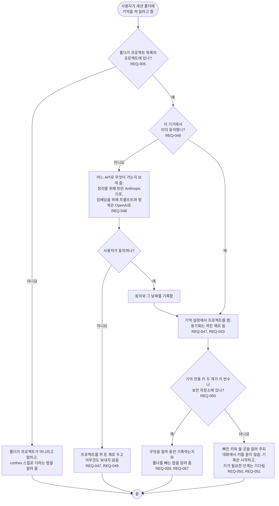

# FL-001 프로젝트에 기억 켜기

[English](FL-001-turn-memory-on.md)

다루는 요구사항: REQ-005, REQ-009, REQ-043, REQ-047, REQ-048, REQ-049, REQ-050, REQ-051, REQ-057

맥락: CTX-005 관리. 사용자가 기억 스킬에 기억을 켜 달라고 할 때 시작합니다.

대화에 붙여 넣은 키는 기억이 자기 원문 기록에서 무엇을 지우든 도구의 대화 기록 파일과 모델 요청에 남습니다. 그래서 스킬은 대화에서 키를 묻지 않습니다.
