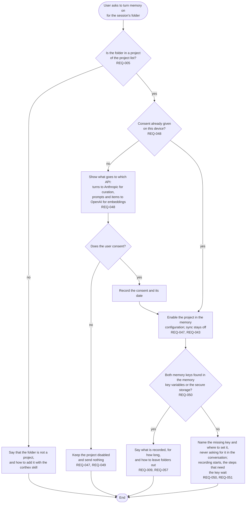

# FL-001 Turn memory on for a project

[한국어](FL-001-turn-memory-on.ko.md)

Serves: REQ-005, REQ-009, REQ-043, REQ-047, REQ-048, REQ-049, REQ-050, REQ-051, REQ-057

Context: CTX-005 Control. Starts when the user asks the memory skill to turn memory on.

A key pasted into the conversation reaches the host transcript and the model request, whatever memory removes from its own raw log, so the skill never asks for one there.
