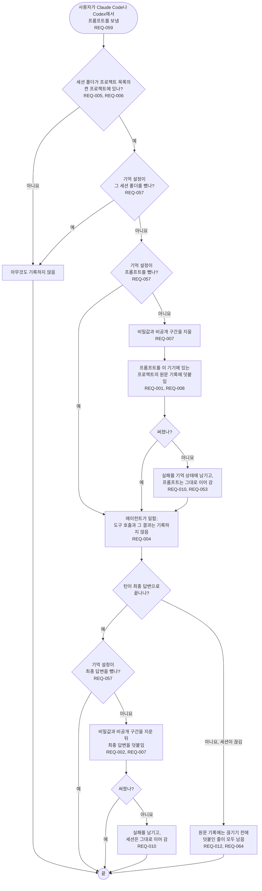

# FL-002 한 턴 기록하기

[English](FL-002-record-a-turn.md)

다루는 요구사항: REQ-001, REQ-002, REQ-004, REQ-005, REQ-006, REQ-007, REQ-008, REQ-010, REQ-011, REQ-012, REQ-053, REQ-057, REQ-059, REQ-064

맥락: CTX-001 기록. 사용자가 프롬프트를 보낼 때 시작하고, 프롬프트 훅은 이어서 FL-004로 갑니다.

이 흐름의 훅 단계는 저마다 95번째 백분위 기준 100 ms 안에 끝납니다(REQ-011).
