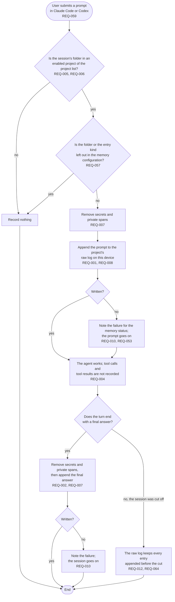

# FL-002 Record a turn

[한국어](FL-002-record-a-turn.ko.md)

Serves: REQ-001, REQ-002, REQ-004, REQ-005, REQ-006, REQ-007, REQ-008, REQ-010, REQ-011, REQ-012, REQ-053, REQ-057, REQ-059, REQ-064

Context: CTX-001 Capture. Starts when the user submits a prompt; the prompt hook then goes on to FL-004.

Each hook step in this flow finishes within 100 ms at the 95th percentile (REQ-011).
