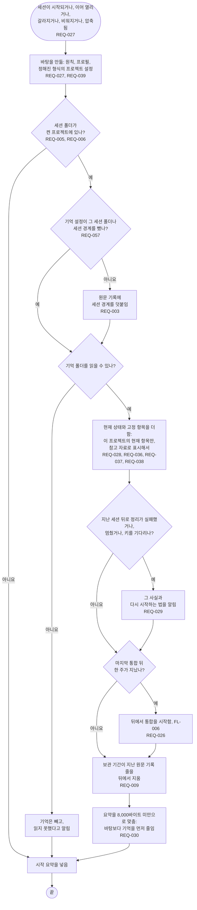

# FL-003 기억과 함께 세션 시작하기

[English](FL-003-start-a-session.md)

다루는 요구사항: REQ-003, REQ-005, REQ-006, REQ-009, REQ-026, REQ-027, REQ-028, REQ-029, REQ-030, REQ-036, REQ-037, REQ-038, REQ-039, REQ-057, REQ-196

맥락: CTX-003 불러오기. 세션이 시작되거나, 이어 열리거나, 갈라지거나, 비워지거나, 압축될 때 시작합니다. 시작 요약의 바탕은 0.1.0에 이미 있고, 기억 부분이 새로 더하는 것입니다.

시작 요약에 항목을 넣을 때 항목의 글 없이 넣은 곳과 항목 ID를 기록합니다(REQ-196).
