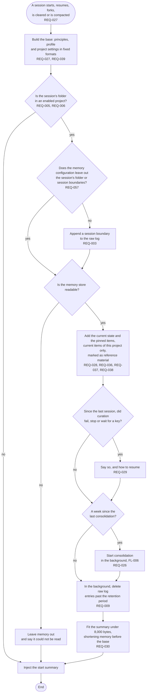

# FL-003 Start a session with memory

[한국어](FL-003-start-a-session.ko.md)

Serves: REQ-003, REQ-005, REQ-006, REQ-009, REQ-026, REQ-027, REQ-028, REQ-029, REQ-030, REQ-036, REQ-037, REQ-038, REQ-039, REQ-057, REQ-196

Context: CTX-003 Recall. Starts when a session starts, resumes, forks, is cleared or is compacted. The base of the start summary is built in 0.1.0; the memory part is new.

When the start summary injects items, it logs where and which item IDs, without their text (REQ-196).
