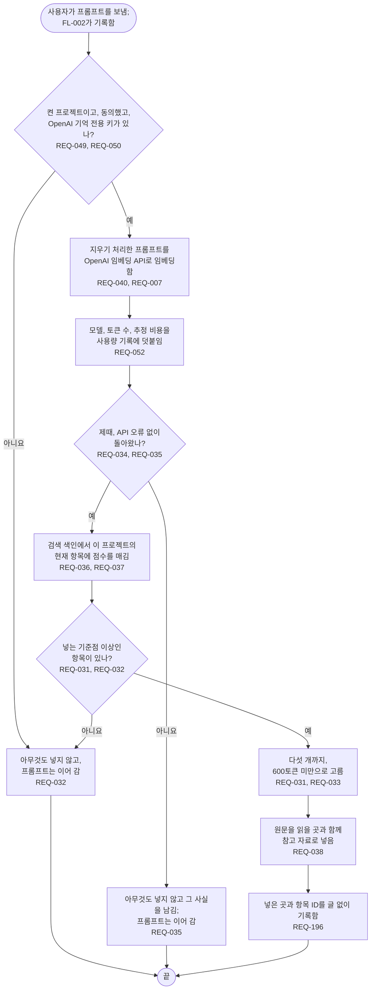

# FL-004 프롬프트에 맞는 기억 불러오기

[English](FL-004-recall-for-a-prompt.md)

다루는 요구사항: REQ-007, REQ-031, REQ-032, REQ-033, REQ-034, REQ-035, REQ-036, REQ-037, REQ-038, REQ-040, REQ-049, REQ-050, REQ-052, REQ-196

맥락: CTX-003 불러오기. 같은 프롬프트 훅에서 FL-002 다음에 시작합니다. 2026-10-27에 D2를 확인했습니다: 임베딩과 규칙이 항목을 고르고, 프롬프트마다 모델에 묻지 않습니다.

프롬프트 훅 전체, 곧 FL-002와 이 흐름을 합쳐 95번째 백분위 기준 1초 안에 끝납니다(REQ-034).
