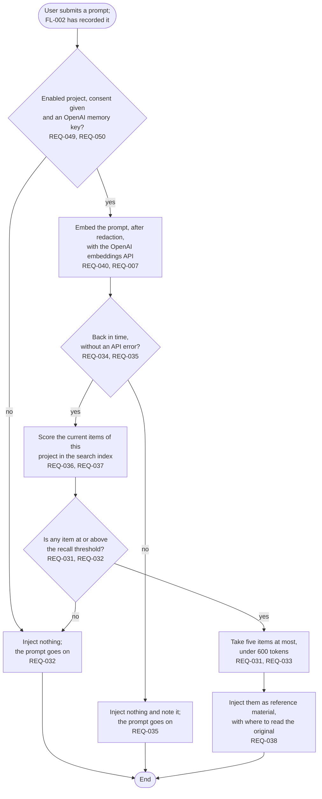

# FL-004 Recall memory for a prompt

[한국어](FL-004-recall-for-a-prompt.ko.md)

Serves: REQ-007, REQ-031, REQ-032, REQ-033, REQ-034, REQ-035, REQ-036, REQ-037, REQ-038, REQ-040, REQ-049, REQ-050

Context: CTX-003 Recall. Starts in the same prompt hook, after FL-002. The flow follows the recommendation of decision D2: embeddings and rules choose the items, and no model is asked for each prompt.

The whole prompt hook, FL-002 and this flow together, finishes within 1 second at the 95th percentile (REQ-034).
