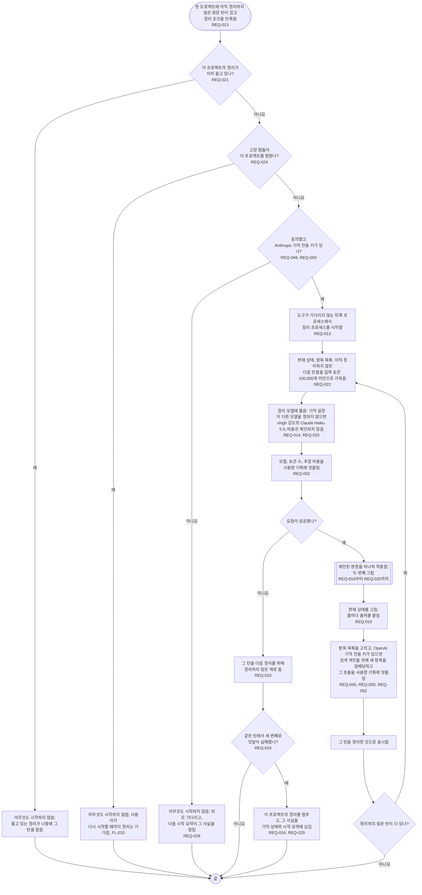
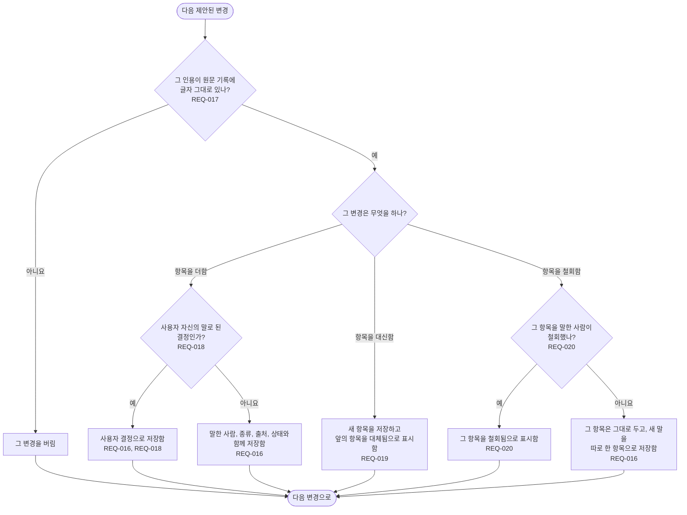

# FL-005 새 턴 정리하기

[English](FL-005-curate-new-turns.md)

다루는 요구사항: REQ-013, REQ-014, REQ-015, REQ-016, REQ-017, REQ-018, REQ-019, REQ-020, REQ-021, REQ-022, REQ-023, REQ-024, REQ-025, REQ-029, REQ-040, REQ-049, REQ-050, REQ-052

맥락: CTX-002 정리. 켠 프로젝트에 아직 정리하지 않은 원문 턴이 있고 정리 조건을 만족할 때 시작합니다. 어떤 사건을 정리 조건으로 할지는 기능 명세가 정합니다. 결정 D4의 추천을 따릅니다: 정리 프로세스의 요청은 Anthropic 기억 전용 키로 냅니다.

## 제안된 변경 하나 적용하기

정리 모델의 답은 항목 목록에 대한 변경을 제안합니다. 변경마다 다음 변경으로 넘어가기 전에 이 그림을 거칩니다.

정리 프로세스는 인용할 수 없는 것은 바꾸지 않습니다. 인용 확인을 통과하지 못한 변경은 버리고, 항목은 대체됨이나 철회됨으로 표시할 뿐 지우지 않습니다. 잊기는 사용자가 직접 합니다(FL-009).
