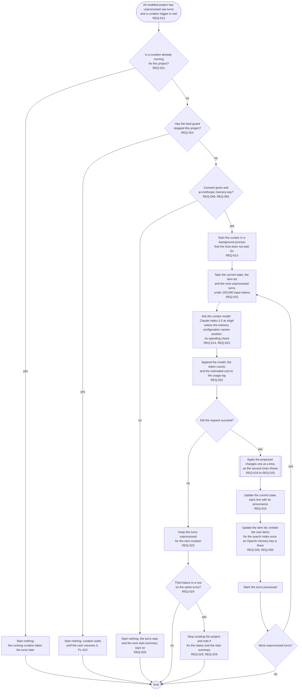
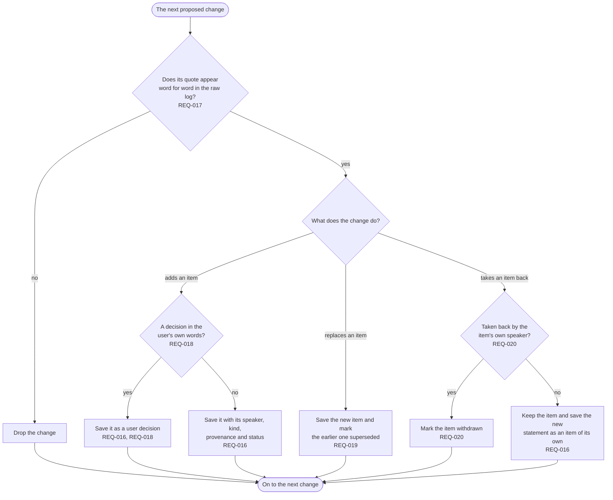

# FL-005 Curate new turns

[한국어](FL-005-curate-new-turns.ko.md)

Serves: REQ-013, REQ-014, REQ-015, REQ-016, REQ-017, REQ-018, REQ-019, REQ-020, REQ-021, REQ-022, REQ-023, REQ-024, REQ-025, REQ-029, REQ-040, REQ-049, REQ-050, REQ-052

Context: CTX-002 Curation. Starts when an enabled project has unprocessed raw turns and a curation trigger is met; which events are triggers is left to the functional spec. The flow follows the recommendation of decision D4: the Anthropic memory key pays for the curator's requests.

## Applying one proposed change

The curator model's answer proposes changes to the item list. Each change goes through this chart before the next one.

The curator changes nothing it cannot quote: a proposed change whose quote check fails is dropped, and items are superseded or withdrawn, never deleted. Forgetting is the user's own act (FL-009).
