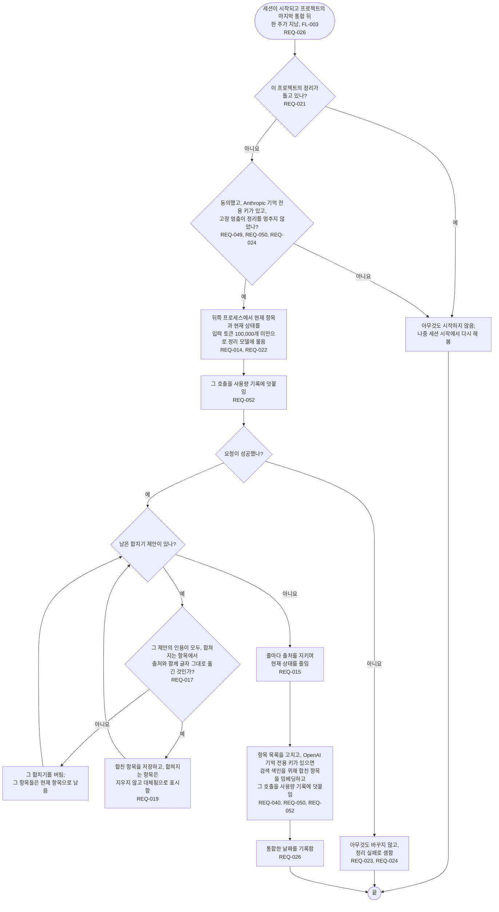

# FL-006 프로젝트 통합하기

[English](FL-006-consolidate-a-project.md)

다루는 요구사항: REQ-014, REQ-015, REQ-017, REQ-019, REQ-021, REQ-022, REQ-023, REQ-024, REQ-026, REQ-040, REQ-049, REQ-050, REQ-052

맥락: CTX-002 정리. 세션이 시작될 때 프로젝트의 마지막 통합 뒤 한 주가 지났으면 FL-003에서 시작합니다. 통합도 정리의 하나이므로, 도는 동안과 실패할 때와 비용을 낼 때 FL-005의 규칙이 그대로 적용됩니다.

통합은 원문 턴이 아니라 항목을 읽으므로, 합친 항목은 합쳐지는 항목들이 이미 가진 인용만 지닐 수 있습니다. 그 인용은 처음 저장될 때 인용 확인을 통과했습니다. 다른 기기에서였거나 그 뒤 지워진 원문 기록의 줄에서였을 수 있으므로(REQ-008, REQ-009), 출처를 그대로 지니고 이 기기의 원문 기록에서 다시 확인하지 않습니다.
