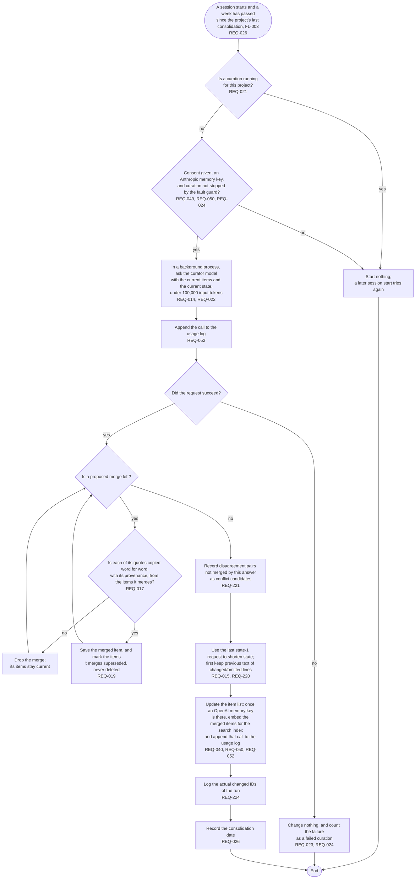

# FL-006 Consolidate a project

[한국어](FL-006-consolidate-a-project.ko.md)

Serves: REQ-014, REQ-015, REQ-017, REQ-019, REQ-021, REQ-022, REQ-023, REQ-024, REQ-026, REQ-040, REQ-049, REQ-050, REQ-052, REQ-220, REQ-221, REQ-224

Context: CTX-002 Curation. Starts from FL-003 when a session starts and a week has passed since the project's last consolidation. A consolidation is a curation, so the rules of FL-005 on running, failing and paying hold here too.

Consolidation reads items, not raw turns, so a merged item can carry only quotes that the items it merges already have. Those quotes passed the quote check when they were first saved, perhaps on another device or from raw log entries deleted since (REQ-008, REQ-009), so they keep their provenance and are not checked against this device's raw log again.
