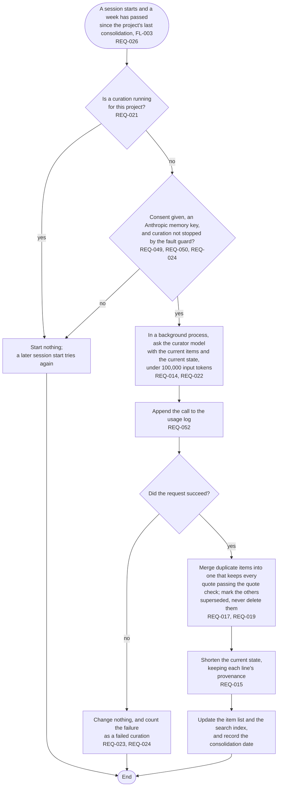

# FL-006 Consolidate a project

[한국어](FL-006-consolidate-a-project.ko.md)

Serves: REQ-014, REQ-015, REQ-017, REQ-019, REQ-021, REQ-022, REQ-023, REQ-024, REQ-026, REQ-049, REQ-050, REQ-052

Context: CTX-002 Curation. Starts from FL-003 when a session starts and a week has passed since the project's last consolidation. A consolidation is a curation, so the rules of FL-005 on running, failing and paying hold here too.

