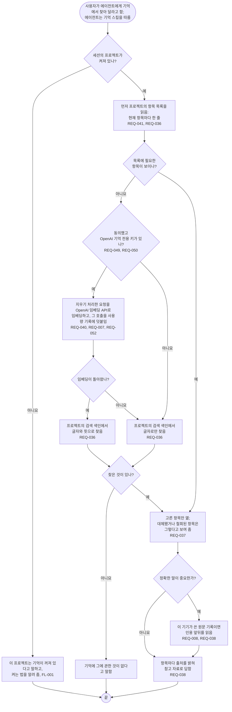

# FL-007 기억 찾기

[English](FL-007-search-memory.md)

다루는 요구사항: REQ-007, REQ-008, REQ-036, REQ-037, REQ-038, REQ-040, REQ-041, REQ-049, REQ-050, REQ-052

맥락: CTX-003 불러오기. 사용자가 에이전트에게 기억에서 무언가를 찾아 달라고 하고, 에이전트가 기억 스킬을 따를 때 시작합니다.

찾기는 훅이 아니라 기억 스킬로 돌기 때문에, 사용자가 물으면 대체됐거나 철회된 항목도 보여 줄 수 있습니다. 그런 항목은 표시해서 보여 주고, 넣지는 않습니다(REQ-037).
