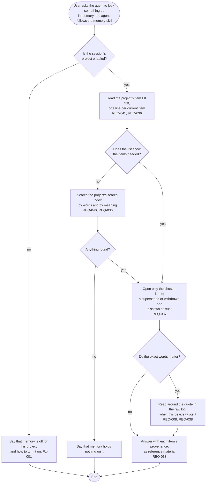

# FL-007 Search memory

[한국어](FL-007-search-memory.ko.md)

Serves: REQ-008, REQ-036, REQ-037, REQ-038, REQ-040, REQ-041

Context: CTX-003 Recall. Starts when the user asks the agent to look something up in memory, and the agent follows the memory skill.

Search runs through the memory skill, not a hook, so it may show a superseded or withdrawn item when the user asks about it; the item is marked, and it is never injected (REQ-037).
