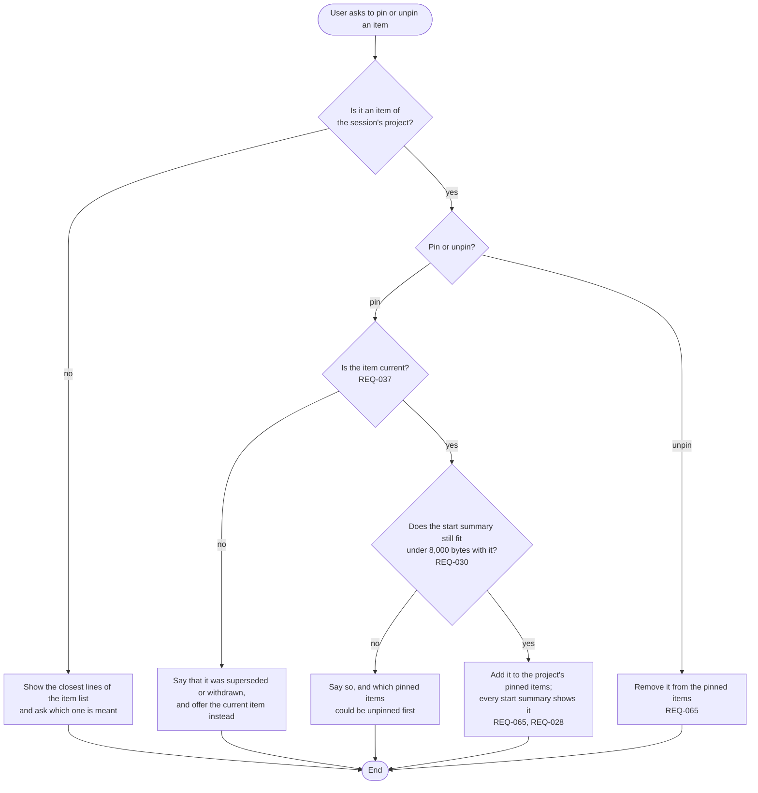

# FL-008 Pin or unpin an item

[한국어](FL-008-pin-an-item.ko.md)

Serves: REQ-028, REQ-030, REQ-037, REQ-065

Context: CTX-005 Control. Starts when the user asks to pin an item, so that every start summary of the project shows it, or to unpin one.

