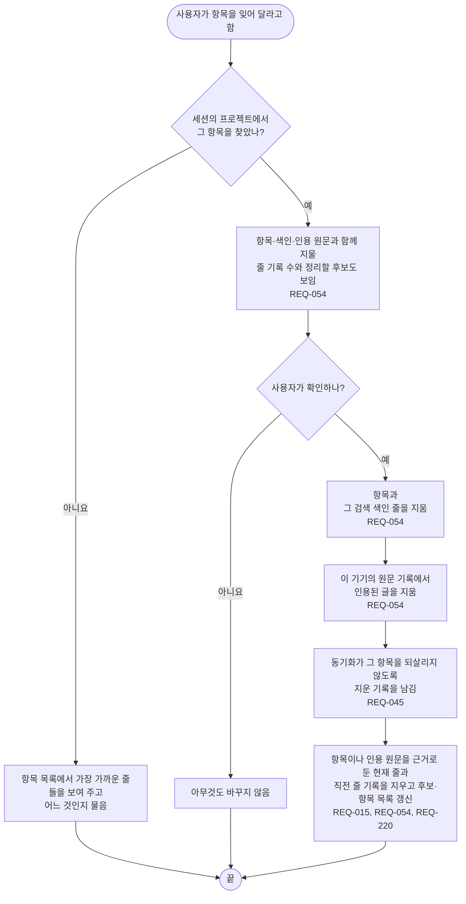

# FL-009 항목 잊기

[English](FL-009-forget-an-item.md)

다루는 요구사항: REQ-015, REQ-045, REQ-054, REQ-220

맥락: CTX-005 관리. 사용자가 기억에 있는 무언가를 잊어 달라고 할 때 시작합니다.

원문의 글은 이 기기에서는 바로 지우고, 사용자의 다른 기기에서는 동기화가 거기서 지운 기록을 적용할 때 지웁니다(FL-012). 동기화를 쓰지 않으면, 각 기기의 원문 기록은 그 기기에서도 항목을 잊을 때까지 자기 사본을 지닙니다.
