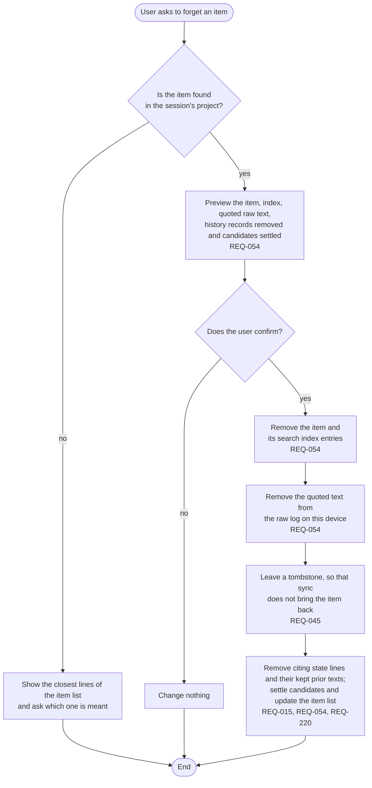

# FL-009 Forget an item

[한국어](FL-009-forget-an-item.ko.md)

Serves: REQ-015, REQ-045, REQ-054, REQ-220

Context: CTX-005 Control. Starts when the user asks to forget something that memory holds.

The raw text is removed on this device at once and on the user's other devices when sync applies the tombstone there (FL-012). Without sync, each device's raw log keeps its own copy until that device forgets the item too.
