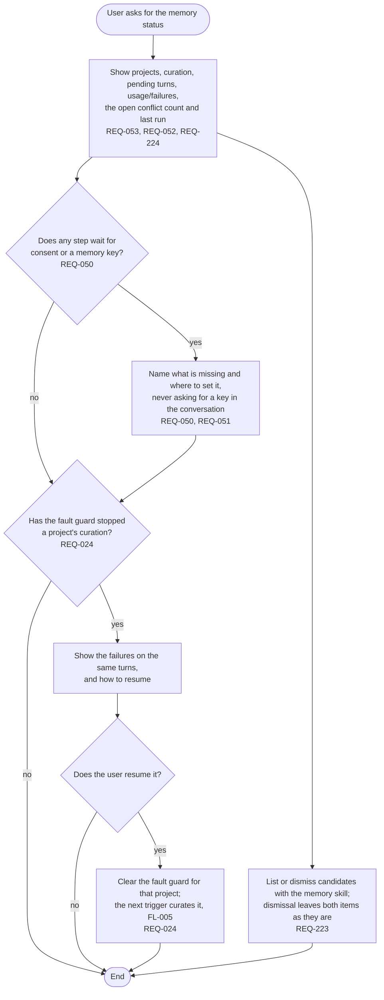

# FL-010 Check the memory status

[한국어](FL-010-check-the-status.ko.md)

Serves: REQ-024, REQ-050, REQ-051, REQ-052, REQ-053, REQ-223, REQ-224

Context: CTX-005 Control. Starts when the user asks for the memory status. It is also where the user resumes a curation that the fault guard stopped.

