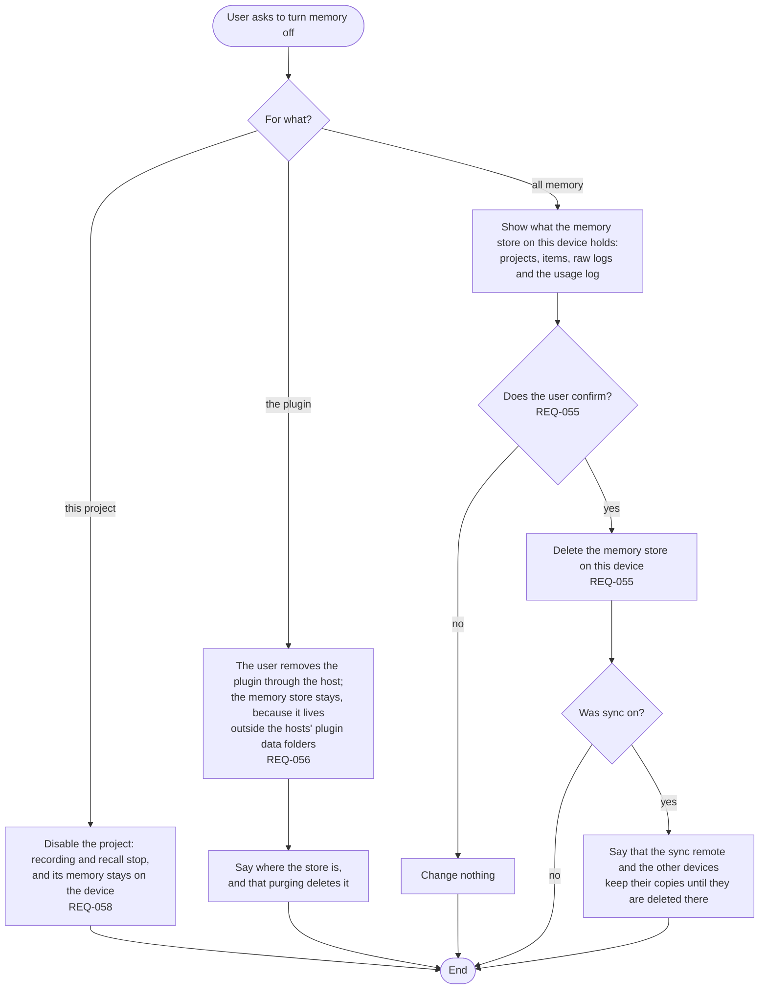

# FL-011 Turn memory off

[한국어](FL-011-turn-memory-off.ko.md)

Serves: REQ-055, REQ-056, REQ-058

Context: CTX-005 Control. Starts when the user asks to turn memory off for a project, to remove the plugin, or to delete all memory on the device.

