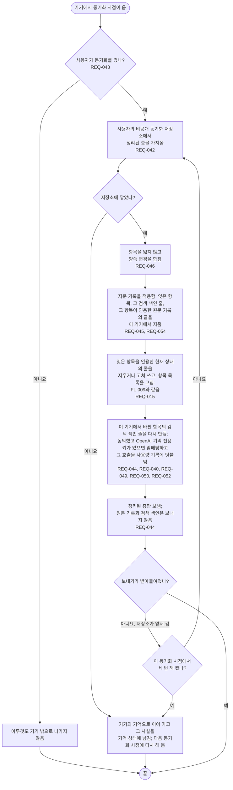

# FL-012 기기 사이에 기억 동기화하기

[English](FL-012-sync-memory.md)

다루는 요구사항: REQ-015, REQ-040, REQ-042, REQ-043, REQ-044, REQ-045, REQ-046, REQ-049, REQ-050, REQ-052, REQ-054

맥락: CTX-004 동기화. 기기에서 세션 시작이나 정리 끝 같은 동기화 시점이 오면 시작합니다. 동기화 시점은 기능 명세가 정합니다. 결정 D3의 추천을 따릅니다: 동기화 저장소는 사용자의 비공개 Git 저장소입니다.

