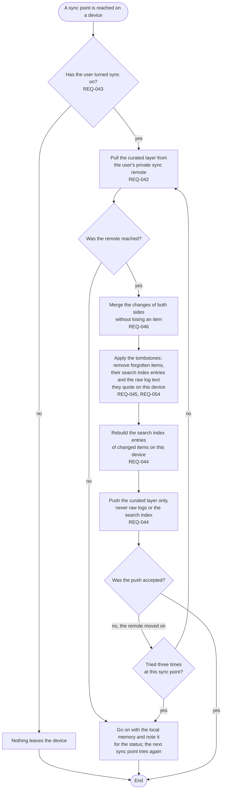

# FL-012 Sync memory between devices

[한국어](FL-012-sync-memory.ko.md)

Serves: REQ-042, REQ-043, REQ-044, REQ-045, REQ-046, REQ-054

Context: CTX-004 Sync. Starts at a sync point on a device, such as a session start or the end of a curation; the functional spec fixes the sync points. The flow follows the recommendation of decision D3: the sync remote is a private Git repository of the user's.

