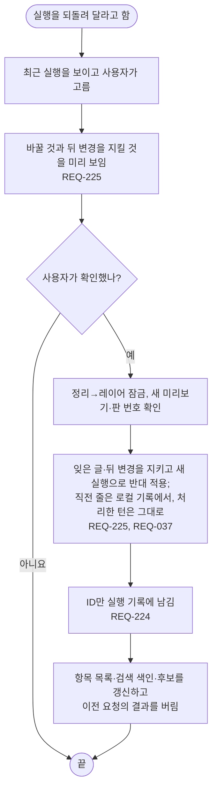

# FL-117 실행 되돌리기

[English](FL-117-undo-a-run.md)

맡는 요구사항: REQ-037, REQ-224, REQ-225

맥락: CTX-005 관리. 사용자가 정리나 통합이 한 일을 되돌려 달라고 할 때 시작합니다.

실행이 없거나 만료됐으면 최근 목록과 run-not-found, 잠금 중이면 lock-busy, 미리보기가 달라졌으면 새 확인과 confirm-stale입니다. 검증할 수 없거나 뒤에 바뀐 대상과 사라진 줄 기록은 지키며 이유를 보입니다. 전부 지키면 nothing입니다. 되돌리기도 되돌릴 수 있습니다(SPEC-145).
