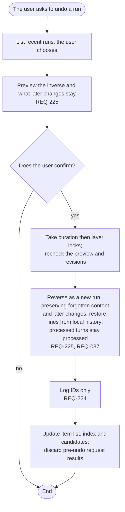

# FL-117 Undo a run

[한국어](FL-117-undo-a-run.ko.md)

Serves: REQ-037, REQ-224, REQ-225

Context: CTX-005 Control. Starts when the user asks to undo what a curation or consolidation did.

A missing/expired run returns run-not-found with recent runs; busy curation returns lock-busy, and preview drift returns confirm-stale with a new confirmation. Preserve objects with unprovable or later revisions and lines whose history is missing, and say why. If everything stays, return nothing. An undo can itself be undone (SPEC-145).
