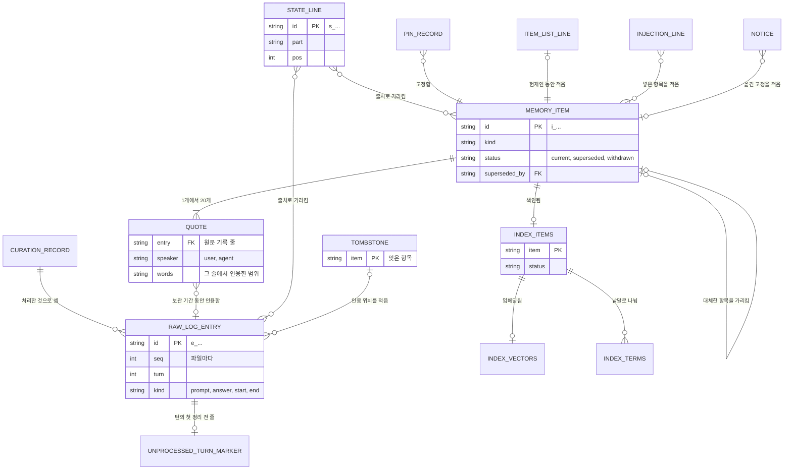

# CORTHEX-MEMORY: 기억 폴더

[English](memory.md)

CORTHEX 자신의 프로젝트에서 `corthex-memory` 플러그인의 05단계입니다. 상태: 2026-10-27 확인했습니다. 남겨 둔 Git 동기화 설계는 D3로 대체됐습니다. 관리자는 C1을 만들기 전에 이 파일을 기능 명세와 함께 확인합니다. 확인이 끝나면 이번 출시의 저장 단위를 고정하며, 그 뒤에 호환되지 않는 변경을 하려면 관리자의 결정과 새 형식 버전이 필요합니다. 이 번역과 영어 원문이 다르면 영어 원문이 원본입니다.

입력: [docs/04-functional-spec/memory.ko.md](../04-functional-spec/memory.ko.md)의 기능 명세(SPEC-001\~SPEC-039), 특히 그 [05단계를 위한 메모](../04-functional-spec/memory.ko.md#05단계-기억-폴더); [docs/02-prd/memory.ko.md](../02-prd/memory.ko.md)의 요구사항 가운데 기억 폴더를 가장 많이 정하는 REQ-008, REQ-009, REQ-012, REQ-044, REQ-045, REQ-054, REQ-056, REQ-063, REQ-064; [docs/01-domain/memory.ko.md](../01-domain/memory.ko.md)의 용어집. 이 파일의 말은 거기서 정한 뜻으로 씁니다. 2026-10-27에 D1·D2·D4와 요구사항 변경 일곱 개를 확인했고, D3는 02단계의 HTTPS 창구와 서버 안으로 정했습니다. 남겨 둔 Git 동기화 상세의 상태는 `superseded (D3, 2026-10-27)`이며 C3 전에 대체 설계가 필요합니다.

> D3 설계 상태: `superseded (D3, 2026-10-27)`. 이곳에 남겨 둔 Git 동기화 제안은 2026-10-27에 확인한 D3 결정으로 대체됐습니다. 구현하거나 실행할 계획이 아닌 과거 자료입니다. HTTPS 창구와 서버 동기화 설계는 C3 전에 따로 작성합니다. 기기의 저장소는 파일과 SQLite 검색 색인을 유지합니다. 이 표시는 여러 단계가 공유하는 행·설정·예시·동의 문구의 동기화 부분에도 적용하며, 그 C1/C2 부분은 확인된 상태입니다.

## 이 파일을 읽는 법

- 기억 폴더는 보통 파일을 담은 폴더이고, 검색 색인만 프로젝트마다 SQLite 파일 하나입니다. 저장 단위(TBL) 하나는 파일 한 종류이거나 파일 안의 줄 한 종류입니다. 검색 색인의 표는 [memory-index.sql](memory-index.sql)에 있고, 프로젝트 허브는 그 ID를 거기서 읽습니다.
- `근거` 열에는 그 저장 단위를 읽거나 쓰는 동작(SPEC)을 모두 적고, [동작마다 읽고 쓰는 자료](#동작마다-읽고-쓰는-자료)는 같은 것을 반대 방향으로 적습니다. 검색 색인의 표는 주석에 자기 근거를 적습니다.
- 상태: 확인한 저장 단위는 `active`, 남겨 둔 Git 동기화 정보와 저장소 표지는 `superseded (D3, 2026-10-27)`입니다.
- 필드 표는 필드를 쓰는 순서대로 적습니다. 선택이라고 적은 필드는 값이 없으면 빼며, 어떤 필드도 `null`로 쓰지 않습니다.
- 기억 폴더 정보나 정리 진행 기록처럼 용어집에 없는 이름은 이 파일의 저장 단위 이름이며, 여기서 정합니다.

## 기억 폴더

기억 폴더는 `~/.corthex/corthex-memory/`이거나 `CORTHEX_MEMORY_HOME`이 가리키는 폴더입니다(SPEC-039). 기억 스킬은 사용자가 처음 기억을 켤 때 기억 폴더를 만들고(SPEC-030), 프로젝트의 기억을 켤 때 그 안에 프로젝트 폴더를 만듭니다. 훅과 뒤에서 도는 프로세스는 기억 폴더를 절대 만들지 않습니다. 기억 폴더가 없으면 아무것도 쓰지 않습니다.

```txt
~/.corthex/corthex-memory/
├─ store.json                         TBL-001 기억 폴더 정보
├─ configuration.json                 TBL-002 기억 설정
├─ store.lock
├─ logs/
│  ├─ usage-2026-10.jsonl             TBL-003 사용량 기록, 달마다 파일 하나
│  ├─ failures-2026-10-24.jsonl       TBL-004 실패 기록, 날마다 파일 하나
│  ├─ hooks-2026-10-24.jsonl          TBL-005 훅 소요 시간, 날마다 파일 하나
│  └─ usage.lock, failures.lock, hooks.lock
├─ sync/                              동기화가 켜진 동안만
│  ├─ state.json                      TBL-006 동기화 정보
│  ├─ sync.lock
│  └─ repo/                           코드가 쓰는 동기화 저장소의 Git 작업 사본
└─ projects/
   └─ <project>/                      프로젝트마다 폴더 하나, 이름은 프로젝트 목록을 따름
      ├─ raw/
      │  ├─ <log>.jsonl               TBL-007 원문 기록, 도구의 세션마다 파일 하나
      │  └─ <log>.lock
      ├─ unprocessed/                 TBL-008 정리 전 턴마다 빈 파일 하나
      ├─ curation.json                TBL-009 정리 진행 기록
      ├─ curation.lock
      ├─ notices/<name>.json          TBL-010 알림
      ├─ injections/<log>.jsonl       TBL-011 넣기 기록, 도구의 세션마다 파일 하나
      ├─ index.db                     TBL-019부터 TBL-022까지 검색 색인
      ├─ layer.lock
      └─ layer/                       정리된 층, 동기화가 함께 씀
         ├─ items/<item>.json         TBL-012 기억 항목
         ├─ state.json                TBL-013 현재 상태
         ├─ state-removed.json        TBL-013 빠진 현재 상태 줄
         ├─ pins.json                 TBL-014 고정
         ├─ item-list.txt             TBL-015 항목 목록
         ├─ tombstones/<item>.json    TBL-016 지운 기록
         └─ deleted.json              TBL-017 프로젝트 지운 기록

동기화 저장소, 사용자의 Git 저장소
├─ corthex-memory-sync.json           TBL-018 동기화 저장소 표지
└─ projects/<project>/                프로젝트마다 정리된 층, 위의 layer/와 같은 배치
```

기능 명세의 정리 진행 기록은 두 부분으로 나눠 둡니다. 훅만 더하는 정리 전 턴 표지(TBL-008)와, 정리 프로세스만 쓰는 정리 진행 기록(TBL-009)입니다. 그래서 한 프로젝트의 두 세션이 동시에 덧붙여도 같은 파일을 쓰는 일이 없습니다.

## 저장 단위

| ID | 저장 단위 | 맥락 | 파일 | 구별하는 값 | 보관 | 동기화 | 근거 | 상태 |
| --- | --- | --- | --- | --- | --- | --- | --- | --- |
| TBL-001 | 기억 폴더 정보 | CTX-005 | `store.json` | 기억 폴더마다 하나 | 모두 지우기까지 | 안 함 | SPEC-001, SPEC-002, SPEC-003, SPEC-005, SPEC-021, SPEC-030, SPEC-033, SPEC-039 | active |
| TBL-002 | 기억 설정 | CTX-005 | `configuration.json` | 기억 폴더마다 하나 | 모두 지우기까지 | 안 함 | SPEC-001, SPEC-002, SPEC-003, SPEC-005, SPEC-006, SPEC-009, SPEC-010, SPEC-011, SPEC-013, SPEC-014, SPEC-019, SPEC-021, SPEC-022, SPEC-023, SPEC-026, SPEC-027, SPEC-030, SPEC-032, SPEC-033, SPEC-036, SPEC-037 | active |
| TBL-003 | 사용량 기록 | CTX-005 | `logs/usage-<month>.jsonl` | 파일과 그 안의 자리 | 모두 지우기까지 | 안 함 | SPEC-014, SPEC-015, SPEC-016, SPEC-018, SPEC-019, SPEC-023, SPEC-025, SPEC-027, SPEC-032, SPEC-033 | active |
| TBL-004 | 실패 기록 | CTX-005 | `logs/failures-<date>.jsonl` | 파일과 그 안의 자리 | 보관 기간 동안 | 안 함 | SPEC-001, SPEC-004, SPEC-007, SPEC-008, SPEC-009, SPEC-013, SPEC-018, SPEC-023, SPEC-027, SPEC-033 | active |
| TBL-005 | 훅 소요 시간 | CTX-005 | `logs/hooks-<date>.jsonl` | 파일과 그 안의 자리 | 8일 | 안 함 | SPEC-002, SPEC-003, SPEC-005, SPEC-008, SPEC-009, SPEC-021, SPEC-023, SPEC-033 | active |
| TBL-006 | 동기화 정보 | CTX-004 | `sync/state.json` | 기억 폴더마다 하나 | 동기화가 켜진 동안 | 안 함 | SPEC-022, SPEC-026, SPEC-027, SPEC-028, SPEC-033 | superseded (D3, 2026-10-27) |
| TBL-007 | 원문 기록 | CTX-001 | `projects/<project>/raw/<log>.jsonl` | `id`, 또는 파일과 `seq` | 줄마다의 시각으로 보관 기간 동안 | 절대 안 함(REQ-044) | SPEC-002, SPEC-003, SPEC-005, SPEC-007, SPEC-009, SPEC-015, SPEC-016, SPEC-020, SPEC-025, SPEC-029, SPEC-035, SPEC-037 | active |
| TBL-008 | 정리 전 턴 표지 | CTX-002 | `projects/<project>/unprocessed/<time>.<log>.<turn>` | 파일 이름 | 그 턴을 처리하거나 지울 때까지 | 안 함 | SPEC-002, SPEC-003, SPEC-009, SPEC-010, SPEC-016, SPEC-022, SPEC-033, SPEC-037 | active |
| TBL-009 | 정리 진행 기록 | CTX-002 | `projects/<project>/curation.json` | 프로젝트마다 하나 | 프로젝트의 기억이 있는 동안 | 안 함 | SPEC-009, SPEC-010, SPEC-012, SPEC-015, SPEC-016, SPEC-017, SPEC-018, SPEC-019, SPEC-022, SPEC-030, SPEC-033, SPEC-037 | active |
| TBL-010 | 알림 | CTX-003 | `projects/<project>/notices/<name>.json` | 파일 이름 | 시작 요약이 보여 줄 때까지 | 안 함 | SPEC-016, SPEC-018, SPEC-019, SPEC-021, SPEC-022, SPEC-028, SPEC-034, SPEC-037 | active |
| TBL-011 | 넣기 기록 | CTX-003 | `projects/<project>/injections/<log>.jsonl` | 파일과 그 안의 자리 | 보관 기간 동안 | 안 함 | SPEC-009, SPEC-021, SPEC-023, SPEC-037 | active |
| TBL-012 | 기억 항목 | CTX-002 | `projects/<project>/layer/items/<item>.json` | `id` | 잊거나 프로젝트의 기억과 함께 지울 때까지 | 함 | SPEC-015, SPEC-016, SPEC-017, SPEC-019, SPEC-020, SPEC-021, SPEC-023, SPEC-024, SPEC-025, SPEC-027, SPEC-028, SPEC-029, SPEC-033, SPEC-034, SPEC-035, SPEC-037 | active |
| TBL-013 | 현재 상태 | CTX-002 | `projects/<project>/layer/state.json`과 `state-removed.json` | 줄마다의 `id` | 줄은 빠질 때까지, 빠진 줄의 기록은 계속 | 함 | SPEC-015, SPEC-017, SPEC-019, SPEC-021, SPEC-027, SPEC-028, SPEC-029, SPEC-034, SPEC-035, SPEC-037 | active |
| TBL-014 | 고정 | CTX-003 | `projects/<project>/layer/pins.json` | 기록마다의 `item` | 항목을 잊을 때까지 계속 | 함 | SPEC-015, SPEC-016, SPEC-019, SPEC-021, SPEC-027, SPEC-028, SPEC-029, SPEC-033, SPEC-034, SPEC-035, SPEC-037 | active |
| TBL-015 | 항목 목록 | CTX-003 | `projects/<project>/layer/item-list.txt` | 줄마다의 항목 ID | 바뀔 때마다 다시 만듦 | 함 | SPEC-015, SPEC-016, SPEC-019, SPEC-025, SPEC-027, SPEC-028, SPEC-029, SPEC-034, SPEC-035, SPEC-037 | active |
| TBL-016 | 지운 기록 | CTX-004 | `projects/<project>/layer/tombstones/<item>.json` | `item` | 계속 | 함 | SPEC-012, SPEC-027, SPEC-028, SPEC-029, SPEC-035, SPEC-037 | active |
| TBL-017 | 프로젝트 지운 기록 | CTX-005 | `projects/<project>/layer/deleted.json` | 프로젝트마다 하나 | 계속 | 함 | SPEC-009, SPEC-012, SPEC-015, SPEC-027, SPEC-028, SPEC-037 | active |
| TBL-018 | 동기화 저장소 표지 | CTX-004 | 동기화 저장소의 `corthex-memory-sync.json` | 동기화 저장소마다 하나 | 동기화 저장소가 있는 동안 | 동기화 저장소 안에 있음 | SPEC-026, SPEC-027, SPEC-028 | superseded (D3, 2026-10-27) |

검색 색인은 SQLite 파일 `projects/<project>/index.db`입니다. 절대 동기화하지 않으며(REQ-044), 기억 항목에서 언제든 다시 만들 수 있습니다(TERM-029).

| 표 | 이름 | 담는 것 |
| --- | --- | --- |
| TBL-019 | `index_meta` | 색인을 만들 때 쓴 것: 임베딩 모델, 벡터 길이, 낱말 나누기의 판 |
| TBL-020 | `index_items` | 기억 항목마다 한 줄: 항목 종류, 항목 상태, 결정 인용의 말한 사람과 시각, 낱말 수 |
| TBL-021 | `index_vectors` | 임베딩이 있는 항목마다 그 임베딩 |
| TBL-022 | `index_terms` | 항목마다 각 낱말이 몇 번 나오는지 |

## 모든 파일

- 글은 바이트 순서 표시 없는 UTF-8이고, 줄은 LF로 끝납니다.
- JSON 파일에는 객체 하나를 담습니다. 두 칸 들여 쓰고, 필드는 그 표의 순서대로 적고, ASCII 밖의 글자는 이스케이프하지 않고 그대로 적고, 끝에 LF를 둡니다. 그래서 같은 내용은 언제나 같은 바이트가 되고, Git은 동기화 저장소에서 실제로 바뀐 곳만 변경으로 봅니다.
- JSON Lines 파일에는 줄마다 빈칸 없이 줄인 객체 하나를 담고, 필드는 같은 순서로 적습니다.
- 시각은 `2026-10-24T13:05:12.345Z`처럼 밀리초까지 적은 UTC이고, 날짜는 파일 이름에서도 `2026-10-24`처럼 UTC 날짜입니다. 시각은 기기마다의 시계에서 옵니다. 시작 요약과 기억 스킬은 그것을 지역 시각으로 보여 줍니다(06단계).
- ID는 접두사와, Crockford base32 소문자로 된 무작위 글자 12개(무작위 60비트)입니다. 기기는 `d_`, 원문 기록 줄은 `e_`, 기억 항목은 `i_`, 현재 상태 줄은 `s_`로 시작하며, 예를 들면 `i_7f3k2m9q4x1v`입니다. 모델이 아니라 코드가 만들고, 다시 쓰지 않습니다. 소문자, 숫자, 밑줄만 담으므로 `REQ-001` 같은 추적 ID처럼 보이지 않고, 프로젝트 허브는 어느 것도 읽지 않습니다.
- 프로젝트 폴더의 이름은 프로젝트 목록에 있는 프로젝트 이름입니다. Windows가 장치 이름으로 예약한 이름(`con`, `prn`, `aux`, `nul`, `com0`\~`com9`, `lpt0`\~`lpt9`)이면 어느 시스템에서나 끝에 `_`를 붙여, 동기화 저장소에서 모든 기기가 폴더를 같게 부르게 합니다. 프로젝트 이름에는 소문자, 숫자, 하이픈만 들어가므로, 다른 프로젝트의 폴더가 `_`로 끝나는 일은 없습니다.
- 글 안의 위치는 저장된 글의 유니코드 코드 포인트를 0부터 센 것이고, 범위의 끝은 범위에 들지 않습니다.
- 어떤 파일도 키, 토큰, 비밀번호를 담지 않습니다(SPEC-031).
- Linux와 macOS에서는 폴더를 사용자만 읽을 수 있게(모드 0700), 파일도 그렇게(0600) 만듭니다. Windows에서는 위 폴더에서 이어받은 권한을 그대로 두며, 기본 위치라면 그것은 사용자의 프로필 폴더에서 온 권한입니다.
- 이름이 `.tmp`, `.bak`, `.lock`, `.stale`로 끝나는 파일은 코드의 작업 파일입니다. 읽는 쪽은 건너뛰고, 동기화는 절대 옮기지 않습니다.

## 저장 단위마다의 필드

### 기억 폴더 정보 (TBL-001)

모든 프로세스가 가장 먼저 읽습니다. 코드가 모르는 형식이거나 그런 형식으로 변환하는 중이면, 기억 폴더의 다른 것은 읽지도 쓰지도 않고, 기억 상태가 플러그인을 업데이트하라고 알립니다(SPEC-039). 변환만 이것을 바꾸며, 그때는 기억 폴더 잠금을 잡습니다.

| 필드 | 값 | 뜻 |
| --- | --- | --- |
| `format` | 정수, `1` | 기억 폴더의 형식 버전(REQ-063) |
| `device` | 기기 ID | 이 기기. 인용, 현재 상태 줄, 고정, 지운 기록이 이 ID로 기기를 가리킴 |
| `made` | 시각 | 기억 폴더를 만든 때 |
| `release` | 글, 예: `0.2.0` | 기억 폴더를 만들었거나 마지막으로 변환한 플러그인 판 |
| `migrating` | (선택) 객체: `from`, `to`, `started` | 시작했지만 끝나지 않은 변환([형식 버전과 변환](#형식-버전과-변환)) |

다른 파일이 있는데 이것을 잃었고 백업도 되돌릴 수 없으면, 아무것도 읽거나 쓰지 않습니다. 기억 상태가 그렇다고 알리고, 사용자가 좋다고 하면 기억 스킬이 새 기기 ID로 기억 폴더 정보를 새로 씁니다. 코드는 원문 기록 줄을 파일과 ID로 찾으므로, 기기 ID가 새로 바뀌어도 잃는 것은 없습니다.

### 기억 설정 (TBL-002)

기억 스킬만 기억 폴더 잠금을 잡고 씁니다. 임시 기기에서는 사용자의 환경 설정이 첫 세션 전에 써 둘 수도 있습니다(SPEC-011). 절대 동기화하지 않고, 키를 담지 않습니다. 아래 기본값은 기능 명세에서 왔고 06단계가 확정했습니다. 빠진 필드는 기본값을 씁니다. 필드의 범위와 패턴은 06단계의 [설정 스키마](../06-api/memory-configuration.schema.json)를 따릅니다.

| 필드 | 값 | 뜻 |
| --- | --- | --- |
| `consent` | (선택) 객체: `at`(시각), `version`(정수) | 사용자의 동의와 그 문구의 판(SPEC-030). 이번 판이 요구하는 판의 동의가 없으면 아무것도 기록하거나 보내지 않습니다. |
| `projects` | 객체: 프로젝트 이름 → `enabled`(true나 false), `since`(시각), 선택인 `left_out`(`folders`: 프로젝트 폴더를 기준으로 한 폴더; `kinds`: `prompt`, `answer`, `boundary` 가운데 몇 개) | 기억을 켠 프로젝트, 마지막으로 켠 때, 기록에서 뺀 것(SPEC-006, SPEC-030, SPEC-036) |
| `retention` | 객체: `days`(1 이상의 정수, 기본값 100) | 보관 기간(SPEC-009) |
| `triggers` | 객체: `turns`(기본값 10), `minutes`(기본값 30) | 턴이 끝날 때의 정리 시작 조건(SPEC-010) |
| `temporary` | (선택) true나 false | 기기가 임시 기기인지. 빠지면 코드가 도구에 묻습니다(SPEC-011) |
| `models` | 객체: `curator`(기본값 `claude-haiku-5-5`), `effort`(기본값 `xhigh`), `embedding`(기본값 `text-embedding-3-small`), `dims`(줄인 벡터 길이, 기본값 512) | 모델(SPEC-014, SPEC-023) |
| `recall` | 객체: `threshold`(숫자, 선택), `skip`(기본값 8) | 넣는 기준점(12단계가 정하기 전에는 값이 없음)과, 불러오기를 돌리는 프롬프트의 가장 짧은 길이(글자 수)(SPEC-023) |
| `prices` | 객체: `taken`(날짜), `from`(공급자마다 가격 페이지 주소 하나씩), `models`(모델 → `input`, `output`, 선택인 `cache_write`, `cache_read`. 단위는 100만 토큰당 미국 달러. 프롬프트 길이에 따라 바뀌는 가격은 선택인 `above`에 `tokens`, `input`, `output`으로 적음) | 가격표(SPEC-032) |
| `sync` | (선택) 객체: `address`, `branch`(기본값 `main`) | 동기화 저장소. 이것이 있는 동안 동기화가 켜져 있습니다(SPEC-026) |

이것을 잃었고 백업도 되돌릴 수 없으면, 그 기기에서 기억은 꺼집니다. 동의도 켠 프로젝트도 없으므로, 사용자가 기억을 다시 켤 때까지 아무것도 기록하거나 보내지 않으며, 기억 상태가 그렇다고 알립니다.

### 사용량 기록 (TBL-003)

모델 API에 보낸 요청 하나(다시 시도한 요청도 하나씩)와 토큰 세기 하나마다 한 줄이며(SPEC-032), 호출한 프로세스가 덧붙입니다. UTC 달마다 파일 하나이고, 기억 상태는 이번 달 파일을 읽습니다. 프로젝트의 기억을 지워도 남기며, 모두 지우기까지 둡니다(SPEC-037). 대화 글, 프롬프트, 답변, 키는 없습니다. 05단계가 요구하는, AI 호출마다의 기록이 이것입니다.

| 필드 | 값 | 뜻 |
| --- | --- | --- |
| `at` | 시각 | 요청을 보낸 때 |
| `project` | 프로젝트 이름 | 그 호출을 한 프로젝트 |
| `call` | `curate`, `consolidate`, `embed-prompt`, `embed-items`, `embed-search`, `count-tokens` 가운데 하나 | 호출의 종류 |
| `model` | 글 | 요청에 적은 모델 |
| `instructions` | (선택) 글, 예: `curate-1` | 정리 요청에 든 플러그인 고정 지시문의 판 |
| `input` | (선택) 정수 | 공급자가 알린 입력 토큰. `count-tokens`면 돌려받은 토큰 수 |
| `output` | (선택) 정수 | 공급자가 알린 출력 토큰 |
| `cache_write` | (선택) 정수 | 공급자의 프롬프트 캐시에 쓴 입력 토큰(06단계가 캐시를 쓰는 곳에서) |
| `cache_read` | (선택) 정수 | 공급자의 프롬프트 캐시에서 읽은 입력 토큰 |
| `first_ms` | (선택) 정수 | 보낸 때부터 스트리밍의 첫 토큰까지의 밀리초 |
| `total_ms` | 정수 | 보낸 때부터 답이 끝나거나 실패할 때까지의 밀리초 |
| `result` | `ok`, `failed`, `refused`, `limit` 가운데 하나 | `refused`: 모델이 거절로 끝냄; `limit`: 출력 상한에서 멈춤(SPEC-014) |
| `error` | (선택) 글 | 오류의 종류. 예: `rate_limit_error`, `overloaded_error`, `timeout`, `network`. 오류의 글은 절대 적지 않음 |
| `request` | (선택) 글 | 응답 헤더에 있는 공급자의 요청 ID |
| `cost` | 숫자 | 가격표로 추정한 비용(미국 달러). 토큰 세기는 0 |
| `prices` | 날짜 | 쓴 가격표의 `taken` 날짜 |

기억 상태는 공급자가 요금을 매기는 호출의 토큰만 더하므로, 토큰 세기가 두 번 세어지지 않습니다.

### 실패 기록 (TBL-004)

기록, 불러오기, 정리, 통합, 동기화, 보관 기간 처리, 기억 스킬의 실패(SPEC-008)와 되돌린 백업마다 한 줄입니다. UTC 날마다 파일 하나이며, 그날 전체가 보관 기간을 지나면 지웁니다. 대화 글, 키, 파일 경로, 오류의 글은 없습니다.

| 필드 | 값 | 뜻 |
| --- | --- | --- |
| `at` | 시각 | 일어난 때 |
| `step` | `record`, `recall`, `summary`, `trigger`, `curate`, `consolidate`, `embed`, `sync`, `retention`, `index`, `restore`, `skill` 가운데 하나 | 실패한 일 |
| `hook` | (선택) `prompt`, `end-of-turn`, `start`, `end` 가운데 하나 | 실패가 일어난 훅 |
| `host` | (선택) `claude-code`나 `codex` | 도구 |
| `project` | (선택) 프로젝트 이름 | 프로젝트를 찾았을 때 그 프로젝트 |
| `error` | 글 | 오류의 종류: `PermissionError` 같은 예외의 클래스 이름, 공급자의 오류 종류, 또는 `lock-busy`, `deadline`, `damaged-line`, `future-entry`, `restored`, `no-project-list` 같은 코드 자체의 종류 |
| `log` | (선택) 원문 기록 파일 이름 | 파일 하나에 대한 오류일 때 그 원문 기록 파일 |
| `count` | (선택) 정수 | 한 줄이 여럿을 나타낼 때 그 수. 예: 한 파일의 상한 줄 |

원문 기록 파일의 상한 줄을 건너뛰거나(SPEC-007) 미래 시각의 줄을 찾은(SPEC-009) 뒤쪽 읽기 프로세스는 그 파일에 대해 `count`를 담은 줄 하나를 씁니다. 마감 시간 전에 실패 기록의 잠금을 잡지 못한 훅은 아무것도 쓰지 않습니다.

### 훅 소요 시간 (TBL-005)

켠 프로젝트를 찾은 훅이 돌 때마다 한 줄이며, 훅이 끝날 때 덧붙입니다(SPEC-008, SPEC-033). 켠 프로젝트를 찾지 못한 훅은 아무것도 쓰지 않으므로(SPEC-001), 그 시간은 QA에서 바깥에서만 잽니다. UTC 날마다 파일 하나이며, 8일보다 오래된 파일은 지웁니다. 그래서 기억 상태에는 언제나 온전한 7일이 있습니다.

| 필드 | 값 | 뜻 |
| --- | --- | --- |
| `at` | 시각 | 훅이 시작된 때 |
| `hook` | `prompt`, `end-of-turn`, `start`, `end` 가운데 하나 | |
| `host` | `claude-code`나 `codex` | |
| `ms` | 정수 | 훅 안에서 잰, 훅의 시작부터 끝까지의 밀리초 |
| `outcome` | `ok`, `left-out`, `no-answer`, `lock-busy`, `deadline`, `error` 가운데 하나 | `left-out`: 폴더나 종류를 뺐음; `no-answer`: 최종 답변이 없는 턴 끝, 기억 상태가 셈(SPEC-003); `deadline`: 훅이 마감 시간을 넘겨 남은 단계를 건너뜀(SPEC-008) |

### 동기화 정보 (TBL-006)

동기화만 동기화 잠금을 잡고 씁니다. 동기화를 끄면 `sync` 폴더를 지웁니다. 이것 옆의 `sync/repo/`는 코드가 쓰는 동기화 저장소의 Git 작업 사본입니다. 거기에는 동기화 저장소에 있는 모든 프로젝트의 정리된 층이 있으며, 이 기기에 없는 프로젝트의 것도 있어 push할 때마다 그대로 옮겨 갑니다. 동기화는 기억 폴더에 폴더가 있는 프로젝트마다 합치고, 정리된 층이 아직 없는 켠 프로젝트에는 동기화 저장소의 것을 복사합니다. push할 때마다 그 뒤에 코드는 브랜치에서 더는 닿지 않는 작업 사본의 커밋과 객체를 모두 버려, 잊은 항목의 글이 기기에 남지 않게 합니다.

| 필드 | 값 | 뜻 |
| --- | --- | --- |
| `base` | (선택) 커밋 ID | 마지막 pull이 찾은 커밋. push는 브랜치가 아직 이 커밋에 있을 때만 브랜치를 바꿉니다(SPEC-028) |
| `last_ok` | (선택) 시각 | pull, 합치기, push까지(push할 것이 없었던 때도) 마친 마지막 동기화가 끝난 때 |
| `last_try` | (선택) 시각 | 마지막 동기화가 시작된 때 |
| `checked` | (선택) 시각 | 마지막 비공개 확인(SPEC-026) |
| `checked_by` | (선택) `github`, `gitlab`, `bitbucket`, `user` 가운데 하나 | 비공개를 확인한 방법. 사용자가 확인해 주었으면 `user` |
| `stopped` | (선택) 객체: `at`, `reason`(`public`이나 `other-files`) | 사용자가 다시 켤 때까지 멈춘 동기화(SPEC-026) |
| `failed` | (선택) 객체: `at`, `error`(예: `unreachable`, `moved`, `newer-format`) | 끝나지 않은 마지막 동기화 시점과 그 까닭(SPEC-027, SPEC-028) |
| `clashes` | 객체 목록: `project`, `item` | 양쪽에서 ID는 같고 글이 다른 항목(SPEC-028) |

이것을 잃으면, 다음 동기화는 기준 커밋 없이 pull하고, push하기 전에 비공개를 다시 확인합니다.

### 원문 기록 (TBL-007)

도구의 세션마다 파일 하나이며, 이름은 `<host>-<key>`입니다: 도구(`claude-code`나 `codex`)와, 도구가 준 세션 ID의 SHA-256 앞 16자리 16진수. 예: `claude-code-3f9a0c41d2e87b65`. 원문 기록 줄 하나가 파일의 한 줄이며, 세션의 훅이 파일의 잠금을 잡고 덧붙입니다(SPEC-007). 보관 기간 처리, 잊기, 지운 기록 적용만 파일을 다시 씁니다. 줄은 저마다의 시각으로 보관 기간을 지나면 지우고, 줄이 남지 않은 파일은 지웁니다(SPEC-009). 절대 동기화하지 않습니다(REQ-044).

| 필드 | 값 | 뜻 |
| --- | --- | --- |
| `id` | 원문 기록 줄 ID | |
| `seq` | 정수 | 파일의 첫 줄은 1, 그 뒤로 하나씩 늘어남. 다시 써도 모든 줄의 `seq`를 그대로 둠 |
| `turn` | (선택) 정수 | 프롬프트나 최종 답변이면, 그 턴 첫 줄의 `seq` |
| `at` | 시각 | 훅이 줄을 쓴 때 |
| `host` | `claude-code`나 `codex` | |
| `session` | 글 | 도구가 준 세션 ID |
| `kind` | `prompt`, `answer`, `start`, `end` 가운데 하나 | `start`와 `end`는 세션 경계(SPEC-005) |
| `speaker` | (선택) `user`나 `agent` | 프롬프트는 `user`, 최종 답변은 `agent` |
| `text` | (선택) 글 | 지우기 처리를 거친 프롬프트나 최종 답변(SPEC-004). UTF-8로 512KB까지(SPEC-002) |
| `cut` | (선택) 정수 | 자르기 전 글의 바이트 수(SPEC-002) |
| `event` | (선택) `start`, `resume`, `clear`, `compact`, `fork` 가운데 하나 | 시작 경계면, 도구가 알린 사건 |
| `reason` | (선택) 글 | 끝 경계면, 도구가 준 까닭. 64글자까지 |
| `forgotten` | (선택) `[start, end]` 쌍의 목록 | 잊기나 지운 기록이 바꾼 `text`의 범위(SPEC-035) |

턴: 프롬프트는 턴을 시작하며, 그 `turn`은 자기 `seq`입니다. 최종 답변은 파일에서 자기 앞의 마지막 프롬프트나 최종 답변의 턴에 들어갑니다. 단, 그 줄이 그 턴의 프롬프트일 때, 또는 그 줄이 최종 답변이고 도구가 다른 훅 뒤에 에이전트가 이어 갔다고 알릴 때만입니다(SPEC-003). 그 밖의 최종 답변은, 프롬프트를 뺀 때처럼, 자기 턴을 시작합니다. 경계는 어느 턴에도 들지 않습니다.

보관 기간 처리는 줄마다의 시각으로 지우므로, 파일의 마지막 줄들을 지우면서 시각이 미래인 앞의 줄을 남길 수 있습니다(SPEC-009). 그러면 다음 덧붙이기가 지운 줄의 `seq`를 다시 받고, 정리 진행 기록은 그 `seq`를 처리한 것으로 셀 수 있습니다. 그래서 보관 기간 처리는 그런 다시 쓰기 전에 정리 진행 기록에서 그 파일의 값을 남기는 줄의 가장 큰 `seq`로 낮추고(TBL-009), 다음 줄은 정리 전으로 셉니다. 둘 사이에서 멈추면 그 줄들을 한 번 더 정리할 뿐입니다.

잊기: 잊기나 이 기기에 적용한 지운 기록은 인용된 범위의 글자를 하나하나 U+FFFD로 바꿉니다. 그래서 글의 길이가 그대로이고 그 줄의 다른 인용 위치도 맞게 남습니다. 그리고 그 범위를 `forgotten`에 더합니다. 이 기기에 남는 항목의 인용과 겹치는 범위는 그 항목의 출처가 남도록 통째로 둡니다(SPEC-035). 나중의 잊기나 지운 기록으로 그런 항목이 남지 않게 되면, 그 잊기나 지운 기록이 앞 항목의 지운 기록에서 그 범위를 찾아 함께 바꿉니다. 정리 프로세스에 보내는 요청은 잊은 범위를 `[forgotten]`으로 보여 주므로, 어떤 인용도 그 범위를 담을 수 없습니다.

### 정리 전 턴 표지 (TBL-008)

정리 전 턴마다 빈 파일 하나이며, 이름은 `<time>.<log>.<turn>`입니다: 그 턴에서 아직 처리하지 않은 가장 오래된 줄의 시각(예: `20261024T130512Z`), 원문 기록 파일, 그 턴의 `seq`. 예: `20261024T130512Z.claude-code-3f9a0c41d2e87b65.42`. 줄을 덧붙인 훅이 원문 기록 파일의 잠금을 잡은 채로, 그 턴의 표지가 없으면 만듭니다. 정리 시작 조건은 표지를 세고 가장 오래된 시각을 이름에서 읽으므로, 어느 훅도 조건을 보려고 원문 기록을 읽거나 파일을 다시 쓰지 않습니다(SPEC-010).

| 필드 | 값 | 뜻 |
| --- | --- | --- |
| `time` | 초까지 적은 UTC 시각 | 그 턴에서 아직 처리하지 않은 가장 오래된 줄을 쓴 때 |
| `log` | 원문 기록 파일 이름 | |
| `turn` | 정수 | 그 턴의 `seq` |

적용한 뒤 정리 프로세스는 원문 기록 파일마다 그 잠금을 잡고, 그 파일의 표지를 아직 처리하지 않은 줄이 있는 턴마다 하나씩으로 바꿉니다. 정리하는 동안 덧붙은 최종 답변이 그런 예입니다. 보관 기간 처리는 자기가 지우는 턴의 표지를 지웁니다. 플러그인 밖에서 잃은 표지는 그 턴의 시작 조건을 늦출 뿐입니다. 무엇을 처리했는지는 정리 진행 기록이 정하므로, 그 프로젝트의 다음 정리가 여전히 그 턴을 정리합니다.

### 정리 진행 기록 (TBL-009)

기억 스킬이 그 프로젝트를 처음 켜기 전에 빈 기록으로 만듭니다. 그래서 이것이 없으면 새것이 아니라 잃은 것입니다. 그 프로젝트의 정리 잠금을 쥔 쪽만 씁니다: 정리 프로세스, 자기가 지운 원문 기록 파일을 이 기록에서 빼고 마지막 줄들을 지운 파일의 값을 낮추는 보관 기간 처리(TBL-007), 사용자가 정리를 다시 시작할 때의 기억 스킬(SPEC-033). 정리 프로세스는 정리된 층 잠금도 잡고, 이 기록이 세는 변경을 쓴 뒤에 이것을 씁니다. 그래서 둘 사이에서 멈추면 그 턴을 잃지 않고 다시 정리하며, 두 번 정리된 것은 통합이 합칩니다.

| 필드 | 값 | 뜻 |
| --- | --- | --- |
| `logs` | 객체: 원문 기록 파일 이름 → 정수 | 원문 기록 파일마다 어디까지 처리했는지: 그 `seq`까지의 줄 |
| `applies` | 정수 | 결과를 적용한 요청마다 하나씩 늘어남. 적용하기 전마다 확인함([잠금](#잠금)) |
| `recent` | 객체 10개까지의 목록: `at`, `kind`(`curate`나 `consolidate`), `result`(`ok`, `failed`, `stale` 가운데 하나), `error`, `applied`, `dropped`, `state`(`new`, `kept`, `cut` 가운데 하나) | 최근 시도, 새것부터. `stale`: 요청을 만든 뒤에 잊기나 지운 기록이 와서 결과를 버림(SPEC-012). `applied`와 `dropped`는 변경 수(SPEC-016); `state`는 현재 상태를 바꿨는지, 그대로 뒀는지, 줄였는지(SPEC-017) |
| `failures` | (선택) 객체: `count`, `log`, `turn` | 같은 첫 정리 전 턴에서 잇따라 실패한 시도(SPEC-018) |
| `consolidation` | 객체: `last`(시각, 선택), `due`(시각, 선택), `failures`(정수) | 마지막으로 끝난 통합, SPEC-015가 다음 통합을 해야 할 때로 정한 시각, 잇따라 실패한 통합 수(SPEC-019) |
| `stopped` | (선택) 객체: `at`, `by`(`curate`나 `consolidate`), `errors`(오류의 종류들) | 사용자가 다시 시작할 때까지의 고장 멈춤(SPEC-018) |
| `rebuilt` | (선택) 시각 | 원문 기록으로 이 기록을 마지막으로 다시 만든 때 |

정리 프로세스는 줄을 처리했다고 세거나 그 줄의 인용을 적용하기 전에, 그 원문 기록 파일을 디스크에 내려씁니다. 그래서 정리 진행 기록이 센 줄은 전원이 끊겨도 잃지 않습니다. 이 기록을 잃으면 정리 프로세스가 다시 만듭니다: 원문 기록 파일마다, 항목이 인용하거나 현재 상태 줄이 출처로 가리키는 가장 새 줄을 그 앞의 줄과 함께 처리한 것으로 세고, 그 뒤의 줄은 같은 턴의 줄이라도 정리 전으로 셉니다. 마지막 정리가 도는 동안 덧붙은 최종 답변은 보내지 않았을 수 있기 때문입니다. 두 번 정리된 턴은 중복 항목을 만들고, 통합이 합칩니다. 알림이 한 번 그렇다고 알리며, 고장 멈춤의 멈춤은 이 기록과 함께 잃습니다.

### 알림 (TBL-010)

시작 요약이 한 번 보여 주는 알림마다 파일 하나입니다(SPEC-022): `curation-failed`, `consolidation-failed`, `rebuilt`, `pin-<item>`. 정리 프로세스, 동기화, 기억 스킬이 쓰고, 같은 이름의 나중 알림은 앞의 것을 바꾸며, 시작 훅은 보여 준 알림을 지웁니다. 고장 멈춤, 기억 전용 키가 없음, 보관 기간 처리가 곧 지울 정리 전 턴처럼 이어지는 상태는 저장하지 않습니다. 시작 훅이 세션이 시작될 때마다 알아냅니다.

| 필드 | 값 | 뜻 |
| --- | --- | --- |
| `at` | 시각 | |
| `kind` | `curation-failed`, `consolidation-failed`, `rebuilt`, `pin-moved`, `pin-dropped` 가운데 하나 | |
| `error` | (선택) 글 | 실패면 오류의 종류 |
| `item` | (선택) 항목 ID | 고정이 옮겨지거나 풀린 항목(SPEC-034) |
| `to` | (선택) 항목 ID | 고정이 옮겨 간 항목 |

### 넣기 기록 (TBL-011)

도구의 세션마다 파일 하나이며, 이름은 그 원문 기록 파일과 같습니다. 원문 기록을 쓰지 않는 뺀 폴더에서도 씁니다(SPEC-006). 시작 요약(SPEC-021)과 그 세션의 프롬프트(SPEC-023)마다 한 줄이며, 짧은 프롬프트나 명령이라 불러오기를 건너뛰었을 때도, 아무것도 넣지 않았을 때도 씁니다. 그래서 불러오기는 그 세션의 마지막 프롬프트 세 개가 어느 항목을 넣었는지 알 수 있습니다. 세션의 훅이 그 세션 원문 기록 파일의 잠금을 잡고 덧붙입니다. 줄은 저마다의 시각으로 보관 기간을 지나면 지웁니다. 항목이나 프롬프트의 글은 없습니다.

| 필드 | 값 | 뜻 |
| --- | --- | --- |
| `at` | 시각 | |
| `session` | 글 | 도구가 준 세션 ID |
| `where` | `start`나 `prompt` | |
| `prompt` | (선택) 원문 기록 줄 ID | 프롬프트를 기록했으면 그 원문 기록 줄 |
| `items` | 항목 ID 목록 | 시작이면 보여 준 고정 항목; 프롬프트면 넣은 항목, 점수가 높은 것부터, 또는 없음 |
| `scores` | (선택) 숫자 목록 | 프롬프트면, 불러오기가 매긴 항목마다의 점수, 같은 순서로 |

### 기억 항목 (TBL-012)

항목마다 파일 하나이며, 이름은 항목 ID입니다. 정리 프로세스가 변경(SPEC-016)이나 합치기(SPEC-019)를 적용할 때 저장하고, 동기화가 다른 기기에서 가져올 때 저장합니다(SPEC-028). 항목의 종류, 제목, 글, 인용은 저장한 뒤 바뀌지 않고, 항목 상태가 바뀌면 파일을 다시 씁니다. 잊기, 지운 기록, 프로젝트의 기억 지우기가 파일을 지웁니다. 동기화합니다.

| 필드 | 값 | 뜻 |
| --- | --- | --- |
| `id` | 항목 ID | |
| `kind` | `decision`, `preference`, `lesson`, `reference`, `fact` 가운데 하나 | 항목 종류 |
| `title` | 글 | 항목 목록에 쓰는 한 줄, 200바이트까지 |
| `text` | 글 | 4,000바이트까지 |
| `quotes` | 인용 1\~20개의 목록 | 첫 인용이 결정 인용 |
| `status` | `current`, `superseded`, `withdrawn` 가운데 하나 | 항목 상태 |
| `superseded_by` | (선택) 항목 ID | 대체된 항목이면, 그것을 대체한 항목 |
| `merges` | (선택) 항목 ID 목록 | 통합이 만든 항목이면, 그것이 합친 항목 |
| `saved` | 시각 | 어느 기기에서든 항목을 처음 저장한 때 |
| `device` | 기기 ID | 항목을 저장한 기기 |
| `changed` | (선택) 시각 | 항목 상태가 마지막으로 바뀐 때 |

인용 하나는 객체입니다:

| 필드 | 값 | 뜻 |
| --- | --- | --- |
| `entry` | 원문 기록 줄 ID | 인용한 원문 기록 줄 |
| `log` | 원문 기록 파일 이름 | 그 줄이 있던 파일 |
| `device` | 기기 ID | 그 줄이 있던 원문 기록의 기기 |
| `start`, `end` | 정수 | 그 줄의 글 안에서 인용의 범위 |
| `speaker` | `user`나 `agent` | 그 줄의 말한 사람. 모델이 말한 값은 쓰지 않음(SPEC-016) |
| `said` | 시각 | 그 줄의 시각 |
| `words` | 글 | 그 줄의 글에서 `start`부터 `end`까지, 2,000바이트까지 |

저장하지 않고 알아내는 것: 항목이 사용자 결정인지(결정 인용이 사용자의 말인 결정이면 사용자 결정)와, 효력이 시작된 때(결정 인용의 `said`). 한 항목의 두 사본 합치기(SPEC-028): `withdrawn`이 `superseded`를 이기고, `superseded`가 `current`를 이깁니다. 대체된 사본 둘이면 `changed`가 나중인 쪽이 이기고, 시각이 같으면 `superseded_by`가 작은 쪽이 이깁니다. 종류, 제목, 글, 인용 가운데 하나라도 다른 두 사본은 충돌입니다. 이 기기의 사본을 그대로 두고, 동기화 정보에 적어 둡니다.

### 현재 상태 (TBL-013)

`state.json`에는 현재 상태의 줄이 있고, `state-removed.json`에는 빠진 줄마다 글 없는 기록을 남겨, 동기화가 그 줄을 되살리지 않게 합니다(SPEC-028). 정리 프로세스(SPEC-017, SPEC-019), 잊기(SPEC-035), 지운 기록(SPEC-029), 동기화가 씁니다. 정리 프로세스가 줄을 그대로 두거나 말만 바꾸는 동안 그 줄은 ID를 지킵니다: 정리 프로세스의 답은 줄마다 그 줄이 그대로 두거나 바꾸는 요청의 줄을 적고, 새 줄에는 코드가 새 ID를 붙입니다. 시작 훅은 `state.json`만 읽습니다. 동기화합니다.

`state.json`은 `lines`를 담은 객체이며, `lines`는 다음의 목록입니다:

| 필드 | 값 | 뜻 |
| --- | --- | --- |
| `id` | 현재 상태 줄 ID | |
| `part` | `goal`, `decisions`, `progress`, `blockers`, `next` 가운데 하나 | 목표, 지금 유효한 결정, 진행 중인 일, 막힘, 다음 행동 |
| `pos` | 정수 | 그 부분 안에서 줄의 자리. 줄은 부분, `pos`, `id` 순서로 보여 줌 |
| `text` | 글 | 한 줄 |
| `cites` | 항목 ID와 원문 기록 줄 ID의 목록, 하나 이상 | 그 줄의 출처(SPEC-017) |
| `at` | 시각 | 줄을 쓰거나 마지막으로 바꾼 때 |
| `device` | 기기 ID | 줄을 쓴 기기 |

`state-removed.json`은 `removed`를 담은 객체이며, `removed`는 `id`, `at`(줄을 뺀 때), `device`를 담은 기록의 목록입니다.

정리가 끝나면 줄의 글은 모두 합쳐 3,000바이트 아래입니다(SPEC-017). 동기화의 합치기는 더 많이 남길 수 있으며, 다음 정리가 상한 아래로 되돌리고, 그동안은 시작 요약이 줄여서 보여 줍니다(SPEC-021).

### 고정 (TBL-014)

`pins`를 담은 객체이며, 그 프로젝트에서 한 번이라도 고정한 항목마다 기록 하나를 둡니다. 고정을 풀어도 기록을 남겨, 동기화가 어느 변경이 새것인지 알 수 있게 합니다(SPEC-028). 기억 스킬이 쓰고(SPEC-034), 고정이 옮겨지거나 풀릴 때 정리 프로세스와 동기화가 씁니다. 잊기는 그 항목의 기록을 빼고, 그 항목의 지운 기록이 항목이 되살아나지 않게 합니다. 동기화합니다.

| 필드 | 값 | 뜻 |
| --- | --- | --- |
| `item` | 항목 ID | |
| `on` | true나 false | 고정했는지, 풀었는지 |
| `at` | 시각 | 고정하거나 푼 때 |
| `device` | 기기 ID | |

시작 요약은 고정 항목을 고정한 순서대로 보여 줍니다. 고정 항목이 대체되면 같은 시각에 그 기록은 `on: false`가 되고, 그것을 대체한 항목이 `on: true`를 받습니다. 철회된 항목의 기록은 `on: false`가 됩니다(SPEC-034).

### 항목 목록 (TBL-015)

현재 항목마다 한 줄이며, 항목 ID, 종류, 결정 인용의 말한 사람, 결정 인용의 날짜, 제목을 탭으로 나눠 적습니다. 예: `i_7f3k2m9q4x1v⇥decision⇥user⇥2026-10-24⇥원문 기록은 기기에만 둠`(⇥는 탭). 새것부터, 그다음 ID 순서입니다. 코드는 항목이 바뀔 때마다 이것을 다시 만들고, 동기화는 합친 뒤 다시 만들 뿐 이것을 합치지 않습니다. 정리된 층에 들어 있으므로 동기화합니다(TERM-032).

| 필드 | 값 | 뜻 |
| --- | --- | --- |
| ID | 항목 ID | |
| 종류 | 항목 종류 | |
| 말한 사람 | `user`나 `agent` | 결정 인용의 말한 사람 |
| 날짜 | UTC 날짜 | 결정 인용을 말한 날 |
| 제목 | 글 | 탭을 빈칸으로 바꾼 항목의 제목 |

### 지운 기록 (TBL-016)

잊은 항목마다 파일 하나이며, 이름은 그 항목의 ID입니다. 잊기(SPEC-035)가 만들거나 동기화가 가져오며, 계속 둡니다(SPEC-029). 파일을 읽을 수 없을 때도, 파일 이름만으로 그 항목이 다시 더해지지 않습니다. 동기화합니다.

| 필드 | 값 | 뜻 |
| --- | --- | --- |
| `item` | 항목 ID | |
| `project` | 프로젝트 이름 | |
| `at` | 시각 | 항목을 잊은 때 |
| `device` | 기기 ID | 항목을 잊은 기기 |
| `quotes` | 객체 목록: `device`, `entry`, `log`, `start`, `end` | 그 항목의 인용마다의 위치. 인용한 글이나 그 해시는 절대 담지 않음 |

### 프로젝트 지운 기록 (TBL-017)

동기화가 켜진 채로 사용자가 프로젝트의 기억을 지울 때 만듭니다(SPEC-037). 이 기기에서는 지우고 나면 그 프로젝트 폴더에 `layer/deleted.json`과 지운 기록만 남습니다. 이것을 적용하는 기기는 합치기에서 그 프로젝트의 `at` 전에 저장한 항목과 그 고정·검색 색인 줄, `at` 전에 쓴 현재 상태 줄을 지웁니다(SPEC-028). 그다음 동기화가 그 프로젝트의 보관 기간 처리를 시작하고, 보관 기간 처리는 정리 잠금을 쥐고 `at` 전에 쓴 원문 기록 줄과 넣기 기록 줄을 보관 기간이 지난 줄처럼 지웁니다(SPEC-009). 그 줄이 지워질 때까지 정리 프로세스는 그 줄을 요청에서 뺍니다(SPEC-015). `at` 뒤에 저장한 것은 남습니다. 그 기기의 기억 설정은 바꾸지 않습니다. 계속 둡니다. 나중에 다시 지우면 `at`을 뒤로 옮기고, 합치기는 나중의 `at`을 남깁니다. 동기화합니다.

| 필드 | 값 | 뜻 |
| --- | --- | --- |
| `project` | 프로젝트 이름 | |
| `at` | 시각 | 프로젝트의 기억을 지운 때 |
| `device` | 기기 ID | 지운 기기 |

### 동기화 저장소 표지 (TBL-018)

Git 저장소가 기억 플러그인의 동기화 저장소임을 표시하는 파일입니다(SPEC-026). 첫 push가 씁니다. 더 새 `format`을 찾은 동기화는 합치지도 push하지도 않고, 기억 상태가 플러그인을 업데이트하라고 알립니다(SPEC-028). 동기화 저장소에는 이 파일 말고는 `projects/<project>/`만 있으며, 프로젝트마다 정리된 층을 기억 폴더와 같은 배치로 담아, 부모 없는 커밋 하나에 둡니다(SPEC-028).

| 필드 | 값 | 뜻 |
| --- | --- | --- |
| `format` | 정수, `1` | 동기화 저장소의 형식 버전 |
| `made` | 시각 | 동기화 저장소에 처음 push한 때 |
| `device` | 기기 ID | 처음 push한 기기 |

## 쓰기와 잠금

### 덧붙이기

JSON Lines 파일(원문 기록, `logs/`의 기록, 넣기 기록)은 이렇게 줄을 받습니다:

1. 파일의 잠금을 잡습니다.
2. 줄이 잘린 뒤처럼 파일의 마지막 바이트가 LF가 아니면, LF부터 씁니다.
3. 줄과 그 LF를 쓰기 호출 한 번으로 쓰고, 잠금을 풀기 전에 시스템에 넘깁니다. fsync는 하지 않습니다. 전원이 끊기면 마지막 줄 몇 개를 잃을 수 있지만, 파일을 읽을 수 없게 되지는 않습니다(SPEC-007).
4. 잠금을 풉니다.

같은 잠금을 잡은 채로, 원문 기록 덧붙이기는 먼저 마지막 온전한 줄을 읽어 `seq`와 `turn`을 정하고, 그 뒤 그 턴의 표지(TBL-008)를 만듭니다.

### 다시 쓰기

파일의 다른 모든 변경과 JSON Lines 파일의 모든 다시 쓰기는 새 파일과 옮기기로 합니다(REQ-064):

1. 새 내용을 같은 폴더의 `<name>.<random>.tmp`에 쓰고, 디스크에 내려씁니다.
2. 옛 파일을 `<name>.bak`으로 남깁니다. 파일 시스템이 하드 링크를 지원하면 하드 링크, 아니면 복사본입니다.
3. 새 파일을 옛 파일 위로 옮깁니다. 옮기기는 옛 파일을 한 번에 바꿉니다.
4. `<name>.bak`을 지웁니다.

원문 기록이나 넣기 기록의 다시 쓰기는 잠금 없이 새 파일을 만든 뒤, 마지막 읽기와 옮기기 동안 파일의 잠금을 잡고, 처음 읽은 뒤에 덧붙은 줄을 그대로 새 파일에 옮겨 적습니다(SPEC-007). 이렇게 하면 덧붙은 줄은 옮겨 가지만 다른 다시 쓰기가 바꾼 것은 옮겨 가지 않으므로, 한 파일의 다시 쓰기는 하나씩 차례로 합니다. 다시 쓰기마다 처음 읽기부터 옮기기까지 그 프로젝트의 정리된 층 잠금을 쥡니다. 잊기와 지운 기록은 어차피 그 잠금을 쥐고, 보관 기간 처리는 원문 기록이나 넣기 기록 파일 하나를 다시 쓰거나 지울 때마다 그 잠금을 잡습니다. 보관 기간 처리가 한 파일에서 남길 줄이 없으면, 마지막 읽기와 지우기 동안 파일의 잠금을 잡고, 그 읽기에서 처음 읽은 뒤에 덧붙은 줄이 보이면 파일을 지우지 않고 그 줄만 담은 새 파일을 옛 파일 위로 옮깁니다(SPEC-009). 다른 파일로 코드가 다시 만들 수 있는 파일(표지, 알림, 항목 목록, 검색 색인)은 디스크에 내려쓰기와 백업을 건너뜁니다.

Windows에서는 다른 프로세스가 파일을 열고 있는 동안 옮기기와 지우기가 실패합니다. 코드는 1초까지 다시 시도하고, 그래도 안 되면 그 단계 전체가 실패하며, 실패 기록에 남기고, 다음 시작 조건에서 다시 돕니다. 읽는 쪽은 파일을 열어 한 번에 다 읽고 바로 닫습니다.

### 되돌리기

- 다시 쓴 파일이 없거나 읽을 수 없는데 그 `.bak`을 읽을 수 있으면, 읽는 쪽이 백업을 제자리로 옮기고 실패 기록에 남깁니다(`restore`, `restored`).
- 세션이 시작될 때마다 코드는 뒤에서 10분보다 오래된 `.tmp` 파일과, 읽을 수 있는 파일의 백업을 지웁니다. 그때까지 백업에는 잊기가 지운 글이 남아 있을 수 있습니다.
- 읽을 수 있는 사본이 하나도 없는 저장 단위는 그 절이 말하는 대로 다룹니다.

### 잠금

| 잠금 | 파일 | 잡는 동안 | 새로 적기 | 넘겨받는 때 |
| --- | --- | --- | --- | --- |
| 기억 폴더 잠금 | `store.lock` | 기억 폴더 정보나 기억 설정의 변경 하나, 또는 변환 | 30초마다 | 2분 뒤 |
| 정리 잠금 | `projects/<project>/curation.lock` | 정리 프로세스 한 번 전체, 그 프로젝트의 보관 기간 처리, 또는 다시 시작하기(SPEC-012) | 적어도 1분마다 | 10분 뒤 |
| 동기화 잠금 | `sync/sync.lock` | 동기화 한 번 | 1분마다 | 10분 뒤 |
| 정리된 층 잠금 | `projects/<project>/layer.lock` | 그 프로젝트의 적용, 잊기, 지운 기록, 고정, 풀기, 합치기 하나, 보관 기간 처리의 원문 기록이나 넣기 기록 파일 하나 다시 쓰기나 지우기, 또는 그 기억 지우기 | 30초마다 | 2분 뒤 |
| 원문 기록 잠금 | `projects/<project>/raw/<log>.lock` | 표지를 함께 만드는 덧붙이기 하나, 다시 쓰기의 마지막 읽기와 옮기기, 또는 보관 기간 처리의 마지막 읽기와 파일 지우기. 그 세션의 넣기 기록도 이 잠금을 씀 | 새로 적지 않음 | 10초 뒤(SPEC-007) |
| `logs/` 잠금 | `logs/usage.lock`, `logs/failures.lock`, `logs/hooks.lock` | 덧붙이기 하나 | 새로 적지 않음 | 10초 뒤 |

- 잠금은 배타적 만들기로 만드는 파일이며, 파일이 있는 동안 만들기는 실패합니다. 잠금에는 쥔 프로세스의 ID, 기기 ID, 시각, 무작위 토큰을 적습니다. 쥔 쪽은 수정 시각을 고쳐 잠금을 새로 적고, 그 시각이 표가 허용하는 것보다 오래되면 잠금은 오래된 것입니다.
- 오래된 잠금을 넘겨받으려면, 프로세스는 그것을 자기만의 이름(`<lock>.<random>.stale`)으로 바꾸고, 이름을 바꾼 파일이 자기가 오래됐다고 본 토큰을 담고 있는지 확인한 뒤, 그것을 지우고 잠금을 새로 만듭니다. 다른 토큰을 담고 있으면 새 잠금이었던 것이므로, 그사이 잠금이 다시 생기지 않았으면 제자리에 돌려놓고 물러납니다.
- 쥔 쪽은 변경하기 전마다 잠금이 아직 자기 토큰을 담고 있는지 확인합니다. 잠금을 잃은 프로세스는 더는 아무것도 바꾸지 않습니다.
- 순서: 기억 폴더, 정리, 동기화, 정리된 층, 원문 기록, `logs/`. 프로세스는 이 순서에서 뒤의 잠금을 쥔 채로 앞의 잠금을 기다리지 않으므로, 두 프로세스가 서로를 기다리는 일이 없습니다.
- 훅은 원문 기록 잠금과 `logs/` 잠금만 잡고, 마감 시간까지만 기다립니다(SPEC-008).
- 읽기에는 잠금이 필요 없습니다. 모든 다시 쓰기가 옮기기로 끝나므로, 읽는 쪽은 옛 파일이나 새 파일을 온전히 봅니다.
- 프로젝트의 보관 기간 처리는 그 정리 잠금을 잡고 돌므로, 원문 기록 파일을 통째로 지우면 정리 진행 기록에서도 뺍니다. 정리 프로세스가 잠금을 쥐고 있으면, 보관 기간 처리는 그 프로젝트를 다음 세션 시작으로 미룹니다. 파일이 지워진 뒤에 이어 연 세션은 `seq` 1부터 새 파일을 시작합니다.
- 기억 스킬은 프로젝트의 기억을 지우거나 모두 지울 때만(SPEC-037, SPEC-038), 오래되기를 기다리지 않고 바로 잠금을 넘겨받습니다. 그러면 잠금을 쥐었던 프로세스는 자기 토큰이 없어진 것을 보고 아무것도 적용하지 않습니다.

요청의 결과를 적용하기 전에 정리 프로세스는 정리된 층 잠금을 잡고 세 가지를 확인합니다. 아직 정리 잠금을 쥐고 있는지. 정리 진행 기록의 `applies`가 요청을 만들 때 읽은 값과 같은지. 혹시 두 프로세스가 잠금을 동시에 쥐었더라도 그사이에 다른 적용이 끼어들지 않게 하려는 것입니다. 그리고 그 프로젝트의 지운 기록(그 수와 `deleted.json`)이 그때와 같은지. 그 뒤로 잊기나 지운 기록이 있었으면 결과를 버리고 요청을 다시 만듭니다(SPEC-012). 그다음 변경을 쓰고, 마지막에 정리 진행 기록을 쓴 뒤 잠금을 풉니다.

## 형식 버전과 변환

- 형식 1이 처음입니다. 기억 폴더(`store.json`), 동기화 저장소(`corthex-memory-sync.json`), 검색 색인(`PRAGMA user_version`) 모두 그렇습니다. 아직 변환은 없으며, 0.1.0 판은 기억 폴더를 쓰지 않습니다.
- 저장 단위를 바꾸는 판은 형식을 올리고 변환을 함께 냅니다. 변환은 기억 폴더 정보에 `migrating`을 적고, [다시 쓰기](#다시-쓰기)대로 파일마다 다시 쓰고, 멈춘 곳부터 다시 돌 수 있으며, 끝에 새 형식을 적고 `migrating`을 뺍니다. 어떤 판도 자기가 아는 것보다 새 형식의 기억 폴더나 동기화 저장소에는 쓰지 않습니다(SPEC-028, SPEC-039).
- 검색 색인은 변환하지 않습니다. 다른 판의 색인, 또는 다른 임베딩 모델이나 벡터 길이로 만든 색인은 지우고 다시 만듭니다. 낱말은 바로, 벡터는 항목을 다시 임베딩해서 만들며, 요청마다 사용량 기록 한 줄을 씁니다.
- 확인이 끝난 뒤 저장 단위를 호환되지 않게 바꾸려면, 단계 계약이 말하는 대로 관리자의 결정이 필요합니다.

## 기기 밖으로 나가는 것

- 동기화가 켜진 동안 동기화 저장소로: 정리된 층(TBL-012\~TBL-017)과 동기화 저장소 표지(TBL-018). 그 밖에는 없습니다(SPEC-027).
- Anthropic과 OpenAI로: 기능 명세의 AI 호출이 보내는 것. 모두 지우기 처리를 거친 턴, 현재 상태, 항목 목록, 항목, 프롬프트, 찾기 요청입니다.
- 절대 나가지 않는 것: 원문 기록 파일(지우기 처리한 턴은 정리 요청 안에서만 나감), 검색 색인, 사용량 기록, 실패 기록, 훅 소요 시간, 넣기 기록, 알림, 정리 전 턴 표지, 정리 진행 기록, 기억 설정, 동기화 정보, 기억 폴더 정보.

## 상한

| 상한 | 값 | 근거 |
| --- | --- | --- |
| 원문 기록 줄 하나의 글 | UTF-8로 512KB | SPEC-002 |
| 끝 경계의 까닭 | 64글자 | 이 파일 |
| 현재 상태 | 줄 글이 모두 합쳐 3,000바이트 아래 | SPEC-017 |
| 항목의 제목 | 200바이트까지의 한 줄 | 이 파일 |
| 항목의 글 | 4,000바이트 | 이 파일 |
| 항목의 인용 | 1\~20개 | 이 파일 |
| 인용 하나의 글 | 2,000바이트 | 이 파일 |
| 항목 파일 하나 | 64KB. 파일이 그보다 커질 변경은 버림 | 이 파일 |
| 정리 진행 기록의 시도 | 10개 | 이 파일 |
| 훅 소요 시간 | 8일 | 이 파일, SPEC-033의 7일을 위해 |
| 실패 기록과 넣기 기록 | 보관 기간 | 이 파일 |
| 사용량 기록 | 모두 지우기까지 | SPEC-037 |
| 지운 기록, 프로젝트 지운 기록, 빠진 현재 상태 줄, 고정 기록 | 계속 | SPEC-028, SPEC-029 |

정리 프로세스의 변경이 항목의 상한을 넘으면, 확인에 실패한 변경처럼 버리고 정리 진행 기록에서 셉니다(SPEC-016). 상한을 넘은 현재 상태는 SPEC-017이 말하는 대로 줄입니다.

## 동작마다 읽고 쓰는 자료

이 저장 단위들 말고도, 훅과 기억 스킬은 corthex 스킬이 쓰는 프로젝트 목록을 읽습니다(SPEC-001, SPEC-030). 기억은 그것을 바꾸지 않습니다.

| 동작 | 이름 | 읽는 것 | 쓰는 것 |
| --- | --- | --- | --- |
| SPEC-001 | 세션의 프로젝트 찾기 | TBL-001, TBL-002 | TBL-004 |
| SPEC-002 | 프롬프트 기록하기 | TBL-001, TBL-002, TBL-007 | TBL-007, TBL-008, TBL-005 |
| SPEC-003 | 최종 답변 기록하기 | TBL-001, TBL-002, TBL-007 | TBL-007, TBL-008, TBL-005 |
| SPEC-004 | 비밀값과 비공개 구간 지우기 | 기억 폴더에서는 없음 | TBL-004 |
| SPEC-005 | 세션 경계 표시하기 | TBL-001, TBL-002, TBL-007 | TBL-007, TBL-005 |
| SPEC-006 | 폴더나 줄 종류 빼기 | TBL-002 | TBL-002 |
| SPEC-007 | 멈춘 뒤에도 원문 기록을 읽을 수 있게 하기 | TBL-007 | TBL-007, TBL-004 |
| SPEC-008 | 세션을 막지 않기 | 없음 | TBL-004, TBL-005 |
| SPEC-009 | 보관 기간이 지난 원문 기록 줄 지우기 | TBL-002, TBL-007, TBL-009, TBL-011, TBL-017 | TBL-007, TBL-008, TBL-009, TBL-011, TBL-004, TBL-005 |
| SPEC-010 | 정리 시작 조건을 만족하면 정리 시작하기 | TBL-002, TBL-008, TBL-009 | 다시 만들 때 TBL-009와 TBL-008 |
| SPEC-011 | 임시 기기에서 자주 정리하고 동기화하기 | TBL-002 | 사용자의 환경 설정을 거쳐 TBL-002 |
| SPEC-012 | 프로젝트마다 정리를 하나만 돌리기 | TBL-009, TBL-016, TBL-017 | TBL-009 |
| SPEC-013 | 정리 프로세스를 뒤에서 돌리기 | TBL-002 | TBL-004 |
| SPEC-014 | 정리 모델에 묻기 | TBL-002 | TBL-003 |
| SPEC-015 | 요청마다 입력 100,000토큰 아래로 지키기 | TBL-007, TBL-009, TBL-012, TBL-013, TBL-014, TBL-015, TBL-017, TBL-020, TBL-022 | TBL-009, TBL-003 |
| SPEC-016 | 제안된 변경 적용하기 | TBL-007, TBL-012 | TBL-012, TBL-014, TBL-015, TBL-009, TBL-008, TBL-010, TBL-019, TBL-020, TBL-021, TBL-022, TBL-003 |
| SPEC-017 | 출처와 함께 현재 상태 고치기 | TBL-013, TBL-012 | TBL-013, TBL-009 |
| SPEC-018 | 실패한 정리 다루기 | TBL-009 | TBL-009, TBL-010, TBL-003, TBL-004 |
| SPEC-019 | 프로젝트를 주마다 통합하기 | TBL-002, TBL-009, TBL-012, TBL-013, TBL-014, TBL-015 | TBL-012, TBL-013, TBL-014, TBL-015, TBL-009, TBL-010, TBL-019, TBL-020, TBL-021, TBL-022, TBL-003 |
| SPEC-020 | 인용은 한 번만 확인하기 | TBL-007, TBL-012 | TBL-012 |
| SPEC-021 | 시작 요약에 기억 더하기 | TBL-001, TBL-002, TBL-010, TBL-013, TBL-014, TBL-012 | TBL-011, TBL-010, TBL-005 |
| SPEC-022 | 시작 요약에 알림 보여 주기 | TBL-010, TBL-009, TBL-008, TBL-002, TBL-006 | TBL-010 |
| SPEC-023 | 프롬프트에 맞게 기억 불러오기 | TBL-002, TBL-011, TBL-012, TBL-019, TBL-020, TBL-021, TBL-022 | TBL-011, TBL-003, TBL-004, TBL-005 |
| SPEC-024 | 넣는 기억을 참고 자료로 표시하기 | TBL-012 | 없음 |
| SPEC-025 | 기억 스킬로 기억 찾기 | TBL-015, TBL-012, TBL-007, TBL-019, TBL-020, TBL-021, TBL-022 | TBL-003 |
| SPEC-026 | 동기화 켜기 | TBL-002, TBL-018 | TBL-002, TBL-006, TBL-018 |
| SPEC-027 | 정해진 때에 정리된 층만 동기화하기 | TBL-002, TBL-006, TBL-012, TBL-013, TBL-014, TBL-016, TBL-017, TBL-018 | TBL-006, TBL-012, TBL-013, TBL-014, TBL-015, TBL-016, TBL-017, TBL-019, TBL-020, TBL-021, TBL-022, TBL-003, TBL-004 |
| SPEC-028 | 두 기기의 변경 합치기 | TBL-012, TBL-013, TBL-014, TBL-016, TBL-017, TBL-018 | TBL-012, TBL-013, TBL-014, TBL-015, TBL-006, TBL-010 |
| SPEC-029 | 잊은 항목마다 지운 기록 남기기 | TBL-016, TBL-012, TBL-013, TBL-007 | TBL-016, TBL-012, TBL-013, TBL-014, TBL-015, TBL-007, TBL-020 |
| SPEC-030 | 프로젝트의 기억 켜기 | TBL-002 | TBL-001, TBL-002, TBL-009 |
| SPEC-031 | 기억 전용 키는 정해진 곳에서만 읽기 | 없음: 키는 절대 저장하지 않음 | 없음 |
| SPEC-032 | 모델 호출마다 사용량 기록하기 | TBL-002 | TBL-003 |
| SPEC-033 | 기억 상태 보여 주기와 정리 다시 시작하기 | TBL-001, TBL-002, TBL-003, TBL-004, TBL-005, TBL-006, TBL-008, TBL-009, TBL-012, TBL-014 | TBL-009 |
| SPEC-034 | 항목 고정하기와 풀기 | TBL-012, TBL-013, TBL-014, TBL-015, TBL-010 | TBL-014, TBL-010 |
| SPEC-035 | 항목 잊기 | TBL-012, TBL-013, TBL-014, TBL-007, TBL-016 | TBL-012, TBL-013, TBL-014, TBL-015, TBL-007, TBL-016, TBL-020 |
| SPEC-036 | 프로젝트의 기억 끄기 | TBL-002 | TBL-002 |
| SPEC-037 | 한 프로젝트의 기억 지우기 | TBL-002, TBL-007, TBL-012, TBL-014 | TBL-007\~TBL-015와 검색 색인을 지우고, 동기화가 없으면 TBL-016도 지움; TBL-002를 쓰고, 동기화가 켜져 있으면 TBL-017도 씀 |
| SPEC-038 | 기기의 기억 모두 지우기 | 기억 폴더 | 기억 폴더를 지움 |
| SPEC-039 | 두 도구가 기억 폴더 하나를 함께 쓰기 | TBL-001 | 없음 |

`index_items`(TBL-020)의 줄을 지우면 `index_vectors`와 `index_terms`(TBL-021, TBL-022)의 그 항목 줄도 지워집니다.

## 그림

한 프로젝트의 저장 단위와 그것들이 서로 가리키는 관계입니다. 기기 자체의 저장 단위(TBL-001\~TBL-006)와 동기화 저장소 표지는 따로 떨어져 있어 뺐습니다.



## 이 단계가 고른 것

기능 명세가 05단계에 맡긴 것입니다. 확인할 때 어느 것이든 바꿀 수 있습니다.

1. 검색 색인을 뺀 모든 저장 단위는 보통 파일로 두고, 프로젝트마다 폴더 하나, 정리된 층은 따로 한 폴더에 둡니다. 동기화 저장소는 그 폴더를 그대로 복사합니다.
2. 도구의 세션마다 원문 기록 파일 하나, 정리 전 턴마다 빈 표지 하나. 그래서 한 프로젝트의 두 세션이 같은 파일을 쓰는 일이 없고, 정리 시작 조건은 폴더의 목록만 봅니다.
3. 위치는 코드 포인트로 셉니다. 잊기는 인용 범위를 길이 그대로 U+FFFD로 채우므로, 그 줄의 다른 인용 위치가 그대로입니다. 채운 자리는 잊은 글이 얼마나 길었는지를 보여 줍니다.
4. 정리 프로세스가 그대로 두거나 말만 바꾸는 동안 ID를 지키는 현재 상태 줄, 그리고 시작 훅이 읽지 않는 파일에 글 없이 계속 두는 빠진 줄의 기록.
5. 항목 상한: 제목 200바이트, 글 4,000바이트, 2,000바이트까지의 인용 1\~20개. 넘는 변경은 자르지 않고 버립니다.
6. 보관: 실패 기록과 넣기 기록은 보관 기간 동안, 훅 소요 시간은 8일, 사용량 기록은 모두 지우기까지. 지운 기록, 빠진 줄, 고정 기록은 계속.
7. 프로젝트마다 보통 SQLite 표로 된 검색 색인. FTS5 대신 플러그인 자체의 낱말 나누기를 쓰고, 변환하지 않고 다시 만듭니다.
8. 항목 목록은 결정 인용의 UTC 날짜로 새것부터.
9. 잃은 정리 진행 기록은 인용과 출처로 다시 만듭니다. 턴을 두 번 정리할 수 있으며, 중복은 통합이 합칩니다.
10. 사람이 보는 곳: 이 단계의 기본인 ERD Editor 대신, 그림이 있는 이 파일과, 표를 데이터베이스로 만든 Notion의 한국어 사본. 검색 색인만 SQL이기 때문입니다.

## 확인할 것

2026-10-27 통과: 아래 추천을 승인했고, 원문 보관 기본값 100일과 새 D3 결정은 02단계에 기록했습니다. Git 전용 추천은 대체됐으며 서버 동기화 설계는 C3 전에 따로 작성합니다. 계획과 선택을 확인한 것이며, 출시 여부는 각 시험 운영 뒤에 정합니다.

관리자는 이 파일을 기능 명세와 함께 확인합니다. 특히 볼 만한 것:

1. 배치, 그리고 정리 진행 기록을 표지와 정리 프로세스만 쓰는 기록으로 나눈 것(고른 것 1, 2).
2. 잊은 글의 길이를 드러내는 잊기의 U+FFFD 채우기(고른 것 3).
3. 항목 상한과, 넘는 변경을 버리는 것(고른 것 5).
4. 기록마다의 보관 기간(고른 것 6), 그리고 기기 권한 0700과 0600.
5. 사람이 보는 곳(고른 것 10).

## 다음 단계를 위한 메모

### 06단계: 훅, 설정, 스킬 명령, 모델 호출

- 기억 설정의 기본값(TBL-002), 줄인 벡터 길이, 날짜와 주소가 있는 첫 가격표.
- 최종 답변의 `turn`을 위해, 다른 훅 뒤에 에이전트가 이어 갔다고 도구마다 알리는 필드: Claude Code는 `stop_hook_active`, Codex는 찾아야 함.
- 정리 프로세스의 답 스키마: 그대로 두거나 바꾸는 줄의 ID를 담은 현재 상태 줄; 글로 적은 인용(인용 확인이 저장된 글의 코드 포인트 범위로 되짚음); 이 파일의 상한.
- 검색 색인의 낱말 나누기: 글자로 된 낱말은 소문자로, 식별자는 통째로, 한글과 다른 CJK 글은 두 글자씩. 그 판은 `index_meta`에 둡니다.
- 동기화의 Git 단계: 부모 없는 커밋 하나, `base`를 조건으로 거는 push(lease), push 뒤 작업 사본에서 닿지 않는 객체 버리기.

### 10단계: 작업 분해

C1에서는 기억 폴더 라이브러리가 먼저입니다: ID와 JSON 형식, 덧붙이기, 다시 쓰기와 되돌리기, 잠금, 기억 폴더 정보, 기억 설정, 표지와 함께하는 원문 기록, `logs/`의 기록. C2는 정리 진행 기록, 알림, 넣기 기록, 항목, 현재 상태, 고정, 항목 목록, 지운 기록, 검색 색인을 더하고, C3은 동기화 정보, 작업 사본, 프로젝트 지운 기록, 동기화 저장소 표지를 더합니다.

### 12단계: QA

- 저장 단위마다 그 필드 표에 맞는지, 그리고 같은 내용이 같은 바이트가 되는지.
- 다시 쓰기의 단계마다(새 파일 뒤, 백업 뒤, 옮기기 뒤) Linux, macOS, Windows에서 멈추고, 그 뒤 읽는 쪽이 되돌리는지. Windows에서는 읽는 쪽이 파일을 연 채로 옮기기와 지우기.
- 잠금: 두 프로세스가 동시에 오래된 잠금을 넘겨받기, 상한을 넘겨 멈춘 쥔 쪽, 보관 기간 처리와 잊기가 한 원문 기록 파일을 함께 다시 쓰기, 보관 기간 처리·잊기·지운 기록이 다시 쓰는 동안 훅의 덧붙이기, 보관 기간 처리가 지우려는 파일에 훅이 덧붙이기(SPEC-007, SPEC-009).
- 보관 기간 처리가 파일의 마지막 줄들을 지우고 시각이 미래인 줄을 남긴 뒤의 덧붙이기: 새 줄을 정리하는지(SPEC-009).
- 항목을 넣은 뒤 불러오기가 건너뛰는 프롬프트 세 개: 그다음 프롬프트가 그 항목을 다시 넣을 수 있는지(SPEC-023).
- 빈 파일에 [memory-index.sql](memory-index.sql)을 돌리면 코드 자체가 만드는 것과 같은 표가 나오는지; 다른 판의 색인은 다시 만드는지.
- 동기화 뒤 동기화 저장소에는 TBL-012\~TBL-018의 파일만 있는지, 기억 폴더의 어떤 파일에도 시험 키가 없는지.
