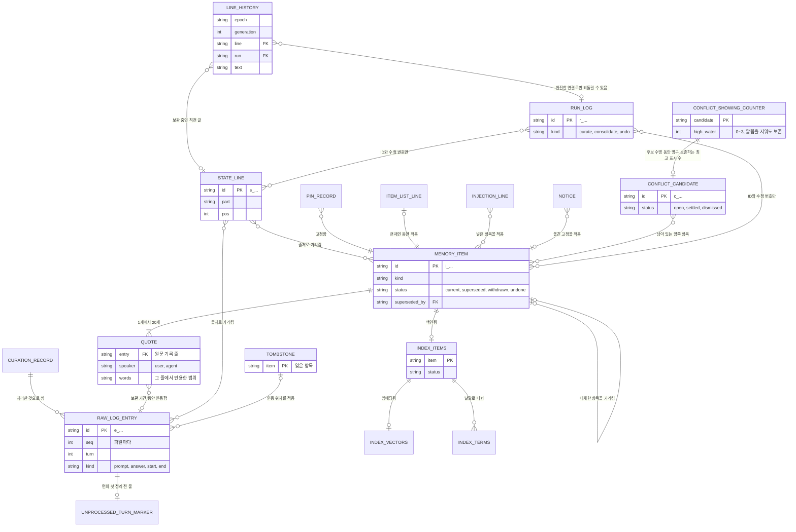

# CORTHEX-MEMORY: 기억 폴더

[English](memory.md)

CORTHEX 자신의 프로젝트에서 `corthex-memory` 플러그인의 05단계입니다. 상태: 2026-10-27 확인했습니다. 남겨 둔 Git 동기화 설계는 D3로 대체됐습니다. 관리자는 C1을 만들기 전에 이 파일을 기능 명세와 함께 확인합니다. 확인이 끝나면 이번 출시의 저장 단위를 고정하며, 그 뒤에 호환되지 않는 변경을 하려면 관리자의 결정과 새 형식 버전이 필요합니다. 이 번역과 영어 원문이 다르면 영어 원문이 원본입니다. 2026-11-03 C2 결정에 따라 TBL-009·010·012·013과 보관·잠금을 넓히고 TBL-119~121을 더했습니다. 2026-11-07 압축 결정에 따라 TBL-122를 더하고 TBL-003·004·005·013을 넓혔습니다. 형식 2는 C2의 목표이며 이번 명세 PR은 기기 자료를 이관하지 않습니다.

입력: [docs/04-functional-spec/memory.ko.md](../04-functional-spec/memory.ko.md)의 기능 명세(SPEC-001\~SPEC-039, SPEC-143\~SPEC-148), 특히 그 [05단계를 위한 메모](../04-functional-spec/memory.ko.md#05단계-기억-폴더); [docs/02-prd/memory.ko.md](../02-prd/memory.ko.md)의 요구사항 가운데 기억 폴더를 가장 많이 정하는 REQ-008, REQ-009, REQ-012, REQ-044, REQ-045, REQ-054, REQ-056, REQ-063, REQ-064; [docs/01-domain/memory.ko.md](../01-domain/memory.ko.md)의 용어집. 이 파일의 말은 거기서 정한 뜻으로 씁니다. 2026-10-27에 D1·D2·D4와 요구사항 변경 일곱 개를 확인했고, D3는 02단계의 HTTPS 창구와 서버 안으로 정했습니다. 남겨 둔 Git 동기화 상세의 상태는 `superseded (D3, 2026-10-27)`이며 C3 전에 대체 설계가 필요합니다.

> D3 설계 상태: `superseded (D3, 2026-10-27)`. 이곳에 남겨 둔 Git 동기화 제안은 2026-10-27에 확인한 D3 결정으로 대체됐습니다. 구현하거나 실행할 계획이 아닌 과거 자료입니다. HTTPS 창구와 서버 동기화 설계는 C3 전에 따로 작성합니다. 기기의 저장소는 파일과 SQLite 검색 색인을 유지합니다. 이 표시는 여러 단계가 공유하는 행·설정·예시의 동기화 부분에도 적용하며, 그 C1/C2 부분은 확인된 상태입니다.

## 이 파일을 읽는 법

- 기억 폴더는 보통 파일을 담은 폴더이고, 검색 색인만 프로젝트마다 SQLite 파일 하나입니다. 저장 단위(TBL) 하나는 파일 한 종류이거나 파일 안의 줄 한 종류입니다. 검색 색인의 표는 [memory-index.sql](memory-index.sql)에 있고, 프로젝트 허브는 그 ID를 거기서 읽습니다.
- `근거` 열에는 그 저장 단위를 읽거나 쓰는 동작(SPEC)을 모두 적고, [동작마다 읽고 쓰는 자료](#동작마다-읽고-쓰는-자료)는 같은 것을 반대 방향으로 적습니다. 검색 색인의 표는 주석에 자기 근거를 적습니다.
- 상태: 확인한 저장 단위는 `active`, 남겨 둔 Git 동기화 정보와 저장소 표지는 `superseded (D3, 2026-10-27)`입니다.
- 필드 표는 필드를 쓰는 순서대로 적습니다. 선택이라고 적은 필드는 값이 없으면 빼며, 어떤 필드도 `null`로 쓰지 않습니다.
- 기억 폴더 정보나 정리 진행 기록처럼 용어집에 없는 이름은 이 파일의 저장 단위 이름이며, 여기서 정합니다.

## 기억 폴더

기억 폴더는 `~/.corthex/corthex-memory/`이거나 `CORTHEX_MEMORY_HOME`이 가리키는 폴더입니다(SPEC-039). 기억 스킬은 사용자가 처음 기억을 켤 때 기억 폴더를 만들고(SPEC-030), 프로젝트의 기억을 켤 때 그 안에 프로젝트 폴더를 만듭니다. 훅과 뒤에서 도는 프로세스는 기억 폴더를 절대 만들지 않습니다. 기억 폴더가 없으면 아무것도 쓰지 않습니다.

```txt
~/.corthex/corthex-memory/
├─ store.json                         TBL-001 기억 폴더 정보
├─ configuration.json                 TBL-002 기억 설정
├─ store.lock
├─ logs/
│  ├─ usage-2026-10.jsonl             TBL-003 사용량 기록, 달마다 파일 하나
│  ├─ failures-2026-10-24.jsonl       TBL-004 실패 기록, 날마다 파일 하나
│  ├─ hooks-2026-10-24.jsonl          TBL-005 훅 소요 시간, 날마다 파일 하나
│  └─ usage.lock, failures.lock, hooks.lock
├─ sync/                              동기화가 켜진 동안만
│  ├─ state.json                      TBL-006 동기화 정보
│  ├─ sync.lock
│  └─ repo/                           코드가 쓰는 동기화 저장소의 Git 작업 사본
└─ projects/
   └─ <project>/                      프로젝트마다 폴더 하나, 이름은 프로젝트 목록을 따름
      ├─ raw/
      │  ├─ <log>.jsonl               TBL-007 원문 기록, 도구의 세션마다 파일 하나
      │  └─ <log>.lock
      ├─ unprocessed/                 TBL-008 정리 전 턴마다 빈 파일 하나
      ├─ curation.json                TBL-009 정리 진행 기록
      ├─ state-history.jsonl          TBL-119 줄 기록
      ├─ runs/<run>.json               TBL-121 실행 기록
      ├─ curation.lock
      ├─ notices/<name>.json          TBL-010 알림
      ├─ notices/conflict-counts.json TBL-010 후보별 영속 횟수 상한
      ├─ injections/<log>.jsonl       TBL-011 넣기 기록, 도구의 세션마다 파일 하나
      ├─ compaction/<log>.json        TBL-122 압축 확인 기록, 도구의 세션마다 파일 하나
      ├─ index.db                     TBL-019부터 TBL-022까지 검색 색인
      ├─ layer.lock
      └─ layer/                       정리된 층, 동기화가 함께 씀
         ├─ items/<item>.json         TBL-012 기억 항목
         ├─ state.json                TBL-013 현재 상태
         ├─ state-removed.json        TBL-013 빠진 현재 상태 줄
         ├─ conflicts.json            TBL-120 충돌 후보, 동기화는 C3에서 결정
         ├─ pins.json                 TBL-014 고정
         ├─ item-list.txt             TBL-015 항목 목록
         ├─ tombstones/<item>.json    TBL-016 지운 기록
         └─ deleted.json              TBL-017 프로젝트 지운 기록

동기화 저장소, 사용자의 Git 저장소
├─ corthex-memory-sync.json           TBL-018 동기화 저장소 표지
└─ projects/<project>/                프로젝트마다 정리된 층, 위의 layer/와 같은 배치
```

기능 명세의 정리 진행 기록은 두 부분으로 나눠 둡니다. 훅만 더하는 정리 전 턴 표지(TBL-008)와, 정리 진행은 정리 프로세스가 맡고 C2 층 쓰기도 층 잠금 아래 필수 수정 표지를 갱신하는 정리 진행 기록(TBL-009)입니다. 그래서 한 프로젝트의 두 세션이 동시에 덧붙여도 같은 파일을 쓰는 일이 없습니다.

## 저장 단위

| ID | 저장 단위 | 맥락 | 파일 | 구별하는 값 | 보관 | 동기화 | 근거 | 상태 |
| --- | --- | --- | --- | --- | --- | --- | --- | --- |
| TBL-001 | 기억 폴더 정보 | CTX-005 | `store.json` | 기억 폴더마다 하나 | 모두 지우기까지 | 안 함 | SPEC-001, SPEC-002, SPEC-003, SPEC-005, SPEC-021, SPEC-030, SPEC-033, SPEC-039, SPEC-146, SPEC-147 | active |
| TBL-002 | 기억 설정 | CTX-005 | `configuration.json` | 기억 폴더마다 하나 | 모두 지우기까지 | 안 함 | SPEC-001, SPEC-002, SPEC-003, SPEC-005, SPEC-006, SPEC-009, SPEC-010, SPEC-011, SPEC-013, SPEC-014, SPEC-019, SPEC-021, SPEC-022, SPEC-023, SPEC-026, SPEC-027, SPEC-030, SPEC-032, SPEC-033, SPEC-036, SPEC-037, SPEC-146, SPEC-147 | active |
| TBL-003 | 사용량 기록 | CTX-005 | `logs/usage-<month>.jsonl` | 파일과 그 안의 자리 | 모두 지우기까지 | 안 함 | SPEC-014, SPEC-015, SPEC-016, SPEC-018, SPEC-019, SPEC-023, SPEC-025, SPEC-027, SPEC-032, SPEC-033 | active |
| TBL-004 | 실패 기록 | CTX-005 | `logs/failures-<date>.jsonl` | 파일과 그 안의 자리 | 보관 기간 동안 | 안 함 | SPEC-001, SPEC-004, SPEC-007, SPEC-008, SPEC-009, SPEC-013, SPEC-018, SPEC-023, SPEC-027, SPEC-033, SPEC-017, SPEC-144, SPEC-145, SPEC-146, SPEC-147 | active |
| TBL-005 | 훅 소요 시간 | CTX-005 | `logs/hooks-<date>.jsonl` | 파일과 그 안의 자리 | 8일 | 안 함 | SPEC-002, SPEC-003, SPEC-005, SPEC-008, SPEC-009, SPEC-021, SPEC-023, SPEC-033, SPEC-146, SPEC-147 | active |
| TBL-006 | 동기화 정보 | CTX-004 | `sync/state.json` | 기억 폴더마다 하나 | 동기화가 켜진 동안 | 안 함 | SPEC-022, SPEC-026, SPEC-027, SPEC-028, SPEC-033 | superseded (D3, 2026-10-27) |
| TBL-007 | 원문 기록 | CTX-001 | `projects/<project>/raw/<log>.jsonl` | `id`, 또는 파일과 `seq` | 줄마다의 시각으로 보관 기간 동안 | 절대 안 함(REQ-044) | SPEC-002, SPEC-003, SPEC-005, SPEC-007, SPEC-009, SPEC-015, SPEC-016, SPEC-020, SPEC-025, SPEC-029, SPEC-035, SPEC-037, SPEC-148 | active |
| TBL-008 | 정리 전 턴 표지 | CTX-002 | `projects/<project>/unprocessed/<time>.<log>.<turn>` | 파일 이름 | 그 턴을 처리하거나 지울 때까지 | 안 함 | SPEC-002, SPEC-003, SPEC-009, SPEC-010, SPEC-016, SPEC-022, SPEC-033, SPEC-037 | active |
| TBL-009 | 정리 진행 기록 | CTX-002 | `projects/<project>/curation.json` | 프로젝트마다 하나 | 프로젝트의 기억이 있는 동안 | 안 함 | SPEC-009, SPEC-010, SPEC-012, SPEC-015, SPEC-016, SPEC-017, SPEC-018, SPEC-019, SPEC-022, SPEC-030, SPEC-033, SPEC-037, SPEC-034, SPEC-035, SPEC-143, SPEC-144, SPEC-145 | active |
| TBL-010 | 알림 | CTX-003 | `projects/<project>/notices/<name>.json` | 파일 이름 | 시작 요약이 보여 줄 때까지 | 안 함 | SPEC-016, SPEC-018, SPEC-019, SPEC-021, SPEC-022, SPEC-028, SPEC-034, SPEC-037, SPEC-143, SPEC-145 | active |
| TBL-011 | 넣기 기록 | CTX-003 | `projects/<project>/injections/<log>.jsonl` | 파일과 그 안의 자리 | 보관 기간 동안 | 안 함 | SPEC-009, SPEC-021, SPEC-023, SPEC-037 | active |
| TBL-012 | 기억 항목 | CTX-002 | `projects/<project>/layer/items/<item>.json` | `id` | 잊거나 프로젝트의 기억과 함께 지울 때까지 | 함 | SPEC-015, SPEC-016, SPEC-017, SPEC-019, SPEC-020, SPEC-021, SPEC-023, SPEC-024, SPEC-025, SPEC-027, SPEC-028, SPEC-029, SPEC-033, SPEC-034, SPEC-035, SPEC-037, SPEC-143, SPEC-145, SPEC-146, SPEC-148 | active |
| TBL-013 | 현재 상태 | CTX-002 | `projects/<project>/layer/state.json`과 `state-removed.json` | 줄마다의 `id` | 줄은 빠질 때까지, 빠진 줄의 기록은 계속 | 함 | SPEC-015, SPEC-017, SPEC-019, SPEC-021, SPEC-027, SPEC-028, SPEC-029, SPEC-034, SPEC-035, SPEC-037, SPEC-145, SPEC-146, SPEC-148 | active |
| TBL-014 | 고정 | CTX-003 | `projects/<project>/layer/pins.json` | 기록마다의 `item` | 항목을 잊을 때까지 계속 | 함 | SPEC-015, SPEC-016, SPEC-019, SPEC-021, SPEC-027, SPEC-028, SPEC-029, SPEC-033, SPEC-034, SPEC-035, SPEC-037, SPEC-145 | active |
| TBL-015 | 항목 목록 | CTX-003 | `projects/<project>/layer/item-list.txt` | 줄마다의 항목 ID | 바뀔 때마다 다시 만듦 | 함 | SPEC-015, SPEC-016, SPEC-019, SPEC-025, SPEC-027, SPEC-028, SPEC-029, SPEC-034, SPEC-035, SPEC-037, SPEC-145 | active |
| TBL-016 | 지운 기록 | CTX-004 | `projects/<project>/layer/tombstones/<item>.json` | `item` | 계속 | 함 | SPEC-012, SPEC-027, SPEC-028, SPEC-029, SPEC-035, SPEC-037, SPEC-021, SPEC-145 | active |
| TBL-017 | 프로젝트 지운 기록 | CTX-005 | `projects/<project>/layer/deleted.json` | 프로젝트마다 하나 | 계속 | 함 | SPEC-009, SPEC-012, SPEC-015, SPEC-027, SPEC-028, SPEC-037, SPEC-145 | active |
| TBL-018 | 동기화 저장소 표지 | CTX-004 | 동기화 저장소의 `corthex-memory-sync.json` | 동기화 저장소마다 하나 | 동기화 저장소가 있는 동안 | 동기화 저장소 안에 있음 | SPEC-026, SPEC-027, SPEC-028 | superseded (D3, 2026-10-27) |
| TBL-119 | 줄 기록 | CTX-002 | `projects/<project>/state-history.jsonl` | epoch, generation, line | 보관 기간 동안 | 안 함 | SPEC-009, SPEC-017, SPEC-019, SPEC-035, SPEC-037, SPEC-145 | active |
| TBL-120 | 충돌 후보 | CTX-002 | `projects/<project>/layer/conflicts.json` | id | 닫힌 후보도 유지 | C3 설계가 정함 | SPEC-015, SPEC-016, SPEC-019, SPEC-033, SPEC-035, SPEC-037, SPEC-143, SPEC-145 | active |
| TBL-121 | 실행 기록 | CTX-002 | `projects/<project>/runs/<run>.json` | id | 보관 기간 동안 | 안 함 | SPEC-009, SPEC-033, SPEC-037, SPEC-144, SPEC-145 | active |
| TBL-122 | 압축 확인 기록 | CTX-003 | `projects/<project>/compaction/<log>.json` | 도구의 세션마다 하나 | 그 세션의 다음 프롬프트까지, 길어야 7일 | 안 함 | SPEC-147, SPEC-037 | active |

검색 색인은 SQLite 파일 `projects/<project>/index.db`입니다. 절대 동기화하지 않으며(REQ-044), 기억 항목에서 언제든 다시 만들 수 있습니다(TERM-029).

| 표 | 이름 | 담는 것 |
| --- | --- | --- |
| TBL-019 | `index_meta` | 색인을 만들 때 쓴 것: 임베딩 모델, 벡터 길이, 낱말 나누기의 판 |
| TBL-020 | `index_items` | 기억 항목마다 한 줄: 항목 종류, 항목 상태, 결정 인용의 말한 사람과 시각, 낱말 수 |
| TBL-021 | `index_vectors` | 임베딩이 있는 항목마다 그 임베딩 |
| TBL-022 | `index_terms` | 항목마다 각 낱말이 몇 번 나오는지 |

## 모든 파일

- 글은 바이트 순서 표시 없는 UTF-8이고, 줄은 LF로 끝납니다.
- JSON 파일에는 객체 하나를 담습니다. 두 칸 들여 쓰고, 필드는 그 표의 순서대로 적고, ASCII 밖의 글자는 이스케이프하지 않고 그대로 적고, 끝에 LF를 둡니다. 그래서 같은 내용은 언제나 같은 바이트가 되고, Git은 동기화 저장소에서 실제로 바뀐 곳만 변경으로 봅니다.
- JSON Lines 파일에는 줄마다 빈칸 없이 줄인 객체 하나를 담고, 필드는 같은 순서로 적습니다.
- 시각은 `2026-10-24T13:05:12.345Z`처럼 밀리초까지 적은 UTC이고, 날짜는 파일 이름에서도 `2026-10-24`처럼 UTC 날짜입니다. 시각은 기기마다의 시계에서 옵니다. 시작 요약과 기억 스킬은 그것을 지역 시각으로 보여 줍니다(06단계).
- ID는 접두사와, Crockford base32 소문자로 된 무작위 글자 12개(무작위 60비트)입니다. 기기는 `d_`, 원문 기록 줄은 `e_`, 기억 항목은 `i_`, 현재 상태 줄은 `s_`, 충돌 후보는 `c_`, 실행은 `r_`로 시작하며, 예를 들면 `i_7f3k2m9q4x1v`입니다. 모델이 아니라 코드가 만들고, 다시 쓰지 않습니다. 소문자, 숫자, 밑줄만 담으므로 `REQ-001` 같은 추적 ID처럼 보이지 않고, 프로젝트 허브는 어느 것도 읽지 않습니다.
- 프로젝트 폴더의 이름은 프로젝트 목록에 있는 프로젝트 이름입니다. Windows가 장치 이름으로 예약한 이름(`con`, `prn`, `aux`, `nul`, `com0`\~`com9`, `lpt0`\~`lpt9`)이면 어느 시스템에서나 끝에 `_`를 붙여, 동기화 저장소에서 모든 기기가 폴더를 같게 부르게 합니다. 프로젝트 이름에는 소문자, 숫자, 하이픈만 들어가므로, 다른 프로젝트의 폴더가 `_`로 끝나는 일은 없습니다.
- 글 안의 위치는 저장된 글의 유니코드 코드 포인트를 0부터 센 것이고, 범위의 끝은 범위에 들지 않습니다.
- 어떤 파일도 키, 토큰, 비밀번호를 담지 않습니다(SPEC-031).
- Linux와 macOS에서는 폴더를 사용자만 읽을 수 있게(모드 0700), 파일도 그렇게(0600) 만듭니다. Windows에서는 위 폴더에서 이어받은 권한을 그대로 두며, 기본 위치라면 그것은 사용자의 프로필 폴더에서 온 권한입니다.
- 이름이 `.tmp`, `.bak`, `.lock`, `.stale`로 끝나는 파일은 코드의 작업 파일입니다. 읽는 쪽은 건너뛰고, 동기화는 절대 옮기지 않습니다.

## 저장 단위마다의 필드

### 기억 폴더 정보 (TBL-001)

모든 프로세스가 가장 먼저 읽습니다. 코드가 모르는 형식이거나 그런 형식으로 변환하는 중이면, 기억 폴더의 다른 것은 읽지도 쓰지도 않고, 기억 상태가 플러그인을 업데이트하라고 알립니다(SPEC-039). 변환만 이것을 바꾸며, 그때는 기억 폴더 잠금을 잡습니다.

| 필드 | 값 | 뜻 |
| --- | --- | --- |
| `format` | 정수: C1은 `1`, C2는 `2` | 기억 폴더의 형식 버전(REQ-063) |
| `device` | 기기 ID | 이 기기. 인용, 현재 상태 줄, 고정, 지운 기록이 이 ID로 기기를 가리킴 |
| `made` | 시각 | 기억 폴더를 만든 때 |
| `release` | 글, 예: `0.2.0` | 기억 폴더를 만들었거나 마지막으로 변환한 플러그인 판 |
| `migrating` | (선택) 객체: `from`, `to`, `started` | 시작했지만 끝나지 않은 변환([형식 버전과 변환](#형식-버전과-변환)) |

다른 파일이 있는데 이것을 잃었고 백업도 되돌릴 수 없으면, 아무것도 읽거나 쓰지 않습니다. 기억 상태가 그렇다고 알리고, 사용자가 좋다고 하면 기억 스킬이 새 기기 ID로 기억 폴더 정보를 새로 씁니다. 코드는 원문 기록 줄을 파일과 ID로 찾으므로, 기기 ID가 새로 바뀌어도 잃는 것은 없습니다.

### 기억 설정 (TBL-002)

기억 스킬만 기억 폴더 잠금을 잡고 씁니다. 임시 기기에서는 사용자의 환경 설정이 첫 세션 전에 써 둘 수도 있습니다(SPEC-011). 절대 동기화하지 않고, 키를 담지 않습니다. 아래 기본값은 기능 명세에서 왔고 06단계가 확정했습니다. 빠진 필드는 기본값을 씁니다. 필드의 범위와 패턴은 06단계의 [설정 스키마](../06-api/memory-configuration.schema.json)를 따릅니다.

| 필드 | 값 | 뜻 |
| --- | --- | --- |
| `consent` | (선택) 객체: `at`(시각), `version`(정수) | 사용자의 동의와 그 문구의 판(SPEC-030). 이번 판이 요구하는 판의 동의가 없으면 아무것도 기록하거나 보내지 않습니다. |
| `projects` | 객체: 프로젝트 이름 → `enabled`(true나 false), `since`(시각), 선택인 `left_out`(`folders`: 프로젝트 폴더를 기준으로 한 폴더; `kinds`: `prompt`, `answer`, `boundary` 가운데 몇 개) | 기억을 켠 프로젝트, 마지막으로 켠 때, 기록에서 뺀 것(SPEC-006, SPEC-030, SPEC-036) |
| `retention` | 객체: `days`(1 이상의 정수, 기본값 100) | 보관 기간(SPEC-009) |
| `triggers` | 객체: `turns`(기본값 10), `minutes`(기본값 30) | 턴이 끝날 때의 정리 시작 조건(SPEC-010) |
| `temporary` | (선택) true나 false | 기기가 임시 기기인지. 빠지면 코드가 도구에 묻습니다(SPEC-011) |
| `models` | 객체: `curator`(기본값 `claude-haiku-5-5`), `effort`(기본값 `xhigh`), `embedding`(기본값 `text-embedding-3-small`), `dims`(줄인 벡터 길이, 기본값 512) | 모델(SPEC-014, SPEC-023) |
| `recall` | 객체: `threshold`(숫자, 선택), `skip`(기본값 8) | 넣는 기준점(12단계가 정하기 전에는 값이 없음)과, 불러오기를 돌리는 프롬프트의 가장 짧은 길이(글자 수)(SPEC-023) |
| `prices` | 객체: `taken`(날짜), `from`(공급자마다 가격 페이지 주소 하나씩), `models`(모델 → `input`, `output`, 선택인 `cache_write`, `cache_read`. 단위는 100만 토큰당 미국 달러. 프롬프트 길이에 따라 바뀌는 가격은 선택인 `above`에 `tokens`, `input`, `output`으로 적음) | 가격표(SPEC-032) |
| `sync` | (선택) 객체: `address`, `branch`(기본값 `main`) | 동기화 저장소. 이것이 있는 동안 동기화가 켜져 있습니다(SPEC-026) |

이것을 잃었고 백업도 되돌릴 수 없으면, 그 기기에서 기억은 꺼집니다. 동의도 켠 프로젝트도 없으므로, 사용자가 기억을 다시 켤 때까지 아무것도 기록하거나 보내지 않으며, 기억 상태가 그렇다고 알립니다.

### 사용량 기록 (TBL-003)

모델 API에 보낸 요청 하나(다시 시도한 요청도 하나씩)와 토큰 세기 하나마다 한 줄이며(SPEC-032), 호출한 프로세스가 덧붙입니다. UTC 달마다 파일 하나이고, 기억 상태는 이번 달 파일을 읽습니다. 프로젝트의 기억을 지워도 남기며, 모두 지우기까지 둡니다(SPEC-037). 대화 글, 프롬프트, 답변, 키는 없습니다. 05단계가 요구하는, AI 호출마다의 기록이 이것입니다.

| 필드 | 값 | 뜻 |
| --- | --- | --- |
| `at` | 시각 | 요청을 보낸 때 |
| `project` | 프로젝트 이름 | 그 호출을 한 프로젝트 |
| `call` | `curate`, `consolidate`, `embed-prompt`, `embed-items`, `embed-search`, `count-tokens` 가운데 하나 | 호출의 종류 |
| `model` | 글 | 요청에 적은 모델 |
| `instructions` | (선택) 글, 예: `curate-1` | 정리 요청에 든 플러그인 고정 지시문의 판 |
| `input` | (선택) 정수 | 공급자가 알린 입력 토큰. `count-tokens`면 돌려받은 토큰 수 |
| `output` | (선택) 정수 | 공급자가 알린 출력 토큰 |
| `cache_write` | (선택) 정수 | 공급자의 프롬프트 캐시에 쓴 입력 토큰(06단계가 캐시를 쓰는 곳에서) |
| `cache_read` | (선택) 정수 | 공급자의 프롬프트 캐시에서 읽은 입력 토큰 |
| `first_ms` | (선택) 정수 | 보낸 때부터 스트리밍의 첫 토큰까지의 밀리초 |
| `total_ms` | 정수 | 보낸 때부터 답이 끝나거나 실패할 때까지의 밀리초 |
| `result` | `ok`, `failed`, `refused`, `limit` 가운데 하나 | `refused`: 모델이 거절로 끝냄; `limit`: 출력 상한에서 멈춤(SPEC-014) |
| `error` | (선택) 글 | 오류의 종류. 예: `rate_limit_error`, `overloaded_error`, `timeout`, `network`. 오류의 글은 절대 적지 않음 |
| `request` | (선택) 글 | 응답 헤더에 있는 공급자의 요청 ID |
| `cost` | 숫자 | 가격표로 추정한 비용(미국 달러). 토큰 세기는 0 |
| `prices` | 날짜 | 쓴 가격표의 `taken` 날짜 |
| `turns` | (선택) 정수 | 정리 요청이 담은 정리 전 턴의 수. 한 턴의 조각은 그 턴 하나를 담음 |
| `parts` | (선택) 정수 | 혼자서도 너무 큰 턴의 조각이면, 그 턴을 나눈 조각 수 |
| `list` | (선택) `full`, `short`, `part` 가운데 하나 | 정리 요청에 든 항목 목록의 꼴(API-006) |
| `estimate` | (선택) 정수 | 정리 요청 입력 토큰의 보통 어림(API-009) |

기억 상태는 공급자가 요금을 매기는 호출의 토큰만 더하므로, 토큰 세기가 두 번 세어지지 않습니다.

정리 줄의 `turns`·`parts`·`list`·`estimate`는 요청의 글 없이 그 크기를 나타내므로, C2 평가가 큰 요청의 까닭을 말할 수 있습니다(TASK-050). 정리 작업자가 정리 요청의 모든 시도 줄에 이 필드를 `prices` 뒤에 이름 순서로 씁니다(TASK-116). 그 전에 쓴 줄에는 없고, 통합 줄에는 쓰지 않습니다. `estimate`는 가리기 전의 요청 문서를 지시문·스키마와 함께 잰 API-009의 보통 어림이므로, 공급자가 글을 어림보다 촘촘하게 세면 입력 토큰이 이를 넘을 수 있습니다.

TASK-078 컴포넌트는 인증용 단일 경계에서 전용 MEMORY 키 두 변수만 고정해 읽습니다. 존재 표시에는 값이 없고 잘못된 헤더 값은 고정 오류로 거부합니다. 요청별 원래 키 스냅샷의 비밀은 사용량 메타데이터에도 넣지 않습니다. 더 넓은 일반 환경값 가림은 그대로 둡니다. 공급자 메시지·본문·예외 문구 및 알려지지 않은 type/code는 분류 결과에 들어가지 않습니다. 알 수 없는 종류는 기존의 안전한 HTTP 종류 코드로 정규화하며 분류기는 재시도·sleep을 맡지 않습니다.

실제 시도마다 설정 가격표와 요청 전송 UTC 시각을 고정해 사용량을 만들며, 응답·thinking 문구 대신 공급자 토큰 수만 골라 읽습니다. 출력 토큰에는 청구되는 reasoning이 이미 포함되므로 새 reasoning 필드를 넣지 않습니다. Anthropic 입력·캐시 쓰기·캐시 읽기는 행에서 구분하며 엄격한 above.tokens 문턱과 상태의 입력 합계에는 모두 셉니다. 토큰 수 세기는 비용 0이며 유료 호출 합계에서 뺍니다. 알 수 없는 모델은 비용 0과 사용한 가격표 날짜를 남겨 unpriced를 표시합니다. 묶인 저장소의 보호된 usage 임대 아래 전송 월 파일에 붙이고 디렉터리는 만들지 않습니다. 기록 실패는 호출 결과를 바꾸지 않고 안전한 로컬 오류 메타데이터만 보고합니다. 실제 전송·재시도 연결은 TASK-079·080에 남습니다.

### 실패 기록 (TBL-004)

기록, 불러오기, 정리, 통합, 동기화, 보관 기간 처리, 기억 스킬의 실패(SPEC-008)와 되돌린 백업마다 한 줄입니다. UTC 날마다 파일 하나이며, 그날 전체가 보관 기간을 지나면 지웁니다. 대화 글, 키, 파일 경로, 오류의 글은 없습니다.

| 필드 | 값 | 뜻 |
| --- | --- | --- |
| `at` | 시각 | 일어난 때 |
| `step` | `record`, `recall`, `summary`, `trigger`, `curate`, `consolidate`, `embed`, `sync`, `retention`, `index`, `restore`, `skill`, `compaction` 가운데 하나 | 실패한 일 |
| `hook` | (선택) `prompt`, `end-of-turn`, `start`, `end`, `pre-compact`, `post-compact` 가운데 하나 | 실패가 일어난 훅 |
| `host` | (선택) `claude-code`나 `codex` | 도구 |
| `project` | (선택) 프로젝트 이름 | 프로젝트를 찾았을 때 그 프로젝트 |
| `error` | 글 | 오류의 종류: `PermissionError` 같은 예외의 클래스 이름, 공급자의 오류 종류, 또는 `lock-busy`, `deadline`, `damaged-line`, `future-entry`, `restored`, `no-project-list` 같은 코드 자체의 종류 |
| `log` | (선택) 원문 기록 파일 이름 | 파일 하나에 대한 오류일 때 그 원문 기록 파일 |
| `count` | (선택) 정수 | 한 줄이 여럿을 나타낼 때 그 수. 예: 한 파일의 상한 줄 |

원문 기록 파일의 상한 줄을 건너뛰거나(SPEC-007) 미래 시각의 줄을 찾은(SPEC-009) 뒤쪽 읽기 프로세스는 그 파일에 대해 `count`를 담은 줄 하나를 씁니다. 마감 시간 전이나 마감 시간이 지난 뒤 한 번의 시도에서 실패 기록의 잠금을 잡지 못한 훅은 아무것도 쓰지 않습니다.

### 훅 소요 시간 (TBL-005)

켠 프로젝트를 찾은 훅이 돌 때마다 한 줄이며, 훅이 끝날 때 덧붙입니다(SPEC-008, SPEC-033). 켠 프로젝트를 찾지 못한 훅은 아무것도 쓰지 않으므로(SPEC-001), 그 시간은 QA에서 바깥에서만 잽니다. UTC 날마다 파일 하나이며, 8일보다 오래된 파일은 지웁니다. 그래서 기억 상태에는 언제나 온전한 7일이 있습니다.

| 필드 | 값 | 뜻 |
| --- | --- | --- |
| `at` | 시각 | 훅이 시작된 때 |
| `hook` | `prompt`, `end-of-turn`, `start`, `end`, `pre-compact`, `post-compact` 가운데 하나 | `pre-compact`: 압축 지시 훅; `post-compact`: 압축 확인 훅(SPEC-146, SPEC-147) |
| `host` | `claude-code`나 `codex` | |
| `ms` | 정수 | 훅 안에서 잰, 훅의 시작부터 끝까지의 밀리초 |
| `outcome` | `ok`, `left-out`, `no-answer`, `lock-busy`, `deadline`, `error` 가운데 하나 | `left-out`: 폴더나 종류를 뺐음; `no-answer`: 최종 답변이 없는 턴 끝, 기억 상태가 셈(SPEC-003); `deadline`: 훅이 마감 시간을 넘겨 남은 단계를 건너뜀(SPEC-008) |

### 동기화 정보 (TBL-006)

동기화만 동기화 잠금을 잡고 씁니다. 동기화를 끄면 `sync` 폴더를 지웁니다. 이것 옆의 `sync/repo/`는 코드가 쓰는 동기화 저장소의 Git 작업 사본입니다. 거기에는 동기화 저장소에 있는 모든 프로젝트의 정리된 층이 있으며, 이 기기에 없는 프로젝트의 것도 있어 push할 때마다 그대로 옮겨 갑니다. 동기화는 기억 폴더에 폴더가 있는 프로젝트마다 합치고, 정리된 층이 아직 없는 켠 프로젝트에는 동기화 저장소의 것을 복사합니다. push할 때마다 그 뒤에 코드는 브랜치에서 더는 닿지 않는 작업 사본의 커밋과 객체를 모두 버려, 잊은 항목의 글이 기기에 남지 않게 합니다.

| 필드 | 값 | 뜻 |
| --- | --- | --- |
| `base` | (선택) 커밋 ID | 마지막 pull이 찾은 커밋. push는 브랜치가 아직 이 커밋에 있을 때만 브랜치를 바꿉니다(SPEC-028) |
| `last_ok` | (선택) 시각 | pull, 합치기, push까지(push할 것이 없었던 때도) 마친 마지막 동기화가 끝난 때 |
| `last_try` | (선택) 시각 | 마지막 동기화가 시작된 때 |
| `checked` | (선택) 시각 | 마지막 비공개 확인(SPEC-026) |
| `checked_by` | (선택) `github`, `gitlab`, `bitbucket`, `user` 가운데 하나 | 비공개를 확인한 방법. 사용자가 확인해 주었으면 `user` |
| `stopped` | (선택) 객체: `at`, `reason`(`public`이나 `other-files`) | 사용자가 다시 켤 때까지 멈춘 동기화(SPEC-026) |
| `failed` | (선택) 객체: `at`, `error`(예: `unreachable`, `moved`, `newer-format`) | 끝나지 않은 마지막 동기화 시점과 그 까닭(SPEC-027, SPEC-028) |
| `clashes` | 객체 목록: `project`, `item` | 양쪽에서 ID는 같고 글이 다른 항목(SPEC-028) |

이것을 잃으면, 다음 동기화는 기준 커밋 없이 pull하고, push하기 전에 비공개를 다시 확인합니다.

### 원문 기록 (TBL-007)

도구의 세션마다 파일 하나이며, 이름은 `<host>-<key>`입니다: 도구(`claude-code`나 `codex`)와, 도구가 준 세션 ID의 SHA-256 앞 16자리 16진수. 예: `claude-code-3f9a0c41d2e87b65`. 원문 기록 줄 하나가 파일의 한 줄이며, 세션의 훅이 파일의 잠금을 잡고 덧붙입니다(SPEC-007). 보관 기간 처리, 잊기, 지운 기록 적용만 파일을 다시 씁니다. 줄은 저마다의 시각으로 보관 기간을 지나면 지우고, 줄이 남지 않은 파일은 지웁니다(SPEC-009). 절대 동기화하지 않습니다(REQ-044).

| 필드 | 값 | 뜻 |
| --- | --- | --- |
| `id` | 원문 기록 줄 ID | |
| `seq` | 정수 | 파일의 첫 줄은 1, 그 뒤로 하나씩 늘어남. 다시 써도 모든 줄의 `seq`를 그대로 둠 |
| `turn` | (선택) 정수 | 프롬프트나 최종 답변이면, 그 턴 첫 줄의 `seq` |
| `at` | 시각 | 훅이 줄을 쓴 때 |
| `host` | `claude-code`나 `codex` | |
| `session` | 글 | 도구가 준 세션 ID |
| `kind` | `prompt`, `answer`, `start`, `end` 가운데 하나 | `start`와 `end`는 세션 경계(SPEC-005) |
| `speaker` | (선택) `user`나 `agent` | 프롬프트는 `user`, 최종 답변은 `agent` |
| `text` | (선택) 글 | 지우기 처리를 거친 프롬프트나 최종 답변(SPEC-004). UTF-8로 512KB까지(SPEC-002)이며, `forgotten` 범위 안의 U+FFFD는 하나를 1바이트로 셉니다 |
| `cut` | (선택) 정수 | 자르기 전 글의 바이트 수(SPEC-002) |
| `event` | (선택) `start`, `resume`, `clear`, `compact`, `fork` 가운데 하나 | 시작 경계면, 도구가 알린 사건 |
| `reason` | (선택) 글 | 끝 경계면, 도구가 준 까닭. 64글자까지 |
| `forgotten` | (선택) `[start, end]` 쌍의 목록 | 잊기나 지운 기록이 바꾼 `text`의 범위(SPEC-035) |

턴: 프롬프트는 턴을 시작하며, 그 `turn`은 자기 `seq`입니다. 최종 답변은 파일에서 자기 앞의 마지막 프롬프트나 최종 답변의 턴에 들어갑니다. 단, 그 줄이 그 턴의 프롬프트일 때, 또는 그 줄이 최종 답변이고 도구가 다른 훅 뒤에 에이전트가 이어 갔다고 알릴 때만입니다(SPEC-003). 그 밖의 최종 답변은, 프롬프트를 뺀 때처럼, 자기 턴을 시작합니다. 경계는 어느 턴에도 들지 않습니다.

보관 기간 처리는 줄마다의 시각으로 지우므로, 파일의 마지막 줄들을 지우면서 시각이 미래인 앞의 줄을 남길 수 있습니다(SPEC-009). 그러면 다음 덧붙이기가 지운 줄의 `seq`를 다시 받고, 정리 진행 기록은 그 `seq`를 처리한 것으로 셀 수 있습니다. 그래서 보관 기간 처리는 그런 다시 쓰기 전에 정리 진행 기록에서 그 파일의 값을 남기는 줄의 가장 큰 `seq`로 낮추고(TBL-009), 다음 줄은 정리 전으로 셉니다. 둘 사이에서 멈추면 그 줄들을 한 번 더 정리할 뿐입니다.

잊기: 잊기나 이 기기에 적용한 지운 기록은 인용된 범위의 글자를 하나하나 U+FFFD로 바꿉니다. 그래서 글의 길이가 그대로이고 그 줄의 다른 인용 위치도 맞게 남습니다. 그리고 그 범위를 `forgotten`에 더합니다. 이 기기에 남는 항목의 인용과 겹치는 범위는 그 항목의 출처가 남도록 통째로 둡니다(SPEC-035). 나중의 잊기나 지운 기록으로 그런 항목이 남지 않게 되면, 그 잊기나 지운 기록이 앞 항목의 지운 기록에서 그 범위를 찾아 함께 바꿉니다. 정리 프로세스에 보내는 요청은 잊은 범위를 `[forgotten]`으로 보여 주므로, 어떤 인용도 그 범위를 담을 수 없습니다. 잊기는 다른 원문 기록 다시 쓰기와 같은 방법으로 파일을 다시 쓰며(SPEC-007), 효과를 모두 내는 동안 쥐는 정리된 층 잠금 아래에서 하고 정리 잠금은 잡지 않습니다. 채우는 항목의 줄만 바꿉니다. 다른 줄은 손상되거나 끝나지 않은 줄까지 바이트 그대로 두고, 빠지는 항목이 없고 모든 `seq`가 그대로이므로 정리 진행 기록도 바뀌지 않습니다. 파일의 잠금을 쥔 채, 멈춘 다시 쓰기가 남긴 그 파일의 백업과 임시 파일도 지웁니다. 잊은 글이 그 안에 남아 있을 수 있기 때문입니다. 파일 자체가 없고 그 백업에 줄이 있으면, 잊기의 미리보기는 백업에서 줄을 읽되 아무것도 복원하지 않고, 채우기는 다음 덧붙이기가 그러듯 파일의 잠금 아래에서 백업을 복원한 뒤 채웁니다. U+FFFD는 UTF-8로 3바이트이고 바꾼 글자는 1바이트일 수 있으므로, `text`의 512KB를 셀 때 `forgotten` 범위 안의 U+FFFD는 하나를 1바이트로 셉니다. 그래서 채운 항목도 기록할 때 지킨 한도 안에 남습니다.

### 정리 전 턴 표지 (TBL-008)

정리 전 턴마다 빈 파일 하나이며, 이름은 `<time>.<log>.<turn>`입니다: 그 턴에서 아직 처리하지 않은 가장 오래된 줄의 시각(예: `20261024T130512Z`), 원문 기록 파일, 그 턴의 `seq`. 예: `20261024T130512Z.claude-code-3f9a0c41d2e87b65.42`. 줄을 덧붙인 훅이 원문 기록 파일의 잠금을 잡은 채로, 그 턴의 표지가 없으면 만듭니다. 정리 시작 조건은 표지를 세고 가장 오래된 시각을 이름에서 읽으므로, 어느 훅도 조건을 보려고 원문 기록을 읽거나 파일을 다시 쓰지 않습니다(SPEC-010).

| 필드 | 값 | 뜻 |
| --- | --- | --- |
| `time` | 초까지 적은 UTC 시각 | 그 턴에서 아직 처리하지 않은 가장 오래된 줄을 쓴 때 |
| `log` | 원문 기록 파일 이름 | |
| `turn` | 정수 | 그 턴의 `seq` |

적용한 뒤 정리 프로세스는 원문 기록 파일마다 그 잠금을 잡고, 그 파일의 표지를 아직 처리하지 않은 줄이 있는 턴마다 하나씩으로 바꿉니다. 정리하는 동안 덧붙은 최종 답변이 그런 예입니다. 보관 기간 처리는 자기가 지우는 턴의 표지를 지웁니다. 플러그인 밖에서 잃은 표지는 그 턴의 시작 조건을 늦출 뿐입니다. 무엇을 처리했는지는 정리 진행 기록이 정하므로, 그 프로젝트의 다음 정리가 여전히 그 턴을 정리합니다.

### 정리 진행 기록 (TBL-009)

기억 스킬이 그 프로젝트를 처음 켜기 전에 빈 기록으로 만듭니다. 그래서 이것이 없으면 새것이 아니라 잃은 것입니다. C1에서는 그 프로젝트의 정리 잠금을 쥔 쪽만 씁니다: 정리 프로세스, 자기가 지운 원문 기록 파일을 이 기록에서 빼고 마지막 줄들을 지운 파일의 값을 낮추는 보관 기간 처리(TBL-007), 사용자가 정리를 다시 시작할 때의 기억 스킬(SPEC-033). 정리 프로세스는 정리된 층 잠금도 잡고, 이 기록이 세는 변경을 쓴 뒤에 이것을 씁니다. 그래서 둘 사이에서 멈추면 그 턴을 잃지 않고 다시 정리하며, 두 번 정리된 것은 통합이 합칩니다.

| 필드 | 값 | 뜻 |
| --- | --- | --- |
| `logs` | 객체: 원문 기록 파일 이름 → 정수 | 원문 기록 파일마다 어디까지 처리했는지: 그 `seq`까지의 줄 |
| `applies` | 정수 | 결과를 적용한 요청마다 하나씩 늘어남. 적용하기 전마다 확인함([잠금](#잠금)) |
| `recent` | list of up to 10 attempts; kind `curate`, `consolidate` or `undo`; optional `run`, `reasons` and `edit_reasons` | 최근 시도와 선택 실행 ID, 정리·통합 시도가 버린 것의 이유별 수. C2 형식에서만 undo/run/reasons/edit_reasons를 씀. |
| `failures` | (선택) 객체: `count`, `log`, `turn` | 같은 첫 정리 전 턴에서 잇따라 실패한 시도(SPEC-018) |
| `consolidation` | 객체: `last`(시각, 선택), `due`(시각, 선택), `failures`(정수) | 마지막으로 끝난 통합, SPEC-015가 다음 통합을 해야 할 때로 정한 시각, 잇따라 실패한 통합 수(SPEC-019) |
| `stopped` | (선택) 객체: `at`, `by`(`curate`나 `consolidate`), `errors`(오류의 종류들) | 사용자가 다시 시작할 때까지의 고장 멈춤(SPEC-018) |
| `rebuilt` | (선택) 시각 | 원문 기록으로 이 기록을 마지막으로 다시 만든 때 |
| `fence` | C2 required object: `epoch`, `generation`, `revisions` | 코드가 만든 32hex epoch·단조 증가 정수·대상별 마지막 세대. 대상 키는 item:<id>, line:<id>, pin:<id>, candidate:<id>, run:<id>이며 글은 없음. |
| `conflict_after` | optional candidate ID | 예산 안에 싣는 후보 쌍을 다음 묶음에서 순환 선택할 마지막 ID. 후보 삭제·정리 뒤에도 현재 목록 순서에서 다음 것을 고름. |

C1의 필수 필드는 `logs`, `applies`, `recent`, `consolidation`입니다. 빈 기록은 `{}`인 logs, 0인 applies, 최근 시도 없음, 0인 통합 실패 수를 가집니다. 개수는 불리언을 제외한 0 이상의 정수이며 실패한 턴의 `turn`은 양수입니다. `logs`의 키와 `failures.log`는 턴 표지처럼 `.jsonl`을 뺀 원문 이름 `<host>-<16진수 16글자>`입니다. 최근 시도마다 `at`, `kind`, `result`가 필수이고 `error`, `applied`, `dropped`, `state`는 해당할 때 둡니다. 오류 필드는 06단계의 모델 오류 코드나 내장 예외 클래스 이름을 씁니다. 모르는 필드나 잘못된 필드는 조용히 지우지 않습니다. 기록의 쓰기 임대 아래에서 유효한 백업으로 잘못된 원본을 복원할 수 있으며 읽을 수 있는 사본이 없으면 쓰는 쪽을 멈춥니다. 보호된 C1 다시 쓰기는 나머지 유효한 필드를 모두 보존하며 복원할 수 없는 기록을 거절합니다. 잃은 진행 수를 다시 만드는 것은 C2 정리 프로세스만 합니다.

C2에서 무언가를 버린 정리 시도는 버린 것을 이유별로도 남깁니다. `applied`와 `dropped`는 답의 항목 변경을 세고, `reasons`는 항목 변경을 버린 이유(`shape`, `limit`, `not-in-request`, `not-current`, `quote`, `pasted`)마다 양의 수를 두며 그 합은 `dropped`와 같습니다. `edit_reasons`는 버린 줄 편집의 이유(`not-in-request`, `duplicate`, `shape`, `limit`, `cites`, `decision`)를 같은 방식으로 셉니다. 버린 변경이나 편집은 처음 걸린 검사 하나로만 셉니다(06단계). 통합 시도도 같은 방식으로 남깁니다(TASK-089, TASK-090). `applied`와 `dropped`는 합치기를 세고, `reasons`는 합치기를 버린 이유(`shape`, `limit`, `not-in-request`, `not-current`, `quote`, `speaker`)마다, `edit_reasons`는 마지막 답에서 버린 줄의 이유(`not-in-request`, `duplicate`, `shape`, `cites`, `decision`)마다 수를 둡니다. 그 `state`는 마지막 답이 현재 상태에 한 일(`new`, `kept`, `cut`)입니다. 되돌리기 시도는 두 필드를 두지 않습니다.

정리 프로세스는 줄을 처리했다고 세거나 그 줄의 인용을 적용하기 전에, 그 원문 기록 파일을 디스크에 내려씁니다. 그래서 정리 진행 기록이 센 줄은 전원이 끊겨도 잃지 않습니다. 이 기록을 잃으면 정리 프로세스가 다시 만듭니다: 원문 기록 파일마다, 항목이 인용하거나 현재 상태 줄이 출처로 가리키는 가장 새 줄을 그 앞의 줄과 함께 처리한 것으로 세고, 그 뒤의 줄은 같은 턴의 줄이라도 정리 전으로 셉니다. 마지막 정리가 도는 동안 덧붙은 최종 답변은 보내지 않았을 수 있기 때문입니다. 두 번 정리된 턴은 중복 항목을 만들고, 통합이 합칩니다. 알림이 한 번 그렇다고 알리며, 고장 멈춤의 멈춤은 이 기록과 함께 잃습니다.
C2에서는 이 기록을 쓰는 모든 경로가 레이어 잠금을 잡고 새로 읽어 고칩니다. 진행·시도 필드는 정리 잠금도 필요합니다. API 답을 기다리는 정리 잠금 중에도 잊기 같은 명령은 레이어 잠금 아래 표지 필드만 갱신할 수 있어 SPEC-012의 동시 잊기를 막지 않습니다. 다른 필드는 보존하며 이전 순서의 잠금을 뒤에서 잡지 않습니다. 실제 변경 전에 generation과 영향받는 모든 대상·run 키의 판 번호를 디스크에 남기고, 실패하면 변경을 막습니다. 효과 실패는 판 번호를 보수적으로 예약할 수 있으나 되돌리지 않습니다. 실행 기록은 대상의 전후 판 번호와 같은 epoch를 남기며, 값이 같아진 ABA나 기록되지 않은 뒤 변경도 번호가 달라 지켜집니다. 존재하는 대상의 판 번호가 없으면 0으로 추정하지 않고 미확인으로 둡니다. 기록을 잃거나 백업에서 복원하면 epoch를 새로 만들어 앞 실행의 근거를 무효로 합니다. 지운·잊은 대상의 ID 판 번호는 남은 앞 실행이 가리킬 수 있는 동안 유지합니다. 요청은 applies와 표지 스냅샷을 함께 검사합니다. 이 필드는 형식 2의 계약이며 C1 형식 1 읽기·쓰기는 바꾸지 않습니다.


### 알림 (TBL-010)

시작 요약이 한 번 보여 주는 알림마다 파일 하나입니다(SPEC-022): `curation-failed`, `consolidation-failed`, `rebuilt`, `pin-<item>`. 정리 프로세스, 동기화, 기억 스킬이 저마다 정리된 층 잠금 아래에서 쓰고, 같은 이름의 나중 알림은 앞의 것을 바꾸며, 시작 훅은 보여 준 알림을 지웁니다. 지우기도 그 잠금 아래에서, 알림이 보여 준 바이트 그대로일 때만 하므로 그사이 다시 쓴 알림은 다음 시작까지 남습니다(API-001 7단계). 고장 멈춤, 기억 전용 키가 없음, 보관 기간 처리가 곧 지울 정리 전 턴처럼 이어지는 상태는 저장하지 않습니다. 시작 훅이 세션이 시작될 때마다 알아냅니다.

| 필드 | 값 | 뜻 |
| --- | --- | --- |
| `at` | 시각 | |
| `kind` | `curation-failed`, `consolidation-failed`, `rebuilt`, `pin-moved`, `pin-dropped`, `pin-restored`, `pin-removed`, `conflict` |
| `error` | (선택) 글 | 실패면 오류의 종류 |
| `item` | (선택) 항목 ID | 고정이 옮겨지거나 풀리거나 되돌리기로 없어진 항목, 또는 되돌리기가 고정을 돌려준 항목(SPEC-034) |
| `to` | (선택) 항목 ID | 고정이 옮겨 간 항목 |
| `run` | (선택) 실행 ID | 고정을 돌려주거나 없앤 되돌리기 실행(SPEC-034, SPEC-145) |
| `candidate`, `shown` | optional candidate ID and count 0 to 3 | 충돌 알림의 대상과 보인 횟수. 영속 상한은 conflict-counts.json이 소유. |

C2의 conflict-counts.json은 후보 ID별 0~3 상한을 기기에만 남깁니다. 내용은 ID 순서의 `{"counts": {"<candidate>": <count>}}`이며 백업을 두지 않습니다. 파일이 없거나 손상됐거나 읽을 수 없을 때, 또는 파일에 이름이 없는 후보는 세 번 보인 것으로 셉니다. 후보를 처음 발행하기 전에 0을 내구성 있게 쓰고, 세 번째 뒤 개별 알림을 지워도 상한은 그 ID의 수명 동안 남깁니다. 다시 열기·정리·백업 복구가 0으로 초기화하지 못합니다. 횟수가 없거나 복구의 완전성을 못 믿으면 기존 후보를 보수적으로 소진한 것으로 두고 실패·상태에 알리며, 후보 목록은 계속 볼 수 있습니다. Start는 줄이 실제 예산에 들어간다고 정한 뒤 독립 conflict-counts 잠금 아래 새로 읽고 한 번을 원자적·내구성 있게 예약한 경우만 보입니다. 잠금·기한·쓰기 실패면 보이지 않습니다. 새 파일을 옮기기 전의 실패는 횟수를 올리지 않고, 옮긴 뒤 폴더를 내려쓰는 동안의 실패는 예약 뒤 출력 전에 중단될 때처럼 한 번을 소비합니다. 동시 시작도 합쳐 세 번을 넘지 않습니다. 보통 알림과 달리 이 상한은 건너뛴 fsync나 오래된 백업 복원으로 줄일 수 없습니다. 시작 훅은 정리된 층을 쓰지 않습니다.


### 넣기 기록 (TBL-011)

도구의 세션마다 파일 하나이며, 이름은 그 원문 기록 파일과 같습니다. 원문 기록을 쓰지 않는 뺀 폴더에서도 씁니다(SPEC-006). 시작 요약(SPEC-021)과 그 세션의 프롬프트(SPEC-023)마다 한 줄이며, 짧은 프롬프트나 명령이라 불러오기를 건너뛰었을 때도, 아무것도 넣지 않았을 때도 씁니다. 그래서 불러오기는 그 세션의 마지막 프롬프트 세 개가 어느 항목을 넣었는지 알 수 있습니다. 세션의 훅이 그 세션 원문 기록 파일의 잠금을 잡고 덧붙입니다. 줄마다 잠금을 한 번 시도하고 기록의 대기만큼 기다리며, 잠금이 계속 쓰이고 있으면 기록 줄을 건너뛰듯 그 줄을 건너뜁니다. 줄은 저마다의 시각으로 보관 기간을 지나면 지웁니다. 항목이나 프롬프트의 글은 없습니다.

| 필드 | 값 | 뜻 |
| --- | --- | --- |
| `at` | 시각 | |
| `session` | 글 | 도구가 준 세션 ID |
| `where` | `start`나 `prompt` | |
| `prompt` | (선택) 원문 기록 줄 ID | 프롬프트를 기록했으면 그 원문 기록 줄 |
| `items` | 항목 ID 목록 | 시작이면 보여 준 고정 항목; 프롬프트면 넣은 항목, 점수가 높은 것부터, 또는 없음 |
| `scores` | (선택) 숫자 목록 | 프롬프트면, 불러오기가 매긴 항목마다의 점수, 같은 순서로 |

### 기억 항목 (TBL-012)

항목마다 파일 하나이며, 이름은 항목 ID입니다. 정리 프로세스가 변경(SPEC-016)이나 합치기(SPEC-019)를 적용할 때 저장하고, 동기화가 다른 기기에서 가져올 때 저장합니다(SPEC-028). 항목의 종류, 제목, 글, 인용은 저장한 뒤 바뀌지 않고, 항목 상태가 바뀌면 파일을 다시 씁니다. 잊기, 지운 기록, 프로젝트의 기억 지우기가 파일을 지웁니다. 동기화합니다.

| 필드 | 값 | 뜻 |
| --- | --- | --- |
| `id` | 항목 ID | |
| `kind` | `decision`, `preference`, `lesson`, `reference`, `fact` 가운데 하나 | 항목 종류 |
| `title` | 글 | 항목 목록에 쓰는 한 줄, 200바이트까지 |
| `text` | 글 | 4,000바이트까지 |
| `quotes` | 인용 1\~20개의 목록 | 첫 인용이 결정 인용 |
| `status` | `current`, `superseded`, `withdrawn`, `undone` | 항목 상태 |
| `superseded_by` | (선택) 항목 ID | 대체된 항목이면, 그것을 대체한 항목 |
| `undone_by` | optional run ID | 되돌린 실행 ID. 상태 역연산은 superseded_by·undone_by의 값과 존재 여부도 복원. |
| `merges` | (선택) 항목 ID 목록 | 통합이 만든 항목이면, 그것이 합친 항목 |
| `saved` | 시각 | 어느 기기에서든 항목을 처음 저장한 때 |
| `device` | 기기 ID | 항목을 저장한 기기 |
| `changed` | (선택) 시각 | 항목 상태가 마지막으로 바뀐 때 |

인용 하나는 객체입니다:

| 필드 | 값 | 뜻 |
| --- | --- | --- |
| `entry` | 원문 기록 줄 ID | 인용한 원문 기록 줄 |
| `log` | 원문 기록 파일 이름 | 그 줄이 있던 파일 |
| `device` | 기기 ID | 그 줄이 있던 원문 기록의 기기 |
| `start`, `end` | 정수 | 그 줄의 글 안에서 인용의 범위 |
| `speaker` | `user`나 `agent` | 그 줄의 말한 사람. 모델이 말한 값은 쓰지 않음(SPEC-016) |
| `said` | 시각 | 그 줄의 시각 |
| `words` | 글 | 그 줄의 글에서 `start`부터 `end`까지, 2,000바이트까지 |

저장하지 않고 알아내는 것: 항목이 사용자 결정인지(결정 인용이 사용자의 말인 결정이면 사용자 결정)와, 효력이 시작된 때(결정 인용의 `said`). 한 항목의 두 사본 합치기(SPEC-028): `withdrawn`이 `superseded`를 이기고, `superseded`가 `current`를 이깁니다. 대체된 사본 둘이면 `changed`가 나중인 쪽이 이기고, 시각이 같으면 `superseded_by`가 작은 쪽이 이깁니다. 종류, 제목, 글, 인용 가운데 하나라도 다른 두 사본은 충돌입니다. 이 기기의 사본을 그대로 두고, 동기화 정보에 적어 둡니다.

C2의 `undone`은 이 기기의 되돌리기 상태입니다. C3 설계가 새 상태의 기기 간 병합 순서를 정하며, 위의 과거 Git 규칙은 이를 정하지 않습니다.

### 현재 상태 (TBL-013)

삽입·삭제 때 기존 줄의 상대순서를 지키며 정수 pos를 다시 매길 수 있습니다. 위치만 바뀌는 줄도 이전 part/pos를 TBL-119에 changed, why=position으로 먼저 내구성 있게 기록하고, 필수 줄 수정 번호와 실행의 실제 효과에 포함합니다. 그 줄의 글·근거·at는 보존합니다. 기록 실패 시 전체 state 쓰기를 보류합니다. 실행은 변경 전후 part와 앞뒤 이웃 줄 ID도 보존하며, 추가·복원·위치 변경은 그 이웃과 순서 의존 묶음을 이룹니다. 뒤 실행의 삽입·이동·재번호를 되돌리기가 덮지 않도록 해당 묶음은 보수적으로 지킵니다.

`state.json`은 현재 상태의 줄, `state-removed.json`은 빠진 줄의 ID를 글 없이 남겨 동기화가 임의로 되살리지 않게 합니다(SPEC-028). 정리(SPEC-017·019), 잊기(SPEC-035), 지운 기록(SPEC-029), 검증된 되돌리기(SPEC-145)가 쓰며 동기화 상세는 C3 설계가 정합니다. C2 Start는 상태·제거 표지·현재 항목 정보·개인정보 제거 사실을 일관된 읽기 전용 유효성 보기로 받으며 실제 읽기·임대·마감 시간 연결은 TASK-034/091이 맡습니다. Start는 정리된 층 자료를 쓰지 않습니다. 줄 ID의 유지·복원 규칙은 아래와 같습니다.

줄은 그대로 있거나 고쳐지는 동안 ID를 지킵니다. curate-2는 고침·더함·지움만 이름을 적고(SPEC-017), 마지막 state-1은 유지·고침을 이름으로 적습니다(SPEC-019). 새 ID는 코드가 주고 고치거나 지운 직전 글은 TBL-119에 둡니다. 이름 없는 줄은 글·근거·시각이 그대로입니다.

`state.json`은 `lines`를 담은 객체이며, `lines`는 다음의 목록입니다:

| 필드 | 값 | 뜻 |
| --- | --- | --- |
| `id` | 현재 상태 줄 ID | |
| `part` | `goal`, `decisions`, `progress`, `blockers`, `next` 가운데 하나 | 목표, 지금 유효한 결정, 진행 중인 일, 막힘, 다음 행동 |
| `pos` | 정수 | 그 부분 안에서 줄의 자리. 줄은 부분, `pos`, `id` 순서로 보여 줌 |
| `text` | 글 | 한 줄 |
| `cites` | 항목 ID와 원문 기록 줄 ID의 목록, 하나 이상 | 그 줄의 출처(SPEC-017) |
| `at` | 시각 | 줄을 쓰거나 마지막으로 바꾼 때 |
| `device` | 기기 ID | 줄을 쓴 기기 |

`state-removed.json`은 `removed`를 담은 객체이며 다음 필드 순서의 기록 목록입니다. 새 C2 쓰기는 kind를 명시하고 ID마다 표지 하나를 유지합니다. 새 제거는 이전 복원 필드를 없애고, 검증된 복원은 해당 제거에 대한 restored_by·restored_at을 함께 씁니다.

| 필드 | 값 | 뜻 |
| --- | --- | --- |
| `id` | 상태 줄 ID | 제거된 줄 |
| `at` | 시각 | 이번 제거가 일어난 때 |
| `device` | 기기 ID | 제거를 기록한 기기 |
| `kind` | 선택: `privacy` 또는 `edit` | 생략된 옛 kind는 알 수 없으며 보통 편집으로 추정하지 않음 |
| `restored_by` | 선택: 실행 ID | 이번 제거에 대한 검증된 기기 안 복원 |
| `restored_at` | 선택: 시각 | 그 복원의 시각 |

정리가 끝나면 줄의 글은 모두 합쳐 3,000바이트 아래입니다(SPEC-017). 동기화의 합치기는 더 많이 남길 수 있으며, 다음 정리가 상한 아래로 되돌리고, 그동안은 시작 요약이 줄여서 보여 줍니다(SPEC-021).

2026-11-07부터 글이 `Dead end:`로 시작하는 막힘은 실패한 접근을, 글이 `Done when:`으로 시작하는 다음 행동은 일을 끝내는 조건을 남깁니다(REQ-228). 각 부분의 보통 줄이므로 저장 단위와 그 형식은 바뀌지 않으며, 시작 요약은 이 줄들을 제 이름표로 보여 줍니다(SPEC-021).
C2의 제거 표지는 사생활 지우기인지(kind privacy), 보통 편집인지(kind edit)를 구분합니다. 보통 제거 ID도 계속 남기되, 검증된 기기 안 되돌리기만 restored_by·restored_at으로 의도적 같은 ID 복원을 표시할 수 있습니다. 잊기·지운 기록의 privacy 표지는 이런 복원을 금지하며 직전 글도 남기지 않습니다. 모든 상태 읽기(시작·요청·통합·되돌리기)는 같은 유효성 보기를 씁니다. 유효한 현재 결정 근거가 없는 줄은 원본 파일의 정리가 실패했어도 보기에 없고, 다음 쓰기는 대기 중 stale 정리도 다시 시도합니다. 동기화의 복원·충돌 순서는 C3 설계가 정합니다.

판독기는 kind가 생략된 옛 표지와 하나만 있는 복원 필드도 보존합니다. privacy는 언제나 복원을 막습니다. edit 표지 하나에 형식이 맞는 복원 필드 둘이 있으면 이미 검증한 복원을 뜻하며 이후 실행 기록의 보관 만료와 독립적입니다. 시각 비교만으로 복원 권한을 만들지 않습니다. kind가 없거나 표지가 겹치면 권한 없는 알 수 없는 제거로 숨기고 보고하며 보통 stale로 낮춰 원문을 새로 보관하거나 복원하지 않습니다. 새 쓰기는 겹친 표지 하나를 임의로 고르지 않습니다. 순수 보기는 읽기 전용 소유자의 완전한 보기에서 현재 항목·명시적인 개인정보 인용 사실을 받으며 원문 기록의 만료만으로 보통 줄을 무효화하지 않습니다.


제거 표지를 먼저 반영한 뒤 멈추면 보통 edit 표지 하나가 이미 숨긴 물리 줄이 남을 수 있습니다. 일반 게시는 그 글의 재보관이나 같은 ID 추가를 계속 거절하고 닫힌 근거는 권한을 되살리지 않습니다. 후속 TASK-074/087은 새 원래 소유권과 지원되는 유지보수 문맥 아래 정확한 표지·잔여 줄을 확인하고 표지를 보존하며 새 줄 수정 번호를 예약한 뒤 이미 권한 없는 물리 잔여만 지워야 합니다. 그 글을 새 이력으로 보관하거나 중단된 실행을 완료로 만들지 않습니다. kind 불명·겹침·privacy는 해당 유지보수·잊기 소유자에게 보류하며 복원이나 일반적인 제거 우회 허용이 아닙니다.

### 고정 (TBL-014)

`pins`를 담은 객체이며, 그 프로젝트에서 한 번이라도 고정한 항목마다 기록 하나를 둡니다. 고정을 풀어도 기록을 남겨, 동기화가 어느 변경이 새것인지 알 수 있게 합니다(SPEC-028). 기억 스킬이 쓰고(SPEC-034), 고정이 옮겨지거나 풀릴 때 정리 프로세스와 동기화가 씁니다. 잊기는 그 항목의 기록을 빼고, 그 항목의 지운 기록이 항목이 되살아나지 않게 합니다. 동기화합니다.

| 필드 | 값 | 뜻 |
| --- | --- | --- |
| `item` | 항목 ID | |
| `on` | true나 false | 고정했는지, 풀었는지 |
| `at` | 시각 | 고정하거나 푼 때 |
| `device` | 기기 ID | |

시작 요약은 고정 항목을 고정한 순서대로 보여 줍니다. 고정 항목이 대체되면 같은 시각에 그 기록은 `on: false`가 되고, 그것을 대체한 항목이 `on: true`를 받습니다. 철회된 항목의 기록은 `on: false`가 됩니다(SPEC-034).

### 항목 목록 (TBL-015)

현재 항목마다 한 줄이며, 항목 ID, 종류, 결정 인용의 말한 사람, 결정 인용의 날짜, 제목을 탭으로 나눠 적습니다. 예: `i_7f3k2m9q4x1v⇥decision⇥user⇥2026-10-24⇥원문 기록은 기기에만 둠`(⇥는 탭). 새것부터, 그다음 ID 순서입니다. 코드는 항목이 바뀔 때마다 이것을 다시 만들고, 동기화는 합친 뒤 다시 만들 뿐 이것을 합치지 않습니다. 정리된 층에 들어 있으므로 동기화합니다(TERM-032).

| 필드 | 값 | 뜻 |
| --- | --- | --- |
| ID | 항목 ID | |
| 종류 | 항목 종류 | |
| 말한 사람 | `user`나 `agent` | 결정 인용의 말한 사람 |
| 날짜 | UTC 날짜 | 결정 인용을 말한 날 |
| 제목 | 글 | 탭을 빈칸으로 바꾼 항목의 제목 |

### 지운 기록 (TBL-016)

잊은 항목마다 파일 하나이며, 이름은 그 항목의 ID입니다. 잊기(SPEC-035)가 만들거나 동기화가 가져오며, 계속 둡니다(SPEC-029). 파일을 읽을 수 없을 때도, 파일 이름만으로 그 항목이 다시 더해지지 않습니다. 동기화합니다.

C2 잊기는 필수 수정 번호를 예약한 뒤 선택한 모든 항목의 완전한 기존 TBL-016과 모든 인용 entry 사실을 내구성 있게 게시·검증하고서 항목·원문·상태·이력의 파괴적 효과를 시작합니다. 지운 기록은 보관 기간으로 지우지 않습니다. 건강한 잊기 scrub은 층만 잡으며 층을 가진 채 정리를 새로 잡거나 기다리지 않습니다. 불확실한 이력 복구는 실제 유지보수 소유자가 필요한 문맥을 확립할 때까지 명시적으로 보류하거나 거절합니다.

확인한 잊기(TASK-098)는 층 잠금 아래에서 다음 순서로 일하며, 효과마다 다시 읽어 맞춘 뒤 다음으로 넘어갑니다: 바꾸는 모든 항목·고정 기록·상태 줄·충돌 후보의 울타리 세대; 지운 기록; 항목마다 그 파일과 백업·임시 사본; 검색 색인 행(secure delete로 지우고 write-ahead log를 checkpoint해 비우며, 색인을 열 수 없거나 읽는 쪽이 1초 넘게 로그를 쥐면 색인 파일을 지우고 기억 작업자가 항목에서 다시 만듦, TERM-029, TASK-082); 고정 기록, 그 항목을 가리키는 열린 충돌 후보 정리, 항목 목록과 멈춘 쓰기가 남긴 그 사본; 줄마다 privacy 표지를 남기는 상태 줄과, 멈춘 쓰기가 남긴 상태의 백업·임시 사본(그런 줄을 담을 수 있으므로 그 항목을 인용하는 현재 줄이 없어도 지움); 원문 채우기; 줄 기록(TBL-119). 멈춘 잊기는 이어서 하지 않으며, 같은 항목을 다시 잊으면 `item-not-found`입니다. 지운 기록이 남은 것을 모든 읽기에서 숨기고, 다음 잊기가 앞선 지운 기록의 ID를 인용하는 상태 줄과 줄 기록을 지우며 자기가 채우는 줄에 있는 그 기록의 범위도 채웁니다. 항목 파일, 그 색인 행, 다른 줄의 원문 글은 기기에 남습니다.

| 필드 | 값 | 뜻 |
| --- | --- | --- |
| `item` | 항목 ID | |
| `project` | 프로젝트 이름 | |
| `at` | 시각 | 항목을 잊은 때 |
| `device` | 기기 ID | 항목을 잊은 기기 |
| `quotes` | 객체 목록: `device`, `entry`, `log`, `start`, `end` | 그 항목의 인용마다의 위치. 인용한 글이나 그 해시는 절대 담지 않음 |

### 프로젝트 지운 기록 (TBL-017)

동기화가 켜진 채로 사용자가 프로젝트의 기억을 지울 때 만듭니다(SPEC-037). 이 기기에서는 지우고 나면 그 프로젝트 폴더에 `layer/deleted.json`과 지운 기록만 남습니다. 이것을 적용하는 기기는 합치기에서 그 프로젝트의 `at` 전에 저장한 항목과 그 고정·검색 색인 줄, `at` 전에 쓴 현재 상태 줄을 지웁니다(SPEC-028). 그다음 동기화가 그 프로젝트의 보관 기간 처리를 시작하고, 보관 기간 처리는 정리 잠금을 쥐고 `at` 전에 쓴 원문 기록 줄과 넣기 기록 줄을 보관 기간이 지난 줄처럼 지웁니다(SPEC-009). 그 줄이 지워질 때까지 정리 프로세스는 그 줄을 요청에서 뺍니다(SPEC-015). `at` 뒤에 저장한 것은 남습니다. 그 기기의 기억 설정은 바꾸지 않습니다. 계속 둡니다. 나중에 다시 지우면 `at`을 뒤로 옮기고, 합치기는 나중의 `at`을 남깁니다. 동기화합니다.

| 필드 | 값 | 뜻 |
| --- | --- | --- |
| `project` | 프로젝트 이름 | |
| `at` | 시각 | 프로젝트의 기억을 지운 때 |
| `device` | 기기 ID | 지운 기기 |

### 동기화 저장소 표지 (TBL-018)

Git 저장소가 기억 플러그인의 동기화 저장소임을 표시하는 파일입니다(SPEC-026). 첫 push가 씁니다. 더 새 `format`을 찾은 동기화는 합치지도 push하지도 않고, 기억 상태가 플러그인을 업데이트하라고 알립니다(SPEC-028). 동기화 저장소에는 이 파일 말고는 `projects/<project>/`만 있으며, 프로젝트마다 정리된 층을 기억 폴더와 같은 배치로 담아, 부모 없는 커밋 하나에 둡니다(SPEC-028).

| 필드 | 값 | 뜻 |
| --- | --- | --- |
| `format` | 정수, `1` | 동기화 저장소의 형식 버전 |
| `made` | 시각 | 동기화 저장소에 처음 push한 때 |
| `device` | 기기 ID | 처음 push한 기기 |

### 줄 기록 (TBL-119)

레이어 밖 `projects/<project>/state-history.jsonl`에 한 줄씩 남깁니다. 기기 밖으로 보내지 않고 각 기록의 시각으로 보관 기간 뒤 지우며, 잊기가 가리키는 모든 기록을 함께 지웁니다.

| 필드 | 값 | 뜻 |
| --- | --- | --- |
| `at` | time | 줄을 고치거나 지운 시각 |
| `run` | run ID | 이 기록을 준비한 실행 |
| `epoch`, `generation` | 32 hex characters; integer | 필수 표지의 epoch와 적용 세대. 성공한 실행 연결이 있어야 되돌리기에 쓸 수 있음 |
| `line` | state line ID | 바꾸기 전 줄 |
| `part`, `pos` | as in TBL-013 | 직전 부분과 위치 |
| `op` | `changed`, `removed`, `cut`, `stale`, `recited`, `undone` | 줄에 한 일 |
| `text` | text | 이 적용 전 글 |
| `cites` | list of item and entry IDs | 직전 근거 |
| `why` | text, at most 200 UTF-8 bytes | 답의 이유 또는 자르기·stale·근거 이동·되돌리기·통합 때 코드가 정한 이유 |
| `device` | device ID | 변경을 기록한 기기 |

레이어 잠금 아래 상태를 다시 쓰기 전에 필요한 직전 기록을 전부 덧붙이고 디스크에 남깁니다. 부분 쓰기는 알려진 직전 크기로 되돌리며, 완전한 줄·LF·내구성을 확인할 수 없으면 그 요청의 상태 전체를 그대로 두고 실패를 기록합니다. 뒤 쓰기·복구·되돌리기도 엄격한 완전성 검사를 통과해야 합니다. 실행의 epoch·적용 세대·줄·정확한 기록 해시가 완전한 실행 기록의 실제 변경과 연결될 때만 되돌리기가 씁니다. 적용되지 않은 준비 기록은 복원 근거가 아닙니다. 한 실행의 여러 적용은 세대로 가르고, 실행 전에 있던 줄은 첫 실제 변경 전 글을 복원하며 실행이 처음 더한 줄은 지웁니다. 잊기는 이 내역을 새로 보관하지 않으며 사생활 지우기 표지를 되돌리기가 넘지 못합니다.

잊기는 해당 항목·원문을 인용하는 기록을 지우고, 남는 모든 줄 기록의 why를 빈 글로 만듭니다. 변경 전 cites만으로는 이유가 참고한 새 내용의 출처를 알 수 없기 때문입니다. 현재 파일·미사용 준비 기록·플러그인이 복구할 수 있는 백업과 임시 사본을 층 잠금 아래에서 처리하고 내구성과 제거를 검증한 뒤에만 성공합니다. 자동 줄 기록 복구는 이유를 항상 비운 채로만 복원하여 옛 사본에서 이유가 되살아나지 않게 합니다. A의 직전 글·근거는 남을 수 있으나 B를 담은 이유는 남지 않습니다. 이 변경은 옛 실행의 정확한 기록 해시 연결을 무효로 할 수 있으므로 되돌리기는 이를 history-unavailable로 지키고 설명합니다. history_records는 삭제되거나 비어 있지 않은 이유가 지워지는 각 기록을 한 번씩 세며, 이미 빈 이유의 다른 기록은 세지 않습니다.

이력 복구는 조건부 내부 기반입니다. 실제 TASK-074/lifecycle 소유자가 지원되는 완전한 초기화·쓰기 경로와 원래 비삭제 문맥을 확립하며, 잠금·유효한 빈 파일·deleted.json 부재만으로는 특히 동기화를 끈 중단 삭제를 배제할 수 없습니다. helper는 엄격한 원본 지운 기록·제거 표지 사실을 직접 모으고 호출자의 임의 filter나 개인정보 완료 boolean을 받지 않습니다. 빠진·알 수 없는·겹친·판독 불가 사실이나 사실 백업/임시본이 있으면 보류합니다. 지원되는 C2 항목에는 인용이 있으므로 빈 지운 기록 인용 사실은 복구 증명에 부적격이며 일반 TBL-016 형식은 바꾸지 않습니다. 원문 만료만으로 개인정보 삭제를 추정하지 않습니다. 제어 기록은 원본만 읽으며 전제조건 전에 메타데이터를 복구하지 않습니다.

정상 원본은 그대로 우선하며 전체 개인정보 scrub 완료를 주장하지 않습니다. 지정한 엄격하고 완전한 백업만 선택하고 미사용 준비본은 원본으로 삼지 않습니다. 금지 item/entry 인용 기록을 빼고 남은 모든 이유를 비우며, 안전한 이전 글·근거는 남길 수 있으나 privacy 표지의 상태/undo 복원 금지는 유지합니다. 게시마다 내구성 있는 준비 바이트·원본·개인정보 보기를 검사한 뒤 원본을 마지막으로 읽고 최종 전달 구간에는 소유권·식별 검사만 남깁니다. 백업 정리의 매 시도도 정확한 게시 원본·원래 백업·개인정보 지문을 확인합니다. 확인된 게시·불확실성·정리 미완료를 구분하고 rollback이나 전체 삭제 성공을 말하지 않습니다. 새 원본의 게시·검증 전에는 유일한 정상 백업을 지킵니다. 사본 먼저·원본 나중의 삭제 순서는 lifecycle 안전에 도움이 되지만 비삭제 유지보수 증명을 대신하지 못합니다.

정확한 기록 링크는 최종 LF를 포함한 완전한 원본 UTF-8 JSONL 행 바이트의 SHA-256이며 다시 직렬화한 값이나 이력 파일 전체의 해시가 아닙니다. 엄격한 이력 검사는 불완전·손상·빈 행이 있는 전체 스트림을 거절한 뒤에만 기록을 내놓습니다. 보관 재작성은 남기는 원본 행 바이트를 지킵니다. history cites에는 별도 최소 개수가 없고 빈 cites·빈 값 또는 여러 줄 why도 UTF-8 상한 안에서 유효합니다. 판독한 staged 이력만으로 undo 권한을 만들지 않습니다. 정수 값 pos에는 명시한 최소값이 없고 history generation은 형식2의 비음수 실제 정수 판 번호를 따릅니다. 필요한 모든 이력이 완전하고 내구성 있기 전에는 상태·제거 표지를 바꾸지 않습니다. 표지 다음 상태의 게시가 일부만 끝날 수 있어 실제 범위를 보고하며 여러 파일의 묶음 원자성을 약속하지 않습니다.

건강한 원본만 처리하는 이력 보관은 고정한 기준 시각을 직접 적용하고 남기는 원래 행의 공백·CRLF·정확한 해시까지 바이트 그대로 지킵니다. 백업·임시 사본을 승격하거나 건강한 이유를 비우지 않고 만료만으로 상태·진행·수정 번호를 바꾸지 않습니다. 모두 만료돼도 유효한 빈 원본을 남깁니다. 원래 층 소유권과 None만 성공으로 받는 정본·비삭제·현재 보관 방침의 소유자 전제조건을 고정하며 실제 프로젝트 보관 프로세스는 여전히 정리 다음 층 잠금이 필요합니다. 엄격하고 내구성 있는 원본·준비 바이트와 원래 정체성을 교체·정리 재시도까지 검사하고 되돌림 없이 확인한 공개·불확실성·남은 정리를 보고합니다. 원본이 없거나 손상·읽기 불가이면 모든 사본을 TASK-074 판단에 남깁니다. 건강한 원본 확인 뒤 지정 백업에는 나이 기준 없이, 생성된 임시 사본에는 600초 초과일 때만 정리를 허용하며 정확히 경계·미래 시각·알 수 없는 이름·별칭은 보호합니다. 이 일반 정리는 잊기 scrub이 아니며 TASK-098은 일반 정리 나이와 무관하게 해당 사본들을 검증해야 합니다. TASK-074가 나중에 지정 백업을 복구하면 사용 가능한 이력을 내놓기 전에 현재 보관 기준도 적용해야 합니다.

### 충돌 후보 (TBL-120)

`conflicts.json`은 `{"candidates": [...]}`입니다. 항목 ID만 두고 글은 담지 않으며 닫힌 후보도 보존합니다. 두 현재 항목의 쌍은 순서와 관계없이 열린 후보가 하나만 있습니다. 동기화와 합치기 순서는 C3 설계가 정합니다.

| 필드 | 값 | 뜻 |
| --- | --- | --- |
| `id` | conflict candidate ID | 코드가 만든 c_와 12글자 |
| `items` | two distinct item IDs | 새 항목부터, 같은 시각이면 ID순 |
| `at` | time | 기록한 시각 |
| `run` | run ID | 기록한 실행 |
| `by` | `curate` or `consolidate` | 기록한 종류 |
| `status` | `open`, `settled`, `dismissed` | 열린 동안 두 항목은 현재로 유지 |
| `closed` | optional time | 정리되거나 닫힌 시각 |

항목 변경과 함께 이 파일을 게시하는 항목 작성기는 모든 후보를 제자리에 두고, 새 후보는 열린 채 뒤에 붙이며, 열린 후보만 닫습니다. 그 묶음 뒤에는 모든 열린 후보가 현재 항목 둘을 가리킵니다. 더는 현재가 아닌 항목을 가리키는 열린 후보는 정리하므로, 앞서 중단된 묶음이 열어 둔 후보도 닫힙니다.

보인 횟수는 레이어 밖 TBL-010에 있습니다. 후보를 처음 발행하기 전에 0을 내구성 있게 준비하고, 후보 ID 수명 동안 0~3 상한을 지킵니다. 세 번째 뒤 개별 알림을 지워도 상한은 남으며, 되돌리기로 다시 열려도 초기화하지 않습니다.

### 실행 기록 (TBL-121)

`runs/<run>.json`은 실행마다 파일 하나입니다. 기기 안에서만 쓰고 자체 시각으로 보관 기간 뒤 지웁니다. 모든 역연산에 필요한 이 실행의 직전·직후 ID 메타를 남겨, 더 오래된 원 실행이 만료돼도 이 되돌리기 자체의 역연산이 남은 기록과 허용된 줄 기록만으로 가능해야 합니다.

| 필드 | 값 | 뜻 |
| --- | --- | --- |
| `id` | run ID | 코드가 만든 r_와 12글자 |
| `kind` | `curate`, `consolidate`, `undo` | 실행 종류 |
| `at`, `ended` | times | 시작 및 마지막 적용 완료 |
| `device` | device ID | 이 기기 |
| `undoes` | run ID or empty | 되돌리기가 반대로 적용한 앞 실행 |
| `epoch`, `last` | 32 hex characters; integer | 표지의 epoch·마지막 적용 세대. 목록·되돌리기 전에 TBL-009 run:<id>와 last가 같아야 함 |
| `turns` | object: raw filename to [first seq, last seq] | 정리가 처리한 범위. 되돌리기는 처리 표시를 지우지 않음 |
| `saved` | list of item IDs | 실행이 저장한 항목 |
| `statuses` | list of item and before/after metadata | 상태와 superseded_by/undone_by ID 및 존재 여부. 더 오래된 실행 기록 없이 이 실행을 반대로 적용할 만큼 남김 |
| `merges` | list of item and merged IDs | 합친 항목과 합쳐진 항목 |
| `lines` | 줄·동작·세대·기록 참조·변경 전후 part/앞뒤 이웃 ID의 목록 | 실제 효과와 순서 의존성. 기록 참조는 epoch·세대·줄 및 직전 기록의 SHA-256을 묶음 |
| `pins` | list of item, from, to and prior placement | ID·위치·시각·기기만 두며 이동을 반대로 적용할 만큼 남김 |
| `conflicts` | list of candidate, from, to | 없음·open·settled·dismissed 전후. 다시 열기는 현재 항목이 유효하고 뒤 판 번호가 같을 때만 |
| `kept` | list of id, by, why | 알면 뒤 실행 ID, 모르면 빈 값. 이유는 정해진 종류로 두며 원문은 없음 |
| `revisions` | list of id, before, after | 되돌리기 근거로 쓸 대상별 판 번호 ID·수 |
| `applies` | list of generation and actual change IDs | 실제 변경 ID와 세대의 적용별 연결. 모은 필드는 이를 요약하며 의도·쓰지 않은 직전 기록은 담지 않음 |

각 적용 전에 필수 TBL-009 run:<id> 판 번호를 올립니다. 목록·되돌리기는 실행 기록의 마지막 적용 세대가 이 표지와 정확히 같고 모든 실제 변경 연결이 완전할 때만 허용합니다. 두 번째 기록 쓰기에서 실패해 첫 적용까지만 담은 정상 파일이 남아도 표지가 달라 대상이 되지 않습니다. 선택적인 실행 기록 실패는 실제 적용을 막지 않지만 반드시 실패 로그에 남고 그 실행은 목록·되돌리기에서 빠집니다. 글·인용은 여기에 복제하지 않습니다. `runs`의 세 항목 제목과 되돌리기 이유는 남아 있는 항목·줄 기록에서 그때 읽어 보여 줍니다.

TASK-103의 `run_log`는 이 파일을 위 순서의 필드와 항목 키로 들여 쓴 UTF-8 JSON으로 씁니다. `lines` 항목은 줄·동작·세대·기록 참조와 변경 전후 위치입니다. 기록 참조는 null이거나 이 적용과 줄의 [epoch, 세대, 줄, SHA-256]이고, 위치는 [part, pos, 앞 이웃, 뒤 이웃]이며 이웃이 없으면 빈 문자열, 줄이 없으면 []입니다. 앞에 줄이 없는 것은 추가된 줄뿐이고, 뒤에 줄이 없는 것은 removed·cut·stale·undone 줄뿐입니다. `pins` 항목은 앞뒤 고정 기록(없으면 null)과 두 목록 위치를 `place`로 둡니다. `revisions` ID는 `item:`·`pin:`·`candidate:`·`line:`와 대상 ID이며, 앞 판 번호가 없는 대상은 before가 null이고 한 대상의 판 번호는 적용에서 적용으로 이어집니다. 적용의 changes는 그 세대인 판 번호들의 ID이고, `saved`·`statuses`·`merges`·`lines`·`pins`·`conflicts`의 모든 항목이 그중 하나를 가리키며 그 모두가 가리켜집니다. 여러 적용이 바꾼 줄은 적용마다 항목이 있습니다. 읽기는 모르는 필드, 목록 안의 글, 순서가 어긋난 적용, 다른 epoch·세대·줄을 가리키는 기록 참조, 파일 이름과 다른 `id`를 포함해 그 밖의 파일을 거부하며, 그 실행은 목록에서 빠집니다. 만료는 레이어 임대 아래에서 마지막 적용이 보관 기간을 지난 기록을 백업·임시 사본과 함께 지웁니다. 읽을 수 없는 기록과 원본이 없는 사본은 파일 수정 시각을 따릅니다. 링크를 거쳐서는 아무것도 읽거나 지우지 않아, 링크인 실행 폴더는 만료를 멈추고 링크인 기록이나 사본은 그 실행과 함께 남고, runs 명령은 링크인 기록을 목록에서 뺍니다(TASK-104).

### 압축 확인 기록 (TBL-122)

마지막 압축 요약에 인계 요약의 칸이 빠졌던 도구의 세션마다 파일 하나입니다(SPEC-147). Claude Code가 세션을 압축한 뒤 압축 확인 훅이 쓰고, 도구가 만든 프롬프트가 아니면 그 세션의 다음 프롬프트 훅이 읽어 한 줄을 더한 뒤 지웁니다. 그 세션의 뒤 압축은 이 파일을 바꾸고, 모든 칸을 찾은 확인은 지웁니다. 확인할 때마다 프로젝트의 7일 지난 압축 확인 기록도 지우며, 읽을 수 없는 파일은 지우고 실패 기록에 남깁니다. 이 기기에만 있고, 동기화하지 않으며, 어떤 요청에도 넣지 않습니다. 요약의 말은 하나도 없고 빠진 칸의 이름과 시각만 담습니다.

| 필드 | 값 | 뜻 |
| --- | --- | --- |
| `at` | 시각 | 압축 확인을 한 때 |
| `missing` | `objective`, `facts`, `changes`, `checks`, `dead-ends`, `plan`, `done` 가운데 하나 이상의 목록, 이 순서로 | 요약에 빠진 인계 요약의 칸. 칸마다 그 칸을 부르는 제목과 이름표는 06단계가 적음(`check-1`) |

넣기 기록처럼 그 세션의 원문 기록 잠금 아래에서 쓰고 지우며, 다른 다시 쓰기처럼 새 파일과 옮기기를 거칩니다. 알림처럼 디스크 내려쓰기와 백업은 건너뜁니다. 파일을 잃어도 맥락 한 줄이 빠질 뿐입니다.

## 쓰기와 잠금

### 덧붙이기

JSON Lines 파일(원문 기록, `logs/`의 기록, 넣기 기록)은 이렇게 줄을 받습니다:

1. 파일의 잠금을 잡습니다.
2. 줄이 잘린 뒤처럼 파일의 마지막 바이트가 LF가 아니면, LF부터 씁니다.
3. 줄과 그 LF를 쓰기 호출 한 번으로 쓰고, 잠금을 풀기 전에 시스템에 넘깁니다. fsync는 하지 않습니다. 전원이 끊기면 마지막 줄 몇 개를 잃을 수 있지만, 파일을 읽을 수 없게 되지는 않습니다(SPEC-007).
4. 잠금을 풉니다. 2026-11-03부터 정리 답은 줄 단위 편집을 하고, 고치거나 지운 줄의 직전 글은 기기에 보관 기간 동안 둡니다(TBL-119).

쓰기가 짧으면 호출자는 기록 잠금을 계속 쥔 채 쓰기 전 `fstat`으로 잰 크기로 파일을 줄여 되돌리고 실패를 올립니다.

같은 잠금을 잡은 채로, 원문 기록 덧붙이기는 먼저 마지막 온전한 줄을 읽어 `seq`와 `turn`을 정하고, 그 뒤 그 턴의 표지(TBL-008)를 만듭니다.

### 다시 쓰기

파일의 다른 모든 변경과 JSON Lines 파일의 모든 다시 쓰기는 새 파일과 옮기기로 합니다(REQ-064):

1. 새 내용을 같은 폴더의 `<name>.<random>.tmp`에 쓰고, 디스크에 내려씁니다.
2. 옛 파일을 `<name>.bak`으로 남깁니다. 파일 시스템이 하드 링크를 지원하면 하드 링크, 아니면 복사본입니다.
3. 새 파일을 옛 파일 위로 옮깁니다. 옮기기는 옛 파일을 한 번에 바꿉니다.
4. `<name>.bak`을 지웁니다.

macOS에서 디스크 내려쓰기는 `fcntl.F_FULLFSYNC`를 먼저 시도하고, 없거나 실패하면 `os.fsync`로 돌아갑니다([Apple의 fsync 계약](https://developer.apple.com/library/archive/documentation/System/Conceptual/ManPages_iPhoneOS/man2/fsync.2.html)).

원문 기록이나 넣기 기록의 다시 쓰기는 잠금 없이 새 파일을 만든 뒤, 마지막 읽기와 옮기기 동안 파일의 잠금을 잡고, 처음 읽은 뒤에 덧붙은 줄을 그대로 새 파일에 옮겨 적습니다(SPEC-007). 이렇게 하면 덧붙은 줄은 옮겨 가지만 다른 다시 쓰기가 바꾼 것은 옮겨 가지 않으므로, 한 파일의 다시 쓰기는 하나씩 차례로 합니다. 다시 쓰기마다 처음 읽기부터 옮기기까지 그 프로젝트의 정리된 층 잠금을 쥡니다. 잊기와 지운 기록은 어차피 그 잠금을 쥐고, 보관 기간 처리는 원문 기록이나 넣기 기록 파일 하나를 다시 쓰거나 지울 때마다 그 잠금을 잡습니다. 보관 기간 처리가 한 파일에서 남길 줄이 없으면, 마지막 읽기와 지우기 동안 파일의 잠금을 잡고, 그 읽기에서 처음 읽은 뒤에 덧붙은 줄이 보이면 파일을 지우지 않고 그 줄만 담은 새 파일을 옛 파일 위로 옮깁니다(SPEC-009). 다른 파일로 코드가 다시 만들 수 있는 파일(표지, 알림, 항목 목록, 검색 색인)은 디스크에 내려쓰기와 백업을 건너뜁니다.

잠금 아래에서 파일을 통째로 지울 때는 그 `<name>.bak`과 남은 `<name>.*.tmp`도 함께 지우며, 각 지우기에 같은 Windows 재시도를 적용합니다.

Windows에서는 다른 프로세스가 파일을 열고 있는 동안 옮기기와 지우기가 실패합니다. 코드는 1초까지 다시 시도하고, 그래도 안 되면 그 단계 전체가 실패하며, 실패 기록에 남기고, 다음 시작 조건에서 다시 돕니다. 읽는 쪽은 파일을 열어 한 번에 다 읽고 바로 닫습니다. 잠금을 놓을 때는 잠금이 남지 않도록 훅 기한이 지났어도 그 1초를 따로 모두 쓰며, 그래도 못 놓으면 마지막 예외의 클래스 이름만 알리고 이미 끝난 일을 실패로 바꾸지 않습니다.

### 되돌리기

- 그 파일의 쓰기 잠금을 쥔 프로세스만 읽을 수 있는 `.bak`을 되살리며, 다시 쓴 파일이 없거나(`FileNotFoundError`) 내용을 해석할 수 없을 때(`ValueError` 또는 `UnicodeError`)만 그렇게 합니다. 되살리기 시도 직전에 원본을 다시 읽어 해석되면 유지하고, 아니면 백업을 제자리로 옮겨 `restore`, `restored`를 남깁니다. 옮길 때 백업이 이미 없어졌으면 원본을 한 번 더 읽습니다. 잠깐 열리지 않는 파일은 내용이 해석되지 않는 파일과 다릅니다. `PermissionError`는 Windows에서 1초까지 다시 읽은 뒤 되살리지 않고 실패로 올립니다. 훅 안에서는 이 다시 읽기가 그 훅의 기한에서 멈추지만, 기록 길에서 원문 임대나 저장소 기록 복원 임대를 잡은 뒤에는 보통의 1초 공유 위반 재시도를 씁니다(TASK-060). POSIX에서는 곧바로 올리며, 다른 `OSError`도 되살리지 않고 올립니다.
- 잠금 없이 읽는 쪽이 읽을 수 있는 백업을 찾으면 그 파일의 쓰기 잠금을 짧게 시도하고, 쥔 뒤 다시 확인하고 되살립니다. 잠금을 못 쥐면 되살리지 않고 읽기 실패입니다. 파일 기본 함수는 파일을 옮기지 않고 `RestoreNeeded`를 올리며, TASK-003에서 짧은 잠금 시도를 연결합니다. JSONL 다시 쓰기는 잠금을 쥔 읽기로 지금 항목을 읽습니다.
- 이미 그 파일의 쓰기 잠금을 쥔 추가는 원본이 없고 읽을 수 있는 백업이 있으면 먼저 되살리고 `restored`를 알린 다음 새 항목을 더합니다.
- 치우기는 해석한 기억 루트 안에서 지원하는 C1 기록에 대해 플러그인이 소유하고 생성 규칙을 아는 sidecar 이름만 다룹니다. symlink나 루트 밖 경로를 따라가지 않고 비소유 후보와 알 수 없는 C2 기록 종류를 보존합니다. unlink 전에 파일 동일성·나이·해당 기록의 쓰기 임대·고정한 저장소를 다시 확인합니다. 정확히 600초 된 임시·stale 파일과 미래 시각 파일은 보존하며 600초보다 오래된 것만 대상입니다. 백업은 현재 원본을 실제 구현된 C1 typed pure parser나 스키마로 완전히 판독했을 때만 지웁니다. JSONL은 손상행을 허용하는 reader가 아니라 완전하고 올바른 기록 줄이어야 합니다. 원본이 없거나 열리지 않거나 망가졌거나 스키마에 맞지 않거나 지원 대상이 아니면 백업을 보존합니다. 치우기 자체가 백업을 복원하지는 않습니다. C2 작업이 구현될 때 지원 판독기 종류를 확장합니다. 원문 다시 쓰기 산출물은 일치하는 원문 임대와 layer 임대도 보호하므로 실행 중 다시 쓰기의 임시 파일을 지우지 않습니다. 폴더를 만들지 않으며 원문 항목·표지·정리 진행·사용량 기록을 보관 기간 처리 대신 치우기로 지우지 않습니다. 그때까지 백업에는 잊기가 지운 글이 남아 있을 수 있습니다.
- C1 치우기 라이브러리는 구현된 pure parser로 `store.json`, `configuration.json`, `<host>-<16자리 16진수>.jsonl` 원문 파일을 지원합니다. 정리 진행·layer·사용량·진단 JSONL 백업은 typed reader가 생길 때까지 보존합니다. 임시 이름은 원본 이름·선택적 `.bak`·생성된 8글자 접미사·`.tmp`이고, 분리된 임대 이름은 아는 잠금 이름·소문자 16진수 32글자·`.stale`입니다. C1은 저장소·정리·layer·원문·실패 기록·훅 시간 임대를 알며 sync·사용량 임대 산출물은 보존합니다. 엄격한 원문 검증은 64 KiB씩 읽고 줄 상한 8 MiB와 마지막 LF를 요구합니다. 너무 크거나 미완성인 줄이면 백업을 보존합니다. 기록의 텍스트 상한은 계속 512 KiB입니다.
- 읽을 수 있는 사본이 하나도 없는 저장 단위는 그 절이 말하는 대로 다룹니다.

### 잠금

| 잠금 | 파일 | 잡는 동안 | 새로 적기 | 넘겨받는 때 |
| --- | --- | --- | --- | --- |
| 기억 폴더 잠금 | `store.lock` | 기억 폴더 정보나 기억 설정의 변경 하나, 또는 변환 | 30초마다 | 2분 뒤 |
| 정리 잠금 | `projects/<project>/curation.lock` | 정리 프로세스 한 번 전체, 그 프로젝트의 보관 기간 처리, 다시 시작하기 또는 되돌리기(SPEC-012, SPEC-145) | 적어도 1분마다 | 10분 뒤 |
| 동기화 잠금 | `sync/sync.lock` | 동기화 한 번 | 1분마다 | 10분 뒤 |
| 정리된 층 잠금 | `projects/<project>/layer.lock` | 그 프로젝트의 적용, 잊기, 지운 기록, 고정, 풀기, 합치기, 후보 닫기, 되돌리기 하나, 보관 기간 처리의 원문 기록이나 넣기 기록 파일 하나 다시 쓰기나 지우기, 그 기억 지우기, 또는 세션 시작이 보여 준 저장된 알림 지우기(API-001 7단계) | 30초마다 | 2분 뒤 |
| 알림 횟수 잠금 | `projects/<project>/notices/conflict-counts.lock` | 충돌 횟수 한 번 예약·갱신. 레이어 쓰기는 레이어 뒤에 잡음 | 갱신 안 함 | 10초 |
| 원문 기록 잠금 | `projects/<project>/raw/<log>.lock` | 표지를 함께 만드는 덧붙이기 하나, 다시 쓰기의 마지막 읽기와 옮기기, 또는 보관 기간 처리의 마지막 읽기와 파일 지우기. 그 세션의 넣기 기록과 압축 확인 기록도 이 잠금을 씀 | 새로 적지 않음 | 10초 뒤(SPEC-007) |
| `logs/` 잠금 | `logs/usage.lock`, `logs/failures.lock`, `logs/hooks.lock` | 덧붙이기 하나 | 새로 적지 않음 | 10초 뒤 |

- 잠금은 배타적 만들기로 만드는 파일이며, 파일이 있는 동안 만들기는 실패합니다. 잠금에는 쥔 프로세스의 ID, 기기 ID, 시각, 무작위 토큰을 적습니다. 쥔 쪽은 수정 시각을 고쳐 잠금을 새로 적고, 그 시각이 표가 허용하는 것보다 오래되면 잠금은 오래된 것입니다. 오래됨은 이 기기의 시계와 잠금의 수정 시각을 견주므로 기억 폴더는 로컬 디스크에 둡니다. 시계가 앞으로 뛰거나 서버 시계가 다른 네트워크 폴더에서는 살아 있는 잠금이 오래돼 보일 수 있으며, 그 쥔 쪽은 다음 확인에서 토큰이 없어진 것을 압니다.
- 오래된 잠금을 넘겨받으려면, 프로세스는 그것을 자기만의 이름(`<lock>.<random>.stale`)으로 바꾸고, 이름을 바꾼 파일이 자기가 오래됐다고 본 토큰을 담고 있는지 확인한 뒤, 그것을 지우고 잠금을 새로 만듭니다. 다른 토큰을 담고 있으면 새 잠금이었던 것이므로, 그사이 잠금이 다시 생기지 않았으면 제자리에 돌려놓고 물러납니다.
- 쥔 쪽은 변경하기 전마다 잠금이 아직 자기 토큰을 담고 있는지 확인합니다. 잠금을 잃은 프로세스는 더는 아무것도 바꾸지 않습니다.
- 순서: 기억 폴더, 정리, 동기화, 정리된 층, 알림 횟수, 원문 기록, `logs/`. 프로세스는 이 순서에서 뒤의 잠금을 쥔 채로 앞의 잠금을 기다리지 않으므로, 두 프로세스가 서로를 기다리는 일이 없습니다. 같은 종류의 잠금은 기억 폴더에 대한 상대 경로 문자열 순서로 잡으며, Windows에서는 대소문자를 가리지 않습니다. 한 프로세스가 여러 기억 폴더를 다룰 때에는 부모를 해석한 전체 잠금 경로를 `/` 구분자로 정규화하여 폴더 사이에도 같은 순서를 적용하며, Windows에서는 대소문자를 가리지 않습니다. 각 폴더 안에서는 공통 루트 접두어로 인해 기존 상대 경로 순서가 유지됩니다. 명시적 경로의 순서는 프로세스 기본 기억 폴더를 조회하지 않습니다.
- 훅은 원문 기록 잠금과 logs/ 잠금을 잡고 보통 훅의 기한까지만 기다립니다(SPEC-008). 0.3.0 활성화부터 시작 훅은 충돌 예약을 위해 알림 횟수 잠금도 잡되 많아야 0.25초 기다리고, 요약을 출력한 뒤에는 보여 준 알림을 지우려고 정리된 층 잠금을 잡되 기다림과 지우기를 합쳐 1초 안에 합니다(API-001). 기록 길은 지우기 처리 뒤 50ms 동안 원문·저장소 기록 복원 잠금을 기다리고, 기한 뒤에도 잠금마다 한 번은 시도합니다. 다른 복원 읽기는 다른 잠금 없이 호출자 기한 안에서 그 기록 잠금을 잠시 잡습니다. 기록 길에서 잡은 원문 기록과 저장소 기록 복원은 끝까지 합니다(TASK-060).
- 읽기에는 잠금이 필요 없습니다. 모든 다시 쓰기가 옮기기로 끝나므로, 읽는 쪽은 옛 파일이나 새 파일을 온전히 봅니다.
- 프로젝트의 보관 기간 처리는 그 정리 잠금을 잡고 돌므로, 원문 기록 파일을 통째로 지우면 정리 진행 기록에서도 뺍니다. 정리 프로세스가 잠금을 쥐고 있으면, 보관 기간 처리는 그 프로젝트를 다음 세션 시작으로 미룹니다. 파일이 지워진 뒤에 이어 연 세션은 `seq` 1부터 새 파일을 시작합니다.
- 기억 스킬은 프로젝트의 기억을 지우거나 모두 지울 때만(SPEC-037, SPEC-038), 오래되기를 기다리지 않고 바로 잠금을 넘겨받습니다. 그러면 잠금을 쥐었던 프로세스는 자기 토큰이 없어진 것을 보고 아무것도 적용하지 않습니다.

요청의 결과를 적용하기 전에 정리 프로세스는 정리된 층 잠금을 잡고 세 가지를 확인합니다. 아직 정리 잠금을 쥐고 있는지. 정리 진행 기록의 `applies`가 요청을 만들 때 읽은 값과 같은지. 혹시 두 프로세스가 잠금을 동시에 쥐었더라도 그사이에 다른 적용이 끼어들지 않게 하려는 것입니다. 그리고 그 프로젝트의 지운 기록(그 수와 `deleted.json`)이 그때와 같은지. 그 뒤로 잊기나 지운 기록이 있었으면 결과를 버리고 요청을 다시 만듭니다(SPEC-012). 그다음 변경을 쓰고, 마지막에 정리 진행 기록을 쓴 뒤 잠금을 풉니다.

## 형식 버전과 변환

- 형식 1이 처음입니다. 기억 폴더(`store.json`), 동기화 저장소(`corthex-memory-sync.json`), 검색 색인(`PRAGMA user_version`) 모두 그렇습니다. 아직 변환은 없으며, 0.1.0 판은 기억 폴더를 쓰지 않습니다.
- 저장 단위를 바꾸는 판은 형식을 올리고 변환을 함께 냅니다. 변환은 기억 폴더 정보에 `migrating`을 적고, [다시 쓰기](#다시-쓰기)대로 파일마다 다시 쓰고, 멈춘 곳부터 다시 돌 수 있으며, 끝에 새 형식을 적고 `migrating`을 뺍니다. 어떤 판도 자기가 아는 것보다 새 형식의 기억 폴더나 동기화 저장소에는 쓰지 않습니다(SPEC-028, SPEC-039).
- 검색 색인은 변환하지 않습니다. 다른 판의 색인, 또는 다른 임베딩 모델이나 벡터 길이로 만든 색인은 지우고 다시 만듭니다. 낱말은 바로, 벡터는 항목을 다시 임베딩해서 만들며, 요청마다 사용량 기록 한 줄을 씁니다.
- 확인이 끝난 뒤 저장 단위를 호환되지 않게 바꾸려면, 단계 계약이 말하는 대로 관리자의 결정이 필요합니다.

C2는 기억 폴더 형식 2를 목표로 합니다. C1은 항목·현재 상태를 아직 쓰지 않지만 정리 진행 기록은 엄격하게 읽습니다. 형식 1에 recent.run이나 undo 종류를 더하면 C1이 거부하므로 단순 선택 필드 추가가 하위 호환이라는 판단을 쓰지 않습니다. 확인한 C1 헤더의 형식 2 응답은 store-newer입니다. C2 검색 색인도 undone 제약을 갖는 판 2로 새로 만들며, C3 서버·동기화 형식은 여기서 정하지 않습니다. 이 PR은 계약만 쓰고 실행 코드·실제 이관은 TASK-031 이후에 만듭니다.

실제 이관 전에 이전 패키지의 훅·백그라운드 쓰기가 끝나고 다시 시작하지 않는 유지보수 구간을 확인합니다. 이전 호스트를 닫고 대상 저장소의 이전 쓰기를 배수하며, 저장소·모든 프로젝트의 정리·레이어·원문 잠금을 기존 종류/경로 순서로 잡습니다. 증명할 수 없거나 잠금 중이면 이관을 거부하고 강제 탈취하지 않습니다. store.lock 하나만으로 잠금 밖에서 준비 중인 C1 쓰기가 배제된다고 주장하지 않습니다.

C2 자료를 하나라도 쓰기 전에 C1이 자동 복원할 수 있는 store.json 및 헤더 백업을 형식 2/migrating 표지로 디스크에 남겨 검증합니다. 백업을 먼저 표지하고 primary를 다음에 표지할 수 있으며 그 사이 중단이면 아직 C2 자료가 없어야 합니다. primary만 올리고 형식 1 .bak를 남기지 않습니다. 자동 복원 경로의 헤더 tmp·백업도 점검하고 원본 보존본은 그 경로 밖에 둡니다. 재개 가능한 기록은 각 단계 뒤의 상태를 구분하며, 표지가 완전한 뒤 파일을 하나씩 다시 쓰고 마지막에 migrating을 제거합니다. 어떤 중간 상태나 primary 손상/누락도 구 C1이 형식 1 백업을 되살려 C2 자료에 쓰는 길을 만들지 않아야 합니다. 실제 이관 시험은 모든 경계의 중단·재개와 오래된 클라이언트 복원을 포함합니다.


### 쓰기 없는 이관 목록 (TASK-074)

이관 사전 검사는 명시한 기존 절대 저장소 폴더와 유한한 작업 기한을 받습니다. 엄격한 이름 있는 헤더와 알려진 헤더 임시 사본, 알려진 설정·진행 기록 사본, 설정된 프로젝트와 실제 프로젝트 폴더의 합집합, 모든 프로젝트·원문 디렉터리 항목을 관찰합니다. 읽는 바이트는 알려진 헤더·설정·진행 기록뿐이며 원문과 나머지 내용은 파일 정보로만 관찰합니다. 알 수 없는 프로젝트 디렉터리, 별칭, 보통 파일이 아닌 항목과 알려지지 않은 원문 이름은 내용을 열지 않고 거부합니다. 원본 바이트와 파일·디렉터리 식별을 메모리에 묶어 다시 확인하며, 알려진 원본·백업의 하드링크 쌍만 허용하고 추가 별칭은 거부합니다. 검사 실패는 파일을 돌려놓거나 기한을 늘려도 되살아나지 않습니다. 파일·임대·복구 사본·진단 기록을 만들거나 바꾸지 않습니다.

이 일시적인 목록은 저장 형식이 없고 TBL-001·TBL-009 필드와 공개 API를 바꾸지 않습니다. 옛 쓰기 정지, 비삭제 경로나 유지보수 소유권의 근거도 아닙니다. 실제 소유자는 그 조건과 전체 순서 있는 임대를 확인한 뒤 새 목록을 얻고, 발견한 프로젝트·원문 임대를 모두 가졌는지 확인한 다음에만 원본 보존과 헤더 문턱 게시를 시작합니다. 새 목록에는 자신이 얻은 잠금이 이미 있으며, 바뀐 옛 관찰을 말없이 새 기준으로 삼을 수 없습니다. 기존 C2 내용은 재개 소유자가 해결할 관찰값이지 초기화 계획을 다시 적용할 권한이 아닙니다. 없는 프로젝트 폴더는 보고만 하고 만들지 않습니다.


### 순서 있는 유지보수 진입 (TASK-074)

유지보수 소유자는 실제 유지보수 구간 소유자의 원래 범위 있는 정지 확인을 받으며, 확인 성공 반환은 None만 허용합니다. 잠금 목록이나 PID 몇 개로 호스트 종료·재시작 방지를 추측하지 않습니다. 그 외부 확인이 없으면 임대나 데이터 변경을 허용하지 않습니다. store→모든 프로젝트 curation→모든 프로젝트 layer→모든 raw 순으로 기존 종류·경로 순서를 지키며 정상 stale 정책만 사용하고 강제 인계하지 않습니다. 없는 프로젝트·원문 디렉터리는 실제 초기화/삭제 소유자가 해결해야 하며 이 도우미는 만들지 않습니다.

획득 뒤 새 목록을 원본과 비교하며 원래 획득이 만든 정확한 작업 잠금 이름만 차이로 허용합니다. 새 프로젝트·원문 범위, 데이터·디렉터리 교체와 설명되지 않는 작업 항목은 진입을 거부합니다. 발급한 범위는 원래 루트·디렉터리, 임대 객체·토큰·경로 및 정지 확인 함수에 묶이고, 관찰한 검증 실패 뒤에는 변경 권한이 되살아나지 않습니다. 기한이나 정지 근거를 잃어도 안전한 원래 경로의 자기 원래 토큰만 해제할 수 있습니다. 미확인 해제를 보고하되 기존 게시 실패를 덮어쓰지 않습니다. 이 소유권은 정상 작업 잠금만 만들며 이관 기록을 게시하거나 초기화·쓰기·비삭제 경로와 이력 복구 권한을 만들지 않습니다. 실제 변경 전에는 그 근거가 여전히 필요합니다.


## 기기 밖으로 나가는 것

- 동기화가 켜진 동안 동기화 저장소로: 정리된 층(TBL-012\~TBL-017)과 동기화 저장소 표지(TBL-018). 그 밖에는 없습니다(SPEC-027).
- Anthropic과 OpenAI로: 기능 명세의 AI 호출이 보내는 것. 모두 지우기 처리를 거친 턴, 현재 상태, 항목 목록, 항목, 프롬프트, 찾기 요청입니다.
- 도구에게만, 시작 요약·불러오기와 같이: 현재 상태의 목표와 다음 행동 줄을 담은 압축 지시(SPEC-146). 도구의 압축 요약은 플러그인이 저장하지도 보내지도 않습니다(SPEC-147).
- 절대 나가지 않는 것: 원문 기록 파일(지우기 처리한 턴은 정리 요청 안에서만 나감), 검색 색인, 사용량 기록, 실패 기록, 훅 소요 시간, 넣기 기록, 압축 확인 기록, 알림, 정리 전 턴 표지, 정리 진행 기록, 기억 설정, 동기화 정보, 기억 폴더 정보.

줄 기록·실행 기록·판 번호 표지·충돌 횟수 상한은 기기 밖으로 절대 보내지 않습니다. conflicts.json을 보내거나 합치는 일은 C3 설계가 정합니다.

## 상한

| 상한 | 값 | 근거 |
| --- | --- | --- |
| 원문 기록 줄 하나의 글 | UTF-8로 512KB. `forgotten` 범위 안의 U+FFFD는 하나를 1바이트로 셈 | SPEC-002, SPEC-035 |
| 끝 경계의 까닭 | 64글자 | 이 파일 |
| 현재 상태 | 줄 글이 모두 합쳐 3,000바이트 아래 | SPEC-017 |
| 항목의 제목 | 200바이트까지의 한 줄 | 이 파일 |
| 항목의 글 | 4,000바이트 | 이 파일 |
| 항목의 인용 | 1\~20개 | 이 파일 |
| 인용 하나의 글 | 2,000바이트 | 이 파일 |
| 항목 파일 하나 | 64KB. 파일이 그보다 커질 변경은 버림 | 이 파일 |
| 정리 진행 기록의 시도 | 10개 | 이 파일 |
| 훅 소요 시간 | 8일 | 이 파일, SPEC-033의 7일을 위해 |
| 실패 기록과 넣기 기록 | 보관 기간 | 이 파일 |
| 사용량 기록 | 모두 지우기까지 | SPEC-037 |
| 지운 기록, 프로젝트 지운 기록, 빠진 현재 상태 줄, 고정 기록 | 계속 | SPEC-028, SPEC-029 |
| 줄 기록과 실행 기록 | 각 기록·실행 시각부터 보관 기간 | SPEC-009, SPEC-144 |
| 압축 확인 기록 | 그 세션의 다음 프롬프트까지, 길어야 7일 | SPEC-147 |

정리 프로세스의 변경이 항목의 상한을 넘으면, 확인에 실패한 변경처럼 버리고 정리 진행 기록에서 셉니다(SPEC-016). 상한을 넘은 현재 상태는 SPEC-017이 말하는 대로 줄입니다.

## 동작마다 읽고 쓰는 자료

이 저장 단위들 말고도, 훅과 기억 스킬은 corthex 스킬이 쓰는 프로젝트 목록을 읽습니다(SPEC-001, SPEC-030). 기억은 그것을 바꾸지 않습니다.

| 동작 | 이름 | 읽는 것 | 쓰는 것 |
| --- | --- | --- | --- |
| SPEC-001 | 세션의 프로젝트 찾기 | TBL-001, TBL-002 | TBL-004 |
| SPEC-002 | 프롬프트 기록하기 | TBL-001, TBL-002, TBL-007 | TBL-007, TBL-008, TBL-005 |
| SPEC-003 | 최종 답변 기록하기 | TBL-001, TBL-002, TBL-007 | TBL-007, TBL-008, TBL-005 |
| SPEC-004 | 비밀값과 비공개 구간 지우기 | 기억 폴더에서는 없음 | TBL-004 |
| SPEC-005 | 세션 경계 표시하기 | TBL-001, TBL-002, TBL-007 | TBL-007, TBL-005 |
| SPEC-006 | 폴더나 줄 종류 빼기 | TBL-002 | TBL-002 |
| SPEC-007 | 멈춘 뒤에도 원문 기록을 읽을 수 있게 하기 | TBL-007 | TBL-007, TBL-004 |
| SPEC-008 | 세션을 막지 않기 | 없음 | TBL-004, TBL-005 |
| SPEC-009 | 보관 기간이 지난 원문 기록 줄 지우기 | TBL-002, TBL-007, TBL-009, TBL-011, TBL-017, TBL-119, TBL-121 | TBL-007, TBL-008, TBL-009, TBL-011, TBL-004, TBL-005, TBL-119, TBL-121 |
| SPEC-010 | 정리 시작 조건을 만족하면 정리 시작하기 | TBL-002, TBL-008, TBL-009 | 다시 만들 때 TBL-009와 TBL-008 |
| SPEC-011 | 임시 기기에서 자주 정리하고 동기화하기 | TBL-002 | 사용자의 환경 설정을 거쳐 TBL-002 |
| SPEC-012 | 프로젝트마다 정리를 하나만 돌리기 | TBL-009, TBL-016, TBL-017 | TBL-009 |
| SPEC-013 | 정리 프로세스를 뒤에서 돌리기 | TBL-002 | TBL-004 |
| SPEC-014 | 정리 모델에 묻기 | TBL-002 | TBL-003 |
| SPEC-015 | 요청마다 입력 100,000토큰 아래로 지키기 | TBL-007, TBL-009, TBL-012, TBL-013, TBL-014, TBL-015, TBL-017, TBL-020, TBL-022, TBL-120 | TBL-009, TBL-003 |
| SPEC-016 | 제안된 변경 적용하기 | TBL-007, TBL-012, TBL-120 | TBL-012, TBL-014, TBL-015, TBL-009, TBL-008, TBL-010, TBL-019, TBL-020, TBL-021, TBL-022, TBL-003, TBL-120 |
| SPEC-017 | 출처와 함께 현재 상태 고치기 | TBL-013, TBL-012, TBL-119 | TBL-013, TBL-009, TBL-119, TBL-004 |
| SPEC-018 | 실패한 정리 다루기 | TBL-009 | TBL-009, TBL-010, TBL-003, TBL-004 |
| SPEC-019 | 프로젝트를 주마다 통합하기 | TBL-002, TBL-009, TBL-012, TBL-013, TBL-014, TBL-015, TBL-119, TBL-120 | TBL-012, TBL-013, TBL-014, TBL-015, TBL-009, TBL-010, TBL-019, TBL-020, TBL-021, TBL-022, TBL-003, TBL-119, TBL-120 |
| SPEC-020 | 인용은 한 번만 확인하기 | TBL-007, TBL-012 | TBL-012 |
| SPEC-021 | 시작 요약에 기억 더하기 | TBL-001, TBL-002, TBL-010, TBL-013, TBL-014, TBL-012, TBL-016 | TBL-011, TBL-010, TBL-005 |
| SPEC-022 | 시작 요약에 알림 보여 주기 | TBL-010, TBL-009, TBL-008, TBL-002, TBL-006 | TBL-010 |
| SPEC-023 | 프롬프트에 맞게 기억 불러오기 | TBL-002, TBL-011, TBL-012, TBL-019, TBL-020, TBL-021, TBL-022 | TBL-011, TBL-003, TBL-004, TBL-005 |
| SPEC-024 | 넣는 기억을 참고 자료로 표시하기 | TBL-012 | 없음 |
| SPEC-025 | 기억 스킬로 기억 찾기 | TBL-015, TBL-012, TBL-007, TBL-019, TBL-020, TBL-021, TBL-022 | TBL-003 |
| SPEC-026 | 동기화 켜기 | TBL-002, TBL-018 | TBL-002, TBL-006, TBL-018 |
| SPEC-027 | 정해진 때에 정리된 층만 동기화하기 | TBL-002, TBL-006, TBL-012, TBL-013, TBL-014, TBL-016, TBL-017, TBL-018 | TBL-006, TBL-012, TBL-013, TBL-014, TBL-015, TBL-016, TBL-017, TBL-019, TBL-020, TBL-021, TBL-022, TBL-003, TBL-004 |
| SPEC-028 | 두 기기의 변경 합치기 | TBL-012, TBL-013, TBL-014, TBL-016, TBL-017, TBL-018 | TBL-012, TBL-013, TBL-014, TBL-015, TBL-006, TBL-010 |
| SPEC-029 | 잊은 항목마다 지운 기록 남기기 | TBL-016, TBL-012, TBL-013, TBL-007 | TBL-016, TBL-012, TBL-013, TBL-014, TBL-015, TBL-007, TBL-020 |
| SPEC-030 | 프로젝트의 기억 켜기 | TBL-002 | TBL-001, TBL-002, TBL-009 |
| SPEC-031 | 기억 전용 키는 정해진 곳에서만 읽기 | 없음: 키는 절대 저장하지 않음 | 없음 |
| SPEC-032 | 모델 호출마다 사용량 기록하기 | TBL-002 | TBL-003 |
| SPEC-033 | 기억 상태 보여 주기와 정리 다시 시작하기 | TBL-001, TBL-002, TBL-003, TBL-004, TBL-005, TBL-006, TBL-008, TBL-009, TBL-012, TBL-014, TBL-120, TBL-121 | TBL-009 |
| SPEC-034 | 항목 고정하기와 풀기 | TBL-012, TBL-013, TBL-014, TBL-015, TBL-010, TBL-009 | TBL-014, TBL-010, TBL-009 |
| SPEC-035 | 항목 잊기 | TBL-012, TBL-013, TBL-014, TBL-007, TBL-016, TBL-009, TBL-119, TBL-120 | TBL-012, TBL-013, TBL-014, TBL-015, TBL-007, TBL-016, TBL-020, TBL-009, TBL-119, TBL-120 |
| SPEC-036 | 프로젝트의 기억 끄기 | TBL-002 | TBL-002 |
| SPEC-037 | 한 프로젝트의 기억 지우기 | TBL-002, TBL-007, TBL-012, TBL-014, TBL-119, TBL-120, TBL-121 | TBL-007~TBL-015, 검색 색인, TBL-119~TBL-122를 삭제. 동기화가 꺼졌으면 TBL-016도 삭제. TBL-002를 쓰며 동기화가 켜졌으면 TBL-017을 씀 |
| SPEC-038 | 기기의 기억 모두 지우기 | 기억 폴더 | 기억 폴더를 지움 |
| SPEC-039 | 두 도구가 기억 폴더 하나를 함께 쓰기 | TBL-001 | 없음 |
| SPEC-143 | 충돌 후보를 보이고 정리하기 | TBL-009, TBL-010, TBL-012, TBL-120 | TBL-009, TBL-010, TBL-120 |
| SPEC-144 | 실행마다 기록 남기기 | TBL-009, TBL-121 | TBL-009, TBL-121, TBL-004 |
| SPEC-145 | 실행 되돌리기 | TBL-009, TBL-012, TBL-013, TBL-014, TBL-015, TBL-016, TBL-017, TBL-119, TBL-120, TBL-121 | TBL-009, TBL-010, TBL-012, TBL-013, TBL-014, TBL-015, TBL-019, TBL-020, TBL-021, TBL-022, TBL-119, TBL-120, TBL-121, TBL-004 |
| SPEC-146 | 압축 전에 도구에 인계 요약 지시 주기 | TBL-001, TBL-002, TBL-012, TBL-013 | TBL-004, TBL-005 |
| SPEC-147 | 압축 뒤 요약 확인하기 | TBL-001, TBL-002, TBL-122 | TBL-122, TBL-004, TBL-005 |
| SPEC-148 | 근거를 다시 읽을 곳 보여 주기 | TBL-007, TBL-012, TBL-013 | 없음 |

`index_items`(TBL-020)의 줄을 지우면 `index_vectors`와 `index_terms`(TBL-021, TBL-022)의 그 항목 줄도 지워집니다.

## 그림

한 프로젝트의 저장 단위와 그것들이 서로 가리키는 관계입니다. 기기 자체의 저장 단위(TBL-001\~TBL-006)와 동기화 저장소 표지는 따로 떨어져 있어 뺐습니다.



## 이 단계가 고른 것

기능 명세가 05단계에 맡긴 것입니다. 확인할 때 어느 것이든 바꿀 수 있습니다.

1. 검색 색인을 뺀 모든 저장 단위는 보통 파일로 두고, 프로젝트마다 폴더 하나, 정리된 층은 따로 한 폴더에 둡니다. 동기화 저장소는 그 폴더를 그대로 복사합니다.
2. 도구의 세션마다 원문 기록 파일 하나, 정리 전 턴마다 빈 표지 하나. 그래서 한 프로젝트의 두 세션이 같은 파일을 쓰는 일이 없고, 정리 시작 조건은 폴더의 목록만 봅니다.
3. 위치는 코드 포인트로 셉니다. 잊기는 인용 범위를 길이 그대로 U+FFFD로 채우므로, 그 줄의 다른 인용 위치가 그대로입니다. 채운 자리는 잊은 글이 얼마나 길었는지를 보여 줍니다.
4. 정리 프로세스가 그대로 두거나 말만 바꾸는 동안 ID를 지키는 현재 상태 줄, 그리고 시작 훅이 읽지 않는 파일에 글 없이 계속 두는 빠진 줄의 기록.
5. 항목 상한: 제목 200바이트, 글 4,000바이트, 2,000바이트까지의 인용 1\~20개. 넘는 변경은 자르지 않고 버립니다.
6. 보관: 실패 기록과 넣기 기록은 보관 기간 동안, 훅 소요 시간은 8일, 사용량 기록은 모두 지우기까지. 지운 기록, 빠진 줄, 고정 기록은 계속. 줄 기록과 실행 기록도 보관 기간이 지나면 지웁니다.
7. 프로젝트마다 보통 SQLite 표로 된 검색 색인. FTS5 대신 플러그인 자체의 낱말 나누기를 쓰고, 변환하지 않고 다시 만듭니다.
8. 항목 목록은 결정 인용의 UTC 날짜로 새것부터.
9. 잃은 정리 진행 기록은 인용과 출처로 다시 만듭니다. 턴을 두 번 정리할 수 있으며, 중복은 통합이 합칩니다.
10. 사람이 보는 곳: 이 단계의 기본인 ERD Editor 대신, 그림이 있는 이 파일과, 표를 데이터베이스로 만든 Notion의 한국어 사본. 검색 색인만 SQL이기 때문입니다.
11. 2026-11-07부터, 압축 요약에 빠진 칸의 이름만 다음 프롬프트까지 두는 압축 확인 기록. 요약 자체는 저장하지 않습니다(SPEC-147). 그리고 막힘과 다음 행동의 표시한 줄로 남기는 막힌 길과 끝나는 조건. 현재 상태의 부분과 형식은 그대로입니다(REQ-228).

## 확인할 것

2026-10-27 통과: 아래 추천을 승인했고, 원문 보관 기본값 100일과 새 D3 결정은 02단계에 기록했습니다. Git 전용 추천은 대체됐으며 서버 동기화 설계는 C3 전에 따로 작성합니다. 계획과 선택을 확인한 것이며, 출시 여부는 각 시험 운영 뒤에 정합니다.

관리자는 이 파일을 기능 명세와 함께 확인합니다. 특히 볼 만한 것:

1. 배치, 그리고 정리 진행 기록을 표지와 정리 프로세스만 쓰는 기록으로 나눈 것(고른 것 1, 2).
2. 잊은 글의 길이를 드러내는 잊기의 U+FFFD 채우기(고른 것 3).
3. 항목 상한과, 넘는 변경을 버리는 것(고른 것 5).
4. 기록마다의 보관 기간(고른 것 6), 그리고 기기 권한 0700과 0600.
5. 사람이 보는 곳(고른 것 10).

## 다음 단계를 위한 메모

### 06단계: 훅, 설정, 스킬 명령, 모델 호출

- 기억 설정의 기본값(TBL-002), 줄인 벡터 길이, 날짜와 주소가 있는 첫 가격표.
- 최종 답변의 `turn`을 위해, 다른 훅 뒤에 에이전트가 이어 갔다고 도구마다 알리는 필드: Claude Code는 `stop_hook_active`, Codex는 찾아야 함.
- 정리 프로세스의 답 스키마: 그대로 두거나 바꾸는 줄의 ID를 담은 현재 상태 줄; 글로 적은 인용(인용 확인이 저장된 글의 코드 포인트 범위로 되짚음); 이 파일의 상한.
- 검색 색인의 낱말 나누기: 글자로 된 낱말은 소문자로, 식별자는 통째로, 한글과 다른 CJK 글은 두 글자씩. 그 판은 `index_meta`에 둡니다.
- 동기화의 Git 단계: 부모 없는 커밋 하나, `base`를 조건으로 거는 push(lease), push 뒤 작업 사본에서 닿지 않는 객체 버리기.

### 10단계: 작업 분해

C1에서는 기억 폴더 라이브러리가 먼저입니다: ID와 JSON 형식, 덧붙이기, 다시 쓰기와 되돌리기, 잠금, 기억 폴더 정보, 기억 설정, 표지와 함께하는 원문 기록, `logs/`의 기록. C2는 정리 진행 기록, 알림, 넣기 기록, 항목, 현재 상태, 고정, 항목 목록, 지운 기록, 검색 색인을 더하고, C3은 동기화 정보, 작업 사본, 프로젝트 지운 기록, 동기화 저장소 표지를 더합니다.

### 12단계: QA

- 저장 단위마다 그 필드 표에 맞는지, 그리고 같은 내용이 같은 바이트가 되는지.
- 다시 쓰기의 단계마다(새 파일 뒤, 백업 뒤, 옮기기 뒤) Linux, macOS, Windows에서 멈추고, 그 뒤 읽는 쪽이 되돌리는지. Windows에서는 읽는 쪽이 파일을 연 채로 옮기기와 지우기.
- 잠금: 두 프로세스가 동시에 오래된 잠금을 넘겨받기, 상한을 넘겨 멈춘 쥔 쪽, 보관 기간 처리와 잊기가 한 원문 기록 파일을 함께 다시 쓰기, 보관 기간 처리·잊기·지운 기록이 다시 쓰는 동안 훅의 덧붙이기, 보관 기간 처리가 지우려는 파일에 훅이 덧붙이기(SPEC-007, SPEC-009).
- 보관 기간 처리가 파일의 마지막 줄들을 지우고 시각이 미래인 줄을 남긴 뒤의 덧붙이기: 새 줄을 정리하는지(SPEC-009).
- 항목을 넣은 뒤 불러오기가 건너뛰는 프롬프트 세 개: 그다음 프롬프트가 그 항목을 다시 넣을 수 있는지(SPEC-023).
- 빈 파일에 [memory-index.sql](memory-index.sql)을 돌리면 코드 자체가 만드는 것과 같은 표가 나오는지; 다른 판의 색인은 다시 만드는지.
- 동기화 뒤 동기화 저장소에는 TBL-012\~TBL-018의 파일만 있는지, 기억 폴더의 어떤 파일에도 시험 키가 없는지.

### 비공개 이관 결합과 불변 의도 기록 (TASK-074)

기기 전용 유지보수 기록은 모든 자동 복구 가족 밖의 보조 자료이며 공개 TBL-001/TBL-009 필드를 더하지 않습니다. 버전1 식별 기록은 Windows FILE_ID_INFO의 볼륨 일련번호와 128비트 파일 식별 전체, 또는 POSIX의 열린 디스크립터 기기/파일/파일시스템 식별을 씁니다. 파일과 디렉터리를 구분하며 지원하지 않는 조회·재분석/심볼릭 링크·바뀐 노드를 거절합니다. 한 프로세스의 결합은 원래 경로·PID·식별을 지키고 관찰한 실패를 같은 결합의 재시도로 되살리지 않습니다. 파일 식별은 정지·초기화·지원 쓰기/비삭제 계보나 전체 오프라인 파일시스템 되감기 방지 증명이 아닙니다.

불변 의도 기록은 별도로 만든 비공개 nonce, 정규 루트 해시와 파일 식별, 이름 있는 헤더의 이관 문맥, 고정 프로젝트 epoch, 정확한 원래 메타데이터 바이트/해시 및 다시 계산할 수 있는 헤더/진행 제안을 묶습니다. 소스 이름은 고정 헤더/설정/진행 가족과 프로젝트 ID에서 다시 만들며 기록이 준 경로를 열지 않습니다. 기존 from/to/started 이관 문맥은 이름 있는 저장소 헤더만 정합니다. 공개 표지에 nonce를 더하지 않고 보조 기록만으로 재개 문맥을 만들지 않습니다. 없는 프로젝트/진행 근거나 기존의 모르는 C2 상태를 새 초기화로 추측하지 않습니다.

첫 구현은 쓰기 없는 노드 식별과 순수 의도 직렬화/제안 재계산만 제공합니다. 내구성 원본 보존·확인 기록 게시·검증한 전체 범위 소유권·재개 효과·실제 호스트 제어·초기화/현재 개인정보 사실·이력 복구 권한은 실제 유지보수 소유자의 후속 범위입니다. 완료된 헤더를 다시 열어 옛 빈 초기화 계획을 재생하지 않습니다.

파일 식별 근거: [Windows FILE_ID_INFO](https://learn.microsoft.com/en-us/windows/win32/api/winbase/ns-winbase-file_id_info), [CreateFileW](https://learn.microsoft.com/en-us/windows/win32/api/fileapi/nf-fileapi-createfilew), [Python stat/statvfs](https://docs.python.org/3/library/os.html).

### 이관 효과 전 새 C1 메타데이터 보존 (TASK-074)

비공개 보존 포트는 불변 의도 및 원래 파일 식별/루트 경로 결합과 맞는, 현재 원래 소유자가 잡은 엄격한 새 이관 C1 목록만 받습니다. .maintenance/format-1-to-2/<nonce> 아래 코드가 정한 번호 원본·plan.json과 마지막 prepared.json 봉인을 만듭니다. 직렬화한 경로를 소스 이름으로 쓰지 않습니다. 새 파일을 배타적으로 만들고 효과 전후에 정확한 원래 바이트·해시·노드 식별·원래 PID/기한/임대/정지 확인과 알려진 디렉터리 구성원을 검사합니다. 기존 다른 보조 자료를 보존하고 이미 있는 nonce를 인계하거나 덮지 않습니다. 짧은 쓰기·sync/close 실패·관찰한 변경은 보조 자료의 부분 상태를 보존해 거절을 전파하며 헤더/C2 자료 효과나 되돌리기를 주장하지 않습니다.

원본과 계획을 sync·닫기 확인한 뒤 마지막 봉인을 쓰며 POSIX에서는 부모 디렉터리도 sync합니다. Windows는 파일 자료/메타데이터에 기존 파일 sync/_commit 문턱을 씁니다. 내구성은 OS/파일시스템/저장 장치가 문서화한 문턱을 지키는 조건이며 프로세스/고장 주입 시험을 실제 전원 차단이나 전체 파일시스템 되감기 탐지 증명으로 세지 않습니다. 봉인은 원래/제안 해시와 보조 디렉터리/파일의 파일 식별을 묶는 보조 근거일 뿐 초기화·지원 쓰기/비삭제 계보·재개 권한이 아닙니다. 새 이관 검사는 원본 불변을 요구하고 별도 보존물 검사는 같은 원래 소유권 아래 보존물만 검증하므로 후속 헤더/진행 게시를 허가하지 않습니다. 실제 소유자의 정확한 게시 접두부·이름 있는 헤더 문맥·초기화/현재 개인정보 사실과 완료 헤더 마무리는 후속입니다.

근거: [Python fsync](https://docs.python.org/3/library/os.html#os.fsync), [Microsoft _commit](https://learn.microsoft.com/en-us/cpp/c-runtime-library/reference/commit), [Windows 파일 메타데이터 캐시](https://learn.microsoft.com/en-us/windows/win32/fileio/file-caching), [SQLite 부모 디렉터리 sync 설명](https://sqlite.org/lockingv3.html).

### 정확한 헤더 게시 접두부 (TASK-074)

비공개 새 C1 소유자 헤더 게시기는 고정된 migrating 헤더 두 개를 내구성 있게 준비하고, 첫 교체 전에 각 준비 파일의 파일 식별·정확한 바이트/해시·원래 대상을 기록합니다. 원래 헤더 임시 사본은 보존 뒤 자동 복구 가족 밖으로 옮깁니다. 백업 다음 원본 순서로 게시하며, 매 효과는 정확히 예상한 구성원·바이트·파일 식별의 접두부만 전진시키고 완료 단계마다 배타적인 해시 연결 확인 기록을 둡니다. 알려진 원본/백업 하드링크의 연결 감소도 자기 교체의 검증된 결과일 때만 허용합니다. 두 헤더와 복구 가능한 형식 1 헤더 임시 사본 부재를 확인해야 마지막 headers-complete 확인을 쓸 수 있습니다.

짧은 쓰기·sync/닫기/rename 불확실성·원본 변경·원래 소유권 상실은 부분 효과를 보존하고 확인한 게시와 불확실한 게시를 구분합니다. 원래 기한을 늘리거나 현재 자료를 새 기준으로 삼거나 되돌리지 않습니다. 확인 기록은 정지·초기화·개인정보 계보·재개 권한이 아닌 근거입니다. 이 부분은 C2 프로젝트 바이트를 쓰거나 migrating을 없애거나 실제 진입점을 열지 않습니다. 엄격한 다시 열기/재개와 완료 저장소 마무리는 후속 소유자 부분입니다.

확인 기록은 코드가 만든 새로운 배타적 임시 이름에 전체 바이트를 쓰고 sync·닫기를 확인한 뒤 고정된 원본 이름으로 옮기고 부모 디렉터리를 sync합니다. 게시 전 부분 확인 기록은 원본 가족 밖에 보존하며 완료 원본을 덮거나 권한을 주지 않습니다. 이 방식은 확인 기록 쓰기 중 일반 프로세스 중단이 잘린 이름 있는 원본을 남기지 않게 합니다. 준비/rename 불확실성은 그대로 보존·보고하며 엄격한 다시 열기는 phase 숫자 대신 실제 효과를 검증합니다.

### 중단된 헤더 문턱 다시 열기 (TASK-074)

갱신한 실제 유지보수 구간은 새 전체 순서 있는 범위를 잡고 현재 이름 있는 migrating 헤더를 확인합니다. 비공개 헤더 재개 판독기는 코드 형태 nonce 하나만 받고, 고정 가족과 현재 엄격한 목록에서 경로를 재구성하고, 원래 루트/경로/파일 식별과 봉인된 정확한 원본을 검사하고, 고정 제안을 재생성하고, 이름 있는 migrating 헤더 적어도 하나를 미리 기록한 준비 파일 식별에 묶습니다. 같은 시각이나 보조 기록만으로는 부족합니다. 실제 소스/준비/대상 파일 식별은 하나의 정확한 게시 접두부여야 합니다. 완료된 원본 확인 기록은 정확한 해시 사슬이어야 하며, 빠진 다음 확인은 이미 검증한 효과에서만 다시 만들 수 있습니다. 게시 전 부분 확인 임시 자료는 보존하며 권한을 주지 않습니다. 알 수 없거나 손상된 원본·모순된 효과는 곁 사본으로 복구하지 않고 거절합니다.

그 새 원래 소유권으로 남은 헤더 효과만 실행하며 프로젝트 진행/원문을 바꾸거나 계획 epoch를 바꾸거나 migrating을 없애지 않습니다. 새 원문 임대 범위는 새로 검증할 뿐 옛 구간의 근거로 삼지 않습니다. 완료 헤더나 초기화 이후 프로젝트 자료는 이 헤더 전용 경로에서 거절하고 별도 마무리/복구 소유자에 맡깁니다. 지원 초기화/쓰기 계보와 현재 비삭제/개인정보 사실은 별도이며 관찰한 검증 실패는 그 원래 구간을 무효화합니다.

검증한 헤더 접두부를 재개할 때 누락 확인 재작성이나 기존 완료 문턱 반환 전에 정식·비공개 기록 디렉터리를 모두 다시 동기화합니다. 보이는 파일과 확인 기록만으로 원래 rename의 누락 내구성 장벽을 대신하지 않습니다. 반환한 접두부의 검사가 이후 실패하면 접두부/보호자와 원래 유지보수 관찰자도 폐기하여, 시험 자료를 고쳐도 같은 구간을 되살리지 않습니다. PR146 리뷰 지적을 결함 시험으로 재현하고 면제하지 않습니다. 이 장벽은 여전히 문서의 OS/파일시스템/저장 장치 보장을 전제로 하며 실제 전원 실패 증명이 아닙니다.

### 이관 소유권 아래 프로젝트 초기화 (TASK-074)

프로젝트 초기화는 살아 있는 정확한 전체 migrating 헤더 문턱과 원래 소유권, 필수인 원래 None 전용 지원 C1 계보 확인을 받습니다. 알 수 없는 복원 뒤의 엄격한 형식1 헤더/진행이나 빈 파일만으로 계보를 세우지 않습니다. 실제 구간 조정자가 이 확인을 제공해야 하며 fixture 콜백은 실제 증명이 아닙니다. 유효한 빈 기록을 포함해 기존 알 수 없는 C2 기록은 거절하고 계획 밖 원문/미처리/알림은 바꾸지 않습니다.

프로젝트 효과 전에 고정 제안 파일/빈 디렉터리를 모두 내구성 있게 준비하고 파일 식별 및 예상 소스/대상 해시를 해시 연결 불변 initialization-publications 기록에 둡니다. 경로는 고정 가족과 검증한 프로젝트 ID로 만듭니다. 옛 진행 임시 사본을 복구 밖에 보존하고, 의도의 같은 고정 epoch로 진행 백업 다음 원본을 교체하며, 정식 빈 state/removed/pins/item-list/history/conflicts와 필요한 빈 디렉터리를 게시합니다. 검증한 매 효과만 정확한 예상 접두부를 전진시키며 배타적인 확인을 둡니다. 실패는 부분 효과를 보존하고 알 수 없는 현재 바이트를 고치거나 예약 식별을 되돌리지 않습니다.

마지막 비공개 initialization-complete 기록은 루트/저장소/프로젝트 식별·원래 epoch·쓰기/수명주기 프로토콜 판·실제 게시 사슬을 묶습니다. 이 지원 초기화의 기록이지 포괄적인 비삭제/이력 복구 권한이 아닙니다. 후속 수명주기/삭제/잊기 소유자가 지원 프로토콜을 유지하고 완전한 현재 개인정보/비삭제 사실을 세워야 합니다. 자료 초기화는 migrating을 없애거나 훅/공급자를 활성화하지 않습니다. 완료 헤더를 관찰하면 재생을 금지하며 완료 헤더 마무리/복구는 별도 경로입니다.

게시 전 초기화 준비는 원래 이관 nonce 안에 새 비공개 round를 씁니다. 이 round는 불변 이관 계획이나 프로젝트 epoch를 바꾸지 않습니다. initialization-publications가 있으면 그 준비 파일 식별은 고정되어 재개해야 하며 새 round로 게시된 효과를 숨기면 안 됩니다. 후속 재개 소유자는 게시 전 고아 준비 자료를 보존하고 정식 초기화 효과가 없음을 증명한 경우에만 다른 준비 round를 고릅니다. 초기화 문턱은 원래 C1 계보 콜백 전후에 원래 소유권을 확인한 뒤, 매 효과 전에 콜백 없는 보존물/소스/파일 식별/파일정보 검사를 합니다. 소스 사실은 읽은 뒤에도 파일 식별과 정보를 다시 확인합니다. 원래 소유권/기한이나 시험 예산을 늘리지 않고 중첩된 전체 스캔 중복을 없앱니다.

초기화는 리뷰한 헤더 재개 장벽·원래 구간 폐기 수정을 이어받습니다. 초기화가 반환한 원래 계보 결합 검사가 실패해도 같은 원래 관찰자를 폐기하므로 보조 바이트를 고쳐 그 구간을 되살리지 않습니다. 이전 초기화 결과는 리뷰 전 자신의 바이트만 검증하며 새 통합 소스를 다시 고정·검사합니다.

### 갱신한 소유권의 초기화 재개 (TASK-074)

엄격한 초기화 재개는 새 전체 원래 순서 소유권·갱신한 실제 C1 계보 확인·같은 봉인 루트/의도/원본·전체 검증된 이름 있는 migrating 헤더 문턱을 요구합니다. 보조 근거 해독과 단계 권한 부여를 나눕니다. 현재 유효한 빈 자료나 직렬화 대상에서 추측하지 않고 원래 프로젝트 목록에서 고정 경로/제안을 재생성합니다. 원래 디렉터리는 파일 식별이 같아야 하고 추가 디렉터리/파일 교체는 연속한 초기화 접두부의 미리 기록한 파일 식별·정확한 바이트, 정확한 C2 디렉터리 구성원과 엄격한 원본 확인 해시에 맞아야 합니다. 다른 사본/별칭/추가 C2 기록·손상·모순된 순서는 고치거나 덮지 않고 미룹니다.

초기화 명세가 있으면 그 비공개 round·준비 파일 식별·고정 epoch와 확인/불확실한 실제 효과를 유지하며 독립 검증한 효과에서 다음 빠진 확인까지만 재구성합니다. 명세가 없으면 완료된 헤더 문턱 아래 정식 C1 프로젝트 목록이 그대로임을 검증한 경우에만 새 게시 전 준비 round를 허용합니다. 인식한 고아 준비 자료는 모두 보존하고 원래 이관 nonce/epoch를 바꾸지 않습니다. 이름 있는 손상 명세를 부재로 세지 않습니다. 전체 실제 효과/확인과 프로토콜/루트/프로젝트 식별이 맞아야 마지막 초기화 사실을 받습니다. 완료 헤더나 이후 C2 쓰기는 이 경로에 넣지 않고 마무리/복구 소유자에 맡기며 기록만으로 초기화/이력·실제 호스트 권한을 추측하지 않습니다.

초기화 재개에도 리뷰한 헤더 장벽·원래 구간 폐기 수정을 넣습니다. 누락 초기화 확인을 재작성하거나 완료 초기화를 반환하기 전에 검증한 모든 정식 파일/디렉터리 효과와 비공개 소스 디렉터리를 다시 동기화합니다. 갱신 계보 확인과 반환된 구간의 검증이 실패하면 원래 관찰자를 폐기하므로 로컬 원인을 고쳐 같은 소유권을 되살리지 않습니다. 이전 증거는 각각의 고정 바이트에 남기고 새 통합 소스를 다시 검증합니다.

파일 식별은 한 노드의 수명에 결합하며 이후 모든 할당을 영구 예약하지 않습니다. 초기화 준비 파일을 만들기 전에 이름 있는 C1 헤더 노드는 이미 교체되므로 죽은 옛 식별을 영구 예약하지 않습니다. 대신 실제 migrating 헤더의 준비 식별과 아직 살아 있는 보존 임시 파일·디렉터리·보조 원본을 예약합니다. 식별 인터페이스를 제어하는 회귀 시험은 정확한 파일 결합·준비 바이트·현재 진행 검사를 지키면서 옛 이름 있는 헤더 식별의 정당한 재사용을 나타냅니다. 이 합성 대조는 실제 inode 재사용이나 전원 내구성의 증명이 아닙니다.

### 원래 초기화 소유권 아래 완료 헤더 게시 (TASK-074)

migrating 표식을 하나라도 없애기 전에 정확한 살아 있는 초기화 접두부와 정식 프로토콜 결합 완료 사슬만 받습니다. 실제 구간 조정자의 원래 지원 C1/비삭제 계보 확인과 별도의 원래 None 전용 현재 개인정보 확인이 필수입니다. 유효한 빈 기록이나 완료 영수증만으로 이 권한을 주지 않습니다. 마지막 콜백 뒤 모든 현재 소스/보존물/파일 식별 사실을 고정하고 원문/프로젝트 바이트와 고정 epoch를 지킵니다.

코드로 정한 두 완료 헤더 파일과 식별을 내구성 있게 준비하고, 원래 헤더 식별·불변 의도 해시·초기화 완료 해시를 효과 전에 기록한 뒤 백업 다음 원본을 게시합니다. 검증한 효과마다 원자적 해시 연결 확인을 두며 두 정식 헤더가 완료된 뒤에만 마지막 migration-complete 기록을 씁니다. 실패는 확인/불확실한 효과를 보존하고 되돌리거나 이력 복구 권한을 주지 않습니다. 이후 획득에서 완료 헤더를 하나라도 보면 별도의 마무리 전용 소유권으로 보내고 프로젝트 초기화를 재생하지 않습니다. 이 비공개 게시부는 실제 명령·공급자 호출·일반 보존/이력 접근을 열지 않습니다.

완료 헤더 게시에도 리뷰한 재개 장벽·원래 구간 폐기를 넣습니다. 현재 개인정보 확인과 결합한 반환 객체의 검사 및 게시 실패도 원래 구간을 폐기합니다. 옛 초안 시험은 최종 검증으로 세지 않고 새 통합 소스를 따로 고정·검사합니다.

완료 헤더 게시에 초기화 재개의 파일 식별 수명 수정과 증거 구분을 넣습니다. 완료 게시 모듈과 그 시험10개의 코드는 그대로이며 새 통합 소스도 자신의 전체/strict와 현재 커밋 전체 플랫폼 검사를 거칩니다. 현재 Windows 커밋 전 부분 검사는 완료 게시 경로·반환 구간 폐기와 native/strict이며 이전10개 시험 결과는 옛 소스만 검증합니다.

이 완료 헤더 소스는 앞선 두 재개 경로가 보존 디렉터리 식별을 다시 확인하는 수정도 포함합니다.

통합 소스는 모든 호스트에서 공유 이관 시험의 정식 프로젝트 경로를 사용합니다.

### 마무리 전용 새 소유권과 완료 헤더 재개 (TASK-074)

이름 있는 완료 형식2 헤더를 하나라도 관찰하면 별도의 마무리 전용 관찰/소유권 경로로 갑니다. 현재 형식2 진행을 읽고 현재 C2 payload 바이트는 열지 않고 보존하며 실제 구간 소유권 아래 원래 저장소/정리/층/원문 임대 차례로 잡습니다. 보통 이관 입장은 여전히 모든 완료 헤더를 거절합니다. 새 이관 시작·nonce·epoch·프로젝트 초기화·이력/실행/보관 기록·보조 사본 복구를 추론하지 않습니다.

재개는 원래 루트/보존물 결합·불변 초기화/게시 완료 사슬·코드로 정한 완료 헤더 준비 파일·기록한 파일 식별·두 헤더의 정확한 게시 접두부·정식 확인 사슬을 엄격히 확인합니다. 원래 현재 지원 계보·개인정보 콜백은 필수이고 None 전용이며 기록만으로 권한을 주지 않습니다. 누락 확인 작성이나 완료 반환 전에 검증한 정식/비공개 디렉터리를 동기화하고 반환 뒤 검증 실패를 포함해 원래 구간을 폐기합니다. 현재 합법적인 C2 프로젝트 변경은 고정하고 바꾸지 않습니다. 전혀 게시하지 못한 완료 헤더 준비 파일은 같은 이관 의도 안의 미게시 준비만 재시도하기 전에 새 보조 고아 이름으로 보존할 수 있습니다. 이름 있는 손상 게시 기록을 부재로 취급하지 않습니다. 실제 명령/사전 검사와 개인정보를 지키는 이력 복구는 별도입니다.

첫 완료 헤더가 생기기 전의 재개는 과거 완료 기록이 모두 남아 있어도 초기화 소유권으로 정확한 살아 있는 파일/디렉터리 식별·바이트 접두부를 다시 세워야 합니다. 완료 헤더를 입증한 뒤에는 마무리 전용 소유권이 현재 C2 자료를 고정하고 초기화를 재생하지 않습니다. 서로 다른 입장 경로이며 완료 전 바뀐 항목/진행은 이후 C2 자료 보존 경로를 빌리지 못합니다.

이 통합 소스에는 앞선 헤더·초기화 재개의 보존 디렉터리 결합 회귀 시험이 포함됩니다. 이번 컴포넌트의 범위는 같으며 통합 소스의 시험을 다시 실행합니다.

이 소스는 임시 디렉터리 별칭을 해석한 공유 프로젝트 시험을 포함합니다.

### 새 저장소와 중단된 저장소를 잇는 이관 진행기 (TASK-074)

비공개 이관 진행기는 명시한 절대 기억 폴더, 실행 중인 릴리스, 시작 시각, 유한한 기한 하나, 실제 구간 조정자의 원래 None 전용 확인 세 가지(정지, 지원 C1/비삭제 계보, 현재 개인정보)를 받습니다. 셋 중 하나라도 호출할 수 없으면 아무것도 읽지 않습니다. 명령·훅·실제 확인이 아니며 그 사실을 스스로 만들지 않습니다.

임대를 잡기 전에 이름 있는 두 헤더로, 헤더가 형식2이면 `.maintenance/format-1-to-2` 아래 코드 모양 폴더의 계획 맥락과 고정 단계 기록 이름 네 개로 저장소를 분류합니다. 원문·payload·설정·진행 바이트는 열지 않고 아무것도 고치지 않습니다. 분류는 경로만 고르며, 고른 소유권과 판독기가 모든 것을 다시 확인하고 잘못 고른 경로는 거기서 거절됩니다.

- 엄격한 형식1 이름 헤더는 보통 순서 소유권 아래 새 이관을 시작합니다: 결합, 불변 의도, 새 보존, 헤더 문턱, 초기화, 완료 헤더. 헤더를 하나도 게시하지 못한 이전 시도의 기록은 보조 자료로 남고, 새 시도는 새 nonce를 씁니다.
- migrating 이름 헤더는 기기·생성 시각·릴리스·시작 시각이 맞는 기록이 정확히 하나 있어야 합니다. headers-complete가 없으면 헤더 문턱을, initialization-complete가 없으면 초기화를, 그 밖에는 보통 소유권 아래 마무리를 재개합니다. 완료 이름 헤더가 하나라도 있으면 마무리 전용 소유권을 씁니다.
- 두 이름 헤더가 완료이고 맞는 미완료 기록이 있으면 완료 헤더를 재개합니다. 완료 기록만 있으면 이관이 끝난 저장소이고, 맞는 기록이 없으면 이관할 것이 없는 형식2 저장소입니다. 둘 다 실행 중인 릴리스와 상관없이 임대를 잡지 않습니다.
- 임대 전에 거절: 저장소 없음, 손상·혼합·심볼릭 링크 이름 헤더, 더 새 형식, 완료 헤더 옆의 형식1 헤더, 미완료 이관이 정한 릴리스와 다른 실행 릴리스, 맞는 기록이 없거나 둘 이상.

실패는 컴포넌트가 붙인 게시·불확실 속성을 유지합니다. 진행기는 되돌리지 않으며 다음 호출이 지속 기록에서 이어 갑니다. 개인정보를 지키는 이력 복구와 표지만 남은 접두부 정리는 TASK-074에 남습니다. 실제 기기 이관에는 여전히 문서화한 유지보수 구간이 필요합니다.

사람의 기기에서는 `migrate` 명령(API-154)이 실제 구간 조정자이자 그 진입점입니다. 정확한 저장소 폴더·헤더·단계·설정에 묶인 미리보기에 대한 사람의 yes가 구간 사실이고, 저장소를 만든 지원 C1 릴리스가 계보 사실이며, 그 뒤 확인은 저장소 식별·대상 릴리스·검토한 설정 바이트가 그대로일 때만 통과합니다. 이관 기록은 원래 바이트를 보존하므로 실행 중의 변경은 이관을 멈추고, 재개는 그 변경을 되돌린 뒤에만 성공합니다. 0.3.0 전에는 명령 실행기가 받지 않으므로 설치된 플러그인은 C1 동작을 유지합니다.
