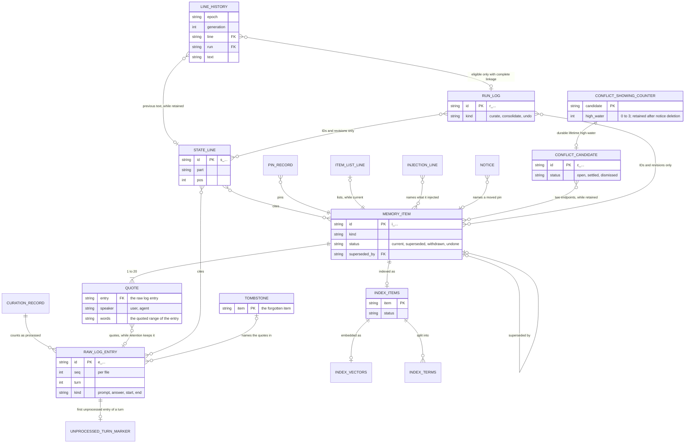

# CORTHEX-MEMORY: memory store

[한국어](memory.ko.md)

Stage 05 of CORTHEX's own project, for the `corthex-memory` plugin. Status: confirmed on 2026-10-27; the retained Git sync design is superseded by D3. The maintainer checks it together with the functional spec before C1 is built; after that check the records are frozen for the release, and a later breaking change needs the maintainer's decision and a new format version. When this file and its Korean translation differ, this file is the source. The 2026-11-03 C2 additions extend TBL-009, TBL-010, TBL-012, TBL-013, retention and locks, and add TBL-119 to TBL-121. The 2026-11-07 additions about compaction add TBL-122 and extend TBL-003, TBL-004, TBL-005 and TBL-013. Format 2 is the C2 target; this specification change migrates no device data.

Inputs: the functional spec in [docs/04-functional-spec/memory.md](../04-functional-spec/memory.md) (SPEC-001 to SPEC-039 and SPEC-143 to SPEC-148), above all its [notes for stage 05](../04-functional-spec/memory.md#stage-05-the-memory-store); the requirements in [docs/02-prd/memory.md](../02-prd/memory.md), of which REQ-008, REQ-009, REQ-012, REQ-044, REQ-045, REQ-054, REQ-056, REQ-063 and REQ-064 shape the memory store most; and the glossary in [docs/01-domain/memory.md](../01-domain/memory.md), whose words this file keeps. The maintainer confirmed D1, D2, D4 and the seven requirement changes on 2026-10-27; D3 chose the HTTPS gateway and server in stage 02. The retained Git sync details have status `superseded (D3, 2026-10-27)` and need a replacement design before C3.

> D3 design status: `superseded (D3, 2026-10-27)`. The Git sync proposal retained here was replaced by the confirmed D3 decision on 2026-10-27. It is historical material, not an implementation or execution plan. The HTTPS gateway and server sync design will be specified separately before C3. Local files and the SQLite search index remain the device store. This notice also covers sync-only parts of shared rows, configuration and examples; their C1/C2 parts remain confirmed.

## How to read this file

- The memory store is a folder of plain files, and one SQLite file per project for the search index. Each record (TBL) is one kind of file, or one kind of line in a file. The search index's tables are in [memory-index.sql](memory-index.sql), and the project hub reads their IDs from there.
- `From` names every behaviour (SPEC) that reads or writes a record, and [Data each behaviour reads and writes](#data-each-behaviour-reads-and-writes) lists the same the other way round. The search index's tables name theirs in their comments.
- Status: `active` for confirmed records; `superseded (D3, 2026-10-27)` for the retained Git sync record and remote marker.
- The field tables give the fields in the order in which they are written. A field marked optional is left out when it has no value; no field is ever written as `null`.
- Names that the glossary does not have, such as the store record or the curation record, are the names of this file's records, defined here.

## The memory store

The memory store is `~/.corthex/corthex-memory/`, or the folder that `CORTHEX_MEMORY_HOME` names (SPEC-039). The memory skill makes it when the user first turns memory on (SPEC-030), and makes a project's folder in it when memory is turned on for that project. Hooks and background processes never make the memory store: where it is missing, they write nothing.

```txt
~/.corthex/corthex-memory/
├─ store.json                         TBL-001 store record
├─ configuration.json                 TBL-002 memory configuration
├─ store.lock
├─ logs/
│  ├─ usage-2026-10.jsonl             TBL-003 usage log, one file per month
│  ├─ failures-2026-10-24.jsonl       TBL-004 failure log, one file per day
│  ├─ hooks-2026-10-24.jsonl          TBL-005 hook timings, one file per day
│  └─ usage.lock, failures.lock, hooks.lock
├─ sync/                              only while sync is on
│  ├─ state.json                      TBL-006 sync record
│  ├─ sync.lock
│  └─ repo/                           the code's Git working copy of the sync remote
└─ projects/
   └─ <project>/                      one folder per project, named after the project list
      ├─ raw/
      │  ├─ <log>.jsonl               TBL-007 raw log, one file per host session
      │  └─ <log>.lock
      ├─ unprocessed/                 TBL-008 one empty file per unprocessed turn
      ├─ curation.json                TBL-009 curation record
      ├─ state-history.jsonl          TBL-119 line history
      ├─ runs/<run>.json               TBL-121 run logs
      ├─ curation.lock
      ├─ notices/<name>.json          TBL-010 notices
      ├─ notices/conflict-counts.json TBL-010 durable conflict showing high-water
      ├─ injections/<log>.jsonl       TBL-011 injection log, one file per host session
      ├─ compaction/<log>.json        TBL-122 compaction check, one file per host session
      ├─ index.db                     TBL-019 to TBL-022 search index
      ├─ layer.lock
      └─ layer/                       the curated layer, which sync shares
         ├─ items/<item>.json         TBL-012 memory items
         ├─ state.json                TBL-013 current state
         ├─ state-removed.json        TBL-013 removed current state lines
         ├─ conflicts.json            TBL-120 candidates; C3 decides sync
         ├─ pins.json                 TBL-014 pins
         ├─ item-list.txt             TBL-015 item list
         ├─ tombstones/<item>.json    TBL-016 tombstones
         └─ deleted.json              TBL-017 project tombstone

the sync remote, a Git repository of the user's
├─ corthex-memory-sync.json           TBL-018 sync remote marker
└─ projects/<project>/                each project's curated layer, as in layer/ above
```

The functional spec's curation record is kept in two parts, so that two sessions of one project can append at once without ever writing the same file: the unprocessed turn markers (TBL-008), which only hooks add, and the curation record (TBL-009), whose progress the curator owns; C2 layer writers also update its mandatory revision fences under the layer lock.

## Records

| ID | Record | Context | File | Identified by | Kept | Synced | From | Status |
| --- | --- | --- | --- | --- | --- | --- | --- | --- |
| TBL-001 | Store record | CTX-005 | `store.json` | one per memory store | until a purge | no | SPEC-001, SPEC-002, SPEC-003, SPEC-005, SPEC-021, SPEC-030, SPEC-033, SPEC-039, SPEC-146, SPEC-147 | active |
| TBL-002 | Memory configuration | CTX-005 | `configuration.json` | one per memory store | until a purge | no | SPEC-001, SPEC-002, SPEC-003, SPEC-005, SPEC-006, SPEC-009, SPEC-010, SPEC-011, SPEC-013, SPEC-014, SPEC-019, SPEC-021, SPEC-022, SPEC-023, SPEC-026, SPEC-027, SPEC-030, SPEC-032, SPEC-033, SPEC-036, SPEC-037, SPEC-146, SPEC-147 | active |
| TBL-003 | Usage log | CTX-005 | `logs/usage-<month>.jsonl` | its file and place | until a purge | no | SPEC-014, SPEC-015, SPEC-016, SPEC-018, SPEC-019, SPEC-023, SPEC-025, SPEC-027, SPEC-032, SPEC-033 | active |
| TBL-004 | Failure log | CTX-005 | `logs/failures-<date>.jsonl` | its file and place | the retention period | no | SPEC-001, SPEC-004, SPEC-007, SPEC-008, SPEC-009, SPEC-013, SPEC-018, SPEC-023, SPEC-027, SPEC-033, SPEC-017, SPEC-144, SPEC-145, SPEC-146, SPEC-147 | active |
| TBL-005 | Hook timings | CTX-005 | `logs/hooks-<date>.jsonl` | its file and place | 8 days | no | SPEC-002, SPEC-003, SPEC-005, SPEC-008, SPEC-009, SPEC-021, SPEC-023, SPEC-033, SPEC-146, SPEC-147 | active |
| TBL-006 | Sync record | CTX-004 | `sync/state.json` | one per memory store | while sync is on | no | SPEC-022, SPEC-026, SPEC-027, SPEC-028, SPEC-033 | superseded (D3, 2026-10-27) |
| TBL-007 | Raw log | CTX-001 | `projects/<project>/raw/<log>.jsonl` | `id`, and also its file and `seq` | the retention period, by each entry's time | never (REQ-044) | SPEC-002, SPEC-003, SPEC-005, SPEC-007, SPEC-009, SPEC-015, SPEC-016, SPEC-020, SPEC-025, SPEC-029, SPEC-035, SPEC-037, SPEC-148 | active |
| TBL-008 | Unprocessed turn markers | CTX-002 | `projects/<project>/unprocessed/<time>.<log>.<turn>` | its name | until its turn is processed or deleted | no | SPEC-002, SPEC-003, SPEC-009, SPEC-010, SPEC-016, SPEC-022, SPEC-033, SPEC-037 | active |
| TBL-009 | Curation record | CTX-002 | `projects/<project>/curation.json` | one per project | as long as the project's memory | no | SPEC-009, SPEC-010, SPEC-012, SPEC-015, SPEC-016, SPEC-017, SPEC-018, SPEC-019, SPEC-022, SPEC-030, SPEC-033, SPEC-037, SPEC-034, SPEC-035, SPEC-143, SPEC-144, SPEC-145 | active |
| TBL-010 | Notices | CTX-003 | `projects/<project>/notices/<name>.json` | its name | until a start summary shows it | no | SPEC-016, SPEC-018, SPEC-019, SPEC-021, SPEC-022, SPEC-028, SPEC-034, SPEC-037, SPEC-143, SPEC-145 | active |
| TBL-011 | Injection log | CTX-003 | `projects/<project>/injections/<log>.jsonl` | its file and place | the retention period | no | SPEC-009, SPEC-021, SPEC-023, SPEC-037 | active |
| TBL-012 | Memory items | CTX-002 | `projects/<project>/layer/items/<item>.json` | `id` | until forgotten, or deleted with the project's memory | yes | SPEC-015, SPEC-016, SPEC-017, SPEC-019, SPEC-020, SPEC-021, SPEC-023, SPEC-024, SPEC-025, SPEC-027, SPEC-028, SPEC-029, SPEC-033, SPEC-034, SPEC-035, SPEC-037, SPEC-143, SPEC-145, SPEC-146, SPEC-148 | active |
| TBL-013 | Current state | CTX-002 | `projects/<project>/layer/state.json` and `state-removed.json` | each line's `id` | a line until it is removed; a removed line's record for good | yes | SPEC-015, SPEC-017, SPEC-019, SPEC-021, SPEC-027, SPEC-028, SPEC-029, SPEC-034, SPEC-035, SPEC-037, SPEC-145, SPEC-146, SPEC-148 | active |
| TBL-014 | Pins | CTX-003 | `projects/<project>/layer/pins.json` | each record's `item` | for good, until the item is forgotten | yes | SPEC-015, SPEC-016, SPEC-019, SPEC-021, SPEC-027, SPEC-028, SPEC-029, SPEC-033, SPEC-034, SPEC-035, SPEC-037, SPEC-145 | active |
| TBL-015 | Item list | CTX-003 | `projects/<project>/layer/item-list.txt` | each line's item ID | made again after every change | yes | SPEC-015, SPEC-016, SPEC-019, SPEC-025, SPEC-027, SPEC-028, SPEC-029, SPEC-034, SPEC-035, SPEC-037, SPEC-145 | active |
| TBL-016 | Tombstones | CTX-004 | `projects/<project>/layer/tombstones/<item>.json` | `item` | for good | yes | SPEC-012, SPEC-027, SPEC-028, SPEC-029, SPEC-035, SPEC-037, SPEC-021, SPEC-145 | active |
| TBL-017 | Project tombstone | CTX-005 | `projects/<project>/layer/deleted.json` | one per project | for good | yes | SPEC-009, SPEC-012, SPEC-015, SPEC-027, SPEC-028, SPEC-037, SPEC-145 | active |
| TBL-018 | Sync remote marker | CTX-004 | `corthex-memory-sync.json` in the sync remote | one per sync remote | as long as the sync remote | it is in the sync remote | SPEC-026, SPEC-027, SPEC-028 | superseded (D3, 2026-10-27) |
| TBL-119 | Line history | CTX-002 | `projects/<project>/state-history.jsonl` | epoch, generation, line | the retention period | no | SPEC-009, SPEC-017, SPEC-019, SPEC-035, SPEC-037, SPEC-145 | active |
| TBL-120 | Conflict candidates | CTX-002 | `projects/<project>/layer/conflicts.json` | id | closed candidates also retained | the C3 design decides | SPEC-015, SPEC-016, SPEC-019, SPEC-033, SPEC-035, SPEC-037, SPEC-143, SPEC-145 | active |
| TBL-121 | Run log | CTX-002 | `projects/<project>/runs/<run>.json` | id | the retention period | no | SPEC-009, SPEC-033, SPEC-037, SPEC-144, SPEC-145 | active |
| TBL-122 | Compaction check | CTX-003 | `projects/<project>/compaction/<log>.json` | one per host session | until the session's next prompt, at most 7 days | no | SPEC-147, SPEC-037 | active |

The search index is the SQLite file `projects/<project>/index.db`. It is never synced (REQ-044) and can always be made again from the memory items (TERM-029).

| Table | Name | What it holds |
| --- | --- | --- |
| TBL-019 | `index_meta` | What the index was built with: the embedding model, the vector length and the version of the word splitting |
| TBL-020 | `index_items` | One row per memory item, with its kind, item status, the speaker and time of its deciding quote, and its number of words |
| TBL-021 | `index_vectors` | The embedding of each item that has one |
| TBL-022 | `index_terms` | How often each word occurs in each item |

## Every file

- Text is UTF-8 without a byte order mark, and lines end in LF.
- A JSON file holds one object, indented by two spaces, with its fields in the order of their table, characters outside ASCII written as they are rather than escaped, and a final LF. The same content therefore always gives the same bytes, and Git sees a change in the sync remote only where there is one.
- A JSON Lines file holds one compact object per line, with its fields in the same order.
- Times are in UTC with milliseconds, as `2026-10-24T13:05:12.345Z`, and dates are UTC dates, as `2026-10-24`, also in file names. Times come from each device's clock. The start summary and the memory skill show them in local time (stage 06).
- IDs are a prefix and 12 random characters of Crockford's base32 in lowercase, 60 random bits: `d_` for a device, `e_` for a raw log entry, `i_` for a memory item, `s_` for a current state line, `c_` for a conflict candidate and `r_` for a run, as `i_7f3k2m9q4x1v`. The code makes them, never the model, and never reuses one. They hold lowercase letters, digits and an underscore, so they never look like trace IDs such as `REQ-001`, and the project hub reads none of them.
- A project's folder has the project's name from the project list. A name that Windows keeps for devices (`con`, `prn`, `aux`, `nul`, `com0` to `com9`, `lpt0` to `lpt9`) gets `_` at its end on every system, so that all devices name the folder alike in the sync remote; project names hold only lowercase letters, digits and hyphens, so no other project's folder ends in `_`.
- Positions in a text count its Unicode code points as stored, from 0, and a range's end is not part of it.
- No file holds a key, a token or a password (SPEC-031).
- On Linux and macOS, folders are made readable by the user alone (mode 0700) and files likewise (0600). On Windows they keep the permissions they take from the folder above them, which for the default place is the user's profile folder.
- Names that end in `.tmp`, `.bak`, `.lock` or `.stale` are the code's working files: readers skip them, and sync never carries them.

## Fields of each record

### Store record (TBL-001)

Every process reads it first. A format that the code does not know, or a migration to one, means that it reads and writes nothing else in the memory store, and the memory status says to update the plugin (SPEC-039). Only a migration changes it, under the store lock.

| Field | Value | Meaning |
| --- | --- | --- |
| `format` | integer, `1` for C1; `2` for C2 | The format version of the memory store (REQ-063) |
| `device` | device ID | This device, as quotes, current state lines, pins and tombstones name it |
| `made` | time | When the memory store was made |
| `release` | text, such as `0.2.0` | The plugin release that made the memory store or last migrated it |
| `migrating` | optional object: `from`, `to`, `started` | A migration that has started and not ended ([Format version and migrations](#format-version-and-migrations)) |

If it is lost and no backup can be restored while other files are there, nothing is read or written; the memory status says so, and the memory skill writes a new store record, with a new device ID, after the user's yes. The code finds a raw log entry by its file and ID, so a new device ID loses nothing.

### Memory configuration (TBL-002)

Written only by the memory skill, under the store lock, and on a temporary device by the user's environment setup before the first session (SPEC-011). Never synced, and never holds a key. The defaults below come from the functional spec, and stage 06 confirmed them; a field left out takes its default. The ranges and patterns of the fields are those of stage 06's [configuration schema](../06-api/memory-configuration.schema.json).

| Field | Value | Meaning |
| --- | --- | --- |
| `consent` | optional object: `at` (time), `version` (integer) | The user's consent and the version of its text (SPEC-030). Without consent at the version the release needs, nothing is recorded or sent. |
| `projects` | object: project name → `enabled` (true or false), `since` (time), optional `left_out` (`folders`: folders relative to the project's folder; `kinds`: any of `prompt`, `answer`, `boundary`) | The projects that memory was turned on for, when it was last turned on, and what is left out of recording (SPEC-006, SPEC-030, SPEC-036) |
| `retention` | object: `days`, integer of 1 or more, default 100 | The retention period (SPEC-009) |
| `triggers` | object: `turns`, default 10; `minutes`, default 30 | The curation triggers at the end of a turn (SPEC-010) |
| `temporary` | optional true or false | Whether the device is a temporary device; left out, the code asks the host (SPEC-011) |
| `models` | object: `curator`, default `claude-haiku-5-5`; `effort`, default `xhigh`; `embedding`, default `text-embedding-3-small`; `dims`, the shortened vector length, default 512 | The models (SPEC-014, SPEC-023) |
| `recall` | object: `threshold`, optional number; `skip`, default 8 | The recall threshold, which has no value until stage 12 sets it, and the shortest prompt, in characters, that recall runs for (SPEC-023) |
| `prices` | object: `taken` (date), `from` (the addresses of the providers' price pages, one each), `models` (model → `input`, `output` and optional `cache_write`, `cache_read`, in US dollars per million tokens, and optional `above` with `tokens`, `input` and `output` for prices that change with the prompt's length) | The price list (SPEC-032) |
| `sync` | optional object: `address`, `branch`, default `main` | The sync remote; sync is on while this is there (SPEC-026) |

If it is lost and no backup can be restored, memory is off on the device: there is no consent and no enabled project, so nothing is recorded or sent until the user turns memory on again, and the memory status says so.

### Usage log (TBL-003)

One line per request to a model API, also each retry, and per token count (SPEC-032), appended by the process that made the call. One file per UTC month; the memory status reads this month's file. Kept until a purge, also when a project's memory is deleted (SPEC-037). No conversation text, no prompt, no answer and no key. It is the record of each AI call that stage 05 asks for.

| Field | Value | Meaning |
| --- | --- | --- |
| `at` | time | When the request was sent |
| `project` | project name | The project the call was for |
| `call` | `curate`, `consolidate`, `embed-prompt`, `embed-items`, `embed-search` or `count-tokens` | The kind of call |
| `model` | text | The model named in the request |
| `instructions` | optional text, such as `curate-1` | The version of the plugin's fixed instructions in a curator request |
| `input` | optional integer | The input tokens the provider reported; for `count-tokens`, the count it returned |
| `output` | optional integer | The output tokens the provider reported |
| `cache_write` | optional integer | Input tokens written to the provider's prompt cache, where stage 06 uses it |
| `cache_read` | optional integer | Input tokens read from the provider's prompt cache |
| `first_ms` | optional integer | Milliseconds from sending to the first streamed token |
| `total_ms` | integer | Milliseconds from sending to the end of the answer, or to the failure |
| `result` | `ok`, `failed`, `refused` or `limit` | `refused`: the model ended with a refusal; `limit`: it stopped at the output limit (SPEC-014) |
| `error` | optional text | The kind of error, such as `rate_limit_error`, `overloaded_error`, `timeout` or `network`; never the error's text |
| `request` | optional text | The provider's request ID, from its response headers |
| `cost` | number | The estimated cost in US dollars from the price list; 0 for a token count |
| `prices` | date | The `taken` date of the price list used |
| `turns` | optional integer | For a curate request: the unprocessed turns it carries; one part of a turn carries that turn |
| `parts` | optional integer | For one part of a turn too large alone: how many parts the turn goes in |
| `list` | optional `full`, `short` or `part` | For a curate request: the form of its item list (API-006) |
| `estimate` | optional integer | For a curate request: the working estimate of its input tokens (API-009) |

The memory status sums the tokens of the calls that the provider charges for, so a token count is not counted twice.

A curate line's `turns`, `parts`, `list` and `estimate` describe its request's size without any of its text, so that the C2 evaluation can say why a request was large (TASK-050). The curation worker writes them on every attempt's line of a curate request (TASK-116), after `prices` in name order; lines written before have none, and a consolidation line never has them. `estimate` is API-009's working estimate of the request document before redaction, with the instructions and the schema, so the input tokens can pass it where the provider reads the text more densely than the estimate does.

The TASK-078 component snapshots only the two dedicated memory-key variables through one authentication boundary. Presence reports contain no values; invalid header values fail with a fixed error. The original per-attempt snapshot also excludes its secrets from usage metadata. The general environment-value redactor remains broader and unchanged. Provider messages, bodies, exception text and unknown type/code strings never enter the classification result. Unknown types normalize to the existing safe HTTP-class code; classification owns no retry or sleep.

Usage construction freezes the configured price list and request-send UTC time for each actual attempt, and extracts only the provider token counters, never response/thinking text. Output tokens already include any billed reasoning; no reasoning field is added. Anthropic input, cache-write and cache-read remain separate in the line and all count toward the strict above.tokens price threshold and status input total. Token counts cost zero and are excluded from paid-call totals. Unknown models cost zero and retain the price-list date for unpriced reporting. A bound, guarded usage-lock append writes the send month without provisioning directories; logging failure preserves the call result and reports only safe local error metadata. Actual transport/retry integration remains TASK-079/080.

### Failure log (TBL-004)

One line per failure of recording, recall, curation, consolidation, sync, retention or the memory skill (SPEC-008), and per backup restored. One file per UTC day, deleted once the whole day is past the retention period. No conversation text, no key, no file path and no error text.

| Field | Value | Meaning |
| --- | --- | --- |
| `at` | time | When it happened |
| `step` | `record`, `recall`, `summary`, `trigger`, `curate`, `consolidate`, `embed`, `sync`, `retention`, `index`, `restore`, `skill` or `compaction` | What failed |
| `hook` | optional: `prompt`, `end-of-turn`, `start`, `end`, `pre-compact` or `post-compact` | The hook it happened in |
| `host` | optional: `claude-code` or `codex` | The host |
| `project` | optional project name | The project, when one was found |
| `error` | text | The kind of error: the exception's class name, such as `PermissionError`; the provider's error type; or one of the code's own, such as `lock-busy`, `deadline`, `damaged-line`, `future-entry`, `restored` or `no-project-list` |
| `log` | optional raw log file name | The raw log file, for an error about one file |
| `count` | optional integer | How many, when one line stands for several, such as the damaged lines of one file |

A background reader that skips damaged lines of a raw log file (SPEC-007) or finds entries in the future (SPEC-009) writes one line for the file, with `count`. A hook that cannot take the failure log's lock before its deadline, or in the single attempt after it, writes nothing.

### Hook timings (TBL-005)

One line per run of a hook that found an enabled project, appended at the end of the hook (SPEC-008, SPEC-033). A hook that finds no enabled project writes nothing at all (SPEC-001), so its time is measured only from outside, in QA. One file per UTC day; files older than 8 days are deleted, so that the memory status always has 7 whole days.

| Field | Value | Meaning |
| --- | --- | --- |
| `at` | time | When the hook started |
| `hook` | `prompt`, `end-of-turn`, `start`, `end`, `pre-compact` or `post-compact` | `pre-compact`: the compaction brief hook; `post-compact`: the compaction check hook (SPEC-146, SPEC-147) |
| `host` | `claude-code` or `codex` | |
| `ms` | integer | Milliseconds from the hook's start to its end, measured inside the hook |
| `outcome` | `ok`, `left-out`, `no-answer`, `lock-busy`, `deadline` or `error` | `left-out`: the folder or the kind was left out; `no-answer`: an end of turn without a final answer, which the memory status counts (SPEC-003); `deadline`: the hook passed its deadline and skipped its other steps (SPEC-008) |

### Sync record (TBL-006)

Written only by the sync, under the sync lock. Turning sync off deletes the `sync` folder. Beside the record, `sync/repo/` is the code's Git working copy of the sync remote. It holds the curated layer of every project in the sync remote, also of projects this device does not have, which every push carries over unchanged. Sync merges each project that has a folder in the memory store and, for an enabled project without a curated layer yet, copies the sync remote's. After each push the code drops every commit and object of the working copy that the branch no longer reaches, so that the text of a forgotten item does not stay on the device.

| Field | Value | Meaning |
| --- | --- | --- |
| `base` | optional commit ID | The commit that the last pull found; a push replaces the branch only while the branch is still there (SPEC-028) |
| `last_ok` | optional time | When the last sync ended that pulled, merged and pushed or had nothing to push |
| `last_try` | optional time | When the last sync started |
| `checked` | optional time | The last privacy check (SPEC-026) |
| `checked_by` | optional: `github`, `gitlab`, `bitbucket` or `user` | How privacy was checked; `user` when the user confirmed it |
| `stopped` | optional object: `at`, `reason` (`public` or `other-files`) | Sync stopped until the user turns it on again (SPEC-026) |
| `failed` | optional object: `at`, `error` (such as `unreachable`, `moved` or `newer-format`) | The last sync point that did not end, with the reason (SPEC-027, SPEC-028) |
| `clashes` | list of objects: `project`, `item` | Items with one ID and different texts on the two sides (SPEC-028) |

If it is lost, the next sync pulls without a base and checks privacy again before it pushes.

### Raw log (TBL-007)

One file per host session, named `<host>-<key>`: the host, `claude-code` or `codex`, and the first 16 hexadecimal characters of the SHA-256 of the host's session ID, as `claude-code-3f9a0c41d2e87b65`. One line per entry, appended by the session's hooks under the file's lock (SPEC-007). Only retention, a forget and a tombstone rewrite it. Entries are deleted by their own time once past the retention period, and a file left without entries is deleted (SPEC-009). Never synced (REQ-044).

| Field | Value | Meaning |
| --- | --- | --- |
| `id` | entry ID | |
| `seq` | integer | 1 for the file's first entry, then one more for each; a rewrite keeps every entry's `seq` |
| `turn` | optional integer | For a prompt or a final answer, the `seq` of its turn's first entry |
| `at` | time | When the hook wrote the entry |
| `host` | `claude-code` or `codex` | |
| `session` | text | The host's session ID |
| `kind` | `prompt`, `answer`, `start` or `end` | `start` and `end` are session boundaries (SPEC-005) |
| `speaker` | optional: `user` or `agent` | `user` for a prompt, `agent` for a final answer |
| `text` | optional text | The prompt or the final answer, once redacted (SPEC-004), at most 512 KB of UTF-8 (SPEC-002), each U+FFFD inside a `forgotten` range counting as one byte |
| `cut` | optional integer | The text's size in bytes before it was cut (SPEC-002) |
| `event` | optional: `start`, `resume`, `clear`, `compact` or `fork` | For a start boundary, the event as the host reports it |
| `reason` | optional text | For an end boundary, the host's reason, at most 64 characters |
| `forgotten` | optional list of `[start, end]` pairs | The ranges of `text` that a forget or a tombstone replaced (SPEC-035) |

Turns: a prompt starts a turn, and its `turn` is its own `seq`. A final answer joins the turn of the last prompt or final answer before it in the file when that entry is the turn's prompt, or when it is a final answer and the host reports that the agent went on after another hook (SPEC-003); any other final answer starts a turn of its own, as when prompts are left out. Boundaries belong to no turn.

Retention goes by each entry's own time, so it can delete a file's last entries while it keeps an earlier entry whose time is in the future (SPEC-009). The next append would then take again a `seq` that a deleted entry had, and the curation record may count that `seq` as processed. So before such a rewrite, retention lowers the file's count in the curation record to the highest `seq` that it keeps (TBL-009), and the next entry counts as unprocessed; a stop between the two only has those entries curated again.

Forgetting: a forget, or a tombstone applied on this device, replaces each character of a quoted range with U+FFFD, so that the text keeps its length and the positions of the entry's other quotes stay valid, and adds the range to `forgotten`. A quoted range that overlaps a quote of an item that stays on this device is kept whole, so that item's provenance holds (SPEC-035). Once a later forget or tombstone leaves no such item, it replaces that range too, which it finds in the earlier item's tombstone. Requests to the curator show each forgotten range as `[forgotten]`, so no quote can hold it. A forget rewrites the file as every raw log rewrite does (SPEC-007), under the curated layer lock that it holds for all of its effects, and never takes the curation lock. It changes only the lines of the entries that it fills: every other line stays byte for byte, a damaged or unfinished one too, no entry goes and every `seq` stays, so the curation record does not change. Holding the file's lock, it also deletes the file's backup and temporary files that a stopped rewrite left, because they can hold the forgotten text. When the file itself is missing and its backup holds the entries, the forget's preview reads them there and restores nothing, and the fill restores the backup under the file's lock, as the next append would, before it fills it. A U+FFFD takes three bytes of UTF-8 where the character that it replaced may take one, so each U+FFFD inside a `forgotten` range counts as one byte toward the 512 KB of `text`: a filled entry stays within the limit that its recording kept.

### Unprocessed turn markers (TBL-008)

One empty file per unprocessed turn, named `<time>.<log>.<turn>`: the time of the turn's oldest unprocessed entry, as `20261024T130512Z`; its raw log file; and the turn's `seq`, as `20261024T130512Z.claude-code-3f9a0c41d2e87b65.42`. The hook that appends an entry makes its turn's marker, under the raw log file's lock, unless one is there. The curation triggers count the markers and read the oldest time from the names, so that no hook reads a raw log or rewrites a file to check them (SPEC-010).

| Field | Value | Meaning |
| --- | --- | --- |
| `time` | UTC time to the second | When the turn's oldest unprocessed entry was written |
| `log` | raw log file name | |
| `turn` | integer | The turn's `seq` |

After applying, the curator, under each raw log file's lock, replaces that file's markers with one for each turn that still has unprocessed entries, such as a final answer appended while it ran. Retention deletes the markers of the turns it deletes. A marker lost outside the plugin only makes its turn's trigger late: the next curation of the project still curates the turn, since the curation record decides what is processed.

### Curation record (TBL-009)

The memory skill makes it, empty, before it first enables the project, so a missing one is lost, not new. In C1, written only by the holder of the project's curation lock: the curator; retention, which removes the raw log files it deletes and lowers the count of a file whose last entries it deletes (TBL-007); and the memory skill when the user resumes curation (SPEC-033). The curator writes it under the curated layer lock as well, after the changes that it counts, so that a stop between the two curates those turns again instead of losing them; consolidation then merges what was curated twice.

| Field | Value | Meaning |
| --- | --- | --- |
| `logs` | object: raw log file name → integer | How far each raw log file is processed: its entries up to that `seq` |
| `applies` | integer | One more for each request whose results were applied; checked before each apply ([Locks](#locks)) |
| `recent` | list of up to 10 attempts; kind `curate`, `consolidate` or `undo`; optional `run`, `reasons` and `edit_reasons` | Recent attempts with an optional run ID and a curate or consolidate attempt's drops by reason; undo, run, reasons and edit_reasons are C2-format fields. |
| `failures` | optional object: `count`, `log`, `turn` | Failed attempts in a row from the same first unprocessed turn (SPEC-018) |
| `consolidation` | object: `last` (optional time), `due` (optional time), `failures` (integer) | The last consolidation that ended, the time SPEC-015 made the next one due, and failed consolidations in a row (SPEC-019) |
| `stopped` | optional object: `at`, `by` (`curate` or `consolidate`), `errors` (the kinds of error) | The fault guard's stop, until the user resumes (SPEC-018) |
| `rebuilt` | optional time | When the record was last made again from the raw log |
| `fence` | C2 required object: `epoch`, `generation`, `revisions` | Code-owned 32-hex epoch, monotonic integer and last generation per namespaced object: item:<id>, line:<id>, pin:<id>, candidate:<id>, run:<id>; no text. |
| `conflict_after` | optional candidate ID | Last candidate ID for rotating complete candidate bundles across batches; resume after its ordered place when it is no longer open. |

In C1 the required fields are `logs`, `applies`, `recent` and `consolidation`; the empty record has `{}` logs, zero applies, no recent attempts and zero consolidation failures. Counts are nonnegative integers, excluding booleans; a failed turn's `turn` is positive. The keys of `logs` and `failures.log` use the raw log stem, `<host>-<16 hex characters>`, as the turn markers do, without `.jsonl`. Each recent attempt requires `at`, `kind` and `result`; `error`, `applied`, `dropped` and `state` are present when applicable. Error fields use stage 06's model error codes or built-in exception class names. Unknown or invalid fields are not silently removed: a valid backup may restore an invalid primary under the record's write leases, and without a readable copy the writer stops. A guarded C1 rewrite preserves all other valid fields and refuses an unrecoverable record; only the C2 curator reconstructs lost progress.

In C2 a curate attempt that dropped something also keeps the drops by reason. `applied` and `dropped` count the answers' item changes, and `reasons` maps each reason for which an item change was dropped (`shape`, `limit`, `not-in-request`, `not-current`, `quote` or `pasted`) to a positive count, the counts adding up to `dropped`; `edit_reasons` maps the reasons for dropped line edits (`not-in-request`, `duplicate`, `shape`, `limit`, `cites` or `decision`) the same way. Each dropped change or edit counts once, under the first check it fails (stage 06). A consolidate attempt keeps its drops the same way (TASK-089, TASK-090): `applied` and `dropped` count the merges, `reasons` maps each reason for which a merge was dropped (`shape`, `limit`, `not-in-request`, `not-current`, `quote` or `speaker`), and `edit_reasons` the reasons for the lines of the last answer that were dropped (`not-in-request`, `duplicate`, `shape`, `cites` or `decision`); its `state` says what the last answer did to the current state: `new`, `kept` or `cut`. An undo attempt holds neither field.

Before the curator counts entries as processed, or applies a quote of them, it flushes their raw log file to disk, so that no entry that the curation record counts can be lost to a power cut. If the record is lost, the curator makes it again: for each raw log file, the newest entry that an item quotes or a current state line cites counts as processed, with the entries before it, and every entry after it as unprocessed, even in its own turn, since a final answer appended while the last curation ran may never have been sent. Turns curated twice make duplicate items, which consolidation merges. A notice says so once, and a stop of the fault guard is lost with the record.
In C2 every writer of this record holds the layer lock and merges a fresh read. Progress/attempt fields additionally require the curation lock. A command such as forget may update only fence fields under the layer lock while a curator waits for an API answer holding the curation lock, preserving SPEC-012's concurrent-forget case. Preserve other fields and never acquire an earlier lock from a later one. Before actual changes, durably advance generation and revisions for all affected object and run keys; failure blocks the mutation. A failed effect may reserve revisions conservatively, never roll them back. Logs bind each object's before/after revisions and epoch: equal-content ABA and unlogged later mutations still differ and are kept. Missing revisions of existing objects are unknown, never assumed zero. Losing/restoring this record rotates epoch and invalidates prior undo proofs. Retain removed/forgotten object revision IDs while retained earlier runs can refer to them. Requests check both applies and the fence snapshot. These are format-2 contracts, not changes to C1 format-1 readers/writers.


### Notices (TBL-010)

One file per notice that the start summary shows once (SPEC-022): `curation-failed`, `consolidation-failed`, `rebuilt` or `pin-<item>`. The curator, the sync and the memory skill write them, each under the curated layer lock; a later notice of the same name replaces the earlier one; the start hook deletes each notice it shows under that lock, and only while it holds the bytes shown, so that a notice written again since stays for the next start (API-001 step 7). Lasting conditions, such as a stop of the fault guard, a missing memory key or unprocessed turns that retention will soon delete, are not stored: the start hook works them out at every session start.

| Field | Value | Meaning |
| --- | --- | --- |
| `at` | time | |
| `kind` | `curation-failed`, `consolidation-failed`, `rebuilt`, `pin-moved`, `pin-dropped`, `pin-restored`, `pin-removed`, `conflict` |
| `error` | optional text | The kind of error, for a failure |
| `item` | optional item ID | The item whose pin moved, was dropped or was removed by an undo, or that an undo gave its pin back (SPEC-034) |
| `to` | optional item ID | The item that the pin moved to |
| `run` | optional run ID | The undo run that gave the pin back or removed it (SPEC-034, SPEC-145) |
| `candidate`, `shown` | optional candidate ID and count 0 to 3 | Conflict notice target and count; conflict-counts.json owns the durable high-water. |

C2 conflict-counts.json stores a device-local 0-to-3 high-water per candidate ID. Its bytes are `{"counts": {"<candidate>": <count>}}` with the IDs in order, and it has no backup: a missing, damaged or unreadable file, or a candidate that it does not name, counts as shown three times. Durably initialize zero before first publishing a candidate; after the third showing remove its individual notice but retain the high-water for the ID's lifetime. Reopening, cleanup or backup recovery never resets zero. Missing/unverifiable counters conservatively exhaust existing candidates, reporting the failure/status while conflicts still lists them. After deciding a line fits, Start takes the independent conflict-counts lease, rereads, and shows it only after an atomic durable reservation. Lease/deadline/write failure omits the line; before the move of the new file it does not increment, and after the move, while the folder is synced, it consumes that showing, as a stop after reservation but before output may. Concurrent starts together cannot exceed three. Unlike ordinary notices, this high-water cannot lose fsync or be reduced by restoring an old backup. The start hook never writes the curated layer.


### Injection log (TBL-011)

One file per host session, named as its raw log file, also in a left-out folder, where no raw log is written (SPEC-006). One line per start summary (SPEC-021) and per prompt of the session (SPEC-023), also when recall skips the prompt, as a short one or a command, or injects nothing, so that recall can tell which items the session's last three prompts injected. Appended by the session's hooks under the lock of the session's raw log file; each line gets one attempt at the lock and recording's wait, and a lock that stays busy skips the line, as it skips a recorded entry. Lines are deleted by their own time once past the retention period. No text of items or prompts.

| Field | Value | Meaning |
| --- | --- | --- |
| `at` | time | |
| `session` | text | The host's session ID |
| `where` | `start` or `prompt` | |
| `prompt` | optional entry ID | The prompt's raw log entry, when the prompt was recorded |
| `items` | list of item IDs | At a start, the pinned items shown; for a prompt, the items injected, best first, or none |
| `scores` | optional list of numbers | For a prompt, recall's score of each item, in the same order |

### Memory items (TBL-012)

One file per item, named by its ID. The curator saves it when it applies a change (SPEC-016) or a merge (SPEC-019), and a sync when it brings it from another device (SPEC-028). An item's kind, title, text and quotes never change once it is saved; a change of item status rewrites the file. A forget, a tombstone or the deletion of the project's memory removes the file. Synced.

| Field | Value | Meaning |
| --- | --- | --- |
| `id` | item ID | |
| `kind` | `decision`, `preference`, `lesson`, `reference` or `fact` | The item kind |
| `title` | text | One line, at most 200 bytes, for the item list |
| `text` | text | At most 4,000 bytes |
| `quotes` | list of 1 to 20 quotes | The first is the deciding quote |
| `status` | `current`, `superseded`, `withdrawn`, `undone` | The item status |
| `superseded_by` | optional item ID | For a superseded item, the item that superseded it |
| `undone_by` | optional run ID | The undo run; inverses restore superseded_by/undone_by values and presence as well as the status. |
| `merges` | optional list of item IDs | For an item made by a consolidation, the items it merged |
| `saved` | time | When the item was first saved, on any device |
| `device` | device ID | The device that saved it |
| `changed` | optional time | When its item status last changed |

Each quote is an object:

| Field | Value | Meaning |
| --- | --- | --- |
| `entry` | entry ID | The raw log entry quoted |
| `log` | raw log file name | The file that held the entry |
| `device` | device ID | The device whose raw log held the entry |
| `start`, `end` | integers | The quote's range in the entry's text |
| `speaker` | `user` or `agent` | The entry's speaker, never the model's word (SPEC-016) |
| `said` | time | The entry's time |
| `words` | text | The entry's text from `start` to `end`, at most 2,000 bytes |

Worked out, not stored: whether the item is a user decision, which it is when it is a decision whose deciding quote is the user's, and the time it took effect, its deciding quote's `said`. Merging two copies of an item (SPEC-028): `withdrawn` beats `superseded`, which beats `current`; of two superseded copies, the later `changed` wins, and on the same time the smaller `superseded_by`. Two copies whose kind, title, text or quotes differ are a clash: the local copy stays, and the sync record lists it.

C2 `undone` is a local undo status. The C3 design decides its cross-device merge order; the retained Git rules above do not define it.

### Current state (TBL-013)

`state.json` holds the current state's lines; `state-removed.json` keeps a record of each line removed, without its text, so that a sync never brings the line back (SPEC-028). The curator (SPEC-017, SPEC-019), a forget (SPEC-035), a tombstone (SPEC-029) and a verified local undo (SPEC-145) write them. The C3 design decides sync details. A line keeps its ID through the edits and verified local undo rules below. C2 Start receives one consistent read-only validity snapshot of state.json, removed markers, current item metadata and privacy facts; TASK-034/091 connect its actual reads, leases and deadline. Start never writes curated-layer data. Synced.

A line keeps its ID while it stays or is changed: curate-2 names only changed/added/removed lines (SPEC-017), while the last state-1 names kept/reworded lines (SPEC-019). Code assigns new IDs and keeps prior changed/removed text in TBL-119. Unnamed lines keep their text, citations and time.

An insertion or deletion may renumber integer pos values while preserving existing relative order. Before changing a position, durably record the earlier part/pos in TBL-119 as changed with why=position, advance the mandatory line revision and include that actual effect in the run. A position-only change preserves text, citations and at. Required history failure defers the whole state write. Each run also keeps before/after part and predecessor/successor line IDs: additions, restorations and placement changes form order-dependency groups with these anchors. Undo conservatively keeps such a group when later insertion, movement or renumbering depends on it, so it cannot overwrite later order.

`state.json` is an object with `lines`, a list of:

| Field | Value | Meaning |
| --- | --- | --- |
| `id` | state line ID | |
| `part` | `goal`, `decisions`, `progress`, `blockers` or `next` | The goal, decisions in force, work in progress, blockers or next actions |
| `pos` | integer | The line's place in its part; lines are shown by part, then `pos`, then `id` |
| `text` | text | One line |
| `cites` | list of item and entry IDs, at least one | The line's provenance (SPEC-017) |
| `at` | time | When the line was written or last changed |
| `device` | device ID | The device that wrote it |

`state-removed.json` is an object with `removed`, a list of the following records, written in this field order. New C2 writers set kind and keep one marker per ID. New removals clear earlier restoration fields; a verified restoration writes both restored_by and restored_at for that removal.

| Field | Value | Meaning |
| --- | --- | --- |
| `id` | state line ID | The removed line |
| `at` | time | When this removal occurred |
| `device` | device ID | The device recording the removal |
| `kind` | optional `privacy` or `edit` | An omitted legacy kind is unknown, never assumed ordinary |
| `restored_by` | optional run ID | The verified local restoration of this removal |
| `restored_at` | optional time | That restoration's time |

The text of the lines stays under 3,000 bytes in all after a curation (SPEC-017). A merge can leave more; the next curation brings the state back under the limit, and the start summary shortens it meanwhile (SPEC-021).

From 2026-11-07 a blocker whose text starts with `Dead end:` keeps an approach that failed, and a next action whose text starts with `Done when:` keeps the condition for finishing the work (REQ-228). They are ordinary lines of their parts, so the record and its format do not change; the start summary shows them under their own labels (SPEC-021).
C2 removal markers distinguish privacy removals (kind privacy) from ordinary edits (kind edit). Retain ordinary removed IDs too, but a verified local undo may mark an intentional same-ID restoration with restored_by/restored_at. Forget/tombstone privacy markers prohibit that restoration and do not archive the removed content. Every state reader (start, request, consolidation and undo) uses the same validity view: a line without required current decision provenance is absent from that view even if physical cleanup failed; later writes retry pending stale cleanup. The C3 design decides sync restoration/conflict precedence.

Readers preserve legacy omitted kinds and individually present restoration fields. Privacy always blocks restoration. A single edit marker with both typed restoration fields represents an already verified restoration, independent of later run-log expiry; timestamps alone never grant that authority. Missing kinds or duplicate markers are non-authoritative unknown removals: hide/report the line, never downgrade it to ordinary stale or archive/restore its source text. New writes do not choose an arbitrary duplicate. The pure view receives current items and explicit privacy-citation facts from its complete read-only owner snapshot; an expired raw entry alone does not invalidate an ordinary line.


A marker-first publication can leave a physical row already hidden by a unique ordinary edit marker. The ordinary publisher must keep refusing re-archive or same-ID addition; a closed receipt never resumes authority. Later TASK-074/087 reconciliation must use fresh original ownership and a supported maintenance context, verify the exact marker/residual row, retain the marker and reserve a fresh line fence, then erase only the already-nonauthoritative physical residue without archiving its text or completing the interrupted run. Unknown, duplicate or privacy markers defer to their maintenance/forget owner; this is not a restoration or a general allow-removed bypass.

### Pins (TBL-014)

An object with `pins`, one record per item ever pinned in the project, kept after an unpin so that a sync can tell which change is newer (SPEC-028). The memory skill writes them (SPEC-034), and the curator and the sync when a pin moves or is dropped. A forget removes the item's record, and its tombstone keeps the item from coming back. Synced.

| Field | Value | Meaning |
| --- | --- | --- |
| `item` | item ID | |
| `on` | true or false | Pinned, or unpinned |
| `at` | time | When it was pinned or unpinned |
| `device` | device ID | |

The start summary shows the pinned items in the order they were pinned. When a pinned item is superseded, its record turns `on: false` and the item that superseded it gets `on: true`, at the same time; a withdrawn item's record turns `on: false` (SPEC-034).

### Item list (TBL-015)

One line per current item: its ID, kind, the deciding quote's speaker, the deciding quote's date and the title, separated by tabs, as `i_7f3k2m9q4x1v⇥decision⇥user⇥2026-10-24⇥Keep raw logs on the device`, where ⇥ stands for a tab. Newest first, then by ID. The code makes it again after every change of the items, and a sync makes it again after merging, never merging it. Synced, since the curated layer holds it (TERM-032).

| Field | Value | Meaning |
| --- | --- | --- |
| ID | item ID | |
| kind | item kind | |
| speaker | `user` or `agent` | Of the deciding quote |
| date | UTC date | When the deciding quote was said |
| title | text | The item's title, with tabs turned into spaces |

### Tombstones (TBL-016)

One file per forgotten item, named by the item's ID, made by a forget (SPEC-035) or brought by a sync, and kept for good (SPEC-029). Its name alone keeps the item from being added again, also when the file cannot be read. Synced.

C2 forget reserves mandatory revisions, then durably publishes and verifies the complete existing TBL-016 for every selected item, including all quote entry facts, before any destructive item/raw/state/history effect. Tombstones never expire. Healthy forget scrub remains layer-only: never acquire or wait for curation while holding layer. Uncertain history repair is explicitly deferred or refused until its actual maintenance owner establishes the required context.

A confirmed forget (TASK-098) works in this order under the layer lock and reads each effect back before the next: the fence generations of every item, pin record, state line and conflict candidate that it changes; the tombstones; each item's file with its backup and temporary copies; its search index rows, deleted under secure delete with the write-ahead log checkpointed and truncated, or, when the index cannot be opened or a reader keeps the log for more than a second, the index's files, which the memory worker builds again from the items (TERM-029, TASK-082); its pin record, the open conflict candidates that name it, settled, and the item list, without the copies of it that stopped writes left; the state lines, each with its privacy marker, and the state's backup and temporary copies that stopped writes left, also when no current line cites the item, because they can hold such a line; the raw fill; and the line history (TBL-119). A forget that stops is not resumed, and a second forget of its item answers `item-not-found`: its tombstones keep every reader from showing what it had still to remove, and a later forget removes the state lines and history records that cite an earlier tombstone's ID and fills that tombstone's ranges in the entries that it fills, while the item's file, its index rows and the raw text of other entries stay on the device.

| Field | Value | Meaning |
| --- | --- | --- |
| `item` | item ID | |
| `project` | project name | |
| `at` | time | When the item was forgotten |
| `device` | device ID | Where it was forgotten |
| `quotes` | list of objects: `device`, `entry`, `log`, `start`, `end` | The place of each of the item's quotes; never their words, nor a hash of them |

### Project tombstone (TBL-017)

Made when the user deletes a project's memory with sync on (SPEC-037). On this device the deletion leaves in the project's folder only `layer/deleted.json` and the tombstones. A device that applies it deletes in the merge the project's items saved before `at`, with their pins and search index rows, and its current state lines written before `at` (SPEC-028). Then the sync starts the project's retention, which deletes the raw log entries and injection log lines written before `at` under the curation lock, as it deletes those past the retention period (SPEC-009); until they are gone, the curator leaves those entries out of its requests (SPEC-015). What is saved after `at` stays. It does not change that device's memory configuration. Kept for good; a later deletion moves `at` on, and a merge keeps the later `at`. Synced.

| Field | Value | Meaning |
| --- | --- | --- |
| `project` | project name | |
| `at` | time | When the project's memory was deleted |
| `device` | device ID | Where it was deleted |

### Sync remote marker (TBL-018)

The file that marks a Git repository as a sync remote of the memory plugin (SPEC-026). The first push writes it. A sync that finds a newer `format` merges and pushes nothing, and the memory status says to update the plugin (SPEC-028). Besides this file, the sync remote holds only `projects/<project>/`, each project's curated layer laid out as in the memory store, in one commit with no parent (SPEC-028).

| Field | Value | Meaning |
| --- | --- | --- |
| `format` | integer, `1` | The format version of the sync remote |
| `made` | time | When the sync remote was first pushed |
| `device` | device ID | The device that first pushed it |

### Line history (TBL-119)

One record per line of `projects/<project>/state-history.jsonl`, outside the layer. It never leaves the device, expires by each record's own time, and is removed wherever a forget applies.

| Field | Value | Meaning |
| --- | --- | --- |
| `at` | time | When the line was changed or removed |
| `run` | run ID | The run that planned this record |
| `epoch`, `generation` | 32 hex characters; integer | The mandatory fence epoch and apply generation; successful run linkage decides whether undo may use it |
| `line` | state line ID | The line before the change |
| `part`, `pos` | as in TBL-013 | Its earlier part and position |
| `op` | `changed`, `removed`, `cut`, `stale`, `recited`, `undone` | What happened to the line |
| `text` | text | The text before this apply |
| `cites` | list of item and entry IDs | Its previous provenance |
| `why` | text, at most 200 UTF-8 bytes | The answer's reason or code-owned cut/stale/recited/undone/consolidation reason |
| `device` | device ID | The device recording the change |

Under the layer lock, append and durably flush every required prior version before rewriting state. Roll back a short append to its known prior size; if complete lines, final LF or durability cannot be verified, keep this request's whole state unchanged and log the failure. Later writes, recovery and undo require strict completeness checks too. Undo uses a record only when epoch, apply generation, line and its exact-record hash link to an actual mutation in a complete run log. Unused staged history is not a restoration source. Generations separate multiple applies of one run: restore an existing line's version before its first actual change, and remove a line first added by the run. Forget does not archive the content it removes, and undo cannot cross a privacy-removal marker.

A forget removes records citing the item or its quoted entries and clears why in every remaining project history record: prior cites cannot establish the provenance of a reason drawn from newer input. Under the layer lock, scrub the primary, unused staged history and every backup/temporary copy the plugin can restore; verify durability and cleanup before reporting success. Automatic history recovery always restores reasons as empty strings, preventing an older copy from reviving them. The prior text/citations of A may remain, but a reason containing B does not. Scrubbing can invalidate an older run's exact-record hash link; undo keeps that line as history-unavailable and explains the limitation. history_records counts each removed record or record with a nonempty reason cleared once, excluding otherwise unchanged already-empty records.

History repair is a conditional internal primitive. The actual TASK-074/lifecycle owner establishes supported complete initialization/writer lineage and an original non-deletion context; a lock, valid-empty files or absent deleted.json cannot prove it, especially after interrupted sync-off deletion. The helper supplies strict canonical tombstone/removed facts, never a caller filter or privacy-complete boolean. Missing/unknown/duplicate/unreadable facts or fact backups/temps postpone repair. Empty tombstone quote facts are ineligible for recovery proof because supported C2 items have quotes; this does not change the ordinary TBL-016 format. Retention loss of raw alone is not privacy evidence. Control reads are primary-only and never repair metadata before the precondition.

A healthy primary wins unchanged, without claiming global privacy scrub. Repair selects only the named strict complete backup, never unused staging; it drops forbidden item/entry citations, clears all remaining reasons and can preserve safe earlier text/citations while privacy markers continue blocking state/undo restoration. Verify durable staged bytes, original source and privacy snapshot before each publication, read primary last and retain only ownership/identity checks through the final handoff. Each backup-cleanup attempt rechecks the exact published primary, original backup and privacy fingerprint. Report known publication, uncertainty and pending cleanup; never roll back or claim whole deletion success. Keep the sole good backup until new primary publication and verification. Sidecopies-before-primary deletion ordering helps lifecycle safety but cannot replace the non-deletion maintenance proof.

Exact-record links use SHA-256 of the original complete UTF-8 JSONL record bytes including the final LF, never a reserialized value or the whole history file. Strict history validation rejects the entire incomplete/damaged/blank-record stream before exposing records. Retention preserves the original bytes of retained records. History cites has no separate minimum; empty cites and empty or multiline why remain valid within its UTF-8 limit. Parsed staged history alone grants no undo authority. Integer-valued pos has no declared minimum; history generation follows the exact nonnegative format-2 counter type. Publish no state or removal-marker changes until all required histories are complete and durable; marker-first then state publication may leave an explicitly reported prefix, never a multi-file atomicity promise.

Healthy-primary-only history retention owns its fixed cutoff and preserves each retained raw record byte-for-byte, including whitespace/CRLF and its exact hash. It never promotes a backup or staging, clears healthy reasons, edits state/progress or advances revisions merely for expiry. All-expired histories keep an empty valid primary. Bind original layer ownership and a mandatory None-only canonical/non-deletion/policy owner precondition; the actual project retention runner still requires curation then layer. Verify strict durable primary/source/staging bytes and original identities through replacement and cleanup retries; report known publication, uncertainty and pending cleanup without rollback. Missing, damaged or inaccessible primaries preserve every copy for TASK-074 reconciliation. A verified healthy primary permits named-backup cleanup with no age threshold and generated-temp cleanup only beyond 600 seconds; exact-boundary/future temps, unknown names and aliases stay protected. This ordinary cleanup is not a forget scrub: TASK-098 must verify the applicable copies regardless of ordinary cleanup age. When TASK-074 later recovers a named backup, apply the current retention cutoff before exposing usable history.

### Conflict candidates (TBL-120)

`conflicts.json` is `{"candidates": [...]}`. It holds item IDs, never text, and retains closed candidates. An unordered pair of current items has at most one open candidate. The C3 design decides sync and merge rules.

| Field | Value | Meaning |
| --- | --- | --- |
| `id` | conflict candidate ID | c_ and 12 characters from the code |
| `items` | two distinct item IDs | The newer item first; ties by ID |
| `at` | time | When it was recorded |
| `run` | run ID | The run that recorded it |
| `by` | `curate` or `consolidate` | The source kind |
| `status` | `open`, `settled`, `dismissed` | Both items stay current while open |
| `closed` | optional time | When it settled or was dismissed |

The item writer that publishes it with item changes keeps every candidate in place, appends new open ones and closes only open ones. After its batch every open candidate names two current items: it settles each open candidate that names an item no longer current, which also closes one that an earlier stopped batch left open.

Showing counts live outside the layer in TBL-010. Durably initialize zero before first publishing a candidate and preserve its 0-to-3 high-water for the candidate ID's lifetime. After the third showing the individual notice is removed but its high-water remains; reopening through undo never resets it.

### Run log (TBL-121)

One file per run, `runs/<run>.json`, local only and deleted by its own time after retention. Store the before/after ID metadata needed to invert this run itself: undoing an undo must not depend on an older original run log that may have expired, only its own retained log and permitted line history.

| Field | Value | Meaning |
| --- | --- | --- |
| `id` | run ID | r_ and 12 code-generated characters |
| `kind` | `curate`, `consolidate`, `undo` | The kind of run |
| `at`, `ended` | times | Start and last completed apply |
| `device` | device ID | The local device |
| `undoes` | run ID or empty | The earlier run reversed by an undo |
| `epoch`, `last` | 32 hex characters; integer | The fence epoch and last apply generation; last must equal TBL-009 run:<id> before listing or undo |
| `turns` | object: raw filename to [first seq, last seq] | Processed curation ranges; undo never clears them |
| `saved` | list of item IDs | Items saved by the run |
| `statuses` | list of item and before/after metadata | Status enums plus superseded_by/undone_by IDs and their presence; enough to invert this run without an older run log |
| `merges` | list of item and merged IDs | Merged item and the items merged |
| `lines` | list of line, op, generation, history reference, before/after part and predecessor/successor IDs | Actual effects and order dependencies; history references bind epoch/generation/line and SHA-256 of the exact prior record |
| `pins` | list of item, from, to and prior placement | IDs, position, times and device only, enough to reverse a move |
| `conflicts` | list of candidate, from, to | Absence/open/settled/dismissed transitions; an inverse may reopen only with current valid items and unchanged later revisions |
| `kept` | list of id, by, why | Later run ID if known, else empty; reason enum, never source text |
| `revisions` | list of id, before, after | Namespaced object revision IDs/numbers for undo proof |
| `applies` | list of generation and actual change IDs | Complete per-apply links; aggregate fields summarize them, never intentions or unused staged histories |

Advance the mandatory TBL-009 run:<id> revision before every apply. Listing and undo require the log's last apply generation to equal that fence exactly, with complete actual-change links. A second log write that fails can leave a well-formed file for only the first apply; the changed fence makes even that file ineligible. Optional log failure does not block the apply, but is logged and leaves the run unlisted/unundoable. Never copy text or quotes here. The up-to-three item titles of runs and reasons in an undo preview are resolved from surviving items/history when shown.

TASK-103's `run_log` writes the file as indented UTF-8 JSON, with fields and entry keys in the order above. A `lines` entry is line, op, generation, history and before/after places: history is null or [epoch, generation, line, SHA-256] of this apply and line, and a place is [part, pos, predecessor, successor], with an empty string for no neighbour, or [] where the line is absent. Only an added line is absent before, and only a removed, cut, stale or undone line is absent after. A `pins` entry holds the pin records before and after, null when absent, and their two list indexes as `place`. A `revisions` ID is `item:`, `pin:`, `candidate:` or `line:` and the object's ID; before is null for an object without an earlier revision, and one object's revisions follow one another from apply to apply. An apply's changes are the IDs of its revisions, all of its generation; every entry of `saved`, `statuses`, `merges`, `lines`, `pins` and `conflicts` names one of them, and each is named; a line changed by several applies has an entry for each. The reader refuses any other file, including an unknown field, text in a list, applies out of order, a history reference to another epoch, generation or line and an `id` that is not its file's name, and that run is unlisted. Expiry, under the layer lease, deletes a log whose last apply is past retention together with its backup and temporary copies; an unreadable log, and a copy whose log is gone, go by their file's modification time. Nothing is read or deleted through a link: a linked run folder stops expiry, and a linked log or copy stays with its run; the runs command leaves a linked log out (TASK-104).

### Compaction check (TBL-122)

One file per host session whose last compaction summary lacked parts of a handoff brief (SPEC-147). The compaction check hook writes it after Claude Code compacts the session; the session's next prompt hook, unless the host made the prompt, reads it, adds its one line and deletes it. A later compaction of the session replaces it, and a check that finds every part deletes it. Each check also deletes the project's compaction checks older than 7 days, and an unreadable one is deleted and noted in the failure log. It stays on the device, is never synced and goes into no request; it holds no word of the summary, only the names of the missing parts and the time.

| Field | Value | Meaning |
| --- | --- | --- |
| `at` | time | When the compaction check ran |
| `missing` | list of `objective`, `facts`, `changes`, `checks`, `dead-ends`, `plan` and `done`, at least one, in this order | The parts of a handoff brief that the summary lacks; stage 06 lists the headings and labels that name each part (`check-1`) |

It is written and deleted under the session's raw log lock, like the injection log, and through a new file and a move like every other rewrite. Like a notice, it skips the flush to disk and the backup: a lost file only leaves out one line of context.

## Writing and locks

### Appending

The JSON Lines files (raw logs, logs and injection logs) take lines this way:

1. Take the file's lock.
2. When the file's last byte is not LF, as after a cut line, start the write with LF.
3. Write the line and its LF with one write call, and hand it to the system before releasing the lock. No fsync: a power cut can lose the last lines but never makes the file unreadable (SPEC-007).
4. Release the lock.

If the write is short, the caller keeps the record lock, truncates the file to its size from `fstat` before the write, and then reports failure.

Under the same lock, a raw log append first reads the last complete line for its `seq` and `turn`, and then makes its turn's marker (TBL-008).

### Rewriting

Every other change of a file, and every rewrite of a JSON Lines file, goes through a new file and a move (REQ-064):

1. Write the new content to `<name>.<random>.tmp` in the same folder, and flush it to disk.
2. Keep the old file as `<name>.bak`: a hard link where the file system has them, a copy where not.
3. Move the new file over the old one, which replaces it at once.
4. Delete `<name>.bak`.

On macOS the disk flush first tries `fcntl.F_FULLFSYNC`, falling back to `os.fsync` when it is unavailable or fails ([Apple's fsync contract](https://developer.apple.com/library/archive/documentation/System/Conceptual/ManPages_iPhoneOS/man2/fsync.2.html)).

A raw log or injection log rewrite builds the new file without the lock, then holds the file's lock for its last read and the move, copying into the new file, unchanged, the lines appended since its first read (SPEC-007). That carries appends over but not another rewrite's changes, so the rewrites of one file run one after another: each holds the project's curated layer lock from its first read to the move. Forgets and tombstones hold it anyway, and retention takes it for each raw log or injection log file that it rewrites or deletes. When retention would keep no line of a file, it holds the file's lock for a last read and the deletion, and if that read finds lines appended since its first read, it keeps them: it moves a new file holding only those lines over the old one instead of deleting it (SPEC-009). Files that the code can make again from others (the markers, notices, the item list and the search index) skip the flush to disk and the backup.

Deleting a whole file under its lock also removes its `<name>.bak` and remaining `<name>.*.tmp` files, using the same Windows retries for each deletion.

On Windows a move or a deletion fails while another process holds the file open. The code tries again for up to one second; then the step fails as a whole, the failure log notes it, and it runs again at its next trigger. Readers open a file, read it whole and close it at once. Lock release always uses that full one-second retry, even after a hook deadline, to avoid leaving a lease behind; if release still fails, it reports only the last exception class and does not turn completed work into a failure.

### Restoring

- Only a process holding the file's write lock restores a readable `.bak`, and only when the rewritten file is missing (`FileNotFoundError`) or its content cannot be interpreted (`ValueError` or `UnicodeError`). It reads the original once more just before each restoration attempt and keeps it if it now parses, otherwise moves the backup back and notes `restore`, `restored`. If the move finds the backup already gone, it reads the original once more. A temporarily inaccessible file is not unreadable content: `PermissionError` is retried on Windows for up to one second, then raised without restoration; within a hook, this retry stops at that hook's deadline, except that acquired raw recording or store-record recovery uses the ordinary one-second sharing retry (TASK-060). POSIX raises it immediately, and other `OSError` failures are raised without restoration.
- An unlocked reader that finds a readable backup makes a short attempt to take the file's write lock, then rechecks and restores while holding it; if it cannot take the lock, the read fails without restoring. The file primitives signal `RestoreNeeded` without moving files; TASK-003 connects the short lock attempt. A JSONL rewrite reads the current entries with the locked read.
- An append, already holding the file's write lock, first restores a readable backup when the original is missing, notes `restored`, and only then appends the new entry.
- Clean-up recognizes only known generated sidecar names owned by the plugin for supported C1 records inside the resolved memory root. It does not follow symlinks or paths outside that root, and preserves unowned and unknown C2 record families. Recheck file identity, age, the record's write leases and the pinned store before unlinking. Keep temporary and stale files aged exactly 600 seconds or dated in the future; only an age greater than 600 seconds qualifies. Delete a backup only after its current primary is completely read by the actually implemented C1 typed pure parser or schema; for JSONL this requires complete, valid record lines rather than the damaged-line-tolerant reader. A missing, inaccessible, damaged, schema-invalid or unsupported primary keeps its backup. Cleanup itself does not restore a backup. C2 tasks extend the supported parser families when implemented. Raw rewrite artifacts are protected by the layer lease as well as the matching raw lease, so an active rewrite's temporary file is not removed. No directory is provisioned and no raw entry, marker, curation progress or usage log is removed as cleanup instead of retention. Until then a backup can hold text that a forget removed.
- The C1 cleanup library supports `store.json`, `configuration.json` and raw files named `<host>-<16 hex characters>.jsonl`, using their implemented pure parsers. It keeps curation, layer, usage and diagnostic JSONL backups until their typed readers exist. Temporary names have the primary name, an optional `.bak`, an eight-character generated suffix and `.tmp`; detached lease names have the known lock name, 32 lowercase hexadecimal characters and `.stale`. C1 knows the store, curation, layer, raw, failure-log and hook-timing leases; it preserves sync and usage lease artifacts. Strict raw validation reads 64 KiB chunks, with an 8 MiB line ceiling and a required final LF; an oversized or incomplete line keeps the backup. The recording limit stays 512 KiB of text.
- A record with no copy that can be read is handled as its section says.

### Locks

| Lock | File | Held for | Refreshed | Taken over after |
| --- | --- | --- | --- | --- |
| Store lock | `store.lock` | One change of the store record or the memory configuration, or a migration | every 30 seconds | 2 minutes |
| Curation lock | `projects/<project>/curation.lock` | A whole curator run, retention of the project, a resume or an undo (SPEC-012, SPEC-145) | at least every minute | 10 minutes |
| Sync lock | `sync/sync.lock` | One sync | every minute | 10 minutes |
| Curated layer lock | `projects/<project>/layer.lock` | One apply, forget, tombstone, pin, unpin, merge, dismiss or undo in the project, retention's rewrite or deletion of one raw log or injection log file, the deletion of its memory, or a session start's deletion of the stored notices that it showed (API-001 step 7) | every 30 seconds | 2 minutes |
| Notice counter lock | `projects/<project>/notices/conflict-counts.lock` | One durable conflict-counter reservation/update; layer writers acquire it after layer | not refreshed | 10 seconds |
| Raw log lock | `projects/<project>/raw/<log>.lock` | One append with its marker, the last read and the move of a rewrite, or retention's last read and deletion of a file; also the session's injection log and compaction check | not refreshed | 10 seconds (SPEC-007) |
| Log locks | `logs/usage.lock`, `logs/failures.lock`, `logs/hooks.lock` | One append | not refreshed | 10 seconds |

- A lock is a file made with an exclusive create, which fails while the file is there. It holds the holder's process ID, the device ID, the time and a random token. The holder refreshes it by touching its modified time; the lock is stale once that time is older than the table allows. Staleness compares this device clock with the lock mtime, so keep the memory folder on a local disk: a forward clock jump or a network folder with a different server clock can make a live lease look stale; that holder discovers the missing token on its next check.
- To take a stale lock over, a process renames it to a name of its own (`<lock>.<random>.stale`), checks that the renamed file holds the token it judged stale, deletes it and makes the lock anew. If the renamed file holds another token, it was a fresh lock: the process puts it back unless a lock is there again, and gives up.
- Before each change, the holder checks that the lock still holds its token. A process that lost its lock changes nothing more.
- Order: store, curation, sync, curated layer, notice counter, raw log, log. A process never waits for a lock earlier in this order while it holds a later one, so no two processes wait for each other. Within one kind, acquire locks in the string order of their paths relative to the memory folder, ignoring case on Windows. Across memory folders in one process, use the full lock path with its parent resolved and '/' separators, ignoring case on Windows. The common root prefix preserves the relative-path order within each folder. Explicit paths do not consult the process-default memory folder for ordering.
- Hooks take raw and log locks, normally waiting at most until their hook deadline (SPEC-008). From the 0.3.0 activation the start hook also takes the notice counter lock for a conflict reservation, waiting at most a quarter of a second, and, once the summary is printed, the curated layer lock to delete the notices it showed, within one second for the wait and the deletions (API-001). Recording waits for raw/store-record recovery locks for 50 ms after redaction and attempts each at least once even after expiry. Other recovery reads borrow the matching lock within their caller deadline, with no other lease held. Acquired raw recording and store-record recovery finish (TASK-060).
- Reading needs no lock: every rewrite ends in a move, so a reader sees the old file or the new one, whole.
- Retention of a project runs under its curation lock, so that deleting a whole raw log file also removes it from the curation record; when a curator holds the lock, retention leaves the project for the next session start. A session resumed after its file was deleted then starts a new file from `seq` 1.
- The memory skill takes a lock over at once, without waiting for it to go stale, only to delete a project's memory or to purge (SPEC-037, SPEC-038). The process that held it then finds its token gone and applies nothing.

Before applying the results of a request, the curator takes the curated layer lock and checks three things: that it still holds the curation lock; that the curation record's `applies` is what it read when it built the request, so that no other apply came in between, even if two processes ever held the lock at once; and that the project's tombstones, their number and `deleted.json`, are as they were then. A forget or a tombstone since then means that the results are dropped and the request built again (SPEC-012). Then it writes the changes and, last, the curation record, and releases the lock.

## Format version and migrations

- Format 1 is the first: for the memory store (`store.json`), the sync remote (`corthex-memory-sync.json`) and the search index (`PRAGMA user_version`). No migration exists yet; release 0.1.0 writes no memory store.
- A release that changes a record raises the format and ships a migration. The migration sets `migrating` in the store record, rewrites each file as [Rewriting](#rewriting) says, can run again from where it stopped, and at the end sets the new format and removes `migrating`. No release writes in a memory store or a sync remote whose format is newer than it knows (SPEC-028, SPEC-039).
- The search index is never migrated: an index of another version, or built with another embedding model or vector length, is deleted and built again, the words at once and the vectors by embedding the items again, each request with its usage line.
- After the checkpoint, a breaking change to a record needs the maintainer's decision, as the stage contract says.

C2 targets memory-store format 2. C1 does not yet write items/state, but its curation reader is strict: recent.run and kind undo are rejected in format 1, so optional additions are not assumed backward compatible. The checked C1 gate returns store-newer for a format-2 header. The C2 search index is rebuilt at version 2 with undone support; C3 server/sync formats are not decided here. This PR specifies that contract; TASK-031 and later C2 work implement it and migrate no real data now.

Before a real migration, establish a maintenance interval with old-package hooks/background writers quiescent and unable to restart. Close old hosts, drain old writers for this store, and acquire store plus all project curation/layer/raw leases in the existing kind/path order. If quiescence cannot be verified or a lease is busy, refuse migration without forced takeover. store.lock alone does not exclude a C1 writer preparing outside its lease.

Before any C2 record is written, durably fence and verify store.json and every header backup C1 may automatically restore as format 2/migrating. A safe sequence can fence the backup before the primary; a stop between them must still precede all C2 data. Never raise only the primary while leaving a format-1 .bak fallback. Inspect recognized header tmp/backup recovery paths too, keeping preserved originals outside automatic recovery. Resumable migration records distinguish every step; only after the complete header fence rewrite files one by one, then remove migrating last. No intermediate state or missing/damaged primary may let old C1 restore format 1 and write C2 records. Migration tests interrupt/resume every boundary and exercise old-client restoration.


### Read-only migration inventory (TASK-074)

The migration preflight takes an explicit existing absolute memory folder and a finite operation deadline. It observes strict named headers and recognized header temporaries, all recognized configuration/progress copies, the union of configured and existing project folders, and every project/raw directory entry. It reads only recognized header, configuration and progress bytes; raw logs and other payloads are metadata-only observations. Unknown project directories, aliases, non-regular files and unrecognized raw names are refused without opening their contents. Originals and file/directory identities are bound in memory and rechecked, including known primary/backup hardlink pairs; an extra alias is refused. A failed check stays failed, even if a file is put back or a later deadline is offered. No file, lease, recovery copy or diagnostic is created or changed.

This transient inventory has no persisted schema and changes no TBL-001/TBL-009 fields or public API. It is not evidence of old-writer quiescence, non-deletion lineage or maintenance ownership. The actual owner must verify those conditions, acquire the complete ordered lease set, then take a fresh inventory and verify that every discovered project/raw lease is covered before preserving originals or fencing headers. Its own acquired locks are present in that new inventory; an earlier observation cannot be silently rebased after any change. Existing C2 payloads are observations to be resolved by the resumable owner, never permission to replay initialization. Missing project folders are reported, not provisioned.


### Ordered maintenance admission (TASK-074)

The maintenance owner consumes the original scoped quiescence check from the actual maintenance-interval owner; successful verification returns only None. It does not infer host shutdown/restart prevention from a lock list or a few PIDs. Without that external verification it admits no lease or data effect. It acquires store, every project curation, every project layer and every raw lease in the existing kind/path order, using ordinary stale policy and no forced takeover. Missing project/raw directories require their actual initialization/deletion owner; this helper never provisions them.

After acquisition, compare a fresh inventory with the originals, allowing only exact working-lock names created by those original acquisitions. New projects/raw scope, replaced data or directories and unaccounted working artifacts refuse admission. The issued scope binds its original root/directories, lease objects/tokens/paths and quiescence function; any observed verification failure permanently revokes effects. Cleanup may release only its original tokens on safe original paths, including after deadline/quiescence loss. It reports unconfirmed release without masking an existing publication failure. This ownership scope creates only ordinary working locks; it neither publishes migration records nor establishes initialization/writer/non-deletion lineage or permission for history repair. Those checks remain required before effects.


## What leaves the device

- To the sync remote, while sync is on: the curated layer (TBL-012 to TBL-017) and the sync remote marker (TBL-018), nothing else (SPEC-027).
- To Anthropic and OpenAI: what the AI calls of the functional spec send, all of it redacted: turns, the current state, the item list, items, prompts and search requests.
- To the host only, as with the start summary and recall: the compaction brief, with the goal and next-action lines of the current state (SPEC-146). The plugin never stores or sends the host's compaction summary (SPEC-147).
- Never: raw log files (their redacted turns go only inside curator requests), the search index, the usage log, the failure log, the hook timings, the injection log, compaction checks, notices, the unprocessed turn markers, the curation record, the memory configuration, the sync record and the store record.

Line history, run logs, revision fences and conflict showing high-water never leave the device. The C3 design decides whether/how conflicts.json is shared and merged.

## Limits

| Limit | Value | From |
| --- | --- | --- |
| Text of one raw log entry | 512 KB of UTF-8, each U+FFFD inside a `forgotten` range counting as one byte | SPEC-002, SPEC-035 |
| Reason of an end boundary | 64 characters | this file |
| Current state | under 3,000 bytes of line text | SPEC-017 |
| Title of an item | one line of at most 200 bytes | this file |
| Text of an item | 4,000 bytes | this file |
| Quotes of an item | 1 to 20 | this file |
| Words of one quote | 2,000 bytes | this file |
| One item file | 64 KB; a change whose file would be larger is dropped | this file |
| Attempts in the curation record | 10 | this file |
| Hook timings | 8 days | this file, for the 7 days of SPEC-033 |
| Failure log and injection log | the retention period | this file |
| Usage log | until a purge | SPEC-037 |
| Tombstones, project tombstones, removed current state lines and pin records | for good | SPEC-028, SPEC-029 |
| Line history and run logs | the retention period, by each record/run time | SPEC-009, SPEC-144 |
| Compaction checks | until the session's next prompt, at most 7 days | SPEC-147 |

A change from the curator that passes a limit of an item is dropped, like a change that fails a check, and counted in the curation record (SPEC-016). A current state over its limit is shortened as SPEC-017 says.

## Data each behaviour reads and writes

Besides these records, the hooks and the memory skill read the project list (SPEC-001, SPEC-030), which the corthex skill writes; memory never changes it.

| Behaviour | Name | Reads | Writes |
| --- | --- | --- | --- |
| SPEC-001 | Find the session's project | TBL-001, TBL-002 | TBL-004 |
| SPEC-002 | Record a prompt | TBL-001, TBL-002, TBL-007 | TBL-007, TBL-008, TBL-005 |
| SPEC-003 | Record a final answer | TBL-001, TBL-002, TBL-007 | TBL-007, TBL-008, TBL-005 |
| SPEC-004 | Remove secrets and private spans | none in the memory store | TBL-004 |
| SPEC-005 | Mark session boundaries | TBL-001, TBL-002, TBL-007 | TBL-007, TBL-005 |
| SPEC-006 | Leave folders or kinds of entries out | TBL-002 | TBL-002 |
| SPEC-007 | Keep the raw log readable after a crash | TBL-007 | TBL-007, TBL-004 |
| SPEC-008 | Never block the session | none | TBL-004, TBL-005 |
| SPEC-009 | Delete raw log entries past the retention period | TBL-002, TBL-007, TBL-009, TBL-011, TBL-017, TBL-119, TBL-121 | TBL-007, TBL-008, TBL-009, TBL-011, TBL-004, TBL-005, TBL-119, TBL-121 |
| SPEC-010 | Start curation when a trigger is met | TBL-002, TBL-008, TBL-009 | TBL-009 and TBL-008 when they are made again |
| SPEC-011 | Curate and sync often on a temporary device | TBL-002 | TBL-002, through the user's environment setup |
| SPEC-012 | Run one curation per project at a time | TBL-009, TBL-016, TBL-017 | TBL-009 |
| SPEC-013 | Run the curator in the background | TBL-002 | TBL-004 |
| SPEC-014 | Ask the curator model | TBL-002 | TBL-003 |
| SPEC-015 | Keep each request under 100,000 input tokens | TBL-007, TBL-009, TBL-012, TBL-013, TBL-014, TBL-015, TBL-017, TBL-020, TBL-022, TBL-120 | TBL-009, TBL-003 |
| SPEC-016 | Apply the proposed changes | TBL-007, TBL-012, TBL-120 | TBL-012, TBL-014, TBL-015, TBL-009, TBL-008, TBL-010, TBL-019, TBL-020, TBL-021, TBL-022, TBL-003, TBL-120 |
| SPEC-017 | Update the current state with provenance | TBL-013, TBL-012, TBL-119 | TBL-013, TBL-009, TBL-119, TBL-004 |
| SPEC-018 | Handle a failed curation | TBL-009 | TBL-009, TBL-010, TBL-003, TBL-004 |
| SPEC-019 | Consolidate a project every week | TBL-002, TBL-009, TBL-012, TBL-013, TBL-014, TBL-015, TBL-119, TBL-120 | TBL-012, TBL-013, TBL-014, TBL-015, TBL-009, TBL-010, TBL-019, TBL-020, TBL-021, TBL-022, TBL-003, TBL-119, TBL-120 |
| SPEC-020 | Check each quote once | TBL-007, TBL-012 | TBL-012 |
| SPEC-021 | Add memory to the start summary | TBL-001, TBL-002, TBL-010, TBL-013, TBL-014, TBL-012, TBL-016 | TBL-011, TBL-010, TBL-005 |
| SPEC-022 | Show notices in the start summary | TBL-010, TBL-009, TBL-008, TBL-002, TBL-006 | TBL-010 |
| SPEC-023 | Recall memory for a prompt | TBL-002, TBL-011, TBL-012, TBL-019, TBL-020, TBL-021, TBL-022 | TBL-011, TBL-003, TBL-004, TBL-005 |
| SPEC-024 | Mark injected memory as reference material | TBL-012 | none |
| SPEC-025 | Search memory through the memory skill | TBL-015, TBL-012, TBL-007, TBL-019, TBL-020, TBL-021, TBL-022 | TBL-003 |
| SPEC-026 | Turn sync on | TBL-002, TBL-018 | TBL-002, TBL-006, TBL-018 |
| SPEC-027 | Sync at fixed points, the curated layer only | TBL-002, TBL-006, TBL-012, TBL-013, TBL-014, TBL-016, TBL-017, TBL-018 | TBL-006, TBL-012, TBL-013, TBL-014, TBL-015, TBL-016, TBL-017, TBL-019, TBL-020, TBL-021, TBL-022, TBL-003, TBL-004 |
| SPEC-028 | Merge the changes of two devices | TBL-012, TBL-013, TBL-014, TBL-016, TBL-017, TBL-018 | TBL-012, TBL-013, TBL-014, TBL-015, TBL-006, TBL-010 |
| SPEC-029 | Leave a tombstone for each forgotten item | TBL-016, TBL-012, TBL-013, TBL-007 | TBL-016, TBL-012, TBL-013, TBL-014, TBL-015, TBL-007, TBL-020 |
| SPEC-030 | Turn memory on for a project | TBL-002 | TBL-001, TBL-002, TBL-009 |
| SPEC-031 | Read memory keys only from their own places | none: keys are never stored | none |
| SPEC-032 | Log each model call's usage | TBL-002 | TBL-003 |
| SPEC-033 | Show the memory status, and resume curation | TBL-001, TBL-002, TBL-003, TBL-004, TBL-005, TBL-006, TBL-008, TBL-009, TBL-012, TBL-014, TBL-120, TBL-121 | TBL-009 |
| SPEC-034 | Pin or unpin an item | TBL-012, TBL-013, TBL-014, TBL-015, TBL-010, TBL-009 | TBL-014, TBL-010, TBL-009 |
| SPEC-035 | Forget an item | TBL-012, TBL-013, TBL-014, TBL-007, TBL-016, TBL-009, TBL-119, TBL-120 | TBL-012, TBL-013, TBL-014, TBL-015, TBL-007, TBL-016, TBL-020, TBL-009, TBL-119, TBL-120 |
| SPEC-036 | Turn memory off for a project | TBL-002 | TBL-002 |
| SPEC-037 | Delete one project's memory | TBL-002, TBL-007, TBL-012, TBL-014, TBL-119, TBL-120, TBL-121 | deletes TBL-007 to TBL-015, the search index and TBL-119 to TBL-122; without sync also deletes TBL-016; writes TBL-002, and with sync on TBL-017 |
| SPEC-038 | Delete all memory on the device | the memory store | deletes the memory store |
| SPEC-039 | Share one memory store between both hosts | TBL-001 | none |
| SPEC-143 | Show and settle conflict candidates | TBL-009, TBL-010, TBL-012, TBL-120 | TBL-009, TBL-010, TBL-120 |
| SPEC-144 | Log each run | TBL-009, TBL-121 | TBL-009, TBL-121, TBL-004 |
| SPEC-145 | Undo a run | TBL-009, TBL-012, TBL-013, TBL-014, TBL-015, TBL-016, TBL-017, TBL-119, TBL-120, TBL-121 | TBL-009, TBL-010, TBL-012, TBL-013, TBL-014, TBL-015, TBL-019, TBL-020, TBL-021, TBL-022, TBL-119, TBL-120, TBL-121, TBL-004 |
| SPEC-146 | Give the host a handoff brief before compaction | TBL-001, TBL-002, TBL-012, TBL-013 | TBL-004, TBL-005 |
| SPEC-147 | Check the summary after compaction | TBL-001, TBL-002, TBL-122 | TBL-122, TBL-004, TBL-005 |
| SPEC-148 | Show where to read a source again | TBL-007, TBL-012, TBL-013 | none |

Deleting a row of `index_items` (TBL-020) also deletes its rows in `index_vectors` and `index_terms` (TBL-021, TBL-022).

## Diagram

The records of one project and how they point at each other. The device's own records (TBL-001 to TBL-006) and the sync remote marker stand apart and are left out.



## Choices this stage made

The functional spec left these to stage 05. Each can change at the checkpoint.

1. Plain files for every record but the search index, one folder per project, and the curated layer in a folder of its own, which the sync remote copies as it is.
2. One raw log file per host session, and one empty marker per unprocessed turn, so that two sessions of a project never write the same file and the curation triggers only list a folder.
3. Positions in code points. A forget fills the quoted range with U+FFFD, keeping its length, so the other quotes of the entry keep their positions; the fill shows how long the forgotten text was.
4. Current state lines that keep their IDs while the curator keeps or rewords them, and records of removed lines, without text, kept for good in a file the start hook does not read. From 2026-11-03 a curate answer edits lines instead of writing the whole state, and each changed or removed line's previous text is kept on the device for the retention period (TBL-119).
5. Item limits: a title of 200 bytes, a text of 4,000 bytes and 1 to 20 quotes of at most 2,000 bytes. A change past them is dropped rather than cut.
6. Keeping: the failure log and the injection log for the retention period, the hook timings for 8 days, the usage log until a purge; tombstones, removed lines and pin records for good; line history and run logs for the retention period.
7. A search index per project in plain SQLite tables, with the plugin's own word splitting instead of FTS5, built again rather than migrated.
8. The item list newest first by the deciding quote's date, in UTC.
9. A lost curation record made again from the quotes and citations, which can curate turns twice; consolidation merges the duplicates.
10. The human view: this file with its diagram, and a Korean copy in Notion with the tables as databases, instead of ERD Editor, the stage's default, since only the search index is SQL.
11. From 2026-11-07, a compaction check that keeps only the names of the parts a compaction summary lacks, and only until the next prompt, so that the summary itself is never stored (SPEC-147); and dead ends and done conditions as marked lines of the blockers and next actions, so that the current state's parts and format stay as they are (REQ-228).

## For the checkpoint

Passed on 2026-10-27: the recommendations listed below, with 100-day default retention and the new D3 decision recorded in stage 02. Git-specific recommendations are superseded, and the server sync design is deferred until before C3. This confirms the plan and choices; release go/no-go decisions still follow the trials.

The maintainer checks this file together with the functional spec. Most worth a look:

1. The layout and the split of the curation record into markers and a record that only the curator writes (choices 1 and 2).
2. The U+FFFD fill of a forget, which shows the forgotten text's length (choice 3).
3. The item limits, and dropping a change past them (choice 5).
4. How long each log is kept (choice 6), and the device permissions of 0700 and 0600.
5. The human view (choice 10).

## Notes for later stages

### Stage 06: hooks, configuration, skill commands and model calls

- The memory configuration's defaults (TBL-002), the shortened vector length, and the first price list with its date and address.
- The field by which each host says that the agent went on after another hook, for the `turn` of a final answer: `stop_hook_active` in Claude Code; Codex's to be found.
- The curator's answer schema: current state lines with the ID of the line they keep or change; quotes as words, which the quote check maps back to code point ranges of the stored text; and the limits of this file.
- The word splitting of the search index: words of letters in lowercase, identifiers kept whole, and Hangul and other CJK text in pairs of characters; its version goes in `index_meta`.
- The Git steps of a sync: one commit with no parent, a push with a lease on `base`, and dropping the working copy's unreachable objects after the push.

### Stage 10: work breakdown

The store library comes first in C1: IDs and JSON form, appending, rewriting and restoring, locks, the store record, the memory configuration, the raw log with its markers and the logs. C2 adds the curation record, notices, the injection log, items, the current state, pins, the item list, tombstones and the search index; C3 the sync record, the working copy, the project tombstone and the sync remote marker.

### Stage 12: QA

- Each record checked against its field table, and the same content giving the same bytes.
- A stop at each step of a rewrite (after the new file, after the backup, after the move), on Linux, macOS and Windows, with a reader restoring afterwards; and on Windows, a move or a deletion while a reader holds the file open.
- Locks: two processes taking a stale lock over at once, a holder paused past its limit, retention and a forget rewriting one raw log file at once, hooks appending while retention, forgets and tombstones rewrite, and a hook appending to a file that retention is about to delete (SPEC-007, SPEC-009).
- Retention deleting a file's last entries while it keeps a future-dated one, then an append: the new entry is curated (SPEC-009).
- An item injected, then three prompts that recall skips: the next prompt can inject the item again (SPEC-023).
- [memory-index.sql](memory-index.sql) run on an empty file gives the same tables as the code's own; an index of another version is built again.
- After a sync, the sync remote holds only the files of TBL-012 to TBL-018, and no file of the memory store holds a test key.

### Private migration binding and immutable intent (TASK-074)

The device-local maintenance journal is auxiliary data outside every automatic-recovery family; it adds no public TBL-001/TBL-009 field. Its version-1 identity record uses Windows FILE_ID_INFO volume serial plus all 128 file-ID bits, or POSIX opened-descriptor device/inode/filesystem ID. It distinguishes a file from a directory. Unsupported identity queries, reparse/symbolic links and changed nodes refuse admission. An in-process binding retains the original path, PID and identity, and an observed failure cannot be repaired by retrying that binding. Native identity is not quiescence, initialization, writer/non-deletion lineage or proof against a whole offline filesystem rollback.

An immutable intent retains an independently generated private nonce, canonical-root digest, native identity, the named-header migration context, fixed project epochs, exact original metadata bytes/hashes and reproducible header/progress proposals. Source names are reconstructed from fixed header/configuration/progress families and project IDs; never open a path supplied by the intent. Only named store headers establish the existing from/to/started migration context: no nonce is added to that public marker, and a journal alone never grants a resume context. Missing project/progress facts and preexisting unknown C2 state do not imply fresh initialization.

The first implementation provides only read-only node identity and pure intent serialization/regeneration. Durable original preservation, checkpoint publication, verified whole-scope ownership, resumed effects, actual host coordination, initialization/current privacy facts and history-repair authority remain the actual maintenance owner's work. Reopening a completed header must never replay the old empty initialization plan.

Native identity references: [Windows FILE_ID_INFO](https://learn.microsoft.com/en-us/windows/win32/api/winbase/ns-winbase-file_id_info), [CreateFileW](https://learn.microsoft.com/en-us/windows/win32/api/fileapi/nf-fileapi-createfilew), [Python stat/statvfs](https://docs.python.org/3/library/os.html).

### Cold metadata preservation before migration effects (TASK-074)

The private preservation port accepts only a currently owned strict cold C1 catalog matching the immutable intent and its original native root/path binding. It creates .maintenance/format-1-to-2/<nonce> with code-generated ordinal original files, plan.json and a final prepared.json seal. Source names never come from serialized paths. New files use exclusive creation; exact original bytes, hashes, node identities, the original PID/deadline/leases/quiescence and known directory memberships are checked around every effect. Existing unrelated auxiliary data is preserved; a preexisting nonce is never adopted or overwritten. Short writes, sync/close failures and observed changes preserve partial auxiliary data and propagate refusal, with no header or C2-data effect and no rollback claim.

Originals and plan are synced and closed before the final seal; POSIX also syncs the containing directories. Windows uses the existing file sync/_commit barrier for file data and metadata. Durability assumes the operating system/filesystem/storage honors those documented barriers; process/fault fixtures do not simulate physical power failure or prove whole-filesystem rollback detection. The seal binds native directory/file identities and original/proposed hashes; it is auxiliary evidence, never initialization, supported-writer/non-deletion lineage or resume authority. Its cold check requires unchanged originals; its separate artifact check requires the same original owner and validates only preserved artifacts, so it cannot authorize later header/progress publication. The actual owner still supplies a verified exact publication prefix, named-header context, initialization/current privacy facts and completed-header finalization.

References: [Python fsync](https://docs.python.org/3/library/os.html#os.fsync), [Microsoft _commit](https://learn.microsoft.com/en-us/cpp/c-runtime-library/reference/commit), [Windows file metadata caching](https://learn.microsoft.com/en-us/windows/win32/fileio/file-caching), [SQLite directory-sync discussion](https://sqlite.org/lockingv3.html).

### Exact header publication prefixes (TASK-074)

The private cold-owner header publisher durably stages both fixed migrating headers and records each stage native identity, exact bytes/hash and original destination before its first replacement. Recognized original header temporaries move outside automatic recovery after preservation. Backup precedes primary; every effect advances only the exact expected namespace/byte/native-identity prefix, and each completed step has an exclusive hash-linked checkpoint. The known primary/backup hardlink decrement is accepted only as that publisher's own verified replacement consequence. Both headers and the absence of recoverable format-1 header temporaries must be verified before a final headers-complete checkpoint.

Short writes, sync/close/rename uncertainty, changed originals or lost original ownership preserve partial effects and report known versus uncertain publication; they never refresh the original deadline, silently rebase current data or roll back. Checkpoints remain evidence, not quiescence, initialization, privacy lineage or resume authority. This component writes no C2 project bytes, removes no migrating marker and exposes no production entry. Strict reopening/resumption and completed-store finalization remain the following owner components.

Checkpoint publications use fresh exclusive code-generated staging names, sync and close their complete bytes, then rename to the fixed primary and sync its directory. A partial unpublished checkpoint remains preserved outside the primary family; it never replaces a complete primary or grants authority. This prevents ordinary process interruption during a checkpoint write from leaving a truncated named primary. Stage/rename uncertainty is still preserved and reported; strict reopening verifies actual effects rather than trusting a phase counter.

### Reopening an interrupted header fence (TASK-074)

A renewed actual maintenance interval acquires the whole fresh ordered scope and verifies current named migrating headers. The private header-resume reader accepts one code-shaped nonce only, reconstructs paths from fixed families and the current strict inventory, checks the original root/path/native identities and exact sealed originals, regenerates the fixed proposals, and binds at least one named migrating header to its pre-recorded native stage ID. A matching timestamp or a journal alone is insufficient. Actual source/stage/destination identities must form one exact publication prefix. Complete primary checkpoints must form the exact hash chain; missing next checkpoints may be recreated only from already verified effects, while unpublished partial checkpoint staging stays preserved and grants no authority. Unknown/damaged primaries or inconsistent effects refuse rather than restore from sidecars.

Only the remaining header effects can run under that new original owner, without changing project progress/raw data, rotating planned epochs or clearing migrating. Fresh raw lease scope is verified afresh, not treated as proof of the old interval. Completed headers and post-initialization project data refuse this header-only path and defer to their dedicated finalization/recovery owners. Supported initialization/writer lineage and current non-deletion/privacy facts remain separate; observed verification failure revokes that original interval.

Resuming any verified header prefix re-flushes both canonical and private journal directories before reconstructing a checkpoint or returning an existing completed fence. Visibility and a journal checkpoint alone cannot substitute for the missed original rename barriers. If a returned prefix check later fails, it revokes the original maintenance observer together with its own prefix/guard; repairing the fixture cannot revive that same interval. PR146 review findings are reproduced by fault fixtures, not waived. These barriers still rely on the documented OS/filesystem/storage guarantees and are not physical power-failure attestation.

### Migration-owned project initialization (TASK-074)

Project initialization consumes a live exact fully migrating header fence, the original owner and a mandatory original None-only supported-C1-lineage check. Strict format-1 headers/progress or empty files alone do not establish lineage after an unknown restore. The real interval coordinator must supply that check; fixture callbacks are not production proof. Refuse preexisting unknown C2 records, including valid-empty records, and leave raw/unprocessed/notices outside the planned initialization untouched.

Before any project effect, durably stage every fixed proposed file/empty directory and record its native identity plus expected source/destination hashes in a hash-linked immutable initialization-publications record. Paths come from fixed families and validated project IDs. Preserve old recognized progress temporaries outside recovery, replace progress backup before primary with the intent's same fixed epoch, and publish canonical empty state/removed/pins/item-list/history/conflicts plus required empty directories. Each verified effect advances only its exact expected prefix and gets an exclusive checkpoint. Failures preserve partial effects and never heal unknown current bytes or roll back reserved identity.

The final private initialization-complete record binds the root/store/project identities, original epochs, writer/lifecycle protocol versions and actual publication chain. It records this supported initialization, not a blanket non-deletion or history-recovery grant. Later lifecycle/delete/forget owners must maintain the supported protocol and establish complete current privacy/non-deletion facts. Initializing this data does not clear migrating or activate a hook/provider. Any observed completed header forbids replay; completed-header finalization/recovery is a separate path.

Unpublished initialization staging uses a fresh private round within the original migration nonce. That round changes neither the immutable migration plan nor any project epoch. Once its initialization-publications record exists, its native stage IDs are fixed and must be resumed; no fresh round may disguise published effects. The following resume owner preserves orphan pre-publication staging and must prove no canonical initialization effect before choosing another staging round. The initialization gate verifies the original owner before/after the original C1-lineage callback, then performs callback-free artifact/source/native/stamp checks before each effect. Source facts recheck native identity and stamps after reads. This removes nested duplicate full scans without weakening the original owner/deadline or extending the fixture budget.

Initialization keeps the reviewed header-resume barrier and original-interval revocation fixes. Its own original lineage-bound returned check also revokes the same original observer after any verification failure; fixing auxiliary bytes cannot revive that interval. Earlier initialization results qualify their own pre-review bytes only; the combined source is re-frozen and rechecked.

### Renewed-owner initialization resumption (TASK-074)

A strict initialization resumer requires a fresh complete original ordered owner, renewed actual C1-lineage verification, the same sealed root/intent/originals and a fully verified named migrating-header fence. Decode auxiliary evidence separately from granting phase authority. Regenerate fixed paths/proposals from the original project catalog, never current valid-empty guesses or serialized destinations. Original directories retain their native IDs; added directories and file replacements must carry the pre-recorded native IDs and exact bytes of one contiguous initialization prefix, with exact C2 directory membership and strict primary checkpoint hashes. Unknown copies/aliases/extra C2 records, damage or inconsistent order defer without repair or overwrite.

If the initialization manifest exists, keep its private round, stage IDs, fixed epochs and known/uncertain actual effects, recreating at most the next missing checkpoint from independently verified effects. If no manifest exists, only a verified unchanged canonical C1 project catalog under the completed header fence permits a fresh unpublished staging round; preserve all recognized orphan staging and do not replace the original migration nonce/epochs. A named malformed manifest is not absence. A final initialization fact is accepted only after all actual effects/checkpoints and protocol/root/project identities agree. Completed headers or later C2 project writes never enter this path; they require finalization/recovery owners, and no initialization/history or live-host authority is inferred merely from the records.

Initialization resumption includes the reviewed header barriers and original-interval revocation fixes. Re-flush every verified canonical file/directory effect plus the private source directory before reconstructing a missing initialization checkpoint or returning completed initialization. Renewed lineage checks and returned-scope verification failures revoke the original observer; repairing a local cause cannot revive that owner. Previous evidence is retained for its own frozen bytes, and this combined source requires fresh qualification.

Native identities bind a node lifetime, not every future allocation. The named C1 header nodes have already been replaced before initialization stages are created; do not reserve those dead historical IDs forever. Reserve the actual migrating-header stage IDs instead, together with still-live preserved temporaries, directories and auxiliary originals. A controlled identity-interface regression represents a legitimate reused historical named-header ID while keeping exact native bindings, stage bytes and current progress checks. This synthetic control is not a physical inode-reuse or durability attestation.

### Final header publication under the original initialized owner (TASK-074)

Before clearing any migrating marker, consume only the live exact initialized prefix and its canonical protocol-bound completion chain. Require the original supported C1/non-deletion lineage check and a separate original None-only current-privacy check from the real interval coordinator. Neither a valid-empty record nor the completion receipt alone grants those authorities. Pin all current source/artifact/native facts after the last callback and preserve raw/project bytes and fixed epochs.

Durably stage both code-derived completed header files and their native IDs, recording original header IDs, the immutable intent hash and initialization completion hash before publishing backup then primary. Each verified effect has an atomic hash-linked checkpoint; only after both canonical headers are complete write the final migration-complete record. Failures preserve known/uncertain effects without rollback or granting history recovery. Any completed header observed by a later acquisition requires a separate finalization-only owner and never replays project initialization. This private publisher exposes no production entry, provider call or general retention/history access.

Finalization incorporates the reviewed resume barriers and original-scope revocation. Its own privacy-bound returned checks and all publication failures revoke the original interval too. Old draft fixtures are not final qualification; this combined source is separately frozen and checked.

Finalization includes the initialization-resume native identity lifetime fix and its retained evidence boundaries. The finalizer module and its ten component test methods are unchanged; the combined source still requires its own full/strict qualification and complete current-head platform CI. Current Windows precommit focus is the final publication path and returned-scope revocation plus native/strict checks; older ten-case component runs qualify their own source only.

This finalization source carries forward the verified archive directory bindings for both earlier resume paths.

The combined source uses the canonical project path in the shared migration fixture for all hosts.

### Finalization-only renewed ownership and header resumption (TASK-074)

Any observed named completed format-2 header routes to a distinct finalization-only observation/ownership path. It parses current format-2 progress, preserves all current C2 payload bytes without opening them and acquires the original store/curation/layer/raw lease order under the actual interval owner. The ordinary migration admission still refuses every completed header. No new migration start, nonce, epoch, project initialization, history/run/archive entry or sidecar recovery is inferred.

Resumption strictly verifies the original root/archive binding, the immutable initialization/publication completion chain, code-derived final header stages, their recorded native identities, the exact two-header publication prefix and canonical checkpoint chain. Original current supported-lineage and privacy callbacks are mandatory and None-only; journal records alone grant neither. Flush verified canonical/private directories before reconstructing a missing checkpoint or returning completion. Revoke the original interval after every verification failure, including returned checks. Current legitimate C2 project changes stay pinned and untouched. An entirely unpublished final-header stage may be preserved under a fresh auxiliary orphan name before retrying only unpublished header preparation inside the same intent. A named damaged publication record is never treated as absent. Actual driver/preflight and privacy-safe history recovery remain separate.

Before the first completed final header exists, resumption must re-establish the exact live initialized native/file/directory prefix through the initialization owner, even when all historical completion records survive. Once a completed final header is proven, the finalization-only owner pins current C2 data instead and never replays initialization. These are distinct admission paths; a changed pre-finalization item/progress cannot borrow the later-C2 preservation path.

This combined source includes the earlier header and initialization archive binding regression. The component keeps its previous scope and receives current-source verification.

This source carries the canonical shared project fixture for temporary directory aliases.

### One migration driver for fresh and interrupted stores (TASK-074)

The private migration driver takes an explicit absolute memory folder, the running release, a start time, one finite deadline and the three original None-only checks of the actual interval coordinator: quiescence, supported C1/non-deletion lineage and current privacy. Without all three callables it reads nothing. It is not a command, hook or production check, and it supplies none of those facts itself.

Before any lease, it classifies the store from the two named headers and, when a header is format 2, from the plan context and four fixed phase-record names in code-shaped folders under `.maintenance/format-1-to-2`. It opens no raw, payload, configuration or progress bytes and repairs nothing. The classification only selects a path; the chosen owner and reader verify everything again, and a wrong selection is refused there.

- Strict format-1 named headers start a fresh migration under the ordinary ordered owner: binding, immutable intent, cold preservation, header fence, initialization and final headers. A record left by an earlier attempt that never published a header stays auxiliary data, and the fresh attempt uses a new nonce.
- A migrating named header needs exactly one record whose context matches its device, creation time, release and start. Without headers-complete it resumes the header fence; without initialization-complete it resumes initialization; otherwise it resumes finalization under the ordinary owner. Any completed named header uses the finalization-only owner.
- Two completed named headers with a matching unfinished record resume final headers. With only completed records the store is complete, and with no matching record it is a format-2 store with nothing to migrate; neither takes a lease, whatever the running release.
- Refused before any lease: no store; a damaged, mixed or symbolic-link named header; a newer format; a format-1 header beside a completed one; a running release that differs from the release an unfinished migration fixed; and no matching record or more than one.

A failure keeps the component's published and uncertain attributes. The driver never rolls back, and a later call resumes from the durable records. Privacy-safe history recovery and marker-only prefix reconciliation remain TASK-074. Real-device migration still requires the documented maintenance interval.

For a person's device, the `migrate` command (API-154) is the actual interval coordinator and its entry. The person's yes to a preview bound to the exact store folder, headers, phase and configuration is the interval fact, and a supported C1 release that made the store is the lineage fact; the checks then pass only while the store identity, target release and reviewed configuration bytes stay the same. The migration records keep the original bytes, so a change during the run stops it and a resume succeeds only once the change is undone. Before 0.3.0 the command runner does not accept it, so installed plugins keep C1 behaviour.
