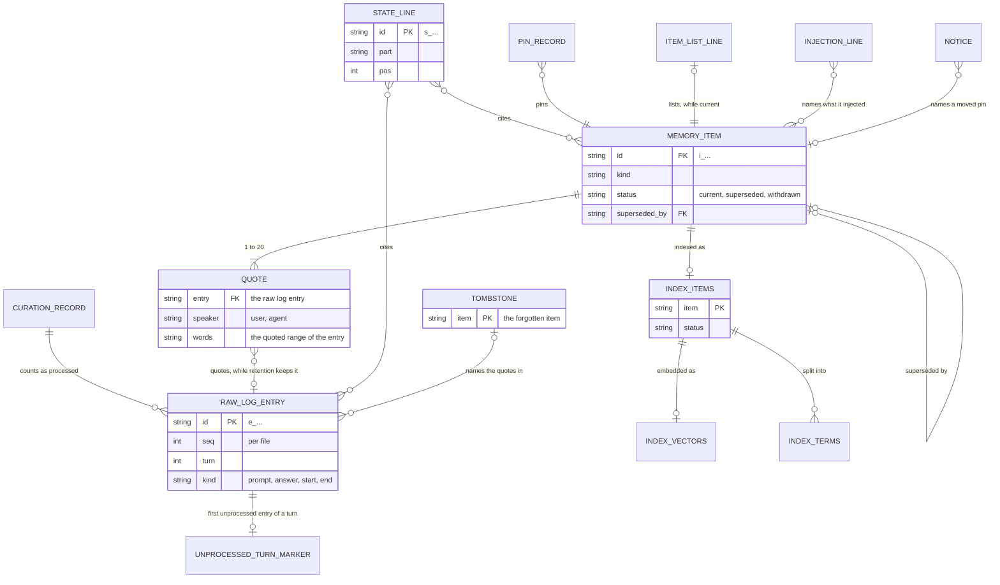

# CORTHEX-MEMORY: memory store

[한국어](memory.ko.md)

Stage 05 of CORTHEX's own project, for the `corthex-memory` plugin. Status: confirmed on 2026-10-27; the retained Git sync design is superseded by D3. The maintainer checks it together with the functional spec before C1 is built; after that check the records are frozen for the release, and a later breaking change needs the maintainer's decision and a new format version. When this file and its Korean translation differ, this file is the source.

Inputs: the functional spec in [docs/04-functional-spec/memory.md](../04-functional-spec/memory.md) (SPEC-001 to SPEC-039), above all its [notes for stage 05](../04-functional-spec/memory.md#stage-05-the-memory-store); the requirements in [docs/02-prd/memory.md](../02-prd/memory.md), of which REQ-008, REQ-009, REQ-012, REQ-044, REQ-045, REQ-054, REQ-056, REQ-063 and REQ-064 shape the memory store most; and the glossary in [docs/01-domain/memory.md](../01-domain/memory.md), whose words this file keeps. The maintainer confirmed D1, D2, D4 and the seven requirement changes on 2026-10-27; D3 chose the HTTPS gateway and server in stage 02. The retained Git sync details have status `superseded (D3, 2026-10-27)` and need a replacement design before C3.

> D3 design status: `superseded (D3, 2026-10-27)`. The Git sync proposal retained here was replaced by the confirmed D3 decision on 2026-10-27. It is historical material, not an implementation or execution plan. The HTTPS gateway and server sync design will be specified separately before C3. Local files and the SQLite search index remain the device store. This notice also covers sync-only parts of shared rows, configuration and examples; their C1/C2 parts remain confirmed.

## How to read this file

- The memory store is a folder of plain files, and one SQLite file per project for the search index. Each record (TBL) is one kind of file, or one kind of line in a file. The search index's tables are in [memory-index.sql](memory-index.sql), and the project hub reads their IDs from there.
- `From` names every behaviour (SPEC) that reads or writes a record, and [Data each behaviour reads and writes](#data-each-behaviour-reads-and-writes) lists the same the other way round. The search index's tables name theirs in their comments.
- Status: `active` for confirmed records; `superseded (D3, 2026-10-27)` for the retained Git sync record and remote marker.
- The field tables give the fields in the order in which they are written. A field marked optional is left out when it has no value; no field is ever written as `null`.
- Names that the glossary does not have, such as the store record or the curation record, are the names of this file's records, defined here.

## The memory store

The memory store is `~/.corthex/corthex-memory/`, or the folder that `CORTHEX_MEMORY_HOME` names (SPEC-039). The memory skill makes it when the user first turns memory on (SPEC-030), and makes a project's folder in it when memory is turned on for that project. Hooks and background processes never make the memory store: where it is missing, they write nothing.

```txt
~/.corthex/corthex-memory/
├─ store.json                         TBL-001 store record
├─ configuration.json                 TBL-002 memory configuration
├─ store.lock
├─ logs/
│  ├─ usage-2026-10.jsonl             TBL-003 usage log, one file per month
│  ├─ failures-2026-10-24.jsonl       TBL-004 failure log, one file per day
│  ├─ hooks-2026-10-24.jsonl          TBL-005 hook timings, one file per day
│  └─ usage.lock, failures.lock, hooks.lock
├─ sync/                              only while sync is on
│  ├─ state.json                      TBL-006 sync record
│  ├─ sync.lock
│  └─ repo/                           the code's Git working copy of the sync remote
└─ projects/
   └─ <project>/                      one folder per project, named after the project list
      ├─ raw/
      │  ├─ <log>.jsonl               TBL-007 raw log, one file per host session
      │  └─ <log>.lock
      ├─ unprocessed/                 TBL-008 one empty file per unprocessed turn
      ├─ curation.json                TBL-009 curation record
      ├─ curation.lock
      ├─ notices/<name>.json          TBL-010 notices
      ├─ injections/<log>.jsonl       TBL-011 injection log, one file per host session
      ├─ index.db                     TBL-019 to TBL-022 search index
      ├─ layer.lock
      └─ layer/                       the curated layer, which sync shares
         ├─ items/<item>.json         TBL-012 memory items
         ├─ state.json                TBL-013 current state
         ├─ state-removed.json        TBL-013 removed current state lines
         ├─ pins.json                 TBL-014 pins
         ├─ item-list.txt             TBL-015 item list
         ├─ tombstones/<item>.json    TBL-016 tombstones
         └─ deleted.json              TBL-017 project tombstone

the sync remote, a Git repository of the user's
├─ corthex-memory-sync.json           TBL-018 sync remote marker
└─ projects/<project>/                each project's curated layer, as in layer/ above
```

The functional spec's curation record is kept in two parts, so that two sessions of one project can append at once without ever writing the same file: the unprocessed turn markers (TBL-008), which only hooks add, and the curation record (TBL-009), which only the curator writes.

## Records

| ID | Record | Context | File | Identified by | Kept | Synced | From | Status |
| --- | --- | --- | --- | --- | --- | --- | --- | --- |
| TBL-001 | Store record | CTX-005 | `store.json` | one per memory store | until a purge | no | SPEC-001, SPEC-002, SPEC-003, SPEC-005, SPEC-021, SPEC-030, SPEC-033, SPEC-039 | active |
| TBL-002 | Memory configuration | CTX-005 | `configuration.json` | one per memory store | until a purge | no | SPEC-001, SPEC-002, SPEC-003, SPEC-005, SPEC-006, SPEC-009, SPEC-010, SPEC-011, SPEC-013, SPEC-014, SPEC-019, SPEC-021, SPEC-022, SPEC-023, SPEC-026, SPEC-027, SPEC-030, SPEC-032, SPEC-033, SPEC-036, SPEC-037 | active |
| TBL-003 | Usage log | CTX-005 | `logs/usage-<month>.jsonl` | its file and place | until a purge | no | SPEC-014, SPEC-015, SPEC-016, SPEC-018, SPEC-019, SPEC-023, SPEC-025, SPEC-027, SPEC-032, SPEC-033 | active |
| TBL-004 | Failure log | CTX-005 | `logs/failures-<date>.jsonl` | its file and place | the retention period | no | SPEC-001, SPEC-004, SPEC-007, SPEC-008, SPEC-009, SPEC-013, SPEC-018, SPEC-023, SPEC-027, SPEC-033 | active |
| TBL-005 | Hook timings | CTX-005 | `logs/hooks-<date>.jsonl` | its file and place | 8 days | no | SPEC-002, SPEC-003, SPEC-005, SPEC-008, SPEC-009, SPEC-021, SPEC-023, SPEC-033 | active |
| TBL-006 | Sync record | CTX-004 | `sync/state.json` | one per memory store | while sync is on | no | SPEC-022, SPEC-026, SPEC-027, SPEC-028, SPEC-033 | superseded (D3, 2026-10-27) |
| TBL-007 | Raw log | CTX-001 | `projects/<project>/raw/<log>.jsonl` | `id`, and also its file and `seq` | the retention period, by each entry's time | never (REQ-044) | SPEC-002, SPEC-003, SPEC-005, SPEC-007, SPEC-009, SPEC-015, SPEC-016, SPEC-020, SPEC-025, SPEC-029, SPEC-035, SPEC-037 | active |
| TBL-008 | Unprocessed turn markers | CTX-002 | `projects/<project>/unprocessed/<time>.<log>.<turn>` | its name | until its turn is processed or deleted | no | SPEC-002, SPEC-003, SPEC-009, SPEC-010, SPEC-016, SPEC-022, SPEC-033, SPEC-037 | active |
| TBL-009 | Curation record | CTX-002 | `projects/<project>/curation.json` | one per project | as long as the project's memory | no | SPEC-009, SPEC-010, SPEC-012, SPEC-015, SPEC-016, SPEC-017, SPEC-018, SPEC-019, SPEC-022, SPEC-030, SPEC-033, SPEC-037 | active |
| TBL-010 | Notices | CTX-003 | `projects/<project>/notices/<name>.json` | its name | until a start summary shows it | no | SPEC-016, SPEC-018, SPEC-019, SPEC-021, SPEC-022, SPEC-028, SPEC-034, SPEC-037 | active |
| TBL-011 | Injection log | CTX-003 | `projects/<project>/injections/<log>.jsonl` | its file and place | the retention period | no | SPEC-009, SPEC-021, SPEC-023, SPEC-037 | active |
| TBL-012 | Memory items | CTX-002 | `projects/<project>/layer/items/<item>.json` | `id` | until forgotten, or deleted with the project's memory | yes | SPEC-015, SPEC-016, SPEC-017, SPEC-019, SPEC-020, SPEC-021, SPEC-023, SPEC-024, SPEC-025, SPEC-027, SPEC-028, SPEC-029, SPEC-033, SPEC-034, SPEC-035, SPEC-037 | active |
| TBL-013 | Current state | CTX-002 | `projects/<project>/layer/state.json` and `state-removed.json` | each line's `id` | a line until it is removed; a removed line's record for good | yes | SPEC-015, SPEC-017, SPEC-019, SPEC-021, SPEC-027, SPEC-028, SPEC-029, SPEC-034, SPEC-035, SPEC-037 | active |
| TBL-014 | Pins | CTX-003 | `projects/<project>/layer/pins.json` | each record's `item` | for good, until the item is forgotten | yes | SPEC-015, SPEC-016, SPEC-019, SPEC-021, SPEC-027, SPEC-028, SPEC-029, SPEC-033, SPEC-034, SPEC-035, SPEC-037 | active |
| TBL-015 | Item list | CTX-003 | `projects/<project>/layer/item-list.txt` | each line's item ID | made again after every change | yes | SPEC-015, SPEC-016, SPEC-019, SPEC-025, SPEC-027, SPEC-028, SPEC-029, SPEC-034, SPEC-035, SPEC-037 | active |
| TBL-016 | Tombstones | CTX-004 | `projects/<project>/layer/tombstones/<item>.json` | `item` | for good | yes | SPEC-012, SPEC-027, SPEC-028, SPEC-029, SPEC-035, SPEC-037 | active |
| TBL-017 | Project tombstone | CTX-005 | `projects/<project>/layer/deleted.json` | one per project | for good | yes | SPEC-009, SPEC-012, SPEC-015, SPEC-027, SPEC-028, SPEC-037 | active |
| TBL-018 | Sync remote marker | CTX-004 | `corthex-memory-sync.json` in the sync remote | one per sync remote | as long as the sync remote | it is in the sync remote | SPEC-026, SPEC-027, SPEC-028 | superseded (D3, 2026-10-27) |

The search index is the SQLite file `projects/<project>/index.db`. It is never synced (REQ-044) and can always be made again from the memory items (TERM-029).

| Table | Name | What it holds |
| --- | --- | --- |
| TBL-019 | `index_meta` | What the index was built with: the embedding model, the vector length and the version of the word splitting |
| TBL-020 | `index_items` | One row per memory item, with its kind, item status, the speaker and time of its deciding quote, and its number of words |
| TBL-021 | `index_vectors` | The embedding of each item that has one |
| TBL-022 | `index_terms` | How often each word occurs in each item |

## Every file

- Text is UTF-8 without a byte order mark, and lines end in LF.
- A JSON file holds one object, indented by two spaces, with its fields in the order of their table, characters outside ASCII written as they are rather than escaped, and a final LF. The same content therefore always gives the same bytes, and Git sees a change in the sync remote only where there is one.
- A JSON Lines file holds one compact object per line, with its fields in the same order.
- Times are in UTC with milliseconds, as `2026-10-24T13:05:12.345Z`, and dates are UTC dates, as `2026-10-24`, also in file names. Times come from each device's clock. The start summary and the memory skill show them in local time (stage 06).
- IDs are a prefix and 12 random characters of Crockford's base32 in lowercase, 60 random bits: `d_` for a device, `e_` for a raw log entry, `i_` for a memory item and `s_` for a current state line, as `i_7f3k2m9q4x1v`. The code makes them, never the model, and never reuses one. They hold lowercase letters, digits and an underscore, so they never look like trace IDs such as `REQ-001`, and the project hub reads none of them.
- A project's folder has the project's name from the project list. A name that Windows keeps for devices (`con`, `prn`, `aux`, `nul`, `com0` to `com9`, `lpt0` to `lpt9`) gets `_` at its end on every system, so that all devices name the folder alike in the sync remote; project names hold only lowercase letters, digits and hyphens, so no other project's folder ends in `_`.
- Positions in a text count its Unicode code points as stored, from 0, and a range's end is not part of it.
- No file holds a key, a token or a password (SPEC-031).
- On Linux and macOS, folders are made readable by the user alone (mode 0700) and files likewise (0600). On Windows they keep the permissions they take from the folder above them, which for the default place is the user's profile folder.
- Names that end in `.tmp`, `.bak`, `.lock` or `.stale` are the code's working files: readers skip them, and sync never carries them.

## Fields of each record

### Store record (TBL-001)

Every process reads it first. A format that the code does not know, or a migration to one, means that it reads and writes nothing else in the memory store, and the memory status says to update the plugin (SPEC-039). Only a migration changes it, under the store lock.

| Field | Value | Meaning |
| --- | --- | --- |
| `format` | integer, `1` | The format version of the memory store (REQ-063) |
| `device` | device ID | This device, as quotes, current state lines, pins and tombstones name it |
| `made` | time | When the memory store was made |
| `release` | text, such as `0.2.0` | The plugin release that made the memory store or last migrated it |
| `migrating` | optional object: `from`, `to`, `started` | A migration that has started and not ended ([Format version and migrations](#format-version-and-migrations)) |

If it is lost and no backup can be restored while other files are there, nothing is read or written; the memory status says so, and the memory skill writes a new store record, with a new device ID, after the user's yes. The code finds a raw log entry by its file and ID, so a new device ID loses nothing.

### Memory configuration (TBL-002)

Written only by the memory skill, under the store lock, and on a temporary device by the user's environment setup before the first session (SPEC-011). Never synced, and never holds a key. The defaults below come from the functional spec, and stage 06 confirmed them; a field left out takes its default. The ranges and patterns of the fields are those of stage 06's [configuration schema](../06-api/memory-configuration.schema.json).

| Field | Value | Meaning |
| --- | --- | --- |
| `consent` | optional object: `at` (time), `version` (integer) | The user's consent and the version of its text (SPEC-030). Without consent at the version the release needs, nothing is recorded or sent. |
| `projects` | object: project name → `enabled` (true or false), `since` (time), optional `left_out` (`folders`: folders relative to the project's folder; `kinds`: any of `prompt`, `answer`, `boundary`) | The projects that memory was turned on for, when it was last turned on, and what is left out of recording (SPEC-006, SPEC-030, SPEC-036) |
| `retention` | object: `days`, integer of 1 or more, default 100 | The retention period (SPEC-009) |
| `triggers` | object: `turns`, default 10; `minutes`, default 30 | The curation triggers at the end of a turn (SPEC-010) |
| `temporary` | optional true or false | Whether the device is a temporary device; left out, the code asks the host (SPEC-011) |
| `models` | object: `curator`, default `claude-haiku-5-5`; `effort`, default `xhigh`; `embedding`, default `text-embedding-3-small`; `dims`, the shortened vector length, default 512 | The models (SPEC-014, SPEC-023) |
| `recall` | object: `threshold`, optional number; `skip`, default 8 | The recall threshold, which has no value until stage 12 sets it, and the shortest prompt, in characters, that recall runs for (SPEC-023) |
| `prices` | object: `taken` (date), `from` (the addresses of the providers' price pages, one each), `models` (model → `input`, `output` and optional `cache_write`, `cache_read`, in US dollars per million tokens, and optional `above` with `tokens`, `input` and `output` for prices that change with the prompt's length) | The price list (SPEC-032) |
| `sync` | optional object: `address`, `branch`, default `main` | The sync remote; sync is on while this is there (SPEC-026) |

If it is lost and no backup can be restored, memory is off on the device: there is no consent and no enabled project, so nothing is recorded or sent until the user turns memory on again, and the memory status says so.

### Usage log (TBL-003)

One line per request to a model API, also each retry, and per token count (SPEC-032), appended by the process that made the call. One file per UTC month; the memory status reads this month's file. Kept until a purge, also when a project's memory is deleted (SPEC-037). No conversation text, no prompt, no answer and no key. It is the record of each AI call that stage 05 asks for.

| Field | Value | Meaning |
| --- | --- | --- |
| `at` | time | When the request was sent |
| `project` | project name | The project the call was for |
| `call` | `curate`, `consolidate`, `embed-prompt`, `embed-items`, `embed-search` or `count-tokens` | The kind of call |
| `model` | text | The model named in the request |
| `instructions` | optional text, such as `curate-1` | The version of the plugin's fixed instructions in a curator request |
| `input` | optional integer | The input tokens the provider reported; for `count-tokens`, the count it returned |
| `output` | optional integer | The output tokens the provider reported |
| `cache_write` | optional integer | Input tokens written to the provider's prompt cache, where stage 06 uses it |
| `cache_read` | optional integer | Input tokens read from the provider's prompt cache |
| `first_ms` | optional integer | Milliseconds from sending to the first streamed token |
| `total_ms` | integer | Milliseconds from sending to the end of the answer, or to the failure |
| `result` | `ok`, `failed`, `refused` or `limit` | `refused`: the model ended with a refusal; `limit`: it stopped at the output limit (SPEC-014) |
| `error` | optional text | The kind of error, such as `rate_limit_error`, `overloaded_error`, `timeout` or `network`; never the error's text |
| `request` | optional text | The provider's request ID, from its response headers |
| `cost` | number | The estimated cost in US dollars from the price list; 0 for a token count |
| `prices` | date | The `taken` date of the price list used |

The memory status sums the tokens of the calls that the provider charges for, so a token count is not counted twice.

### Failure log (TBL-004)

One line per failure of recording, recall, curation, consolidation, sync, retention or the memory skill (SPEC-008), and per backup restored. One file per UTC day, deleted once the whole day is past the retention period. No conversation text, no key, no file path and no error text.

| Field | Value | Meaning |
| --- | --- | --- |
| `at` | time | When it happened |
| `step` | `record`, `recall`, `summary`, `trigger`, `curate`, `consolidate`, `embed`, `sync`, `retention`, `index`, `restore` or `skill` | What failed |
| `hook` | optional: `prompt`, `end-of-turn`, `start` or `end` | The hook it happened in |
| `host` | optional: `claude-code` or `codex` | The host |
| `project` | optional project name | The project, when one was found |
| `error` | text | The kind of error: the exception's class name, such as `PermissionError`; the provider's error type; or one of the code's own, such as `lock-busy`, `deadline`, `damaged-line`, `future-entry`, `restored` or `no-project-list` |
| `log` | optional raw log file name | The raw log file, for an error about one file |
| `count` | optional integer | How many, when one line stands for several, such as the damaged lines of one file |

A background reader that skips damaged lines of a raw log file (SPEC-007) or finds entries in the future (SPEC-009) writes one line for the file, with `count`. A hook that cannot take the failure log's lock before its deadline, or in the single attempt after it, writes nothing.

### Hook timings (TBL-005)

One line per run of a hook that found an enabled project, appended at the end of the hook (SPEC-008, SPEC-033). A hook that finds no enabled project writes nothing at all (SPEC-001), so its time is measured only from outside, in QA. One file per UTC day; files older than 8 days are deleted, so that the memory status always has 7 whole days.

| Field | Value | Meaning |
| --- | --- | --- |
| `at` | time | When the hook started |
| `hook` | `prompt`, `end-of-turn`, `start` or `end` | |
| `host` | `claude-code` or `codex` | |
| `ms` | integer | Milliseconds from the hook's start to its end, measured inside the hook |
| `outcome` | `ok`, `left-out`, `no-answer`, `lock-busy`, `deadline` or `error` | `left-out`: the folder or the kind was left out; `no-answer`: an end of turn without a final answer, which the memory status counts (SPEC-003); `deadline`: the hook passed its deadline and skipped its other steps (SPEC-008) |

### Sync record (TBL-006)

Written only by the sync, under the sync lock. Turning sync off deletes the `sync` folder. Beside the record, `sync/repo/` is the code's Git working copy of the sync remote. It holds the curated layer of every project in the sync remote, also of projects this device does not have, which every push carries over unchanged. Sync merges each project that has a folder in the memory store and, for an enabled project without a curated layer yet, copies the sync remote's. After each push the code drops every commit and object of the working copy that the branch no longer reaches, so that the text of a forgotten item does not stay on the device.

| Field | Value | Meaning |
| --- | --- | --- |
| `base` | optional commit ID | The commit that the last pull found; a push replaces the branch only while the branch is still there (SPEC-028) |
| `last_ok` | optional time | When the last sync ended that pulled, merged and pushed or had nothing to push |
| `last_try` | optional time | When the last sync started |
| `checked` | optional time | The last privacy check (SPEC-026) |
| `checked_by` | optional: `github`, `gitlab`, `bitbucket` or `user` | How privacy was checked; `user` when the user confirmed it |
| `stopped` | optional object: `at`, `reason` (`public` or `other-files`) | Sync stopped until the user turns it on again (SPEC-026) |
| `failed` | optional object: `at`, `error` (such as `unreachable`, `moved` or `newer-format`) | The last sync point that did not end, with the reason (SPEC-027, SPEC-028) |
| `clashes` | list of objects: `project`, `item` | Items with one ID and different texts on the two sides (SPEC-028) |

If it is lost, the next sync pulls without a base and checks privacy again before it pushes.

### Raw log (TBL-007)

One file per host session, named `<host>-<key>`: the host, `claude-code` or `codex`, and the first 16 hexadecimal characters of the SHA-256 of the host's session ID, as `claude-code-3f9a0c41d2e87b65`. One line per entry, appended by the session's hooks under the file's lock (SPEC-007). Only retention, a forget and a tombstone rewrite it. Entries are deleted by their own time once past the retention period, and a file left without entries is deleted (SPEC-009). Never synced (REQ-044).

| Field | Value | Meaning |
| --- | --- | --- |
| `id` | entry ID | |
| `seq` | integer | 1 for the file's first entry, then one more for each; a rewrite keeps every entry's `seq` |
| `turn` | optional integer | For a prompt or a final answer, the `seq` of its turn's first entry |
| `at` | time | When the hook wrote the entry |
| `host` | `claude-code` or `codex` | |
| `session` | text | The host's session ID |
| `kind` | `prompt`, `answer`, `start` or `end` | `start` and `end` are session boundaries (SPEC-005) |
| `speaker` | optional: `user` or `agent` | `user` for a prompt, `agent` for a final answer |
| `text` | optional text | The prompt or the final answer, once redacted (SPEC-004), at most 512 KB of UTF-8 (SPEC-002) |
| `cut` | optional integer | The text's size in bytes before it was cut (SPEC-002) |
| `event` | optional: `start`, `resume`, `clear`, `compact` or `fork` | For a start boundary, the event as the host reports it |
| `reason` | optional text | For an end boundary, the host's reason, at most 64 characters |
| `forgotten` | optional list of `[start, end]` pairs | The ranges of `text` that a forget or a tombstone replaced (SPEC-035) |

Turns: a prompt starts a turn, and its `turn` is its own `seq`. A final answer joins the turn of the last prompt or final answer before it in the file when that entry is the turn's prompt, or when it is a final answer and the host reports that the agent went on after another hook (SPEC-003); any other final answer starts a turn of its own, as when prompts are left out. Boundaries belong to no turn.

Retention goes by each entry's own time, so it can delete a file's last entries while it keeps an earlier entry whose time is in the future (SPEC-009). The next append would then take again a `seq` that a deleted entry had, and the curation record may count that `seq` as processed. So before such a rewrite, retention lowers the file's count in the curation record to the highest `seq` that it keeps (TBL-009), and the next entry counts as unprocessed; a stop between the two only has those entries curated again.

Forgetting: a forget, or a tombstone applied on this device, replaces each character of a quoted range with U+FFFD, so that the text keeps its length and the positions of the entry's other quotes stay valid, and adds the range to `forgotten`. A quoted range that overlaps a quote of an item that stays on this device is kept whole, so that item's provenance holds (SPEC-035). Once a later forget or tombstone leaves no such item, it replaces that range too, which it finds in the earlier item's tombstone. Requests to the curator show each forgotten range as `[forgotten]`, so no quote can hold it.

### Unprocessed turn markers (TBL-008)

One empty file per unprocessed turn, named `<time>.<log>.<turn>`: the time of the turn's oldest unprocessed entry, as `20261024T130512Z`; its raw log file; and the turn's `seq`, as `20261024T130512Z.claude-code-3f9a0c41d2e87b65.42`. The hook that appends an entry makes its turn's marker, under the raw log file's lock, unless one is there. The curation triggers count the markers and read the oldest time from the names, so that no hook reads a raw log or rewrites a file to check them (SPEC-010).

| Field | Value | Meaning |
| --- | --- | --- |
| `time` | UTC time to the second | When the turn's oldest unprocessed entry was written |
| `log` | raw log file name | |
| `turn` | integer | The turn's `seq` |

After applying, the curator, under each raw log file's lock, replaces that file's markers with one for each turn that still has unprocessed entries, such as a final answer appended while it ran. Retention deletes the markers of the turns it deletes. A marker lost outside the plugin only makes its turn's trigger late: the next curation of the project still curates the turn, since the curation record decides what is processed.

### Curation record (TBL-009)

The memory skill makes it, empty, before it first enables the project, so a missing one is lost, not new. Written only by the holder of the project's curation lock: the curator; retention, which removes the raw log files it deletes and lowers the count of a file whose last entries it deletes (TBL-007); and the memory skill when the user resumes curation (SPEC-033). The curator writes it under the curated layer lock as well, after the changes that it counts, so that a stop between the two curates those turns again instead of losing them; consolidation then merges what was curated twice.

| Field | Value | Meaning |
| --- | --- | --- |
| `logs` | object: raw log file name → integer | How far each raw log file is processed: its entries up to that `seq` |
| `applies` | integer | One more for each request whose results were applied; checked before each apply ([Locks](#locks)) |
| `recent` | list of up to 10 objects: `at`, `kind` (`curate` or `consolidate`), `result` (`ok`, `failed` or `stale`), `error`, `applied`, `dropped`, `state` (`new`, `kept` or `cut`) | The last attempts, newest first. `stale`: its results were dropped because a forget or a tombstone came after its request was built (SPEC-012). `applied` and `dropped` count changes (SPEC-016); `state` says whether the current state was replaced, kept or shortened (SPEC-017). |
| `failures` | optional object: `count`, `log`, `turn` | Failed attempts in a row from the same first unprocessed turn (SPEC-018) |
| `consolidation` | object: `last` (optional time), `due` (optional time), `failures` (integer) | The last consolidation that ended, the time SPEC-015 made the next one due, and failed consolidations in a row (SPEC-019) |
| `stopped` | optional object: `at`, `by` (`curate` or `consolidate`), `errors` (the kinds of error) | The fault guard's stop, until the user resumes (SPEC-018) |
| `rebuilt` | optional time | When the record was last made again from the raw log |

The required fields are `logs`, `applies`, `recent` and `consolidation`; the empty record has `{}` logs, zero applies, no recent attempts and zero consolidation failures. Counts are nonnegative integers, excluding booleans; a failed turn's `turn` is positive. The keys of `logs` and `failures.log` use the raw log stem, `<host>-<16 hex characters>`, as the turn markers do, without `.jsonl`. Each recent attempt requires `at`, `kind` and `result`; `error`, `applied`, `dropped` and `state` are present when applicable. Error fields use stage 06's model error codes or built-in exception class names. Unknown or invalid fields are not silently removed: a valid backup may restore an invalid primary under the record's write leases, and without a readable copy the writer stops. A guarded C1 rewrite preserves all other valid fields and refuses an unrecoverable record; only the C2 curator reconstructs lost progress.

Before the curator counts entries as processed, or applies a quote of them, it flushes their raw log file to disk, so that no entry that the curation record counts can be lost to a power cut. If the record is lost, the curator makes it again: for each raw log file, the newest entry that an item quotes or a current state line cites counts as processed, with the entries before it, and every entry after it as unprocessed, even in its own turn, since a final answer appended while the last curation ran may never have been sent. Turns curated twice make duplicate items, which consolidation merges. A notice says so once, and a stop of the fault guard is lost with the record.

### Notices (TBL-010)

One file per notice that the start summary shows once (SPEC-022): `curation-failed`, `consolidation-failed`, `rebuilt` or `pin-<item>`. The curator, the sync and the memory skill write them; a later notice of the same name replaces the earlier one; the start hook deletes each notice it shows. Lasting conditions, such as a stop of the fault guard, a missing memory key or unprocessed turns that retention will soon delete, are not stored: the start hook works them out at every session start.

| Field | Value | Meaning |
| --- | --- | --- |
| `at` | time | |
| `kind` | `curation-failed`, `consolidation-failed`, `rebuilt`, `pin-moved` or `pin-dropped` | |
| `error` | optional text | The kind of error, for a failure |
| `item` | optional item ID | The item whose pin moved or was dropped (SPEC-034) |
| `to` | optional item ID | The item that the pin moved to |

### Injection log (TBL-011)

One file per host session, named as its raw log file, also in a left-out folder, where no raw log is written (SPEC-006). One line per start summary (SPEC-021) and per prompt of the session (SPEC-023), also when recall skips the prompt, as a short one or a command, or injects nothing, so that recall can tell which items the session's last three prompts injected. Appended by the session's hooks under the lock of the session's raw log file. Lines are deleted by their own time once past the retention period. No text of items or prompts.

| Field | Value | Meaning |
| --- | --- | --- |
| `at` | time | |
| `session` | text | The host's session ID |
| `where` | `start` or `prompt` | |
| `prompt` | optional entry ID | The prompt's raw log entry, when the prompt was recorded |
| `items` | list of item IDs | At a start, the pinned items shown; for a prompt, the items injected, best first, or none |
| `scores` | optional list of numbers | For a prompt, recall's score of each item, in the same order |

### Memory items (TBL-012)

One file per item, named by its ID. The curator saves it when it applies a change (SPEC-016) or a merge (SPEC-019), and a sync when it brings it from another device (SPEC-028). An item's kind, title, text and quotes never change once it is saved; a change of item status rewrites the file. A forget, a tombstone or the deletion of the project's memory removes the file. Synced.

| Field | Value | Meaning |
| --- | --- | --- |
| `id` | item ID | |
| `kind` | `decision`, `preference`, `lesson`, `reference` or `fact` | The item kind |
| `title` | text | One line, at most 200 bytes, for the item list |
| `text` | text | At most 4,000 bytes |
| `quotes` | list of 1 to 20 quotes | The first is the deciding quote |
| `status` | `current`, `superseded` or `withdrawn` | The item status |
| `superseded_by` | optional item ID | For a superseded item, the item that superseded it |
| `merges` | optional list of item IDs | For an item made by a consolidation, the items it merged |
| `saved` | time | When the item was first saved, on any device |
| `device` | device ID | The device that saved it |
| `changed` | optional time | When its item status last changed |

Each quote is an object:

| Field | Value | Meaning |
| --- | --- | --- |
| `entry` | entry ID | The raw log entry quoted |
| `log` | raw log file name | The file that held the entry |
| `device` | device ID | The device whose raw log held the entry |
| `start`, `end` | integers | The quote's range in the entry's text |
| `speaker` | `user` or `agent` | The entry's speaker, never the model's word (SPEC-016) |
| `said` | time | The entry's time |
| `words` | text | The entry's text from `start` to `end`, at most 2,000 bytes |

Worked out, not stored: whether the item is a user decision, which it is when it is a decision whose deciding quote is the user's, and the time it took effect, its deciding quote's `said`. Merging two copies of an item (SPEC-028): `withdrawn` beats `superseded`, which beats `current`; of two superseded copies, the later `changed` wins, and on the same time the smaller `superseded_by`. Two copies whose kind, title, text or quotes differ are a clash: the local copy stays, and the sync record lists it.

### Current state (TBL-013)

`state.json` holds the current state's lines; `state-removed.json` keeps a record of each line removed, without its text, so that a sync never brings the line back (SPEC-028). The curator (SPEC-017, SPEC-019), a forget (SPEC-035), a tombstone (SPEC-029) and a sync write them. A line keeps its ID while the curator keeps or rewords it: the curator's answer names, for each line, the line of the request it keeps or changes, and the code gives new lines new IDs. The start hook reads only `state.json`. Synced.

`state.json` is an object with `lines`, a list of:

| Field | Value | Meaning |
| --- | --- | --- |
| `id` | state line ID | |
| `part` | `goal`, `decisions`, `progress`, `blockers` or `next` | The goal, decisions in force, work in progress, blockers or next actions |
| `pos` | integer | The line's place in its part; lines are shown by part, then `pos`, then `id` |
| `text` | text | One line |
| `cites` | list of item and entry IDs, at least one | The line's provenance (SPEC-017) |
| `at` | time | When the line was written or last changed |
| `device` | device ID | The device that wrote it |

`state-removed.json` is an object with `removed`, a list of records with `id`, `at` (when the line was removed) and `device`.

The text of the lines stays under 3,000 bytes in all after a curation (SPEC-017). A merge can leave more; the next curation brings the state back under the limit, and the start summary shortens it meanwhile (SPEC-021).

### Pins (TBL-014)

An object with `pins`, one record per item ever pinned in the project, kept after an unpin so that a sync can tell which change is newer (SPEC-028). The memory skill writes them (SPEC-034), and the curator and the sync when a pin moves or is dropped. A forget removes the item's record, and its tombstone keeps the item from coming back. Synced.

| Field | Value | Meaning |
| --- | --- | --- |
| `item` | item ID | |
| `on` | true or false | Pinned, or unpinned |
| `at` | time | When it was pinned or unpinned |
| `device` | device ID | |

The start summary shows the pinned items in the order they were pinned. When a pinned item is superseded, its record turns `on: false` and the item that superseded it gets `on: true`, at the same time; a withdrawn item's record turns `on: false` (SPEC-034).

### Item list (TBL-015)

One line per current item: its ID, kind, the deciding quote's speaker, the deciding quote's date and the title, separated by tabs, as `i_7f3k2m9q4x1v⇥decision⇥user⇥2026-10-24⇥Keep raw logs on the device`, where ⇥ stands for a tab. Newest first, then by ID. The code makes it again after every change of the items, and a sync makes it again after merging, never merging it. Synced, since the curated layer holds it (TERM-032).

| Field | Value | Meaning |
| --- | --- | --- |
| ID | item ID | |
| kind | item kind | |
| speaker | `user` or `agent` | Of the deciding quote |
| date | UTC date | When the deciding quote was said |
| title | text | The item's title, with tabs turned into spaces |

### Tombstones (TBL-016)

One file per forgotten item, named by the item's ID, made by a forget (SPEC-035) or brought by a sync, and kept for good (SPEC-029). Its name alone keeps the item from being added again, also when the file cannot be read. Synced.

| Field | Value | Meaning |
| --- | --- | --- |
| `item` | item ID | |
| `project` | project name | |
| `at` | time | When the item was forgotten |
| `device` | device ID | Where it was forgotten |
| `quotes` | list of objects: `device`, `entry`, `log`, `start`, `end` | The place of each of the item's quotes; never their words, nor a hash of them |

### Project tombstone (TBL-017)

Made when the user deletes a project's memory with sync on (SPEC-037). On this device the deletion leaves in the project's folder only `layer/deleted.json` and the tombstones. A device that applies it deletes in the merge the project's items saved before `at`, with their pins and search index rows, and its current state lines written before `at` (SPEC-028). Then the sync starts the project's retention, which deletes the raw log entries and injection log lines written before `at` under the curation lock, as it deletes those past the retention period (SPEC-009); until they are gone, the curator leaves those entries out of its requests (SPEC-015). What is saved after `at` stays. It does not change that device's memory configuration. Kept for good; a later deletion moves `at` on, and a merge keeps the later `at`. Synced.

| Field | Value | Meaning |
| --- | --- | --- |
| `project` | project name | |
| `at` | time | When the project's memory was deleted |
| `device` | device ID | Where it was deleted |

### Sync remote marker (TBL-018)

The file that marks a Git repository as a sync remote of the memory plugin (SPEC-026). The first push writes it. A sync that finds a newer `format` merges and pushes nothing, and the memory status says to update the plugin (SPEC-028). Besides this file, the sync remote holds only `projects/<project>/`, each project's curated layer laid out as in the memory store, in one commit with no parent (SPEC-028).

| Field | Value | Meaning |
| --- | --- | --- |
| `format` | integer, `1` | The format version of the sync remote |
| `made` | time | When the sync remote was first pushed |
| `device` | device ID | The device that first pushed it |

## Writing and locks

### Appending

The JSON Lines files (raw logs, logs and injection logs) take lines this way:

1. Take the file's lock.
2. When the file's last byte is not LF, as after a cut line, start the write with LF.
3. Write the line and its LF with one write call, and hand it to the system before releasing the lock. No fsync: a power cut can lose the last lines but never makes the file unreadable (SPEC-007).
4. Release the lock.

If the write is short, the caller keeps the record lock, truncates the file to its size from `fstat` before the write, and then reports failure.

Under the same lock, a raw log append first reads the last complete line for its `seq` and `turn`, and then makes its turn's marker (TBL-008).

### Rewriting

Every other change of a file, and every rewrite of a JSON Lines file, goes through a new file and a move (REQ-064):

1. Write the new content to `<name>.<random>.tmp` in the same folder, and flush it to disk.
2. Keep the old file as `<name>.bak`: a hard link where the file system has them, a copy where not.
3. Move the new file over the old one, which replaces it at once.
4. Delete `<name>.bak`.

On macOS the disk flush first tries `fcntl.F_FULLFSYNC`, falling back to `os.fsync` when it is unavailable or fails ([Apple's fsync contract](https://developer.apple.com/library/archive/documentation/System/Conceptual/ManPages_iPhoneOS/man2/fsync.2.html)).

A raw log or injection log rewrite builds the new file without the lock, then holds the file's lock for its last read and the move, copying into the new file, unchanged, the lines appended since its first read (SPEC-007). That carries appends over but not another rewrite's changes, so the rewrites of one file run one after another: each holds the project's curated layer lock from its first read to the move. Forgets and tombstones hold it anyway, and retention takes it for each raw log or injection log file that it rewrites or deletes. When retention would keep no line of a file, it holds the file's lock for a last read and the deletion, and if that read finds lines appended since its first read, it keeps them: it moves a new file holding only those lines over the old one instead of deleting it (SPEC-009). Files that the code can make again from others (the markers, notices, the item list and the search index) skip the flush to disk and the backup.

Deleting a whole file under its lock also removes its `<name>.bak` and remaining `<name>.*.tmp` files, using the same Windows retries for each deletion.

On Windows a move or a deletion fails while another process holds the file open. The code tries again for up to one second; then the step fails as a whole, the failure log notes it, and it runs again at its next trigger. Readers open a file, read it whole and close it at once. Lock release always uses that full one-second retry, even after a hook deadline, to avoid leaving a lease behind; if release still fails, it reports only the last exception class and does not turn completed work into a failure.

### Restoring

- Only a process holding the file's write lock restores a readable `.bak`, and only when the rewritten file is missing (`FileNotFoundError`) or its content cannot be interpreted (`ValueError` or `UnicodeError`). It reads the original once more just before each restoration attempt and keeps it if it now parses, otherwise moves the backup back and notes `restore`, `restored`. If the move finds the backup already gone, it reads the original once more. A temporarily inaccessible file is not unreadable content: `PermissionError` is retried on Windows for up to one second, then raised without restoration; within a hook, this retry stops at that hook's deadline, except that acquired raw recording or store-record recovery uses the ordinary one-second sharing retry (TASK-060). POSIX raises it immediately, and other `OSError` failures are raised without restoration.
- An unlocked reader that finds a readable backup makes a short attempt to take the file's write lock, then rechecks and restores while holding it; if it cannot take the lock, the read fails without restoring. The file primitives signal `RestoreNeeded` without moving files; TASK-003 connects the short lock attempt. A JSONL rewrite reads the current entries with the locked read.
- An append, already holding the file's write lock, first restores a readable backup when the original is missing, notes `restored`, and only then appends the new entry.
- Clean-up recognizes only known generated sidecar names owned by the plugin for supported C1 records inside the resolved memory root. It does not follow symlinks or paths outside that root, and preserves unowned and unknown C2 record families. Recheck file identity, age, the record's write leases and the pinned store before unlinking. Keep temporary and stale files aged exactly 600 seconds or dated in the future; only an age greater than 600 seconds qualifies. Delete a backup only after its current primary is completely read by the actually implemented C1 typed pure parser or schema; for JSONL this requires complete, valid record lines rather than the damaged-line-tolerant reader. A missing, inaccessible, damaged, schema-invalid or unsupported primary keeps its backup. Cleanup itself does not restore a backup. C2 tasks extend the supported parser families when implemented. Raw rewrite artifacts are protected by the layer lease as well as the matching raw lease, so an active rewrite's temporary file is not removed. No directory is provisioned and no raw entry, marker, curation progress or usage log is removed as cleanup instead of retention. Until then a backup can hold text that a forget removed.
- The C1 cleanup library supports `store.json`, `configuration.json` and raw files named `<host>-<16 hex characters>.jsonl`, using their implemented pure parsers. It keeps curation, layer, usage and diagnostic JSONL backups until their typed readers exist. Temporary names have the primary name, an optional `.bak`, an eight-character generated suffix and `.tmp`; detached lease names have the known lock name, 32 lowercase hexadecimal characters and `.stale`. C1 knows the store, curation, layer, raw, failure-log and hook-timing leases; it preserves sync and usage lease artifacts. Strict raw validation reads 64 KiB chunks, with an 8 MiB line ceiling and a required final LF; an oversized or incomplete line keeps the backup. The recording limit stays 512 KiB of text.
- A record with no copy that can be read is handled as its section says.

### Locks

| Lock | File | Held for | Refreshed | Taken over after |
| --- | --- | --- | --- | --- |
| Store lock | `store.lock` | One change of the store record or the memory configuration, or a migration | every 30 seconds | 2 minutes |
| Curation lock | `projects/<project>/curation.lock` | A whole curator run, retention of the project, or a resume (SPEC-012) | at least every minute | 10 minutes |
| Sync lock | `sync/sync.lock` | One sync | every minute | 10 minutes |
| Curated layer lock | `projects/<project>/layer.lock` | One apply, forget, tombstone, pin, unpin or merge in the project, retention's rewrite or deletion of one raw log or injection log file, or the deletion of its memory | every 30 seconds | 2 minutes |
| Raw log lock | `projects/<project>/raw/<log>.lock` | One append with its marker, the last read and the move of a rewrite, or retention's last read and deletion of a file; also the session's injection log | not refreshed | 10 seconds (SPEC-007) |
| Log locks | `logs/usage.lock`, `logs/failures.lock`, `logs/hooks.lock` | One append | not refreshed | 10 seconds |

- A lock is a file made with an exclusive create, which fails while the file is there. It holds the holder's process ID, the device ID, the time and a random token. The holder refreshes it by touching its modified time; the lock is stale once that time is older than the table allows. Staleness compares this device clock with the lock mtime, so keep the memory folder on a local disk: a forward clock jump or a network folder with a different server clock can make a live lease look stale; that holder discovers the missing token on its next check.
- To take a stale lock over, a process renames it to a name of its own (`<lock>.<random>.stale`), checks that the renamed file holds the token it judged stale, deletes it and makes the lock anew. If the renamed file holds another token, it was a fresh lock: the process puts it back unless a lock is there again, and gives up.
- Before each change, the holder checks that the lock still holds its token. A process that lost its lock changes nothing more.
- Order: store, curation, sync, curated layer, raw log, log. A process never waits for a lock earlier in this order while it holds a later one, so no two processes wait for each other. Within one kind, acquire locks in the string order of their paths relative to the memory folder, ignoring case on Windows.
- Hooks take raw and log locks, normally waiting at most until their hook deadline (SPEC-008). Recording waits for raw/store-record recovery locks for 50 ms after redaction and attempts each at least once even after expiry. Other recovery reads borrow the matching lock within their caller deadline, with no other lease held. Acquired raw recording and store-record recovery finish (TASK-060).
- Reading needs no lock: every rewrite ends in a move, so a reader sees the old file or the new one, whole.
- Retention of a project runs under its curation lock, so that deleting a whole raw log file also removes it from the curation record; when a curator holds the lock, retention leaves the project for the next session start. A session resumed after its file was deleted then starts a new file from `seq` 1.
- The memory skill takes a lock over at once, without waiting for it to go stale, only to delete a project's memory or to purge (SPEC-037, SPEC-038). The process that held it then finds its token gone and applies nothing.

Before applying the results of a request, the curator takes the curated layer lock and checks three things: that it still holds the curation lock; that the curation record's `applies` is what it read when it built the request, so that no other apply came in between, even if two processes ever held the lock at once; and that the project's tombstones, their number and `deleted.json`, are as they were then. A forget or a tombstone since then means that the results are dropped and the request built again (SPEC-012). Then it writes the changes and, last, the curation record, and releases the lock.

## Format version and migrations

- Format 1 is the first: for the memory store (`store.json`), the sync remote (`corthex-memory-sync.json`) and the search index (`PRAGMA user_version`). No migration exists yet; release 0.1.0 writes no memory store.
- A release that changes a record raises the format and ships a migration. The migration sets `migrating` in the store record, rewrites each file as [Rewriting](#rewriting) says, can run again from where it stopped, and at the end sets the new format and removes `migrating`. No release writes in a memory store or a sync remote whose format is newer than it knows (SPEC-028, SPEC-039).
- The search index is never migrated: an index of another version, or built with another embedding model or vector length, is deleted and built again, the words at once and the vectors by embedding the items again, each request with its usage line.
- After the checkpoint, a breaking change to a record needs the maintainer's decision, as the stage contract says.

## What leaves the device

- To the sync remote, while sync is on: the curated layer (TBL-012 to TBL-017) and the sync remote marker (TBL-018), nothing else (SPEC-027).
- To Anthropic and OpenAI: what the AI calls of the functional spec send, all of it redacted: turns, the current state, the item list, items, prompts and search requests.
- Never: raw log files (their redacted turns go only inside curator requests), the search index, the usage log, the failure log, the hook timings, the injection log, notices, the unprocessed turn markers, the curation record, the memory configuration, the sync record and the store record.

## Limits

| Limit | Value | From |
| --- | --- | --- |
| Text of one raw log entry | 512 KB of UTF-8 | SPEC-002 |
| Reason of an end boundary | 64 characters | this file |
| Current state | under 3,000 bytes of line text | SPEC-017 |
| Title of an item | one line of at most 200 bytes | this file |
| Text of an item | 4,000 bytes | this file |
| Quotes of an item | 1 to 20 | this file |
| Words of one quote | 2,000 bytes | this file |
| One item file | 64 KB; a change whose file would be larger is dropped | this file |
| Attempts in the curation record | 10 | this file |
| Hook timings | 8 days | this file, for the 7 days of SPEC-033 |
| Failure log and injection log | the retention period | this file |
| Usage log | until a purge | SPEC-037 |
| Tombstones, project tombstones, removed current state lines and pin records | for good | SPEC-028, SPEC-029 |

A change from the curator that passes a limit of an item is dropped, like a change that fails a check, and counted in the curation record (SPEC-016). A current state over its limit is shortened as SPEC-017 says.

## Data each behaviour reads and writes

Besides these records, the hooks and the memory skill read the project list (SPEC-001, SPEC-030), which the corthex skill writes; memory never changes it.

| Behaviour | Name | Reads | Writes |
| --- | --- | --- | --- |
| SPEC-001 | Find the session's project | TBL-001, TBL-002 | TBL-004 |
| SPEC-002 | Record a prompt | TBL-001, TBL-002, TBL-007 | TBL-007, TBL-008, TBL-005 |
| SPEC-003 | Record a final answer | TBL-001, TBL-002, TBL-007 | TBL-007, TBL-008, TBL-005 |
| SPEC-004 | Remove secrets and private spans | none in the memory store | TBL-004 |
| SPEC-005 | Mark session boundaries | TBL-001, TBL-002, TBL-007 | TBL-007, TBL-005 |
| SPEC-006 | Leave folders or kinds of entries out | TBL-002 | TBL-002 |
| SPEC-007 | Keep the raw log readable after a crash | TBL-007 | TBL-007, TBL-004 |
| SPEC-008 | Never block the session | none | TBL-004, TBL-005 |
| SPEC-009 | Delete raw log entries past the retention period | TBL-002, TBL-007, TBL-009, TBL-011, TBL-017 | TBL-007, TBL-008, TBL-009, TBL-011, TBL-004, TBL-005 |
| SPEC-010 | Start curation when a trigger is met | TBL-002, TBL-008, TBL-009 | TBL-009 and TBL-008 when they are made again |
| SPEC-011 | Curate and sync often on a temporary device | TBL-002 | TBL-002, through the user's environment setup |
| SPEC-012 | Run one curation per project at a time | TBL-009, TBL-016, TBL-017 | TBL-009 |
| SPEC-013 | Run the curator in the background | TBL-002 | TBL-004 |
| SPEC-014 | Ask the curator model | TBL-002 | TBL-003 |
| SPEC-015 | Keep each request under 100,000 input tokens | TBL-007, TBL-009, TBL-012, TBL-013, TBL-014, TBL-015, TBL-017, TBL-020, TBL-022 | TBL-009, TBL-003 |
| SPEC-016 | Apply the proposed changes | TBL-007, TBL-012 | TBL-012, TBL-014, TBL-015, TBL-009, TBL-008, TBL-010, TBL-019, TBL-020, TBL-021, TBL-022, TBL-003 |
| SPEC-017 | Update the current state with provenance | TBL-013, TBL-012 | TBL-013, TBL-009 |
| SPEC-018 | Handle a failed curation | TBL-009 | TBL-009, TBL-010, TBL-003, TBL-004 |
| SPEC-019 | Consolidate a project every week | TBL-002, TBL-009, TBL-012, TBL-013, TBL-014, TBL-015 | TBL-012, TBL-013, TBL-014, TBL-015, TBL-009, TBL-010, TBL-019, TBL-020, TBL-021, TBL-022, TBL-003 |
| SPEC-020 | Check each quote once | TBL-007, TBL-012 | TBL-012 |
| SPEC-021 | Add memory to the start summary | TBL-001, TBL-002, TBL-010, TBL-013, TBL-014, TBL-012 | TBL-011, TBL-010, TBL-005 |
| SPEC-022 | Show notices in the start summary | TBL-010, TBL-009, TBL-008, TBL-002, TBL-006 | TBL-010 |
| SPEC-023 | Recall memory for a prompt | TBL-002, TBL-011, TBL-012, TBL-019, TBL-020, TBL-021, TBL-022 | TBL-011, TBL-003, TBL-004, TBL-005 |
| SPEC-024 | Mark injected memory as reference material | TBL-012 | none |
| SPEC-025 | Search memory through the memory skill | TBL-015, TBL-012, TBL-007, TBL-019, TBL-020, TBL-021, TBL-022 | TBL-003 |
| SPEC-026 | Turn sync on | TBL-002, TBL-018 | TBL-002, TBL-006, TBL-018 |
| SPEC-027 | Sync at fixed points, the curated layer only | TBL-002, TBL-006, TBL-012, TBL-013, TBL-014, TBL-016, TBL-017, TBL-018 | TBL-006, TBL-012, TBL-013, TBL-014, TBL-015, TBL-016, TBL-017, TBL-019, TBL-020, TBL-021, TBL-022, TBL-003, TBL-004 |
| SPEC-028 | Merge the changes of two devices | TBL-012, TBL-013, TBL-014, TBL-016, TBL-017, TBL-018 | TBL-012, TBL-013, TBL-014, TBL-015, TBL-006, TBL-010 |
| SPEC-029 | Leave a tombstone for each forgotten item | TBL-016, TBL-012, TBL-013, TBL-007 | TBL-016, TBL-012, TBL-013, TBL-014, TBL-015, TBL-007, TBL-020 |
| SPEC-030 | Turn memory on for a project | TBL-002 | TBL-001, TBL-002, TBL-009 |
| SPEC-031 | Read memory keys only from their own places | none: keys are never stored | none |
| SPEC-032 | Log each model call's usage | TBL-002 | TBL-003 |
| SPEC-033 | Show the memory status, and resume curation | TBL-001, TBL-002, TBL-003, TBL-004, TBL-005, TBL-006, TBL-008, TBL-009, TBL-012, TBL-014 | TBL-009 |
| SPEC-034 | Pin or unpin an item | TBL-012, TBL-013, TBL-014, TBL-015, TBL-010 | TBL-014, TBL-010 |
| SPEC-035 | Forget an item | TBL-012, TBL-013, TBL-014, TBL-007, TBL-016 | TBL-012, TBL-013, TBL-014, TBL-015, TBL-007, TBL-016, TBL-020 |
| SPEC-036 | Turn memory off for a project | TBL-002 | TBL-002 |
| SPEC-037 | Delete one project's memory | TBL-002, TBL-007, TBL-012, TBL-014 | deletes TBL-007 to TBL-015 and the search index, and without sync TBL-016; writes TBL-002, and with sync on TBL-017 |
| SPEC-038 | Delete all memory on the device | the memory store | deletes the memory store |
| SPEC-039 | Share one memory store between both hosts | TBL-001 | none |

Deleting a row of `index_items` (TBL-020) also deletes its rows in `index_vectors` and `index_terms` (TBL-021, TBL-022).

## Diagram

The records of one project and how they point at each other. The device's own records (TBL-001 to TBL-006) and the sync remote marker stand apart and are left out.



## Choices this stage made

The functional spec left these to stage 05. Each can change at the checkpoint.

1. Plain files for every record but the search index, one folder per project, and the curated layer in a folder of its own, which the sync remote copies as it is.
2. One raw log file per host session, and one empty marker per unprocessed turn, so that two sessions of a project never write the same file and the curation triggers only list a folder.
3. Positions in code points. A forget fills the quoted range with U+FFFD, keeping its length, so the other quotes of the entry keep their positions; the fill shows how long the forgotten text was.
4. Current state lines that keep their IDs while the curator keeps or rewords them, and records of removed lines, without text, kept for good in a file the start hook does not read.
5. Item limits: a title of 200 bytes, a text of 4,000 bytes and 1 to 20 quotes of at most 2,000 bytes. A change past them is dropped rather than cut.
6. Keeping: the failure log and the injection log for the retention period, the hook timings for 8 days, the usage log until a purge; tombstones, removed lines and pin records for good.
7. A search index per project in plain SQLite tables, with the plugin's own word splitting instead of FTS5, built again rather than migrated.
8. The item list newest first by the deciding quote's date, in UTC.
9. A lost curation record made again from the quotes and citations, which can curate turns twice; consolidation merges the duplicates.
10. The human view: this file with its diagram, and a Korean copy in Notion with the tables as databases, instead of ERD Editor, the stage's default, since only the search index is SQL.

## For the checkpoint

Passed on 2026-10-27: the recommendations listed below, with 100-day default retention and the new D3 decision recorded in stage 02. Git-specific recommendations are superseded, and the server sync design is deferred until before C3. This confirms the plan and choices; release go/no-go decisions still follow the trials.

The maintainer checks this file together with the functional spec. Most worth a look:

1. The layout and the split of the curation record into markers and a record that only the curator writes (choices 1 and 2).
2. The U+FFFD fill of a forget, which shows the forgotten text's length (choice 3).
3. The item limits, and dropping a change past them (choice 5).
4. How long each log is kept (choice 6), and the device permissions of 0700 and 0600.
5. The human view (choice 10).

## Notes for later stages

### Stage 06: hooks, configuration, skill commands and model calls

- The memory configuration's defaults (TBL-002), the shortened vector length, and the first price list with its date and address.
- The field by which each host says that the agent went on after another hook, for the `turn` of a final answer: `stop_hook_active` in Claude Code; Codex's to be found.
- The curator's answer schema: current state lines with the ID of the line they keep or change; quotes as words, which the quote check maps back to code point ranges of the stored text; and the limits of this file.
- The word splitting of the search index: words of letters in lowercase, identifiers kept whole, and Hangul and other CJK text in pairs of characters; its version goes in `index_meta`.
- The Git steps of a sync: one commit with no parent, a push with a lease on `base`, and dropping the working copy's unreachable objects after the push.

### Stage 10: work breakdown

The store library comes first in C1: IDs and JSON form, appending, rewriting and restoring, locks, the store record, the memory configuration, the raw log with its markers and the logs. C2 adds the curation record, notices, the injection log, items, the current state, pins, the item list, tombstones and the search index; C3 the sync record, the working copy, the project tombstone and the sync remote marker.

### Stage 12: QA

- Each record checked against its field table, and the same content giving the same bytes.
- A stop at each step of a rewrite (after the new file, after the backup, after the move), on Linux, macOS and Windows, with a reader restoring afterwards; and on Windows, a move or a deletion while a reader holds the file open.
- Locks: two processes taking a stale lock over at once, a holder paused past its limit, retention and a forget rewriting one raw log file at once, hooks appending while retention, forgets and tombstones rewrite, and a hook appending to a file that retention is about to delete (SPEC-007, SPEC-009).
- Retention deleting a file's last entries while it keeps a future-dated one, then an append: the new entry is curated (SPEC-009).
- An item injected, then three prompts that recall skips: the next prompt can inject the item again (SPEC-023).
- [memory-index.sql](memory-index.sql) run on an empty file gives the same tables as the code's own; an index of another version is built again.
- After a sync, the sync remote holds only the files of TBL-012 to TBL-018, and no file of the memory store holds a test key.
