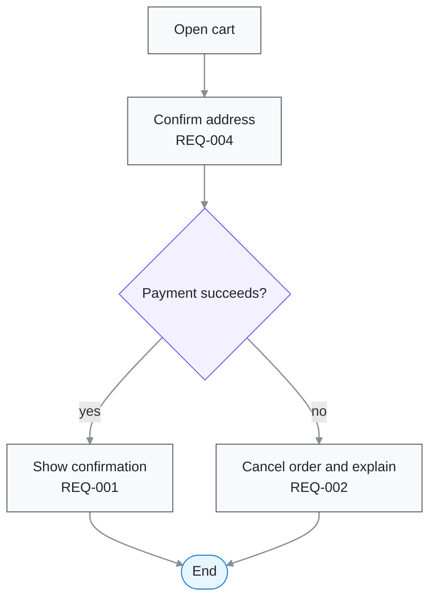

# Stage 03 · User flow

| Slot | This stage |
| --- | --- |
| Inputs | Requirements (REQ) from stage 02, contexts and glossary (CTX, TERM) |
| Outputs | One file per flow in the stage's `source` folder, by default `docs/03-user-flow/`. Each file holds one Mermaid flowchart with an FL ID; each step names the REQ IDs it serves, and the SCR IDs once the sitemap exists |
| Human view | On a project on NEXUS, by default NEXUS's list of the flows; otherwise by default a Notion database with one row per flow and its diagram, as set in `human`; for a workshop, a board such as Miro. See Diagrams below and [notion-database.md](notion-database.md) |
| Sync | Diagrams are text, so changes show in the repository's history. Apply changes in the direction `truth` gives |
| Human checkpoints | Each flow's main path and its main failure paths are reviewed |
| Trace IDs | FL-001… |

## Steps

1. Pick the goals users come with; each goal is one flow.
2. Draw the main path first, then the failure paths the requirements imply: invalid input, missing permission, network or payment failure.
3. Label each step with the requirements it serves.
4. List requirements that no flow uses; they are gaps or out of scope.

## Checks

- Every Must requirement appears in at least one flow.
- Every decision has all of its branches, and every flow has an end.
- Failure paths exist wherever a requirement describes unwanted behaviour.

## Diagrams

The Mermaid file is the flow, and every view shows the same code. Draw it in the `corthex-diagram` skill's grammar and check it with that skill's lint, as the template below does: a step as a rectangle, a decision as a diamond with every branch labelled, an end as a stadium, each with its class, every line with an ID and its class, and a legend under the diagram. A flow that also shows stores or model calls uses those kinds and lines too.

- GitHub and most editors draw a Mermaid block in a Markdown file as a diagram.
- In Notion, put the flow's Mermaid code in a code block on the flow's row, with the block's language set to Mermaid. Notion draws it, and the block can show the code, the diagram or both side by side. Copy the code from the file unchanged, so the two can be compared line by line.
- For a workshop, draw the flows on the project's Miro board, one frame per flow, the way stage 01 sets up the board in the `corthex-discover` skill. At the checkpoint, bring what people changed on the board back into the files; the files stay the source.

## Output template

````markdown
# FL-001 Place an order

Serves: REQ-001, REQ-002



| Shape | Means |
| --- | --- |
| Rectangle | A step |
| Diamond | A decision; each branch is labelled |
| Stadium | Where the flow ends |
````
