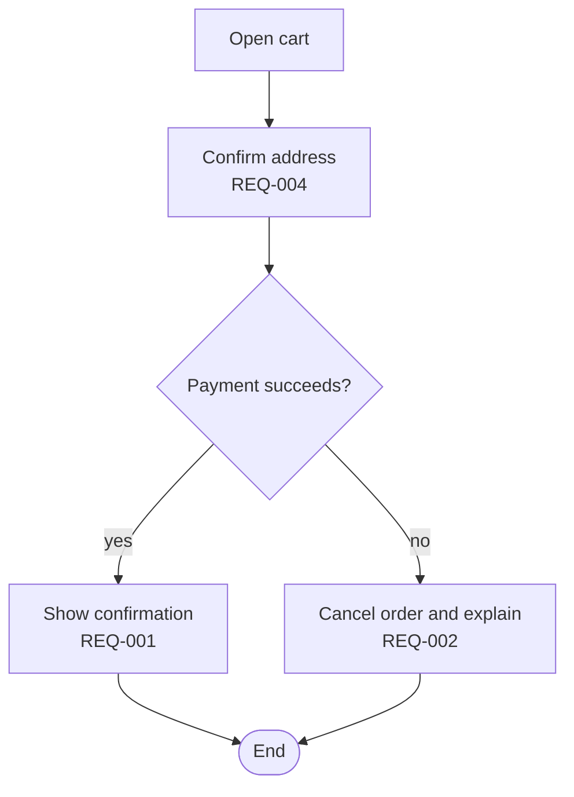

# Stage 03 · User flow

| Slot | This stage |
| --- | --- |
| Inputs | Requirements (REQ) from stage 02, contexts and glossary (CTX, TERM) |
| Outputs | One file per flow in the stage's `source` folder, by default `docs/03-user-flow/`. Each file holds one Mermaid flowchart with an FL ID; each step names the REQ IDs it serves, and the SCR IDs once the sitemap exists |
| Human view | A shared database or a board, as set in `human` |
| Sync | Diagrams are text, so changes show in the repository's history. Apply changes in the direction `truth` gives |
| Human checkpoints | Each flow's main path and its main failure paths are reviewed |
| Trace IDs | FL-001… |

## Steps

1. Pick the goals users come with; each goal is one flow.
2. Draw the main path first, then the failure paths the requirements imply: invalid input, missing permission, network or payment failure.
3. Label each step with the requirements it serves.
4. List requirements that no flow uses; they are gaps or out of scope.

## Checks

- Every Must requirement appears in at least one flow.
- Every decision has all of its branches, and every flow has an end.
- Failure paths exist wherever a requirement describes unwanted behaviour.

## Output template

````markdown
# FL-001 Place an order

Serves: REQ-001, REQ-002


````
