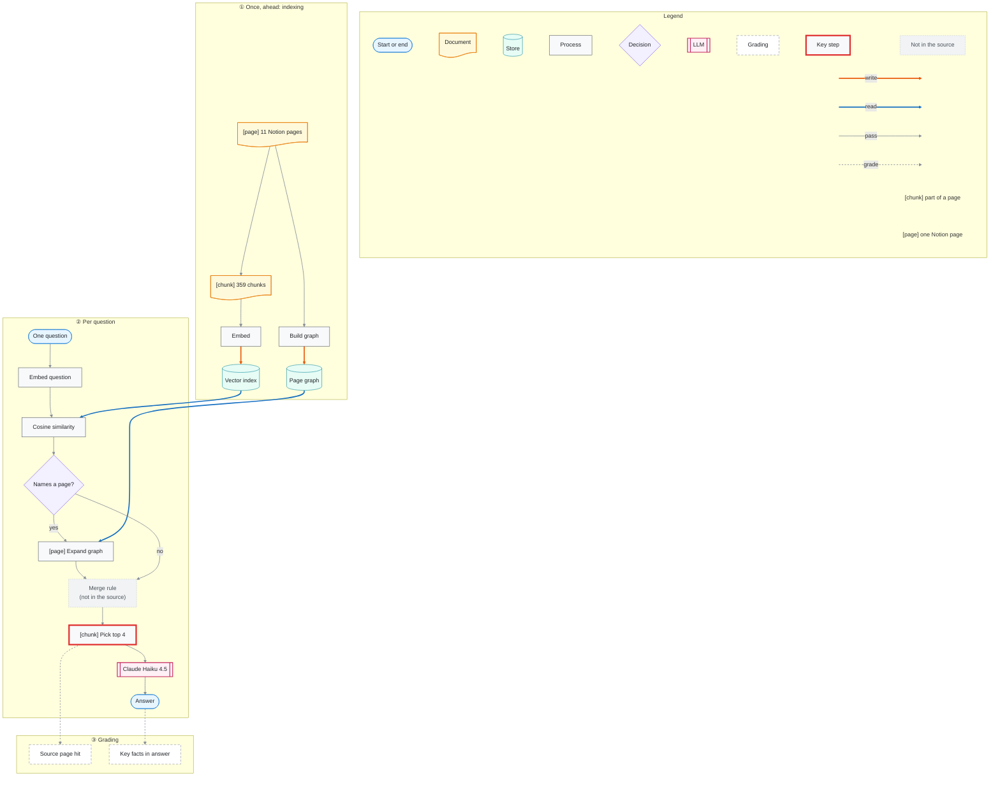

# Visual grammar

Version 1. The shapes and lines come from a retrospective of 2026-11-19, in which six pipeline diagrams were redrawn because every box and line had been the same grey; the colours and the Mermaid forms were rendered in Mermaid 12.1 (light theme) and 12.3 (dark theme) on 2026-11-20. `scripts/diagram-check.py` checks this version.

A diagram in this grammar answers two questions at a glance: **what each box is**, from its shape, and **what each line does to data**, from its style.

## 1. Boxes: the shape says what a box is

Every box has exactly one kind, given as a Mermaid class.

| Kind | Class | Mermaid | D2 | Use for |
| --- | --- | --- | --- | --- |
| Start or end | `term` | `@{ shape: stadium }` or `id([text])` | `shape: oval` | Where a flow begins or ends: a question, a request, an answer |
| Document | `doc` | `@{ shape: doc }` | `shape: document` | Text kept as a unit: pages, files, chunks |
| Store | `store` | `@{ shape: cyl }` or `id[(text)]` | `shape: cylinder` | Anything kept to be read later: an index, a database, a cache, a graph |
| Process | `proc` | `@{ shape: rect }` or `id[text]` | `shape: rectangle` | One action in code: embed, sort, merge |
| Decision | `decide` | `@{ shape: diam }` or `id{text}` | `shape: diamond` | A question whose branches are labelled |
| LLM | `llm` | `@{ shape: fr-rect }` or `id[[text]]` | `double-border: true` | A model call |
| Grading | `grade` | `@{ shape: rect }`, dashed by its class | `stroke-dash: 4` | A check against the source, by a person or a script |

Two marks go on top of a kind:

| Mark | Class | Drawn as | Use for |
| --- | --- | --- | --- |
| Key step | `key` | Thick red border | The one to three steps the caption or a comparison turns on |
| Not in the source | `gap` | Grey dotted box, and the label says "(not in the source)", in Korean "(원문에 없음)" | A part the source does not describe, drawn so the flow stays whole |

- Mermaid has no double-bordered box. The framed rectangle `fr-rect`, a box with a line inside each side, stands in for the LLM.
- Version 1 makes the key step a mark rather than an eighth kind, so a key store stays a cylinder and a key decision stays a diamond.
- `ghost` is a third class used only inside the legend, for the empty ends of a line sample and for tag samples.
- Write the shape with `@{ shape: ... }` (Mermaid 11.3 and later) or with the brackets above. A document box has no bracket form.

## 2. Lines: the style says what happens to data

The four lines follow CRUD, the four things a program does to stored data (create, read, update, delete).

| Line | Class | Mermaid | Style | Use for |
| --- | --- | --- | --- | --- |
| Write | `write` | `==>` | Orange `#e8590c`, 3 px | Into a store: create or update |
| Read | `read` | `==>` | Blue `#1971c2`, 3 px | Out of a store |
| Pass | `pass` | `-->` | Grey `#868e96`, 1.5 px | Data handed on without a store |
| Grade | `gradeLine` | `-.->` | Grey dotted | What a grader compares with the source |

- A line into a store is a write and a line out of one is a read. A store that is written but never read usually means a read line is missing; drawing by this rule found missing read lines in two of the six diagrams it came from.
- Colours mean CRUD only. Say which path a line belongs to, such as vector, BM25 or graph search, with the box names or a short label on the line, not with another colour.
- Draw a delete or an update as a write with a label ("delete", "update") until real diagrams show it needs a line of its own.
- Give every line an ID and a class: `A e1@==> B`, then `class e1 write`. Line IDs need Mermaid 11.10 or later. `linkStyle` counts lines by position, so it breaks when a line is added.
- Label every branch of a decision, such as "yes" and "no".

## 3. Lanes

- Separate what happens at different times or by different actors into lanes, one `subgraph` each, numbered ①, ②, ③ in reading order: for example "① Once, ahead: indexing", "② Per question", "③ Grading".
- Flow from top to bottom (`flowchart TB`) `[default]`. Put parallel paths of the same step side by side.
- One box, one action. When two things run apart, draw two branches; a chain reads as the first one's result feeding the second.

## 4. Legend

- A diagram that uses three or more kinds, any line other than pass, a mark or a tag has a legend. The legend shows only what the diagram uses.
- In Mermaid, the legend is a `subgraph` titled "Legend" (in Korean "범례") that links to nothing outside it. Put the shapes in one row joined by invisible links (`~~~`), each line kind as a short sample between two empty `ghost` boxes, and each tag as a `ghost` box with its meaning.
- When the legend inside the diagram makes the layout worse, put a legend table directly under the diagram and write `%% legend: below` in the source, so that the lint does not ask for one.

## 5. Tags (optional)

- A tag names the unit of data a box works on, such as `[chunk]` (a part of a page) and `[page]` (one whole page). In the diagram it came from, the tags showed that the graph step starts from pages while the rest works on chunks.
- Choose the axis for each diagram: rows and tables, nodes and relations, messages and conversations, synchronous and asynchronous.
- Write the tag at the start of the label in square brackets. Use at most three tag kinds in one diagram, and show each in the legend.

## 6. Colours

Copy these class definitions as they are:

```text
classDef term fill:#e7f5ff,stroke:#1c7ed6,color:#212529
classDef doc fill:#fff9db,stroke:#e67700,color:#212529
classDef store fill:#e6fcf5,stroke:#0c8599,color:#212529
classDef proc fill:#f8f9fa,stroke:#495057,color:#212529
classDef decide fill:#f3f0ff,stroke:#7048e8,color:#212529
classDef llm fill:#fff0f6,stroke:#c2255c,stroke-width:2px,color:#212529
classDef grade fill:#ffffff,stroke:#868e96,stroke-dasharray:6 4,color:#212529
classDef key stroke:#e03131,stroke-width:4px
classDef gap fill:#f1f3f5,stroke:#adb5bd,stroke-dasharray:2 3,color:#495057
classDef ghost fill:none,stroke:none
classDef write stroke:#e8590c,stroke-width:3px
classDef read stroke:#1971c2,stroke-width:3px
classDef pass stroke:#868e96,stroke-width:1.5px
classDef gradeLine stroke:#868e96,stroke-width:1.5px,stroke-dasharray:4 4
```

- A class with a fill also sets the text colour, with a contrast of at least 4.5:1, because a dark theme changes the default text colour but keeps a fixed fill. `ghost` sets none, so its text follows the theme.
- In the dark theme the grey borders of the process, grading and not-in-the-source boxes fade, so their label and the legend carry the meaning. The red key border stays clear in both themes; a dark key border did not.
- A diagram about one mechanism may colour its own categories, such as node types or relation types, with arrowheads in the line's colour. Kept items are dark and solid, dropped ones faint and dashed. Every colour goes in the legend.

## 7. Worked example

Caption: *Only the graph path reads the page graph, and how its pages merge with the vector results is not in the source.*



How it reads: the orange lines fill the two stores once, ahead of time; the blue lines show each question reading them; the red border marks the step the answer depends on; the grey dotted box says the source does not explain the merge.

## 8. The same grammar in D2

For an image made with D2, as [targets.md](targets.md) describes, the classes are:

```text
classes: {
  term: {shape: oval; style: {fill: "#e7f5ff"; stroke: "#1c7ed6"}}
  doc: {shape: document; style: {fill: "#fff9db"; stroke: "#e67700"}}
  store: {shape: cylinder; style: {fill: "#e6fcf5"; stroke: "#0c8599"}}
  proc: {shape: rectangle; style: {fill: "#f8f9fa"; stroke: "#495057"}}
  decide: {shape: diamond; style: {fill: "#f3f0ff"; stroke: "#7048e8"}}
  llm: {shape: rectangle; style: {fill: "#fff0f6"; stroke: "#c2255c"; double-border: true}}
  grade: {shape: rectangle; style: {fill: "#ffffff"; stroke: "#868e96"; stroke-dash: 4}}
  write: {style: {stroke: "#e8590c"; stroke-width: 3}}
  read: {style: {stroke: "#1971c2"; stroke-width: 3}}
  pass: {style: {stroke: "#868e96"; stroke-width: 1}}
  gradeline: {style: {stroke: "#868e96"; stroke-dash: 3}}
}
```

D2 draws the LLM's double border exactly. For a key step add `style.stroke: "#e03131"` and `style.stroke-width: 4` to the box.

## 9. Open questions in version 1

These come from the same retrospective and stay open until a real diagram answers them; each answer is a decision:

- Fix a few tag axes in the grammar, or choose one per diagram (version 1 chooses per diagram).
- Keep seven kinds and two marks, or merge some, such as the key step and the LLM.
- Give delete and update lines of their own, apart from write.
- Mark calls to an outside API, such as an embedding API.
- Show a path with a label beside the line or with a line style.
