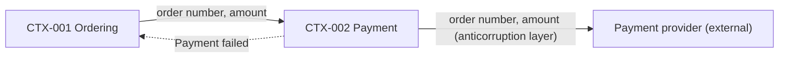

# Stage 01 · Domain discovery

| Slot | This stage |
| --- | --- |
| Inputs | The product idea, interview and meeting notes, and existing documents. A board from an earlier workshop, or its export or photos, is an input too |
| Outputs | One domain design document per product or part, `<name>.md` in the stage's `source` folder, by default `docs/01-domain/domain.md`: bounded contexts with CTX IDs, the dependencies between them, the hotspots and the glossary with TERM IDs |
| Human view | An event storming board with one frame per step, by default a Miro board, as set in `human` and `link`. Layout, legend and tools: [event-storming-board.md](event-storming-board.md) |
| Sync | While the workshop runs, the board leads: at each checkpoint, read the board and write the document, with the board's link and the time you read it. The default `truth` is `source`: once the last checkpoint is passed, change the document first, then the board |
| Human checkpoints | The event timeline after step 1-b, the context boundaries after step 7, and the context tables and the context map after step 9 |
| Trace IDs | CTX-001…, TERM-001… |

## Ways of working

Event storming is a conversation held on a board. At the start, agree on who puts the stickies on the board first, and record the choice in the stage's `note`. Unless the user chooses otherwise, use draft and correct.

| Way | Who goes first | When the AI stops for the user |
| --- | --- | --- |
| Draft and correct (default) | The AI drafts each step in a new frame; people move, rewrite, add and comment on the board. In step 1-a, people may write their own events first | After steps 1-b, 7 and 9 |
| Workshop | People place the stickies in every step, with a time box, such as an hour for steps 1 to 4 and forty minutes for steps 5 to 9. The AI checks the rules, asks questions and writes the document | After every step, with its checks |
| One-pass draft | The AI drafts steps 1 to 9 at once | Once, after step 9 |

Mistakes in early steps carry into later ones and are harder to see at the end, so suggest the one-pass draft only when the user wants speed more than review.

When the knowledge comes from interviews or chats with people, plan and run them as [interviews.md](interviews.md) says.

## Steps

Each step adds one layer to the board. Start each step in a copy of the previous step's frame, placed below it, so the board keeps every step.

End each sticky the AI makes with a confidence label: `[sure]` when the user's words or a document support it, `[inferred]` for an inference, or `[guess]` for an unsupported guess. Use the board's language: on a Korean board, `[확실]`, `[추론]` and `[추측]`. A `[guess]` is also a hotspot. Remove the label when a person corrects or confirms the item; keep any answered hotspot and its source.

- **Step 0 · Prepare.** Start from the user's purpose, not from what is already built. Ask what the product is for, who it is for and what they want from it, and put the answer on the board in their own words, with your restatement beside it. Only then read the existing code and documents, as material for the later steps. Agree on the scope (what is in and what is out), the inputs, the parts of the product if there are several, and the way of working. Open the board in `link`, or ask before creating one. Put the legend and a scope note on the board, with the open questions numbered and a recommended answer for each; checkpoint 1 asks them.
- **Step 1-a · Events.** Collect domain events: things that happened and that the business cares about, in the past tense, such as "Order placed". Each one changes data; leave out reads, searches and signing in. When people write events too, the AI puts the events it finds in the inputs in a separate strip of AI proposals, and people move the ones they accept out of it.
- **Step 1-b · Timeline.** Order the events from left to right in time, one lane per flow. Merge events that mean the same thing under one name, and keep the other names for the glossary's Avoid column. Stack outcomes that depend on a condition, such as "Payment taken" and "Payment failed", one above the other. **Checkpoint 1: the timeline.**
- **Step 2 · External systems.** Add each system outside the product that sends or receives an event, next to that event.
- **Step 3 · Commands.** Add the command that causes each event, to its left, in the imperative, such as "Place order". When one command causes several events, mark them as one transaction candidate.
- **Step 4 · Hotspots.** Add hotspots at any step, next to the sticky concerned, for open questions, risks, disagreements and every guess the AI made. In this step, collect them and fill gaps. Mark them; do not solve them now.
- **Step 5 · Actors.** Add who gives each command, below it. People who sign in differently or have different permissions are different actors.
- **Step 6 · Aggregates.** Add, above each group of events, the thing that receives the commands and keeps the rules, such as "Order". Write one or two lines of rules on each aggregate's sticky. Where nothing fits, or its rules are not yet known, add a hotspot.
- **Step 7 · Bounded contexts.** Group the aggregates, with their commands and events, into contexts by responsibility and by language: where one word means two things, there are two contexts. Draw each boundary and name it. Each context is a candidate package or service; say whether it is core, supporting or generic. **Checkpoint 2: the contexts.** Then give each agreed context a CTX ID.
- **Step 8 · Policies, read models and the context map.** Add policies, written as `When <event>, <command>`, between an event and the command it triggers, and read models, the information an actor looks at before a command. A policy that crosses a boundary is a dependency between two contexts. Draw the context map: a solid arrow for a synchronous call, a dashed arrow for an asynchronous event, and on each arrow the data it carries.
- **Step 9 · Context tables.** Use the type assigned in step 7 to set the depth. For a core context, fill the whole table with a row per command, each an API candidate: who or what gives it (an actor, a policy or another context), the read model it needs, the aggregate that takes it and the events it causes. For a supporting context, keep the table's format and fill the Command and Events columns; other columns are optional. For a generic context or an external system, one line of purpose and its relationship pattern is enough. Directly below each table, start with `- Aggregate rules:`; for each core rule, give its source in parentheses: user's words, document or inferred. In a core context, add one Given–When–Then example per key command, one line each, to carry into stage 04's acceptance criteria and stage 12's tests. Then list the external systems, links and hotspots. The rows keep in text the links that the board shows by position. When a table makes the board too large, the board may show command names only, with the full table in the document. **Checkpoint 3: the tables and the context map.**
- **Document.** Write or update the domain design document from the board, with the template below, and link the frames of steps 7 to 9. Keep each open hotspot as an open question, including items marked for review in stage 02, and name those that need an answer before the requirements are written.

## Starting from an existing document

When the stage already has a domain document, written without a board, still begin Step 0 with the user's words, and compare the document with them before you use it. Where the document serves that purpose, use it as the AI's draft: in each step, draw what the document says in that step's frame, and stop where the chosen way of working says. Where it describes what is already built rather than what the user wants, mark the difference as a hotspot. In a workshop, people still go first, and the AI uses the document for its checks and questions. Put each context's CTX ID in its name on the board, such as "CTX-001 Ordering", so the board and the document keep the same IDs. What changes on the board updates the document under its existing IDs; an item that goes away is marked as removed, never renumbered. At each checkpoint, list what the board leaves out of the document and why, such as reads and sign-ins that are not events, so the user sees everything that was dropped.

## Adding to an existing product

When a product already has a domain document or code and the work adds a feature, still begin step 0 with the user's purpose. Draw the current context map from the document or code, then run steps 1 to 9 in new frames for only the contexts that change. Refer to unchanged contexts by their existing CTX IDs instead of drawing them again. Keep the same checkpoints for the changed part.

## When the board drifts from the purpose

If the user asks whether you and they mean the same thing, or the board no longer matches their words, stop before the next step and withdraw any checkpoint question still open. Put the user's words beside the board and say plainly where the two differ and why, such as a Step 0 that started from what is built. If the purpose was wrong, ask the user to say it again in their own words, and start over from Step 0 in a new column beside the old one. Keep the old frames as material, and never delete them. Instead of updating the document at each checkpoint, leave it as it is until the new column passes its last checkpoint, then rewrite it once: the IDs that carry over keep their numbers, and the rest are marked as removed.

## Checkpoints

At each checkpoint, stop and send a short note with only these three bundles, linking the frames concerned. Keep the rest on the board and in the document:

1. Items the AI marked as guesses.
2. Two or three questions about what the AI is least sure of, each with two choices, a number and a recommended answer. The user can answer "as recommended" or name only the numbers to change.
3. At checkpoints 2 and 3, the aggregate rules of the core contexts.

At checkpoints 1 and 2, use one of the questions in bundle 2 to ask once what might be missing: compare the actors, external systems and contexts with an independent list, such as similar services, regulations or stakeholders, and say which list you used. In a small project one short list is enough. At checkpoint 3, if policies crossing a boundary cluster around one pair of contexts, or synchronous calls form a circle, include a question in bundle 2 about revisiting the boundaries in step 7.

The user answers on the board or in the conversation. Read the board again before you go on: a change on the board is an answer, but silence is not approval.

- An answer that lets you go on without approving the content, such as "I don't follow it, but go ahead", lets you continue with your recommendations. Record it as permission to continue, not as approval, keep your guesses marked as guesses, and bring them back at the next checkpoint.
- When the user says they do not follow the board, explain with examples from their own product before you go on, and add what you explained to the frame's term memo ([event-storming-board.md](event-storming-board.md)).
- Record each answer with `corthex-record`: the user's words, the time and what it settles. On the board, turn each hotspot the answer settles into an answered hotspot, with the answer and where it came from, and mark the checkpoint passed, with its date. An answered hotspot stays on the board, so the board shows what was decided.
- In the checkpoint's `corthex-record` record, also give the number of items people edited on the board, the number of comments people left and whether the answer came only in the conversation. When a checkpoint is approved with no human board edits or comments, write "approved as drawn" in section 2 of the document and offer once an optional ten-minute read-through: tell each flow as a one-line story and ask only what is wrong. Put the aggregate rules and command rows approved as drawn in section 6's hotspot table with state "review in stage 02", so they remain among the open questions stage 02 reads.

## Board and document

- Read the board before every step and before every checkpoint. People may have changed it since your last read.
- At each checkpoint, bring the document up to date with the board and set `synced_at` to the time you read the board. Give IDs only to what people agreed on at a checkpoint.
- IDs are unique in the whole project, across all parts of the product. Before numbering, search the project's documents for the IDs already used, such as with `grep -rhoE "(CTX|TERM)-[0-9]+" docs/`, and continue after the highest.
- With `truth: source`, the document holds once the last checkpoint is passed. Make a later change in the document first, then on the board, and say what changed in a comment on the board.
- A project that keeps working on the board sets `truth: human`. Then refresh the document from the board, and do not edit the document directly.
- When the board and the document differ, list the differences and ask before changing either side.

## Checks

- The board holds the user's purpose in their own words, and the document's service overview agrees with it.
- Every event is in the past tense, changes data and has its place on the timeline.
- Every command is in the imperative and causes at least one event; commands in core and supporting contexts have a row in their context's table.
- Every aggregate belongs to exactly one context, and every event to the context of its aggregate.
- Every aggregate has at least one rule or a hotspot saying its rules are not yet known.
- Every policy names the event that triggers it and the command it gives. A policy that crosses a boundary appears in the context map with its direction, its kind (call or event) and its data.
- Every link to or from an external system names its relationship pattern.
- A circle of synchronous calls between contexts is a hotspot.
- A word that means different things in two contexts has a glossary row for each, with the difference stated.
- Every hotspot is answered, with where the answer came from, or kept open with what would answer it.
- Screens, fields and other requirement-level details are not fixed here. Note them for stage 02.

## Output template

`domain.md`, or one file per part of the product, named after the part:

````markdown
---
board: https://miro.com/app/board/<board-id>/
synced_at: 2026-01-12T10:00+09:00
---

# Acme shop: domain design

Status: steps 1 to 9 done, checkpoints 1 to 3 passed on 2026-01-12.

## 1. Service overview

Acme shop sells goods online and delivers them.

- Customer: places and cancels orders, and pays
- Store staff: prepare and ship orders, and refund payments
- Payment provider (external system): takes payments

## 2. Event storming

- Board: [Acme shop domain](https://miro.com/app/board/<board-id>/)
- Frames: [Step 7 Contexts](https://miro.com/app/board/<board-id>/?moveToWidget=<frame-id>), [Step 8 Context map](https://miro.com/app/board/<board-id>/?moveToWidget=<frame-id>), [Step 9 Context tables](https://miro.com/app/board/<board-id>/?moveToWidget=<frame-id>)
- Way of working: draft and correct
- Checkpoint records: <answers, counts of items people edited and comments they left, and whether the answer was only in conversation>
- Approval with no human board edits or comments: <approved as drawn, when applicable>

## 3. Bounded contexts and packages

| Context | Type | Aggregates | Package |
| --- | --- | --- | --- |
| CTX-001 Ordering | core | Order | `ordering` |
| CTX-002 Payment | supporting | Payment | `payment` |

## 4. Context tables

### CTX-001 Ordering

Purpose: customers place and cancel orders.

| Given by | Read model | Command | Aggregate | Events |
| --- | --- | --- | --- | --- |
| Customer | Cart summary | Place order | Order | Order placed |
| Customer, Store staff | | Cancel order | Order | Order cancelled |
| Policy: when Payment failed (CTX-002) | | Cancel order | Order | Order cancelled |

- Aggregate rules: Order: an order has at least one item, and its total is the sum of its items (inferred).
- Given–When–Then: Given a cart with one item, When the customer gives Place order, Then an order for that item is placed with its total.
- Given–When–Then: Given an unpaid order, When the customer gives Cancel order, Then Order cancelled.
- External systems: none
- Links: calls Payment to take a payment; follows Payment failed
- Hotspots: Can staff cancel a paid order?

### CTX-002 Payment

Purpose: take and refund payments through the payment provider.

| Given by | Read model | Command | Aggregate | Events |
| --- | --- | --- | --- | --- |
| | | Take payment | | Payment taken, or Payment failed |
| | | Refund payment | | Payment refunded |

- Aggregate rules: Payment: an order has at most one taken payment, and a refund never exceeds the amount taken.
- External systems: Payment provider
- Links: called by Ordering; tells Ordering when a payment fails
- Hotspots: none

## 5. Dependencies between contexts

| From | To | Kind | Pattern | Why | Data |
| --- | --- | --- | --- | --- | --- |
| CTX-001 | CTX-002 | call (sync) | | Placing an order takes a payment | order number, amount |
| CTX-002 | CTX-001 | event (async) | | When a payment fails, cancel the order | Payment failed |
| CTX-002 | Payment provider | call (sync) | anticorruption layer | Take or refund a payment | order number, amount |




## 6. Hotspots

| Hotspot | Context | State | Answer or next step |
| --- | --- | --- | --- |
| Can staff cancel a paid order? | CTX-001 | open | Ask the store owner before stage 02 |
| Order has at least one item and its total is the sum of its items | CTX-001 | review in stage 02 | Approved as drawn; revisit the rule when writing requirements |
| Place order command row | CTX-001 | review in stage 02 | Approved as drawn; revisit the command when writing requirements |

## 7. Glossary

| ID | Term | Definition | Context | Code name | Avoid |
| --- | --- | --- | --- | --- | --- |
| TERM-001 | Order | A customer's request to buy items, from placement to delivery | CTX-001 | `Order` | purchase, booking |
| TERM-002 | Payment | Money taken from a customer for one order | CTX-002 | `Payment` | charge, transaction |
````
