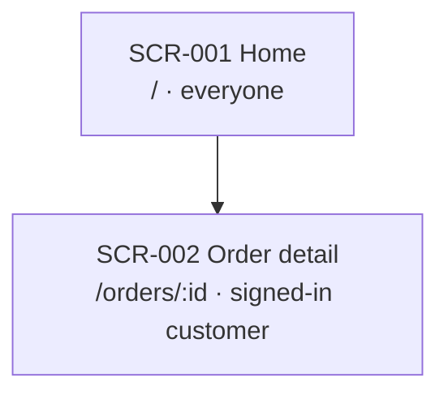

# Stage 07 · Sitemap

| Slot | This stage |
| --- | --- |
| Inputs | User flows (FL) and the functional spec (SPEC) |
| Outputs | `sitemap.yaml`, by default `docs/07-sitemap/sitemap.yaml`: the screen tree, one SCR ID per screen with its parent, path, who can see it and the flows that pass through it |
| Human view | By default three views drawn from the YAML: a board, a list and slides, as set in `human`. See Views below |
| Sync | The YAML is the data and the views are drawn from it, so the default `truth` is `source`. Draw the views again after every change |
| Human checkpoints | The navigation structure is agreed |
| Trace IDs | SCR-001… |

## Steps

1. Collect every flow step that shows the user something; each distinct view is a screen candidate.
2. Merge candidates that are the same screen in different states. States belong to stage 08, not to the sitemap.
3. Arrange the screens in a tree with paths and access rules.
4. Add the SCR IDs back to the user flows.
5. For each screen, name the context and glossary terms of the aggregates/read models it represents in `terms: [CTX-001, TERM-001]`, or `terms: none`. List the part's terms without a screen in `# without a screen: TERM-002`. Keep an intentionally absent screen explicit rather than adding one to clear a check.
6. Preserve each screen's source lifecycle status, such as `active` or `removed`. A removed screen keeps its ID/history; it is not an active route. This status is separate from the loading/error states of stage08 and from a stage checkpoint.

## Checks

- Every flow step that shows something maps to a screen.
- Every screen is reachable from the root, and no two screens share a path.
- Every screen states who can see it.
- Every screen in the YAML appears once in each view.

## Views

People change the sitemap only in the YAML, by asking the AI or in a pull request. Draw the three views from it, never by hand, in the same change as the YAML and again before the checkpoint.

- **Board**: the screen tree as a diagram, one box per screen with its ID, name, path and who can see it, and an arrow from each parent to each child.
- **List**: one row per screen in tree order, with its ID, name, path, access and flows.
- **Slides**: one slide per branch under the root, with its screens and the flows that pass through them, for a review meeting.

Put the three views on one page, by default `docs/07-sitemap/sitemap.html`, with the time you drew it at the top. Where the host can publish a page, such as an artifact in Claude Code, publish it and put its link in `link`.

A Mermaid flowchart draws the board in GitHub, Notion and most editors:



## Output template

```yaml
- id: SCR-001
  name: Home
  path: /
  access: everyone
  status: active
  flows: [FL-001, FL-002]
  terms: none
  children:
    - id: SCR-002
      name: Order detail
      path: /orders/:id
      access: signed-in customer
      status: active
      flows: [FL-002]
      terms: [CTX-001, TERM-001]
```
